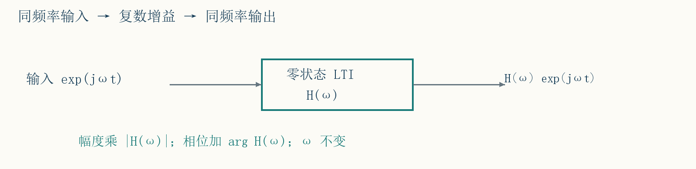
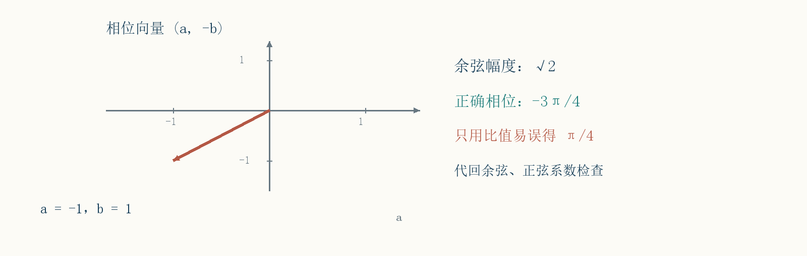
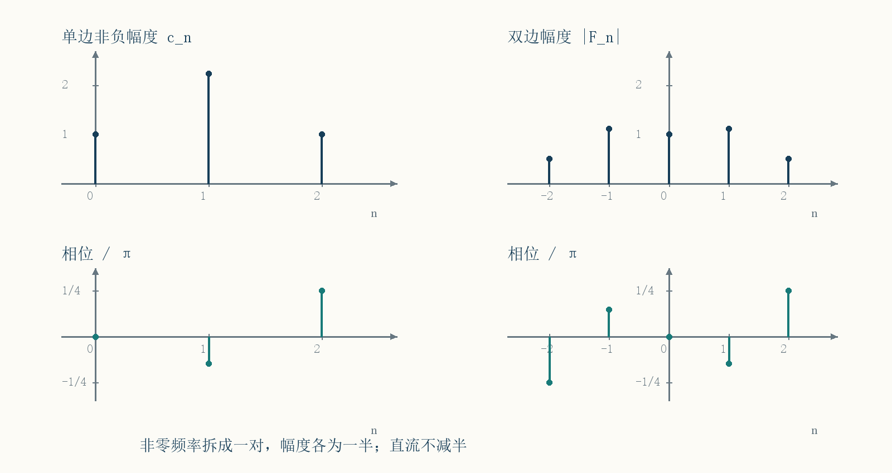
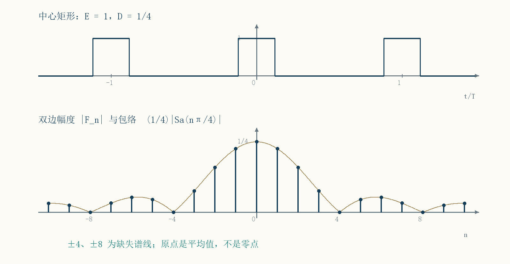
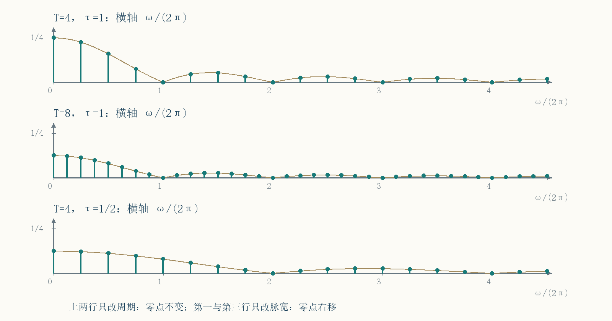
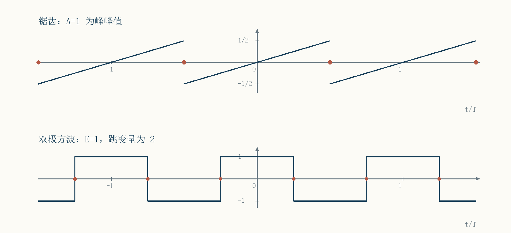
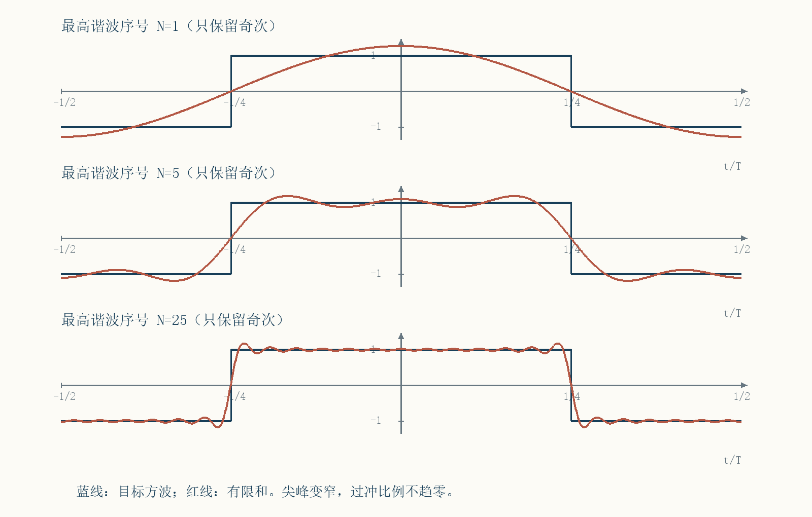
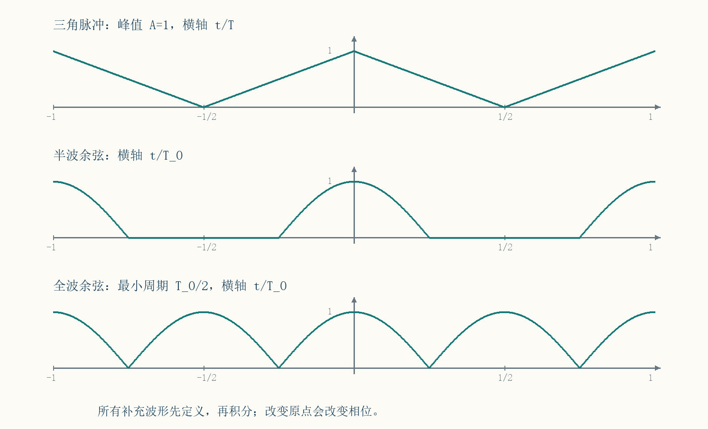

# 第3讲 傅里叶级数与频谱

!!! tip "本讲配套文件"
    - [Word 下载（第三节课 信号与系统自学笔记.docx）](../文件/第三节课 信号与系统自学笔记.docx)

## 01 本讲要解决什么问题
资料内容：课件第 2—12、47 页。上一讲把输入拆成冲激，用卷积求输出；这一讲换一组基本信号，把周期波形拆成不同频率的正弦或复指数。这样既能看清波形包含哪些频率，也便于理解系统怎样改变每个频率成分。
本讲路线：第 02—05 节推导系数及形式转换；第 06—09 节学习频谱和对称性；第 10—15 节计算典型波形、功率、误差及吉布斯现象；第 16—17 节补全课下推导；第 18 节衔接傅里叶变换；最后核对易错点并自测。
先修知识：定积分、分部积分、三角恒等式、复数模与辐角，以及上一讲的零状态 LTI 卷积。先记住欧拉公式 $\mathrm e^{j\theta}=\cos\theta+j\sin\theta$，其中 $j^2=-1$；虚数单位不是谐波下标。
### 统一周期与系数约定
用 $T>0$ 表示选定周期，$\omega_1=2\pi/T$ 是对应角频率，单位为弧度每秒；普通频率为 $\nu_1=1/T$，单位为赫兹。课件写 $T_1$，本笔记简写为 $T$。若称基波，通常应取最小正周期；常量没有唯一的最小正周期。
整数 $n$ 表示谐波序号，$n\omega_1$ 是谐波角频率。$a_0$ 是平均值，本讲采用 $a_0+\sum$，不是另一些教材的 $a_0/2+\sum$。$a_n,b_n$ 是带符号的实系数；$c_n,d_n$ 表示非负幅度；$F_n$ 是一般为复数的指数系数。除特别说明，三角形式讨论实信号。
易错提醒：$F_n$ 是离散序号对应的级数系数；后续连续频率函数 $F(\omega)$ 是傅里叶变换，二者不能只因字母相同就直接等同。横轴是频率的离散谱，也不表示原信号在时间上是离散信号。
## 02 为什么选择复指数作为基本信号
资料内容：课件第 5—7、11 页。补充推导：对零状态 LTI 系统，令输入为全轴存在的 $\mathrm e^{j\omega t}$，从卷积出发：

$$r(t)=\int_{-\infty}^{\infty}h(\tau)\mathrm e^{j\omega(t-\tau)}d\tau.$$

积分时 $t$ 固定，利用指数相乘关系把与积分变量无关的因子提出：

$$r(t)=\mathrm e^{j\omega t}H(\omega),\qquad H(\omega)=\int_{-\infty}^{\infty}h(\tau)\mathrm e^{-j\omega\tau}d\tau.$$

因此频率不变，只乘一个复常数；模决定幅度缩放，辐角决定相位移动。这称复指数的特征函数性质。普通函数核 $h$ 绝对可积时，上式对全部实频率都存在；其他情况须另查收敛或分布意义。
对实系统，输入 $\cos\omega t$ 是复指数的实部。线性和实系数保证输出可取实部：$|H(\omega)|\cos[\omega t+\arg H(\omega)]$。输入在零时刻才接入且乘了阶跃，通常还会有启动暂态，不能直接用这条全轴公式代表全部过程。

{ loading=lazy }
*图 1 补充示意 同频率复指数经过零状态 LTI 系统*

补充例题：$h(t)=\mathrm e^{-t}u(t)$ 时，$H(\omega)=\int_0^\infty\mathrm e^{-(1+j\omega)\tau}d\tau=1/(1+j\omega)$。于是模为 $1/\sqrt{1+\omega^2}$，相位为 $-\arctan\omega$。低频保留较多，高频幅度较小，输出还存在相位滞后。
## 03 三角系数为什么这样积分
资料内容：课件第 13 页。补充推导：系数公式的核心是一个周期内的正交性。为避免一开始就对无穷级数逐项积分，先讨论有限和，再在平方可积的框架中作投影。
### 整周期积分与正交性
令 $k$ 为非零整数，则指数积分端点相差 $T$，指数因子相差 $\mathrm e^{jk\omega_1T}=1$，故

$$\int_{t_0}^{t_0+T}\mathrm e^{jk\omega_1t}dt=0.$$

当 $k=0$ 时积分为 $T$。取实部、虚部得到整周期正弦余弦平均为零。再用积化和差，例如 $2\cos m x\cos n x=\cos(m-n)x+\cos(m+n)x$，可知正整数 $m,n$ 满足

$$\frac1T\int_{t_0}^{t_0+T}\cos m\omega_1t\cos n\omega_1t\,dt=\begin{cases}1/2,&m=n,\\0,&m\ne n.\end{cases}$$

两个正弦的结果相同；一正弦一余弦的积分总为零。常数与任意正整数次谐波也正交。注意三角基函数的平均平方是二分之一，常数一的平均平方是一。
### 用投影提取一个系数
写出三角形式 $f=a_0+\sum_{n=1}^{\infty}[a_n\cos n\omega_1t+b_n\sin n\omega_1t]$。平均一次，所有谐波项消失；乘第 $m$ 次余弦后平均，仅第 $m$ 次余弦的平均平方保留下来。于是

$$a_0=\frac1T\int_{t_0}^{t_0+T}f(t)dt,$$

$$a_n=\frac2T\int_{t_0}^{t_0+T}f(t)\cos n\omega_1t\,dt,\qquad n\ge1,$$

$$b_n=\frac2T\int_{t_0}^{t_0+T}f(t)\sin n\omega_1t\,dt,\qquad n\ge1.$$

对有限和，上述消项是直接代数；对平方可积周期函数，这些式子定义正交投影系数，有限项的最优性见第 14 节。函数值能否由无穷级数逐点恢复，则另需收敛定理，不能由“写得出积分”自动推出。
为什么任意起点都可以：被积函数也具有周期 $T$。把跨界部分平移一个周期后，任意完整周期的积分都相同。选 $[-T/2,T/2]$ 便于利用奇偶性，选 $[0,T]$ 便于按开关时序分段。
## 04 收敛到哪里与狄利克雷条件
资料内容：课件第 14—15、44 页。课件列出的工程常用充分条件是：每周期绝对可积，只有有限个跳变间断，只有有限个极值；使用时还应保证跳点左右极限有限。分段连续可微的常见波形满足足够的收敛条件。

$$\int_{t_0}^{t_0+T}|f(t)|dt<\infty.$$

在这些条件下，傅里叶级数在连续点收敛到函数值，在跳点收敛到两侧极限的平均：

$$\lim_{N\to\infty}S_N(t)=\frac{f(t^-)+f(t^+)}2.$$

这是本讲使用的收敛定理。正文证明系数、对称性和均方误差所需关系；此处直接采用该定理，不把它误当成只由正交性就能证明的结论。周期边界的右侧要从下一周期取值。
补充说明：改变有限个点的函数值不改变积分，所以不改变任何傅里叶系数。锯齿在接缝从正半幅跳到负半幅，级数在该点等于零，无论原图把端点画在哪一侧。
课件三个“反例”说明不满足某条充分条件：无限缩小阶梯有无限跳点；$\sin(2\pi/t)$ 在零附近无限振荡；$1/t$ 在 $0<t\le1$ 不绝对可积。前两者不能因此就判定“没有傅里叶级数”；未满足一组充分条件，不等于不可能收敛。后一例的普通系数积分本身就会遇到发散。
易错提醒：均方收敛、逐点收敛、一致收敛不是同一回事。跳变波形的有限和都是连续函数，它们不能在包含跳点的全周期上一致收敛到不连续波形。
## 05 紧缩形式与相位象限
资料内容：课件第 16—17 页。将同频率的两项合并时，要先确定采用余弦还是正弦，以及幅度必须非负。
展开 $c_n\cos(n\omega_1t+\varphi_n)$ 并比较正弦余弦系数，得到

$$a_n=c_n\cos\varphi_n,\qquad b_n=-c_n\sin\varphi_n.$$

因此 $c_n=\sqrt{a_n^2+b_n^2}$，相位是平面向量 $(a_n,-b_n)$ 的方向角，写作 $\varphi_n=\operatorname{atan2}(-b_n,a_n)$。这里双参数反正切会检查象限；单独计算 $-\arctan(b_n/a_n)$ 只有补上象限后才可靠。
正弦紧缩形式同理：$d_n\sin(n\omega_1t+\theta_n)$ 展开后有 $a_n=d_n\sin\theta_n$、$b_n=d_n\cos\theta_n$，故 $d_n=c_n$，$\theta_n=\operatorname{atan2}(a_n,b_n)$，也即 $\theta_n=\varphi_n+\pi/2$，相位均按模 $2\pi$ 理解。
补充例题：$-\cos\omega_1t+\sin\omega_1t$ 的向量为 $(-1,-1)$，所以 $c_1=\sqrt2$、$\varphi_1=-3\pi/4$。误用单值反正切会得到 $\pi/4$，使整个波形反号。代回 $c_1\cos\varphi_1=-1$ 和 $-c_1\sin\varphi_1=1$ 可立即检查。

{ loading=lazy }
*图 2 补充示意 余弦相位由向量方向决定 不能只看比值*

易错提醒：系数为零时幅度为零，相位没有定义，不应画一条有意义的相位谱线。直流单独保留带符号平均值 $a_0$，非零频率的“幅度非负”约定不能不加区分地套给负直流。
## 06 指数形式与单双边谱
资料内容：课件第 22—25、29 页。欧拉公式给 $\cos x=(\mathrm e^{jx}+\mathrm e^{-jx})/2$、$\sin x=(\mathrm e^{jx}-\mathrm e^{-jx})/(2j)$。代入第 $n$ 对三角项并收集同频率项：

$$a_n\cos n\omega_1t+b_n\sin n\omega_1t=\frac{a_n-jb_n}{2}\mathrm e^{jn\omega_1t}+\frac{a_n+jb_n}{2}\mathrm e^{-jn\omega_1t}.$$

于是统一写成

$$f(t)=\sum_{n=-\infty}^{\infty}F_n\mathrm e^{jn\omega_1t},\qquad F_n=\frac1T\int_{t_0}^{t_0+T}f(t)\mathrm e^{-jn\omega_1t}dt.$$

积分式也可直接由复指数正交性证明：乘 $\mathrm e^{-jm\omega_1t}$ 并整周期平均，仅 $n=m$ 的项保留。$F_0=a_0$；对正整数 $n$，$F_n=(a_n-jb_n)/2$、$F_{-n}=(a_n+jb_n)/2$。
对实信号，$F_{-n}=\overline{F_n}$。把正负频率的一对相加，可得 $2|F_n|\cos(n\omega_1t+\arg F_n)$。故单边余弦幅度为 $c_n=2|F_n|$，相位为 $\arg F_n$；直流不乘二。
双边幅度谱画 $|F_n|$，不是带符号的 $F_n$；负实系数的模仍为正，其负号用相位 $\pi$ 表示。对实信号，幅度谱偶对称；共轭相位在模 $2\pi$ 意义下反对称，零谱线的相位除外。负实数的相位可选 $\pi$ 或 $-\pi$，不应因主值分支看似不奇对称就误判信号不是实信号。
补充讲解：正负频率表示相反方向的复平面旋转，是表达实振荡的一对数学分量。不能把课件“负频率无物理意义”推广成所有复信号的普遍结论；复信号未必有共轭对称谱。
## 07 课件混合谐波例题全解
资料内容：课件第 26—28 页。给定

$$f(t)=1+\sin\omega_1t+2\cos\omega_1t+\cos(2\omega_1t+\pi/4).$$

目标与策略：先按频率分组，再统一换成余弦幅相；随后把每个非零频率拆成正负一对。第一谐波有 $a_1=2,b_1=1$，所以 $c_1=\sqrt5$，$\varphi_1=-\arctan(1/2)\approx-0.147584\pi$。第二谐波已是紧缩式，$c_2=1,\varphi_2=\pi/4$。

$$f(t)=1+\sqrt5\cos[\omega_1t-\arctan(1/2)]+\cos(2\omega_1t+\pi/4).$$

指数系数逐个写为 $F_0=1$、$F_1=1-j/2$、$F_{-1}=1+j/2$、$F_2=\mathrm e^{j\pi/4}/2$、$F_{-2}=\mathrm e^{-j\pi/4}/2$，其余均零。因为 $1/(2j)=-j/2$，正频率第一项的虚部为负。

{ loading=lazy }
*图 3 第 26—28 页频谱重绘 用精确系数区分单边与双边*

检查：双边第一对的模为 $\sqrt5/2$，相位相反；第二对模为二分之一。直流仍为一。课件的 $-0.15\pi$ 与 $1.12$ 是近似值，计算和重构时保留精确量可避免不必要误差。
## 08 奇偶对称性怎样减少积分
资料内容：课件第 31—33 页。以下先假设实信号，选关于零对称的一周期。函数的奇偶性依赖时间原点；移动原点后可能不再是奇函数或偶函数。
若 $f$ 偶对称，$f\sin n\omega_1t$ 为奇函数，所以 $b_n=0$。而 $f\cos n\omega_1t$ 为偶函数，可以把积分折半：

$$a_0=\frac2T\int_0^{T/2}f(t)dt,\qquad a_n=\frac4T\int_0^{T/2}f(t)\cos n\omega_1t\,dt.$$

此时 $F_n=a_n/2$ 对非零整数频率为实数，但可能为负；非负幅度是 $c_n=|a_n|$。例如 $f=-\cos\omega_1t$ 为偶函数，却有 $a_1=-1$、$c_1=1$。
若 $f$ 奇对称，其平均为零，且与余弦相乘仍为奇函数，所以 $a_0=a_n=0$；只需算

$$b_n=\frac4T\int_0^{T/2}f(t)\sin n\omega_1t\,dt.$$

此时 $F_n=-jb_n/2$ 为纯虚数，幅度 $c_n=|b_n|$ 仍是非负实数。若 $b_n>0$，余弦相位为 $-\pi/2$；若 $b_n<0$，为 $\pi/2$。课件第 33 页把 $c_n$ 也写为虚数，与幅度定义不一致。
补充一般分解：任意实信号可写为偶部 $[f(t)+f(-t)]/2$ 与奇部 $[f(t)-f(-t)]/2$ 的和。前者贡献直流和余弦，后者贡献正弦，适用于没有整体奇偶对称性的波形。
## 09 半波对称性与谐波缺失
资料内容：课件第 31、34 页。半波反对称也称奇谐对称，条件是 $f(t+T/2)=-f(t)$；它不同于 $f(-t)=-f(t)$。例如关于原点偶对称的双极方波，也可以具有半波反对称。
补充证明：把指数系数在零到一周期的积分拆成两半，第二半令 $t=s+T/2$。指数因子多出 $\mathrm e^{-jn\pi}=(-1)^n$，波形多出负号，得到

$$F_n=\frac{1-(-1)^n}{T}\int_0^{T/2}f(s)\mathrm e^{-jn\omega_1s}ds.$$

当 $n$ 为偶数，包括零时，前因子为零；当 $n$ 为奇数，前因子为二。故直流和全部偶次谐波消失。取实虚部即得课件奇数序号的半周期积分公式，前系数为 $4/T$。
若 $f(t+T/2)=f(t)$，相同换元给前因子 $1+(-1)^n$，所以只保留偶次谐波和直流。这同时说明 $T/2$ 已是周期，若原来称 $T$ 为最小周期就矛盾；课件“偶谐函数”是相对于选定周期的说法。
易错提醒：正负都有的波形不一定平均为零；必须比较正负面积。平均为零也不足以推出半波反对称。观察对称性只能消去确定为零的项，剩下的系数仍须积分。
## 10 周期矩形脉冲 从积分到频谱
资料内容：课件第 35—40 页。先固定定义：每个周期以零为中心，高度 $E>0$、宽度 $0<\tau<T$，在 $|t|<\tau/2$ 为 $E$，其余为零，并周期延拓。占空比 $D=\tau/T$。
由于波形为偶函数，系数实数。对 $n\ne0$，直接积分：

$$F_n=\frac ET\int_{-\tau/2}^{\tau/2}\mathrm e^{-jn\omega_1t}dt=\frac{2E}{n\omega_1T}\sin\frac{n\omega_1\tau}{2}=\frac E{n\pi}\sin(n\pi D).$$

零序号不能直接代入分母，单独算平均得到 $F_0=E\tau/T=ED$。定义 $\operatorname{Sa}(x)=\sin x/x$，并用连续延拓令 $\operatorname{Sa}(0)=1$，便能统一写成

$$F_n=ED\operatorname{Sa}(n\pi D),\qquad n\in\mathbb Z.$$

三角系数为 $a_0=ED$、$a_n=2ED\operatorname{Sa}(n\pi D)$、$b_n=0$。紧缩幅度是 $c_n=|a_n|$，非零项的相位按 $a_n$ 的正负取零或 $\pi$。

{ loading=lazy }
*图 4 第 35—37 页矩形波与谱线重绘 补充取占空比四分之一*

### 包络过零和实际缺失谱线不是一回事
连续包络的非零零点是 $\omega=2k\pi/\tau$，其中整数 $k\ne0$；原点是峰值，不是零点。实际谱线只在 $n\omega_1$，恰好落在零点的条件是 $nD$ 为非零整数。
补充例题：$E=2,T=4,\tau=1$，则 $D=1/4$、$\omega_1=\pi/2$，平均为二分之一。$F_1=\sqrt2/\pi$、$F_2=1/\pi$、$F_3=\sqrt2/(3\pi)$、$F_4=0$、$F_5=-\sqrt2/(5\pi)$。第五次幅度取正，相位取 $\pi$；不是画一条负幅度线。每第四条非零序号谱线消失。
一般若 $D=p/q$ 为既约分数，缺失序号为 $q$ 的非零整数倍；若 $D$ 无理，没有非零整数序号恰好命中包络零点，但谱线仍会接近零点。
### 课件第 18—19 页的右移矩形
那里的脉冲从零开始，而非以零为中心。设高电平区间为 $0<t<\tau$，它等于上述中心矩形右移 $\tau/2$。补充换元证明：在系数积分中令 $s=t-t_d$，并利用一周期积分与起点无关，时移后系数为 $F_n\mathrm e^{-jn\omega_1t_d}$。
因此右移矩形的系数是 $ED\operatorname{Sa}(n\pi D)\mathrm e^{-jn\pi D}$。也可直接算出 $a_n=E\sin(2\pi nD)/(n\pi)$、$b_n=E[1-\cos(2\pi nD)]/(n\pi)$。
自检：若按课件图的归一化比例取 $E=1,D=0.3$，则 $a_1\approx0.30273$、$b_1\approx0.41667$、$c_1\approx0.51504$，余弦加相位约定下 $\varphi_1=-0.3\pi$。第 19、24 页图中的正相位方向与该波形及“加相位”公式不一致；本笔记以系数积分核对，不能照抄相位正负。图中标记的 0.3 若是绝对时宽而非归一化时宽，应先算 $D=0.3/T$，不能默认为占空比。
## 11 脉宽 周期和带宽怎样分别影响频谱
资料内容：课件第 37—40、46 页。必须说明“保持什么不变”，否则比例关系容易误用。谱线间隔为 $\Delta\omega=2\pi/T$；归一化连续包络为 $\operatorname{Sa}(\omega\tau/2)$；完整包络还乘有 $E\tau/T$。
保持高度和脉宽不变而增大周期：谱线更密，直流及连续包络整体降低，第一包络零点 $2\pi/\tau$ 不变。但同一序号的 $F_n$ 还含变动的 $n\pi\tau/T$，一般不能说它严格只按周期反比变化。
保持高度和周期不变而缩短脉宽：间隔不变，包络第一零点向高频移动，直流降低，归一化频谱展开得更宽。不能据此断言每条高频谱线的绝对幅度都增大；各线要代入正弦函数计算。

{ loading=lazy }
*图 5 第 38—39 页规律重绘 固定脉宽改周期与固定周期改脉宽分开比较*

矩形周期信号的平均功率为 $P=E^2\tau/T$，一个周期内的平方积分为 $E^2\tau$。周期增长时前者下降，后者不变；非零周期信号在全轴的总能量通常无穷，不能把课件“能量减少”不加限定地理解为总能量减少。
课件按第一零点定义工程带宽：单边角频率宽度 $B_\omega=2\pi/\tau$，单边普通频率宽度 $B_\nu=1/\tau$。若问双边主瓣宽度，则分别是 $4\pi/\tau$ 与 $2/\tau$。矩形谱并不在此突然截止，严格带限带宽仍无穷。
易错提醒：第一零点、幅度下降到峰值十分之一、包含指定功率比例等，是不同带宽约定。课件列出的是工程选择，不是所有周期信号通用的唯一带宽公式；作答先写采用哪一种。
## 12 锯齿与双极方波的完整计算
资料内容：课件第 21、41 页。两题分别体现奇对称和偶对称加半波反对称。
### 周期锯齿
设 $f(t)=At/T$，$-T/2<t<T/2$，周期延拓，$A>0$ 是峰峰值。奇对称给 $a_0=a_n=0$。用 $\int t\sin kt\,dt=-t\cos kt/k+\sin kt/k^2$，在半周期积分：

$$b_n=\frac{4A}{T^2}\left[-\frac{t\cos n\omega_1t}{n\omega_1}+\frac{\sin n\omega_1t}{(n\omega_1)^2}\right]_0^{T/2}=\frac A{n\pi}(-1)^{n+1}.$$

这里 $\sin n\pi=0$、$\cos n\pi=(-1)^n$，再用 $\omega_1T=2\pi$ 化简。故

$$f(t)=\frac A\pi\sum_{n=1}^{\infty}\frac{(-1)^{n+1}}n\sin n\omega_1t.$$

指数系数 $F_n=-jb_n/2$。紧缩正弦幅度为 $|b_n|$，负系数另加相位 $\pi$；课件带正负的 $b_n$ 图不是非负幅度图。接缝处两侧为 $A/2$ 和 $-A/2$，级数收敛到零。
### 高低电平为正负 E 的对称方波
令 $q=E$ 在 $|t|<T/4$，$q=-E$ 在 $T/4<|t|<T/2$，周期延拓。它偶对称、平均零、半波反对称。将其写成高度为 $E$、占空比二分之一的单极矩形 $p$ 的两倍减去常量：$q=2p-E$。
常量只改变直流。非零序号的指数系数为 $2E\sin(n\pi/2)/(n\pi)$，余弦系数再乘二：

$$q(t)=\frac{4E}{\pi}\left[\cos\omega_1t-\frac13\cos3\omega_1t+\frac15\cos5\omega_1t-\cdots\right].$$

也可直接积分核查第一项：$a_1=(4/T)[\int_0^{T/4}E\cos\omega_1t\,dt-\int_{T/4}^{T/2}E\cos\omega_1t\,dt]=4E/\pi$。
资料核对：第 41 页原图标出高低电平为 $+E,-E$，但级数前系数写成 $2E/\pi$。对这张图应改为 $4E/\pi$；若把 $E$ 改定义成峰峰值，才是前者。本笔记依原图电平计算，不混用幅值定义。

{ loading=lazy }
*图 6 第 21 与 41 页波形重绘 并标出锯齿与方波接缝的级数值*

## 13 帕塞瓦尔等式与功率核验
资料内容：课件第 30 页。对平方可积周期信号，平均功率为 $P=(1/T)\int_{t_0}^{t_0+T}|f(t)|^2dt$。实信号可以写平方；复信号必须取模平方。这里是信号归一化功率，换算实际电功率还应考虑阻抗。
补充推导：有限三角和平方后，交叉项因正交性整周期平均为零；每个正弦余弦项贡献幅度平方的一半，直流贡献自身平方。因此

$$\frac1T\int|S_N(t)|^2dt=a_0^2+\frac12\sum_{n=1}^{N}(a_n^2+b_n^2)=\sum_{n=-N}^{N}|F_n|^2.$$

上式的积分均取完整一周期。对平方可积周期函数，三角基的完备性保证 $S_N$ 均方收敛到 $f$，于是取极限得到帕塞瓦尔等式：

$$P=a_0^2+\frac12\sum_{n=1}^{\infty}c_n^2=\sum_{n=-\infty}^{\infty}|F_n|^2.$$

这一步的依据是均方收敛，不是无条件交换无穷求和、平方和积分。对复信号保留最右侧的模平方和即可。
补充例题一：第 07 节波形的功率为 $1^2+5/2+1/2=4$。双边谱算得 $1+2(5/4)+2(1/4)=4$。若把单边幅度直接当 $F_n$，就会出现四倍的谐波功率错误。
补充例题二：方波平方处处为 $E^2$，所以 $P=E^2$。由系数又有 $P=(8E^2/\pi^2)\sum_{k=0}^{\infty}1/(2k+1)^2$，故奇数倒数平方和为 $\pi^2/8$。若误用课件漏掉二倍的系数，算得功率只有 $E^2/4$，能够反证幅度错误。
## 14 为什么有限傅里叶和使均方误差最小
资料内容：课件第 42—43 页。补充证明：不是随便截取一个级数就最优，而是在相同的直流与前 $N$ 次谐波张成的空间中，傅里叶系数给出最小均方误差。
设任意候选 $p_N=A_0+\sum_{n=1}^N[A_n\cos n\omega_1t+B_n\sin n\omega_1t]$。定义 $\mathcal E(p_N)=(1/T)\int|f-p_N|^2dt$。用系数积分式可知，残差 $f-S_N$ 与每个保留的基函数正交，因此也与 $S_N-p_N$ 正交。
把差写成 $f-p_N=(f-S_N)+(S_N-p_N)$，平方积分，交叉项消失：

$$\mathcal E(p_N)=\mathcal E(S_N)+(a_0-A_0)^2+\frac12\sum_{n=1}^{N}[(a_n-A_n)^2+(b_n-B_n)^2].$$

附加各项都非负，并且仅当所有候选系数等于傅里叶系数时同时为零。因此 $S_N$ 唯一最优；这里的唯一按均方意义理解，单点修改不影响结论。
剩余误差就是未保留的平均功率：

$$\mathcal E_N=P-a_0^2-\frac12\sum_{n=1}^{N}(a_n^2+b_n^2)=\sum_{|n|>N}|F_n|^2.$$

补充例题：幅值为正负一的方波只保留基波，$\mathcal E_1=1-8/\pi^2\approx0.18943$；再保留三次谐波，$\mathcal E_3=1-(8/\pi^2)(1+1/9)\approx0.09937$。均方根误差分别约为 $0.4352$、$0.3152$，不能把均方误差直接叫均方根误差。
易错提醒：增加一个系数恰为零的谐波时误差不变，所以更准确说“不增”，不是每一步都严格下降。这个最优性针对整周期均方误差，不保证每个时刻的误差都最小。
## 15 有限项重构与吉布斯现象
资料内容：课件第 43—44 页。增加谐波可以改善整体波形，但跳点附近仍会出现振铃与过冲。第 04 节保证跳点本身收敛到中值；它并没有承诺跳点附近所有位置的最大误差都趋零。

{ loading=lazy }
*图 7 第 43—44 页有限项重构重绘 补充显示最高序号 1 5 25 的方波近似*

课件结论：对常见分段光滑跳变波形，过冲渐近约为总跳变量的百分之九。跳变越陡不意味着有限和能在一点内完成跳跃；增加项数主要让振铃集中在更窄的区域，过冲比例并不消失。
补充解释：正负一方波的总跳变量为二，因此过冲约为 $0.08949\times2=0.17898$，峰值趋近 $1.17898$，不是 $1.09$。百分比的分母是跳变量，而不是高电平。
补充来源：对上升跳变附近作随项数缩放的局部坐标 $z$，狄利克雷核积分给出归一化过渡 $1/2+(1/\pi)\int_0^z(\sin v/v)dv$。其第一次极大出现在 $z=\pi$，超过高电平的比例为 $(1/\pi)\int_0^\pi(\sin v/v)dv-1/2\approx0.08949$。此处给出常数的来源，核的完整极限证明属于补充理论，不作为本讲计算前提。
均方误差仍趋零，因为过冲集中区的宽度缩小。固定远离跳点的时刻，与随项数移动到尖峰位置的时刻，是不同的取极限方式。
补充条件：课件“连续信号不出现 Gibbs”应理解为常见分段光滑且波形本身无跳变时，没有由函数值跳跃引发的固定比例过冲；有限项仍可能有可见误差或波纹。不能据此断言任意连续函数的傅里叶级数都一致收敛。
由分部积分理解衰减：分段光滑波形的函数值跳跃产生通常按 $1/n$ 量级衰减的边界项；若周期接缝也连续而导数存在跳跃，继续分部积分通常得到 $1/n^2$。这解释方波与三角波的差别，但某些谐波仍会因对称性恰好为零。
## 16 课下推导一 周期三角脉冲
资料内容：课件第 45 页要求自行推导若干波形，但没有给出全部幅值与宽度。本节和下一节均为补充例题，先明确定义；实际教材图不同，应按其定义重新代入。周期锯齿已在第 12 节完成。
设每周期在 $|t|\le T/2$ 上 $f(t)=A(1-2|t|/T)$，其中 $A>0$，即零点峰值为 $A$、周期边界为零的三角波。偶对称给 $b_n=0$。平均由三角形面积除周期得到 $a_0=A/2$。

$$a_n=\frac{4A}{T}\int_0^{T/2}(1-2t/T)\cos n\omega_1t\,dt.$$

先记 $k=n\omega_1$。原函数为 $(1-2t/T)\sin kt/k-2\cos kt/(Tk^2)$；求导后两项正弦抵消，恢复被积函数。代上下限得到

$$a_n=\frac{8A}{T^2k^2}[1-(-1)^n]=\frac{2A}{\pi^2n^2}[1-(-1)^n].$$

所以偶次项为零，奇次项为 $4A/(\pi^2n^2)$，级数为

$$f(t)=\frac A2+\frac{4A}{\pi^2}\sum_{k=0}^{\infty}\frac{\cos(2k+1)\omega_1t}{(2k+1)^2}.$$

检查：三角波本身不是半波反对称，因为它始终非负；减去平均值后才有半波反对称。这解释“只有奇次交流谐波，却仍有直流”。波形连续，角点处导数跳变，与 $1/n^2$ 衰减一致。直接平方积分给平均功率 $A^2/3$。
## 17 课下推导二 半波与全波余弦
补充例题：设 $A>0,\omega_0>0$。半波整流余弦为 $f_h(t)=A\max(\cos\omega_0t,0)$，最小周期 $T_0=2\pi/\omega_0$。令 $x=\omega_0t$，一周期内仅 $|x|<\pi/2$ 有信号，偶对称给正弦系数零。
平均为 $a_0=(A/2\pi)\int_{-\pi/2}^{\pi/2}\cos x\,dx=A/\pi$。对正整数序号，

$$a_n=\frac{2A}{\pi}\int_0^{\pi/2}\cos x\cos nx\,dx.$$

序号一必须单独算，$\int_0^{\pi/2}\cos^2x\,dx=\pi/4$，故 $a_1=A/2$。当 $n\ne1$，积化和差并积分：

$$a_n=\frac A\pi\left[\frac{\sin((n-1)\pi/2)}{n-1}+\frac{\sin((n+1)\pi/2)}{n+1}\right].$$

大于一的奇数项为零；当 $n=2k$，两正弦分别为 $(-1)^{k-1}$ 与 $(-1)^k$，相减分母得

$$f_h(t)=\frac A\pi+\frac A2\cos\omega_0t+\frac{2A}{\pi}\sum_{k=1}^{\infty}\frac{(-1)^{k-1}}{4k^2-1}\cos2k\omega_0t.$$

全波整流余弦为 $f_w=A|\cos\omega_0t|$。利用 $f_w(t)=f_h(t)+f_h(t-T_0/2)$：直流加倍，一次项因移相 $\pi$ 抵消，偶次项加倍，所以

$$f_w(t)=\frac{2A}\pi+\frac{4A}\pi\sum_{k=1}^{\infty}\frac{(-1)^{k-1}}{4k^2-1}\cos2k\omega_0t.$$

全波最小周期已变为 $T_0/2$，其真正基频为 $2\omega_0$。若继续用 $\omega_0$ 作参考，看到的是“只含偶次谐波”；换用真正基频后就不该说它没有基波。

{ loading=lazy }
*图 8 补充例题波形 定义三角脉冲 半波余弦与全波余弦*

自检：半波的平均功率为 $A^2/4$，全波为 $A^2/2$。求法是对有信号区间积分 $A^2\cos^2x$ 再除完整周期；全波取绝对值不改变平方，因此功率等于原余弦功率。
## 18 从离散谱走向傅里叶变换
资料内容：课件第 7、38 页。此处只作本讲衔接，不提前展开下一讲的全部变换性质。固定一个宽度有限的脉冲，把重复周期拉长，谱线间隔 $\Delta\omega=2\pi/T$ 趋零，而每条级数系数也趋小。
补充推导：单个脉冲 $p$ 的变换定义为 $P(\omega)=\int_{-\infty}^{\infty}p(t)\mathrm e^{-j\omega t}dt$。当一周期包含整个脉冲，周期重复信号的系数恰为 $F_n=P(n\Delta\omega)/T$。因此其级数可写成

$$\sum_{n=-\infty}^{\infty}F_n\mathrm e^{jn\Delta\omega t}=\frac1{2\pi}\sum_{n=-\infty}^{\infty}P(n\Delta\omega)\mathrm e^{jn\Delta\omega t}\Delta\omega.$$

在适当收敛条件和解释下，这个黎曼和趋向逆变换积分 $p(t)=(1/2\pi)\int P(\omega)\mathrm e^{j\omega t}d\omega$。矩形脉冲的 $P(\omega)=E\tau\operatorname{Sa}(\omega\tau/2)$，跳点仍应取左右中值。
关键区别：形成连续谱的是经过归一化的 $TF_n=P(n\omega_1)$，不是直接把趋零的 $F_n$ 连成曲线。这也解释逆变换为何出现 $1/(2\pi)$。
补充系统衔接：若 $h$ 绝对可积、周期输入平方可积，输出各谐波系数满足 $R_n=F_nH(n\omega_1)$，可在均方意义下理解。对有限三角和由线性直接成立；对无限和需要连续性与收敛依据。非零初始状态的响应仍需另外处理。
## 19 资料核对与作业记录
本笔记以第三节课 Ch3_1.pdf 的 PDF 页码标注资料内容；历史介绍仅作背景，计算主线为傅里叶级数。本节列出会影响计算的核对点，方便对照而不混淆资料与补充。
第 5 页冲激分解的通用形式应在全轴积分；若把冲激恰放在积分上端点，必须另说明分布端点约定。正文采用全轴卷积和全轴冲激分解。
第 16—17 页相位公式需补象限，幅度应为 $\sqrt{a_n^2+b_n^2}$；第 17 页印成 $a_n^n$ 的指数应为二。第 19、24 页相位图须与右移矩形和加相位约定一并核对，见第 10 节。
第 21 页带符号正弦系数不等于非负幅度；第 25 页比较单双边应为 $|F_n|=c_n/2$，不是一般复数 $F_n=c_n/2$。直流单独处理。第 32—33 页非负幅度应取绝对值，奇实函数的 $F_n$ 可纯虚，但 $c_n$ 不能为虚数。
第 37 页零点公式必须排除原点。第 37—39、46 页比例、包络和能量表述需说明固定参数、横轴和归一化方式，不能说所有谱线都与脉宽简单成正比，或完整包络与周期无关。
第 41 页按图中高低电平正负 $E$，方波余弦级数应以 $4E/\pi$ 开头。第 42—44 页要区分均方误差不增与逐点误差；跳点收敛到中值；吉布斯过冲百分比以总跳变量为基准。
### 课件原列任务
第 45 页要求推导周期锯齿、三角脉冲、半波余弦、全波余弦。笔记已在明确波形定义下给出补充完整解，实际题图的幅值、宽度和时间原点仍需对应。
第 47 页作业：3-4、3-5、3-6、3-9；预习第 3.4—3.7 节。该文件未给这些编号的完整题面，故这里只记录，不把自行编写的题目冒充教材原题。以下自测均为补充练习。
## 20 闭卷自测
1．由整周期正交性推导三角系数前为什么有 $2/T$，而平均值前只有 $1/T$。若选非最小周期两倍，频率网格怎样变化？
2．将 $-3\cos\omega_1t+4\sin\omega_1t$ 写成非负幅度的余弦形式，给出正负频率指数系数。
3．第 07 节波形右移 $T/4$ 后，各非零指数系数怎样变化？平均功率是否改变？
4．幅度二、周期四、宽度一的中心矩形，求平均值、第一和第五谐波的单边幅度及相位，指出缺失谱线。
5．同一矩形脉冲保持宽度与幅度、周期改为八，求谱线间隔、第一包络零点和平均功率。解释不能说第一条系数恰好减半。
6．说明奇函数与奇谐函数的差别，分别给出一个只有其中一种对称性的波形。
7．重算峰峰值为 $A$ 的锯齿 $b_n$，指出接缝的级数值；用时域平方积分求平均功率。
8．正负二方波的第一、第三余弦系数是多少？只保留基波的均方误差与渐近过冲峰值约是多少？
9．第 07 节信号只保留直流和第一谐波，均方误差是多少？证明其他系数选择无法降低误差。
10．一个信号在某个点从零跳到三，原定义该点值为三。级数收敛到多少？改变该单点值会改变系数吗？
11．求第 16 节三角波的平均值、第三和第四余弦系数，解释为何直流不破坏“交流部分只有奇次项”。
12．全波整流余弦的最小周期与平均值是什么？若频率轴仍以原余弦的角频率为单位，为什么只见偶序号？
13．判断并解释：幅度谱可以为负；零谱线有确定相位；均方误差趋零就没有过冲；脉宽变小意味着每条高频绝对幅度增大；方波第一零点之外频谱全为零。
14．输入为 $1+2\cos t$，实 LTI 系统 $h=\mathrm e^{-t}u(t)$，输入在全轴存在。求输出并说明为何没有额外启动暂态。
## 21 自测详解与复习索引
### 1 至 5 系数 相位与矩形频谱
1．常数基函数平均平方为一，正弦余弦为二分之一，投影需除以各自平均平方，所以产生不同前系数。周期改取两倍时网格间隔减半，但原有频率只落在新网格的偶序号，奇序号系数为零；真正最小周期没有改变。
2．幅度五，向量 $(-3,-4)$ 在第三象限；可取 $\varphi=-\pi+\arctan(4/3)\approx-2.21430$。代回 $5\cos\varphi=-3$、$-5\sin\varphi=4$。$F_1=(-3-4j)/2$，$F_{-1}=(-3+4j)/2$，直流零。
3．乘时移因子 $\mathrm e^{-jn\pi/2}$。$F_0=1$ 不变；新 $F_1=(1-j/2)(-j)=-1/2-j$，新 $F_{-1}=-1/2+j$；新 $F_2=-\mathrm e^{j\pi/4}/2$，负序号取共轭。所有模不变，因此功率仍为四。
4．$D=1/4$，平均为 $ED=1/2$。$F_1=\sqrt2/\pi>0$，故 $c_1=2\sqrt2/\pi,\varphi_1=0$。$F_5=-\sqrt2/(5\pi)$，故 $c_5=2\sqrt2/(5\pi),\varphi_5=\pi$。缺失为非零四的倍数序号。
5．新间隔 $\pi/4$，第一包络零点仍为 $2\pi$；功率 $4/8=1/2$。新 $F_1=(2/\pi)\sin(\pi/8)$，原为 $(2/\pi)\sin(\pi/4)$，两者比为 $\sin(\pi/8)/\sin(\pi/4)$，并不等于二分之一。
### 6 至 10 对称性 功率与收敛
6．奇对称比较原点两侧，半波反对称比较平移半周期后。第 12 节中心双极方波偶对称却半波反对称，所以不是奇函数。中心锯齿是奇函数，但例如 $t=T/8$ 与 $t+T/2$ 的周期取值分别为 $A/8,-3A/8$，不互为相反数，因此不是奇谐函数。
7．用分部积分得 $b_n=A(-1)^{n+1}/(n\pi)$，接缝两侧平均为零。功率由 $P=(A^2/T^3)\int_{-T/2}^{T/2}t^2dt=A^2/12$；也可用 $(1/2)\sum b_n^2$ 核验。
8．$a_1=8/\pi$、$a_3=-8/(3\pi)$。功率四，只留基波得 $\mathcal E_1=4-32/\pi^2\approx0.75772$。总跳变量四，峰值约 $2+0.08949\times4=2.35796$。这是增加项数后的尖峰极限；只留基波时的峰值为 $8/\pi$，两者不是同一个问题。
9．丢弃的第二谐波幅度一，所以误差为二分之一。任何候选系数偏离原直流一、第一余弦二、第一正弦一，都会附加 $(A_0-1)^2+[(A_1-2)^2+(B_1-1)^2]/2$，不能使误差更小。
10．跳点收敛到 $3/2$；原定义的单点值不能决定级数和。改变一个点不改变任何系数积分。
### 11 至 14 典型波形与系统
11．平均 $A/2$，$a_3=4A/(9\pi^2)$，$a_4=0$。原波形不半波反对称，减去平均后才满足，因此结论是交流项只有奇次，直流仍存在。
12．最小周期 $\pi/\omega_0$，平均 $2A/\pi$。真正基频是 $2\omega_0$；以旧基频计序号时，它的每个谐波都落在偶序号，不能说真正基波缺失。
13．五条均不成立。幅度是模而非带符号系数；零复数无辐角；均方误差是积分指标而过冲看局部最大值；脉宽变化同时改变比例因子与正弦采样；矩形第一零点是工程带宽边界，不是严格截止频率。
14．$H(0)=1$、$H(1)=1/(1+j)$，模为 $1/\sqrt2$，辐角为 $-\pi/4$。因此输出 $r=1+\sqrt2\cos(t-\pi/4)$。输入在全轴存在且卷积从负无穷进行，这里没有另加零时刻开关；若输入改成乘阶跃，则须重新处理启动过程。
### 学完后的检查
能否从正交性推出系数而不是只背公式；能否用象限判断和系数代回核验相位；能否区分单边幅度、双边模和带符号系数；能否把奇偶对称与半波反对称分别检查；能否明确宽度、周期和带宽的固定条件；能否用功率发现方波漏因子；能否同时解释均方误差下降与吉布斯过冲不消失。
系数与相位出错回看第 03、05—07 节；对称性出错回看第 08—09 节；矩形、带宽与方波回看第 10—12 节；功率与误差回看第 13—15 节；课下四类波形回看第 12、16—17 节；资料中不同写法的核对见第 19 节。

