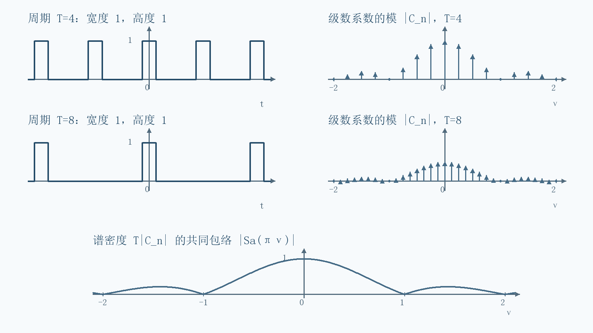
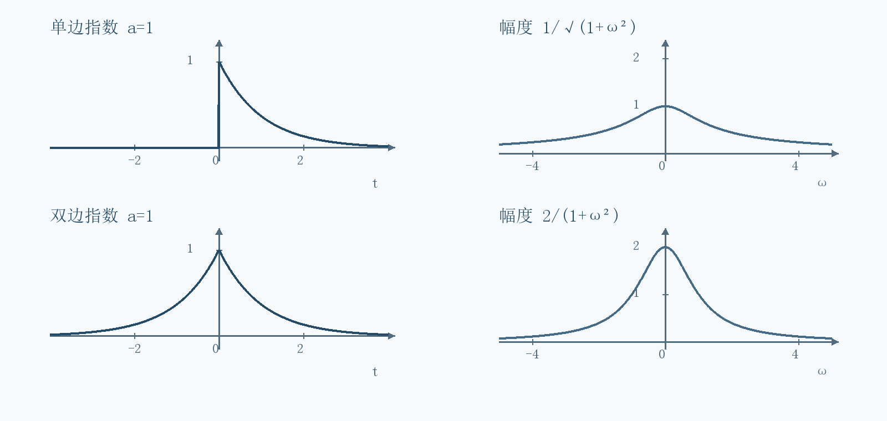
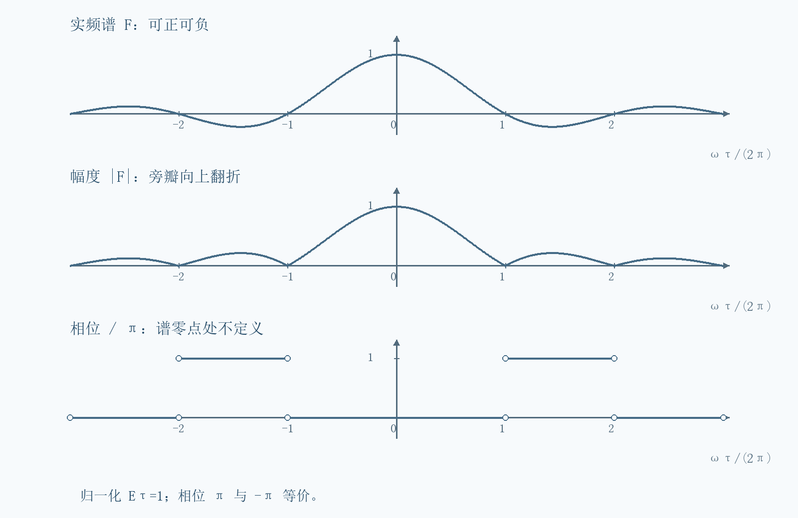
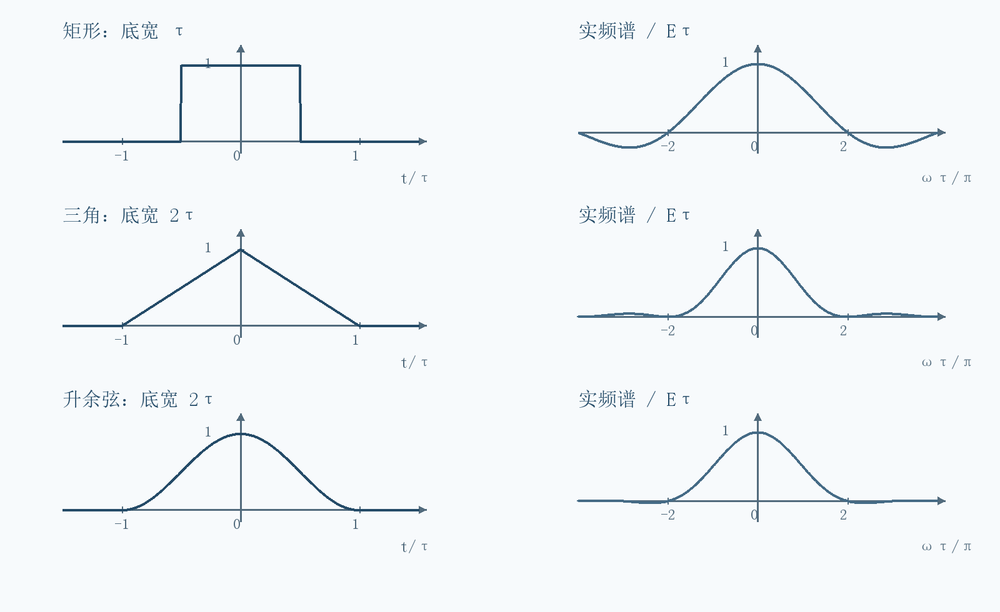
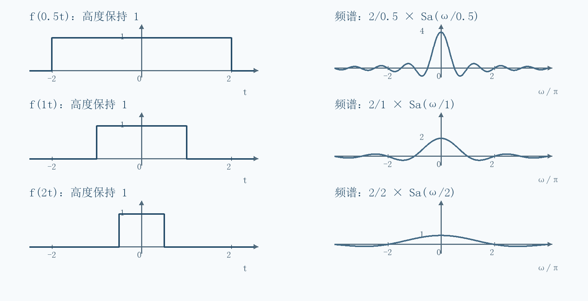
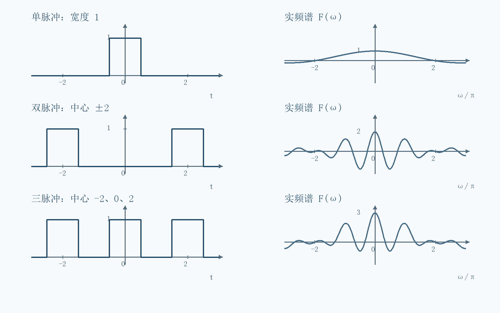
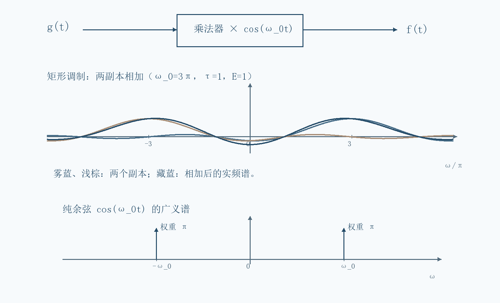
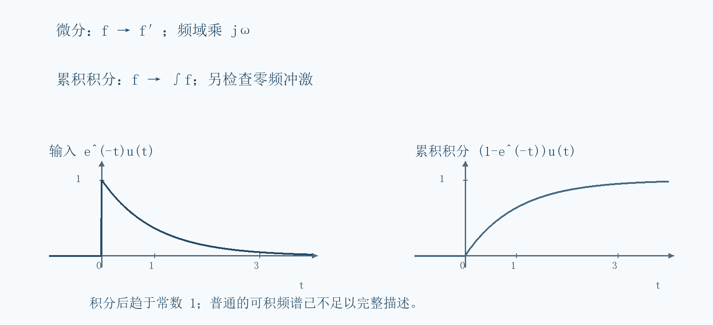
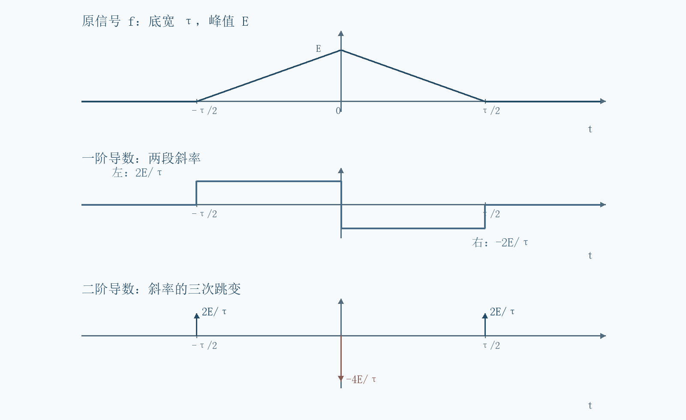

# 第4讲 傅里叶变换与典型信号频谱

!!! tip "本讲配套文件"
    - [Word 下载（第四节课 信号与系统自学笔记.docx）](../文件/第四节课 信号与系统自学笔记.docx)

## 01 本讲的目标与统一记号
资料内容：课件第 2—12 页。本讲把上一讲“用离散谐波表示周期信号”的方法推广到非周期信号，并用变换性质简化积分。读完后应能从定义计算典型频谱，判断相位与对称性，并解释阶跃、冲激为什么需要广义变换。
本笔记用 $j^2=-1$；$t$ 是时间，$\omega$ 是角频率，单位为弧度每秒。普通频率记为 $\nu$，有 $\omega=2\pi\nu$。全篇采用以下一对变换，正变换无系数，反变换有 $1/(2\pi)$：

$$F(\omega)=\mathcal{F}\{f(t)\}=\int_{-\infty}^{\infty}f(t)e^{-j\omega t}dt.$$

$$f(t)=\frac{1}{2\pi}\int_{-\infty}^{\infty}F(\omega)e^{j\omega t}d\omega.$$

记号 $f(t)\leftrightarrow F(\omega)$ 表示这一变换对。若改用普通频率，指数变成 $e^{-j2\pi\nu t}$，反变换前不再有 $1/(2\pi)$。同一道题不要混用两套记号。
定义 $\operatorname{Sa}(x)=\sin x/x$，并用极限补定 $\operatorname{Sa}(0)=1$。它与有些软件的归一化 sinc 不同：后者常定义为 $\sin(\pi x)/(\pi x)$。
补充讲解：若 $f$ 的量纲是伏特，则 $F$ 的量纲是伏特乘秒。$F$ 是频谱密度，不能直接当作某一根正弦波的振幅；反变换中一个窄频段的复贡献近似为 $F(\omega)e^{j\omega t}d\omega/(2\pi)$。
易错提醒：$F(0)=\int f(t)dt$ 是带符号的面积；它不是非周期信号的平均值，也不是总能量。能量由 $\int |f(t)|^2dt$ 定义。

## 02 从离散谐波到连续频谱
资料内容：课件第 5—9 页。先取一个固定的有限时宽脉冲 $p(t)$，以足够大的周期 $T$ 重复它；每周期容纳一个完整脉冲。设 $\Delta\omega=2\pi/T$，傅里叶级数系数记为 $C_n$，避免与连续变换 $P(\omega)$ 混淆。

$$C_n=\frac{1}{T}\int_{-T/2}^{T/2}p(t)e^{-jn\Delta\omega t}dt=\frac{1}{T}P(n\Delta\omega).$$

把它代回级数，并用 $1/T=\Delta\omega/(2\pi)$：

$$p_T(t)=\sum_{n=-\infty}^{\infty}C_ne^{jn\Delta\omega t}=\frac{1}{2\pi}\sum_{n=-\infty}^{\infty}P(n\Delta\omega)e^{jn\Delta\omega t}\Delta\omega.$$

当周期增大，其他重复脉冲离观察区越来越远，频率间隔变小。右边是频率轴上的黎曼和，在适当收敛条件下趋向反变换积分。于是密度应当是 $TC_n$，而不是趋于零的 $C_n$ 本身。
补充条件：上述图像推导先对有限支撑、分段光滑脉冲理解最直接。一般信号可先截断再取极限；交换求和、积分和极限需要收敛条件，不能把图像直觉当作对所有函数的证明。尤其 $n\Delta\omega\to\omega$ 时，固定非零频率通常要求序号随周期变化，不能一直固定 $n$。

{ loading=lazy }
*图 1 第 6—8 页思路重绘 固定单脉冲时周期增大 谱线变密且系数变小 密度保持同一包络*

易错提醒：非周期不等于所有频率都非零。非周期信号也可以严格带限；连续谱是频率变量连续，不是说每个频率都有贡献。周期功率信号的傅里叶变换则可以用冲激谱表示，见第 15 节。

## 03 存在条件与怎样读复频谱
资料内容：课件第 9—11 页。若 $\int_{-\infty}^{\infty}|f(t)|dt<\infty$，则正变换对每个实频率都绝对收敛，且 $|F(\omega)|\le\int|f(t)|dt$。绝对可积是普通正变换存在的充分条件，不是必要条件。
补充讲解：反变换恢复函数还需说明收敛方式。例如绝对可积且在所考察点附近分段光滑时，对称截断的反变换在连续点恢复原值，在跳点恢复左右极限的平均。更一般的平方可积信号可在均方意义下变换；冲激、常数、阶跃则放在广义函数框架中。本讲涉及三种情况时分别说明。

$$F(\omega)=R(\omega)+jX(\omega)=|F(\omega)|e^{j\varphi(\omega)}.$$

$$|F(\omega)|=\sqrt{R^2(\omega)+X^2(\omega)},\qquad \varphi(\omega)=\operatorname{atan2}(X(\omega),R(\omega)).$$

幅度非负；相位要判断象限，并允许相差 $2k\pi$ 的等价表示。在谱零点，相位没有定义。实数频谱的负值，应画成正的幅度并配置相位 $\pi$ 或 $-\pi$。
自检：实信号满足 $F(-\omega)=F^*(\omega)$，所以幅度是偶函数，相位可按模 $2\pi$ 的意义取反对称。若算出实信号的正负频率幅度不同，应优先检查积分上下限和指数符号。
补充讲解：变换的“一一对应”要在选定空间内理解；普通积分无法区分只在有限个点取值不同的函数。改变矩形脉冲端点的单点值，不会改变其傅里叶变换。

## 04 单边与双边指数的完整积分
资料内容：课件第 13—14 页。先设 $a>0$。单边衰减指数 $f(t)=e^{-at}u(t)$ 在负半轴为零，故

$$F(\omega)=\int_0^{\infty}e^{-(a+j\omega)t}dt=\left[-\frac{e^{-(a+j\omega)t}}{a+j\omega}\right]_0^{\infty}=\frac{1}{a+j\omega}.$$

上限项为零来自 $e^{-at}\to0$，这正是 $a>0$ 必须写出的原因。对实数 $a\le0$，不能直接沿用这一普通积分结论。

$$F(\omega)=\frac{a}{a^2+\omega^2}-j\frac{\omega}{a^2+\omega^2},\quad |F(\omega)|=\frac{1}{\sqrt{a^2+\omega^2}},\quad \varphi(\omega)=-\arctan\frac{\omega}{a}.$$

这里实部恒正，因此普通反正切不会丢象限。零频值 $1/a$ 等于曲线面积。$\omega=a$ 时幅度为峰值的 $1/\sqrt2$，$\omega=\sqrt3a$ 时为峰值的一半；二者不能混称同一种带宽。
双边指数 $g(t)=e^{-a|t|}$ 必须在零点拆积分：负半轴是 $e^{at}$，正半轴是 $e^{-at}$。

$$G(\omega)=\int_{-\infty}^0e^{(a-j\omega)t}dt+\int_0^{\infty}e^{-(a+j\omega)t}dt=\frac{1}{a-j\omega}+\frac{1}{a+j\omega}=\frac{2a}{a^2+\omega^2}.$$

它实偶且处处正，所以幅度就是 $G$，相位为零。零频值为 $2/a$，等于左右两半的总面积。两种指数不要只看“都含有 $e^{-at}$”就套同一个结果。
补充例题：$3e^{-2t}u(t)\leftrightarrow3/(2+j\omega)$，故 $F(0)=3/2$，$|F(2)|=3/(2\sqrt2)$，$\varphi(2)=-\pi/4$。三项分别从面积、模和辐角得到，可互相核对。

{ loading=lazy }
*图 2 第 13—14 页重绘 取参数为一 对比单边与双边指数及其幅度谱*

## 05 矩形脉冲的频谱与相位
资料内容：课件第 15 页。设 $E>0,\tau>0$，矩形在 $|t|<\tau/2$ 内为 $E$，其余为零。脉宽是 $\tau$。

$$F(\omega)=E\int_{-\tau/2}^{\tau/2}e^{-j\omega t}dt=E\frac{e^{-j\omega\tau/2}-e^{j\omega\tau/2}}{-j\omega}=\frac{2E\sin(\omega\tau/2)}{\omega}.$$

$$F(\omega)=E\tau\operatorname{Sa}(\omega\tau/2),\qquad F(0)=E\tau.$$

公式在非零频率由积分得到，在零频率通过连续极限补值。谱零点是 $\omega=2k\pi/\tau$，其中 $k$ 为非零整数。零频率是最大值，不是零点。
幅度谱为 $E\tau|\operatorname{Sa}(\omega\tau/2)|$；相位按 $F$ 的正负选零或 $\pi$，零点不定义。课件频谱曲线下穿横轴时画的是带符号的实频谱，不能把纵坐标直接写成非负的幅度。
补充例题：高度二、区间 $-1<t<1$ 的脉冲，$E=2,\tau=2$，故 $F(\omega)=4\operatorname{Sa}(\omega)$。在 $\omega=3\pi/2$ 处，$F=-8/(3\pi)$，幅度为 $8/(3\pi)$，相位为 $\pi$；在零频率值为四。
工程上常以第一正零点 $2\pi/\tau$ 表示单边角频率带宽，对应普通频率 $1/\tau$；完整主瓣横跨两个第一零点，宽度是 $4\pi/\tau$。矩形频谱旁瓣无限延伸，严格支撑带宽仍是无限。

{ loading=lazy }
*图 3 第 15 页重绘 分开画带符号实频谱 幅度与相位 零点的相位留空*

## 06 三角脉冲为何得到平方型频谱
资料内容：课件第 16 页。本节定义为 $f(t)=E(1-|t|/\tau)$，限于 $|t|<\tau$，外部为零，故底宽为 $2\tau$，峰值为 $E>0$。不要与第 18 节作业的底宽 $\tau$ 混淆。
利用偶性，将复指数中的奇函数项消去：

$$F(\omega)=2E\int_0^{\tau}(1-t/\tau)\cos(\omega t)dt.$$

对含 $t$ 的项分部积分：$\int t\cos(\omega t)dt=t\sin(\omega t)/\omega+\cos(\omega t)/\omega^2$。代入后两项正弦边界恰好抵消，得到

$$F(\omega)=\frac{2E[1-\cos(\omega\tau)]}{\tau\omega^2}=E\tau\operatorname{Sa}^2(\omega\tau/2).$$

最后一步用 $1-\cos x=2\sin^2(x/2)$。零频值用极限得 $E\tau$，正好是三角形面积。该频谱非负，相位在非零谱值处为零，谱零点处仍无定义。
补充讲解：同一个参数 $\tau$ 下，课件矩形底宽为 $\tau$，三角形底宽为 $2\tau$；二者碰巧面积相同、第一谱零点相同。若要比较“相同底宽”的信号，应先重新统一参数。

## 07 升余弦脉冲与平滑性
资料内容：课件第 17—18 页。按原页定义与波形，$f(t)=E[1+\cos(\pi t/\tau)]/2$ 在 $|t|\le\tau$ 内成立，外部为零。它的底宽是 $2\tau$。该定义是有限时宽的升余弦脉冲，不要与通信教材中其他命名相近的滤波器脉冲混用。
补充推导：设 $z=\omega\tau$，把余弦拆为两个复指数。第一部分是高度 $E/2$、宽 $2\tau$ 的矩形，后两部分各有系数 $E/4$：

$$F(\omega)=E\tau\operatorname{Sa}(z)+\frac{E\tau}{2}[\operatorname{Sa}(z-\pi)+\operatorname{Sa}(z+\pi)].$$

因为 $\sin(z\pm\pi)=-\sin z$，对 $z\ne0,\pm\pi$ 合并分母：

$$F(\omega)=E\tau\frac{\sin z}{z}+E\tau\frac{z\sin z}{\pi^2-z^2}=\frac{E\tau\operatorname{Sa}(z)}{1-(z/\pi)^2}.$$

$$F(0)=E\tau,\qquad F(\pi/\tau)=F(-\pi/\tau)=E\tau/2.$$

在 $z=\pi$ 附近，$\sin z/z$ 与 $1-z^2/\pi^2$ 同时为零，其比值极限为 $1/2$；因此这里不是无穷大，也不是谱零点。第一正零点实际为 $2\pi/\tau$。
资料校核：第 17 页印出的分子是 $E\tau\operatorname{Sa}(\omega\tau/2)$，与该页给定定义不符；这样会在 $\omega=\pi/\tau$ 产生发散，有限可积脉冲不可能有这种频谱。本笔记据积分改为 $E\tau\operatorname{Sa}(\omega\tau)$，并保留可去奇点的补值。
补充讲解：为什么边缘平滑会减少高频？分部积分把一次时域导数变成一次 $j\omega$ 因子。对这里的紧支撑分段光滑脉冲，矩形本身有跳变，频谱包络约按 $1/|\omega|$ 衰减；三角形连续但一阶导数跳变，约按 $1/\omega^2$；升余弦及一阶导数连续、二阶导数跳变，约按 $1/|\omega|^3$。
易错提醒：这是这些波形的大频率包络规律，须有相应分段光滑性和边界条件；不是说所有频率点都严格按幂函数取值，也不能不检查条件就推广为任意函数的定理。

{ loading=lazy }
*图 4 第 18 页比较思路重绘 同一参数下三种波形与归一化实频谱 注意底宽不同*

## 08 高斯脉冲为何变换后仍为高斯
资料内容：课件第 24—26 页。设 $f(t)=Ee^{-(t/\tau)^2}$，其中 $\tau>0$。结果为

$$F(\omega)=\sqrt{\pi}E\tau e^{-(\omega\tau/2)^2}.$$

补充推导：先计算 $I(b)=\int_{-\infty}^{\infty}e^{-x^2}e^{-jbx}dx$。高斯衰减允许对参数求导并分部积分。利用 $xe^{-x^2}=-(e^{-x^2})'/2$：

$$I'(b)=-j\int xe^{-x^2}e^{-jbx}dx=\frac{j}{2}\int (e^{-x^2})'e^{-jbx}dx=-\frac{b}{2}I(b).$$

边界项因高斯衰减为零，故解此微分方程得 $I(b)=I(0)e^{-b^2/4}$。常数来自高斯积分：将 $I(0)^2$ 化为平面二重积分，再用极坐标，得到

$$I(0)^2=\int_0^{2\pi}\int_0^{\infty}e^{-r^2}r\,dr\,d\theta=\pi,\qquad I(0)=\sqrt{\pi}.$$

原题令 $x=t/\tau$，则 $dt=\tau dx,b=\omega\tau$，所以 $F=E\tau I(\omega\tau)$，得到所列结果。
自检：峰值 $F(0)=\sqrt\pi E\tau$ 是面积。时域在 $|t|=\tau$ 衰减至峰值的 $1/e$，频域在 $|\omega|=2/\tau$ 衰减至峰值的 $1/e$，一宽一窄。形状属于同一函数族，不表示每个参数下变换前后都数值相等。

## 09 冲激 常数 符号与阶跃
资料内容：课件第 19—23 页。这几种信号不能全部用绝对可积函数的普通积分解释。以下等式含冲激或主值时，统一按广义傅里叶变换理解。
### 冲激和常数的归一化
冲激的筛选性质立即给出

$$\mathcal{F}\{\delta(t)\}=\int\delta(t)e^{-j\omega t}dt=1.$$

反过来，用反变换作用于频域冲激：$\mathcal{F}^{-1}\{\delta(\omega)\}=1/(2\pi)$，故

$$1\leftrightarrow2\pi\delta(\omega),\qquad \delta(t-t_0)\leftrightarrow e^{-j\omega t_0}.$$

补充讲解：冲激谱上的箭头标注的是权重或面积，不是有限高度。常数和纯正弦一般是功率信号，总能量无限；“集中在某频率”应理解为谱支撑或功率分布，不能当作有限总能量的普通密度。
课件第 21 页用面积为一的窄矩形逼近冲激：脉宽为 $\tau$，高度为 $1/\tau$，频谱是 $\operatorname{Sa}(\omega\tau/2)$。当 $\tau\to0$，每个固定频率处趋于一。这解释了冲激的平坦频谱。
### 符号函数先衰减再取极限
符号函数在正半轴为一，负半轴为负一，零点取零。乘上 $e^{-a|t|}$，其中 $a>0$，得到可积辅助函数：

$$F_a(\omega)=\frac{1}{a+j\omega}-\frac{1}{a-j\omega}=\frac{-2j\omega}{a^2+\omega^2}.$$

$$\operatorname{sgn}(t)\leftrightarrow2\operatorname{PV}\frac{1}{j\omega}.$$

这里极限为 $a\to0^+$，并在广义意义下取。PV 是柯西主值：对光滑、快速衰减的测试函数 $\psi$，$\operatorname{PV}(1/\omega)$ 通过对称删去零点附近的区间后积分并取极限来定义。它不是在零点填一个数就能变成普通函数。
### 阶跃为什么多一个冲激
由 $u(t)=[1+\operatorname{sgn}(t)]/2$，线性相加得

$$u(t)\leftrightarrow\pi\delta(\omega)+\operatorname{PV}\frac{1}{j\omega}.$$

补充解释：若从 $u'=\delta$ 得出 $j\omega U=1$，只能确定非零频率部分；因为 $\omega\delta(\omega)=0$，微分会丢掉常数信息。$\pi\delta$ 正是不能靠简单“除以 $j\omega$”恢复的部分。
易错提醒：本笔记凡出现 $1/(j\omega)$ 的广义变换，均按 PV 理解；阶跃的原点取值不影响变换。含冲激的谱也不宜画成一条普通的有限幅度曲线。

## 10 互易性与矩形频谱的反变换
资料内容：课件第 28 页。若 $f(t)\leftrightarrow F(\omega)$，则互易性质为

$$F(t)\leftrightarrow2\pi f(-\omega).$$

来源：在反变换中把时间改成 $-s$，得到 $2\pi f(-s)=\int F(\xi)e^{-j\xi s}d\xi$。这个积分已经是对函数 $F$ 的正变换，只需把哑变量改名即可。反号和 $2\pi$ 都由本讲变换约定决定。
补充条件：先在正反变换均合法的函数类内证明，再推广到广义变换。它不是“把时域和频域的图交换后完全不变”，还伴随横轴反向及纵轴系数。
课件例题的完整计算：设频谱在 $|\omega|<\omega_c$ 内为常数 $A$，外部为零，其中 $\omega_c>0$，则直接反变换得

$$f(t)=\frac{A}{2\pi}\int_{-\omega_c}^{\omega_c}e^{j\omega t}d\omega=\frac{A\sin(\omega_ct)}{\pi t}=\frac{A\omega_c}{\pi}\operatorname{Sa}(\omega_ct).$$

在 $t=0$ 用极限得到 $A\omega_c/\pi$。反过来，$\operatorname{Sa}(\omega_ct)$ 的变换在带内为 $\pi/\omega_c$，边界可取半值。这给出一个非周期但严格带限的信号，也说明“非周期必含所有频率”并不准确。
自检：令 $A=2,\omega_c=3$，反变换为 $6\operatorname{Sa}(3t)/\pi$；原点值等于频谱矩形面积十二除以 $2\pi$。

## 11 线性叠加与双脉冲
资料内容：课件第 29—30 页。积分的线性直接给出：若 $f_k\leftrightarrow F_k$，且系数 $a_k$ 为常数，则有限线性组合满足

$$\mathcal{F}\{\sum_{k=1}^{N}a_kf_k(t)\}=\sum_{k=1}^{N}a_kF_k(\omega).$$

易错提醒：相加的是复频谱，通常 $|F_1+F_2|\ne|F_1|+|F_2|$；相位也不能直接相加。相同频率分量可能相消。
课件双脉冲：两个高度 $E$、宽度 $\tau$ 的矩形分别以 $-T$ 和 $T$ 为中心，设 $T\ge\tau/2$。它等于“宽 $2T+\tau$ 的大矩形”减去“宽 $2T-\tau$ 的中央矩形”。原页阶跃表达式省略的幅度因子，统一由 $E$ 补齐。

$$F(\omega)=\frac{2E}{\omega}\left[\sin\frac{\omega(2T+\tau)}{2}-\sin\frac{\omega(2T-\tau)}{2}\right].$$

用和差化积 $\sin(A+B)-\sin(A-B)=2\cos A\sin B$，取 $A=\omega T,B=\omega\tau/2$，得到

$$F(\omega)=2E\tau\operatorname{Sa}(\omega\tau/2)\cos(\omega T).$$

第一因子控制单个脉冲的包络，余弦来自两脉冲之间的相对位置。$F(0)=2E\tau$ 等于两块面积。频谱零点既可能来自单脉冲包络，也可能来自脉冲间相消。

## 12 奇偶虚实性与共轭检验
资料内容：课件第 31—34 页。把核写成 $\cos\omega t-j\sin\omega t$，利用奇函数在对称区间的积分为零，就能推导以下四种对应。
实偶时域信号对应实偶频谱：$F(\omega)=2\int_0^{\infty}f(t)\cos\omega t\,dt$。
实奇时域信号对应纯虚奇频谱：$F(\omega)=-2j\int_0^{\infty}f(t)\sin\omega t\,dt$。
纯虚偶时域信号对应纯虚偶频谱；纯虚奇时域信号对应实奇频谱。这两条可把 $f=jg$ 代入前两条并用 $j^2=-1$ 验证。
补充例题：$f(t)=\operatorname{sgn}(t)e^{-a|t|}$ 是实奇，上一节结果 $-2j\omega/(a^2+\omega^2)$ 果然纯虚且奇。再乘 $j$，频谱变为 $2\omega/(a^2+\omega^2)$，是实奇。
反褶与共轭的一般公式为

$$f(-t)\leftrightarrow F(-\omega),\quad f^*(t)\leftrightarrow F^*(-\omega),\quad f^*(-t)\leftrightarrow F^*(\omega).$$

来源：第一条令积分变量 $s=-t$，注意交换上下限；第二条把 $\int f(t)e^{j\omega t}dt$ 整体共轭；第三条连续使用前两条。令实信号满足 $f^*=f$，立即得到共轭对称检验 $F(-\omega)=F^*(\omega)$。
易错提醒：实偶频谱不一定非负，矩形就是反例；纯虚奇频谱也不是“没有幅度”，只是实部为零。图上必须分清画的是虚部、实部还是模。

## 13 尺度变换与复合自变量
资料内容：课件第 35—36 页。若 $a$ 是非零实数，则

$$f(at)\leftrightarrow\frac{1}{|a|}F(\omega/a).$$

来源：令 $s=at$。当 $a>0$，$dt=ds/a$ 且上下限方向不变；当 $a<0$，上下限倒置产生另一个负号，因此前面的系数是 $1/|a|$。指数中的频率仍为 $\omega/a$，不能也改成绝对值。
当 $|a|>1$，时域压缩，频域横向展开，谱的纵向整体还需乘 $1/|a|$。如果 $a<0$，另有反褶。信号峰值不变时，其能量变为原来的 $1/|a|$，但这不表示每个固定频率点的谱值都更小，因为频谱还发生横向变化。
补充组合公式：先写 $at-b=a(t-b/a)$，再用时移，可得

$$f(at-b)\leftrightarrow\frac{1}{|a|}e^{-j\omega b/a}F(\omega/a).$$

完整例题：已知 $f(t)=e^{-|t|}\leftrightarrow2/(1+\omega^2)$，求 $g(t)=f(2t-4)$。先读出 $a=2,b=4$，中心由零移到二，宽度减半；于是

$$G(\omega)=\frac12 e^{-j2\omega}\frac{2}{1+(\omega/2)^2}=\frac{e^{-j2\omega}}{1+\omega^2/4}.$$

面积检查 $G(0)=1$，等于原面积二除以二；相位为 $-2\omega$，符合延时二。若是 $f(-2t+4)$，仍延时二，但频谱输入应改成 $-\omega/2$；本例因原谱偶对称看不出反褶，一般信号不能省略。

{ loading=lazy }
*图 5 第 35—36 页尺度规律重绘 以矩形为例 同时显示横向伸缩和纵向系数*

## 14 时移与有限脉冲列
资料内容：课件第 37—39 页。延时 $t_0$ 的信号为 $f(t-t_0)$，其变换是

$$f(t-t_0)\leftrightarrow e^{-j\omega t_0}F(\omega).$$

来源：令 $s=t-t_0$，积分核写成 $e^{-j\omega(s+t_0)}$，与 $s$ 无关的因子提出即可。因此幅度不变，相位加上 $-\omega t_0$。仅有幅度谱，无法辨别同一波形的不同延时。
课件三脉冲：令 $p(t)$ 为高度 $E$、宽度 $\tau$ 的中心矩形，三个中心在 $-T,0,T$。由时移和线性

$$f(t)=p(t+T)+p(t)+p(t-T),$$

$$F(\omega)=P(\omega)[e^{j\omega T}+1+e^{-j\omega T}]=E\tau\operatorname{Sa}(\omega\tau/2)[1+2\cos(\omega T)].$$

计算例：取 $E=1,\tau=1,T=2$，则 $F(\omega)=\operatorname{Sa}(\omega/2)[1+2\cos(2\omega)]$。$F(0)=3$；在 $\omega=\pi/3$ 时方括号为零，所以虽单脉冲谱非零，总谱仍相消。
补充推导：对 $N$ 个中心在 $0,T,\ldots,(N-1)T$ 的相同脉冲，移位因子构成等比数列：

$$F_N(\omega)=P(\omega)\sum_{k=0}^{N-1}e^{-jk\omega T}=P(\omega)e^{-j(N-1)\omega T/2}\frac{\sin(N\omega T/2)}{\sin(\omega T/2)}.$$

当分母为零，必须回到求和式或取极限，不能当作真发散；在 $\omega=2m\pi/T$ 处，求和恰为 $N$。若将脉冲列中心移回零点，整体线性相位相应消失。
补充条件：有限个脉冲仍是非周期信号，频谱仍连续。只有向正负时间方向都无限延展、形成真正周期重复，并按广义极限处理，才得到冲激谱；不能把单向无穷列直接当作双向周期信号。

{ loading=lazy }
*图 6 第 30 与 38 页重绘 以单个矩形为基元得到双脉冲及三脉冲的频谱*

## 15 频移 调制与正弦冲激谱
资料内容：课件第 40—42 页。将时间信号乘以复指数，指数与变换核合并，得到

$$f(t)e^{j\omega_0t}\leftrightarrow F(\omega-\omega_0).$$

正的 $\omega_0$ 使整个复频谱向右移。由欧拉公式分解余弦和正弦，再分别频移：

$$f(t)\cos\omega_0t\leftrightarrow\frac12[F(\omega-\omega_0)+F(\omega+\omega_0)].$$

$$f(t)\sin\omega_0t\leftrightarrow\frac{1}{2j}[F(\omega-\omega_0)-F(\omega+\omega_0)].$$

后式也等于 $j[F(\omega+\omega_0)-F(\omega-\omega_0)]/2$，与课件写法一致。易错提醒：余弦的两个副本同号，正弦的两个副本反号且有虚数系数；不能只背“搬移两次”而漏掉这些因子。
课件调制矩形例题：令 $g(t)$ 为中心矩形，先写 $G(\omega)=E\tau\operatorname{Sa}(\omega\tau/2)$，代入频移公式：

$$F(\omega)=\frac{E\tau}{2}\operatorname{Sa}[(\omega-\omega_0)\tau/2]+\frac{E\tau}{2}\operatorname{Sa}[(\omega+\omega_0)\tau/2].$$

补充解释：这是两个带符号的复频谱副本相加后再取模，不能把两条幅度曲线直接拼起来。矩形的旁瓣无限延伸，所以“两个副本完全不重叠”只是主瓣层面的近似说法。
把基带函数取为常数一，利用 $1\leftrightarrow2\pi\delta(\omega)$，得到

$$e^{j\omega_0t}\leftrightarrow2\pi\delta(\omega-\omega_0),$$

$$\cos\omega_0t\leftrightarrow\pi[\delta(\omega-\omega_0)+\delta(\omega+\omega_0)],$$

$$\sin\omega_0t\leftrightarrow\frac{\pi}{j}[\delta(\omega-\omega_0)-\delta(\omega+\omega_0)].$$

补充衔接：周期信号若写作 $f(t)=\sum C_ne^{jn\omega_1t}$，则广义变换为 $2\pi\sum C_n\delta(\omega-n\omega_1)$。所以“傅里叶级数系数”与“冲激谱权重”相差 $2\pi$；谱的相位还包含复系数的辐角。

{ loading=lazy }
*图 7 第 40—42 页重绘 调制框图和左右搬移的两个频谱副本 下方冲激箭头标注权重*

## 16 微分性质与边界项
资料内容：课件第 22、43—44 页。时域求导对应频域乘 $j\omega$：

$$f'(t)\leftrightarrow j\omega F(\omega),\qquad f^{(n)}(t)\leftrightarrow(j\omega)^nF(\omega).$$

普通积分推导：对 $\int f'(t)e^{-j\omega t}dt$ 分部积分，得到边界项 $[f(t)e^{-j\omega t}]_{-\infty}^{\infty}$ 加上 $j\omega F$。当函数足够光滑、函数及相应导数可积并具有所需的无穷远衰减时，边界项为零。分段波形有跳变时，应把跳变产生的冲激计入广义导数。
补充例题：$f(t)=e^{-at}u(t)$ 的导数不是单独的 $-ae^{-at}u(t)$，而是

$$f'(t)=-ae^{-at}u(t)+\delta(t),\qquad -\frac{a}{a+j\omega}+1=\frac{j\omega}{a+j\omega}.$$

右边正是 $j\omega F$。漏掉原点冲激，就会少一个常数一。
频域求导则来自对变换核求导；若 $tf(t)$ 绝对可积，可交换求导与积分：

$$F'(\omega)=\int(-jt)f(t)e^{-j\omega t}dt,\qquad tf(t)\leftrightarrow jF'(\omega).$$

更一般地，$t^nf(t)\leftrightarrow j^nF^{(n)}(\omega)$；等价地，$\mathcal{F}^{-1}\{F^{(n)}\}=(-jt)^nf(t)$。
完整计算例：由 $e^{-at}u(t)\leftrightarrow1/(a+j\omega)$，先求频率导数 $-j/(a+j\omega)^2$，再乘 $j$，得到 $te^{-at}u(t)\leftrightarrow1/(a+j\omega)^2$。面积检查为 $F(0)=1/a^2$。
课件冲激检验：由 $u'=\delta$，$j\omega[\pi\delta(\omega)+\operatorname{PV}(1/(j\omega))]=1$；再求一次导数，得 $\delta'(t)\leftrightarrow j\omega$。这里冲激偶是广义导数，不是两个普通尖峰。

## 17 积分性质与不能漏掉的零频项
资料内容：课件第 45—46 页。定义累积积分 $g(t)=\int_{-\infty}^t f(s)ds$。下限必须固定为负无穷，这决定了积分常数。其变换为

$$G(\omega)=F(\omega)\operatorname{PV}\frac{1}{j\omega}+\pi F(0)\delta(\omega).$$

来源一：$g=f*u$，即 $\int f(s)u(t-s)ds$，利用阶跃变换，得到 $F(\omega)[\operatorname{PV}(1/(j\omega))+\pi\delta(\omega)]$；再用冲激筛选关系 $F(\omega)\delta(\omega)=F(0)\delta(\omega)$。这是卷积定理在本式中的使用，补充说明，不在本讲展开一般卷积理论。
来源二：$g'=f$ 给出 $j\omega G=F$，但不能确定零频冲激项；该项还要由下限条件补定。对于绝对可积的 $f$，$g(-\infty)=0$，$g(+\infty)=F(0)$，可能不会衰减，所以应预期出现广义频谱。
补充条件：可先对快速衰减的光滑函数证明；本讲有限脉冲和衰减指数满足相应条件。更一般地，要求积分存在，且 $F$ 在零点附近足够光滑使主值乘积有意义，例如 $f$ 与 $tf$ 均绝对可积。直接把非绝对收敛的重积分随意换序并不构成普通积分意义下的证明，可借助衰减正则化说明。
若 $F(0)=0$，零频冲激项消失；若 $F$ 在零点可微，商 $F(\omega)/(j\omega)$ 在零点还可补极限 $F'(0)/j$。如果另加积分常数 $C$，其频谱再增加 $2\pi C\delta(\omega)$。
完整例题：取 $f(t)=e^{-at}u(t),a>0$。先按区间积分得 $g(t)=(1-e^{-at})u(t)/a$，所以用已有变换对

$$G(\omega)=\frac{1}{a}\left[\pi\delta(\omega)+\operatorname{PV}\frac{1}{j\omega}-\frac{1}{a+j\omega}\right].$$

另一方面，$F(0)=1/a$，积分性质给出 $\pi\delta(\omega)/a+\operatorname{PV}[1/(j\omega(a+j\omega))]$。部分分式

$$\frac{1}{j\omega(a+j\omega)}=\frac{1}{a}\left[\frac{1}{j\omega}-\frac{1}{a+j\omega}\right]$$

使两种方法一致。易错提醒：只写 $F/(j\omega)$ 会漏掉 $\pi\delta/a$；积分在正无穷趋于 $1/a$，并不回到零。

{ loading=lazy }
*图 8 第 43—46 页补充示意 微分强调高频 积分保留累积常数信息 例示衰减指数的累积积分*

## 18 图示作业用微分法完整求解
资料内容：课件第 47 页作业图。三角脉冲峰值 $E>0$，零点在 $-\tau/2$ 与 $\tau/2$，所以底宽是 $\tau$。函数为 $f(t)=E(1-2|t|/\tau)$，限于 $|t|<\tau/2$，外部为零。
第一步，读出两侧斜率。左半段在时长 $\tau/2$ 内从零升到 $E$，斜率 $2E/\tau$；右半段斜率 $-2E/\tau$。原函数连续，因此一阶导数只有两段常数，没有冲激：

$$f'(t)=\frac{2E}{\tau}[u(t+\tau/2)-2u(t)+u(t-\tau/2)].$$

第二步，对一阶导数中的三个跳变求广义导数，得到

$$f''(t)=\frac{2E}{\tau}[\delta(t+\tau/2)-2\delta(t)+\delta(t-\tau/2)].$$

三个冲激权重之和为零，符合一阶导数从零开始又回到零。中间冲激权重是 $-4E/\tau$，因为斜率从正 $2E/\tau$ 跳到负 $2E/\tau$，不是只下降 $2E/\tau$。
第三步，逐个变换冲激并运用二阶微分性质：

$$(j\omega)^2F(\omega)=\frac{2E}{\tau}[e^{j\omega\tau/2}-2+e^{-j\omega\tau/2}]=\frac{4E}{\tau}[\cos(\omega\tau/2)-1].$$

第四步，对 $\omega\ne0$ 除以 $(j\omega)^2=-\omega^2$，再用 $1-\cos x=2\sin^2(x/2)$：

$$F(\omega)=\frac{4E[1-\cos(\omega\tau/2)]}{\tau\omega^2}=\frac{E\tau}{2}\operatorname{Sa}^2(\omega\tau/4).$$

第五步，补零频并核对：$F(0)=E\tau/2$ 等于三角形面积；第一正零点是 $4\pi/\tau$。它与第 16 页底宽 $2\tau$ 的三角形相比缩短一半，因此频谱横向加宽一倍、零频值减半。
补充解释：若只从二阶导数在广义框架中求原函数，还可能丢掉一次函数的信息。本题原信号是已知紧支撑脉冲，$F$ 是普通连续函数，零频用连续极限补定，不允许额外加入频域冲激及其导数。

{ loading=lazy }
*图 9 第 47 页作业图重绘 原三角形 一阶导数及二阶导数 冲激权重明确标出*

## 19 解题路线与资料校核
做计算题先完成五件事：明确波形定义与宽度；固定变换约定；判断普通还是广义变换；选择基元与性质；最后用面积、奇偶、相位和尺度核验。只有需要直接积分时才展开积分，不要机械地把所有题从定义算一遍。
补充综合例题：设 $p(t)$ 为高度一、底宽二的中心矩形，求 $h(t)=p(2(t-1))\cos3t$。先有 $P(\omega)=2\operatorname{Sa}(\omega)$；压缩并右移得 $G(\omega)=e^{-j\omega}\operatorname{Sa}(\omega/2)$；最后调制：

$$H(\omega)=\frac12e^{-j(\omega-3)}\operatorname{Sa}[(\omega-3)/2]+\frac12e^{-j(\omega+3)}\operatorname{Sa}[(\omega+3)/2].$$

易错提醒：频移作用于整个 $G$，包括指数相位，不能只移动 Sa 函数。这里载波是 $\cos3t$；若改成 $\cos[3(t-1)]$，结果会不同。
### 本讲需要特别核对的表述
第 3 页复习页把零频列入矩形谱零点，实际零频是面积峰值；谱线随脉宽、周期的变化还包含 Sa 自变量变化，不能概括成每条谱线都简单成正比或反比。
第 9 页“非周期包含所有频率”的表述应加限制；本笔记第 10 节提供严格带限的非周期反例。第 10 页的存在性条件与反演条件也应分开讨论，见第 03 节。
第 17 页升余弦公式的 Sa 自变量应按定义校正为 $\omega\tau$，见第 07 节推导。该页原波形和分段定义本身是对称的，并非单边脉冲。
第 19、23、45 页的 $1/(j\omega)$ 按主值广义函数理解。第 20、42 页关于常数、正弦“能量集中”的说法应注意它们通常是无限能量的功率信号。
第 36 页的尺度性质同时改变频率自变量与纵向因子，不能据此断言所有固定频率点都下降。第 39 页讨论主瓣及谱峰集中，不等于严格带限；有限脉冲列到周期信号要说明双向无限延展。
第 47 页作业三角形的底宽是 $\tau$，第 16 页例题底宽是 $2\tau$，答案相应不同。这不是二选一的记号问题，必须先读图。
### 作业与预习记录
原讲义另布置教材 3-29 的第 1、3、4、7 小题；本次资料未附这些题的完整题面，因此这里只记录题号，不猜题。图示三角脉冲作业已在第 18 节完整解答。预习范围为教材 §3.8—§3.11。

## 20 闭卷自测
以下均为补充练习。除题内说明外，$a>0,\tau>0$，采用本讲角频率变换约定。先独立作答，再翻第 21 节。
1．周期为 $T$ 的单脉冲重复信号，其系数为 $C_n$；写出它与单脉冲连续频谱 $P$ 的关系，并说明为什么不能把 $C_n$ 直接当作谱密度。
2．求 $2e^{-3t}u(t)$ 的频谱、零频值，以及在 $\omega=3$ 时的幅度和相位。
3．高度三、区间 $-2<t<2$ 的矩形脉冲，求频谱、第一正零点，以及单边第一零点普通频率带宽。
4．峰值二、底宽六的对称三角脉冲，求频谱与零频值。若底宽减半、峰值不变，答案怎样变化？
5．判断第 07 节升余弦脉冲在 $\omega=\pi/\tau$ 处是否发散，并求该处谱值。
6．频谱在 $|\omega|<4$ 内为三，外部为零，求反变换及其原点值。
7．已知 $f\leftrightarrow F$，写出 $f(2t-6)$、$f^*(-t)$、$tf(t)$ 的变换，并写明尺度式要求。
8．设 $p(t)$ 为高度一、宽度一的中心矩形，求 $p(t-2)+p(t+2)$ 的频谱，并给出由两脉冲相消产生的第一正零点。
9．写出 $u(t-2)$ 与 $\cos(5t+\pi/3)$ 的广义频谱。冲激箭头上应标高度还是权重？
10．求 $te^{-2t}u(t)$ 的频谱，并用零频面积检查。
11．求 $g(t)=\int_{-\infty}^t e^{-2s}u(s)ds$ 及其频谱。为什么不能漏掉零频冲激？
12．一个实奇信号的变换是否一定是奇函数？是否一定是实函数？用 $\operatorname{sgn}(t)e^{-|t|}$ 验证。
13．不看第 18 节，用微分法求峰值一、底宽四的对称三角脉冲频谱，列出二阶导数中三个冲激的权重。
14．设 $p(t)$ 为高度一、底宽二的中心矩形，求 $p(t-1)\cos2t$ 的频谱。说明频移时哪些因子都要移动。
15．“时域压缩后，各个固定频率点的幅度都变小”“有限个矩形脉冲的频谱是离散谱”“谱值为零处相位为零”分别是否正确？简述理由。

## 21 自测详解与复习索引
1．$C_n=P(n\Delta\omega)/T$，其中 $\Delta\omega=2\pi/T$，所以谱密度采样值是 $TC_n$。周期增大时系数一般趋小，而反变换中还要结合变小的频率间隔；完整黎曼和见第 02 节。
2．线性系数二提出，得到 $F=2/(3+j\omega)$。$F(0)=2/3$；$\omega=3$ 时分母模为 $3\sqrt2$，故幅度 $\sqrt2/3$，相位为 $-\pi/4$。回看第 04 节。
3．先读出 $E=3,\tau=4$，故 $F=12\operatorname{Sa}(2\omega)$。第一正零点由 $2\omega=\pi$ 得 $\pi/2$；除以 $2\pi$ 得普通频率带宽 $1/4$。严格带宽仍无限。回看第 05 节。
4．第 06 节的半宽参数取三，得 $F=6\operatorname{Sa}^2(3\omega/2)$，$F(0)=6$。底宽减半后半宽为 $3/2$，故新谱为 $3\operatorname{Sa}^2(3\omega/4)$：纵向减半、横向加宽一倍。
5．不发散。令 $z=\omega\tau$，在 $z=\pi$ 附近，分子 $\sin z/z$ 与分母 $1-z^2/\pi^2$ 的一阶零点之比为 $1/2$，所以结果为 $E\tau/2$。直接把两个零相除不是答案。回看第 07 节。
6．反变换是 $3\sin4t/(\pi t)=12\operatorname{Sa}(4t)/\pi$，在原点用极限得到 $12/\pi$。也可用频谱面积二十四除以 $2\pi$ 核验。回看第 10 节。
7．先将 $2t-6=2(t-3)$，得到 $e^{-j3\omega}F(\omega/2)/2$；共轭反褶得到 $F^*(\omega)$；乘时间得到 $jF'(\omega)$。尺度参数须为非零实数，乘时间的普通积分推导还要求相应加权可积性。回看第 12、13、16 节。
8．单脉冲谱 $P=\operatorname{Sa}(\omega/2)$，两次时移之和为 $2\cos2\omega$，所以 $F=2\operatorname{Sa}(\omega/2)\cos2\omega$。第一相消零点是 $\omega=\pi/4$，此时 Sa 因子非零。回看第 11、14 节。
9．时移阶跃得到 $e^{-j2\omega}[\pi\delta(\omega)+\operatorname{PV}(1/(j\omega))]$，其中 $e^{-j2\omega}\delta(\omega)=\delta(\omega)$。余弦先拆成两个复指数，得到

$$\pi e^{j\pi/3}\delta(\omega-5)+\pi e^{-j\pi/3}\delta(\omega+5).$$

箭头标注权重，余弦这道题的权重为复数，不能仅画两个“高度为 $\pi$”的实箭头而丢相位。回看第 09、15 节。
10．对 $1/(2+j\omega)$ 求频率导数，得到 $-j/(2+j\omega)^2$，再乘 $j$，结果 $1/(2+j\omega)^2$。零频为 $1/4$；直接积分 $\int_0^{\infty}te^{-2t}dt$ 分部积分也得 $1/4$。
11．分段积分给出 $g=(1-e^{-2t})u(t)/2$，故

$$G(\omega)=\frac{\pi}{2}\delta(\omega)+\frac12\operatorname{PV}\frac{1}{j\omega}-\frac{1}{2(2+j\omega)}.$$

累积积分最终趋于 $1/2$，不衰减到零；零频冲激由总面积和固定的积分下限决定。漏掉它会改变时域常数部分。回看第 17 节。
12．实奇对应纯虚奇，非零情况下并非实函数。把 $a=1$ 代入辅助函数结果，得 $F=-2j\omega/(1+\omega^2)$，确实满足 $F(-\omega)=-F(\omega)$ 且实部为零。
13．左右斜率分别为 $1/2$ 与 $-1/2$；在 $t=-2,0,2$ 处的斜率跳变量为 $1/2,-1,1/2$，故

$$f''(t)=\frac12\delta(t+2)-\delta(t)+\frac12\delta(t-2).$$

变换后 $-\omega^2F=\cos2\omega-1$，所以 $F=(1-\cos2\omega)/\omega^2=2\operatorname{Sa}^2(\omega)$，零频补值为二，等于三角形面积。回看第 18 节。
14．单脉冲谱 $P=2\operatorname{Sa}(\omega)$；延时得 $G=2e^{-j\omega}\operatorname{Sa}(\omega)$；再调制得

$$H(\omega)=e^{-j(\omega-2)}\operatorname{Sa}(\omega-2)+e^{-j(\omega+2)}\operatorname{Sa}(\omega+2).$$

频移替换整个函数的频率自变量，包括相位因子。若只平移 Sa，得到的是另一个载波相位条件下的信号。回看第 19 节。
15．三句均不准确。尺度变换还改变频率自变量，例如宽二的矩形在 $\omega=\pi$ 原谱为零，压缩为宽一后该处频谱反而非零；有限脉冲列的频谱是连续函数，双向无限周期重复才产生冲激谱；零谱值处相位没有定义。
复习索引：归一化与密度看 01—03；典型变换积分看 04—08；冲激、主值与阶跃看 09；性质推导看 10—17；三角作业看 18；复合运算及校核看 19。能够独立解释每个公式的适用条件，比只记住结果更重要。

