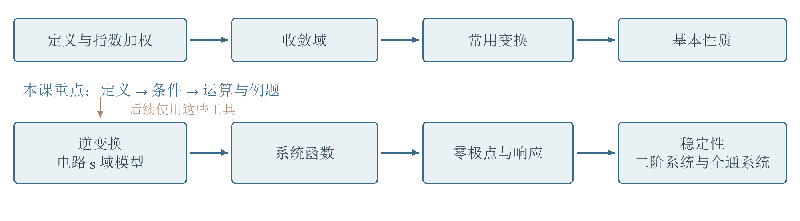
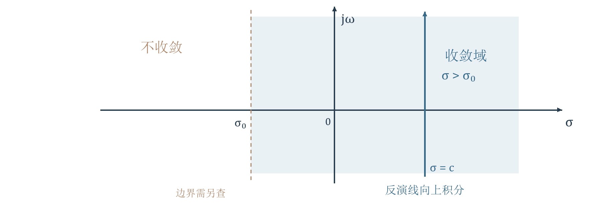
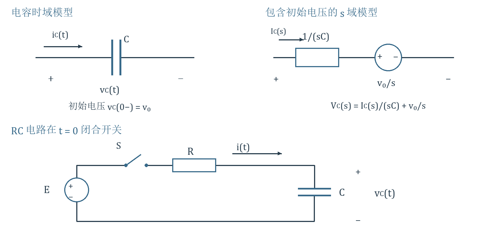
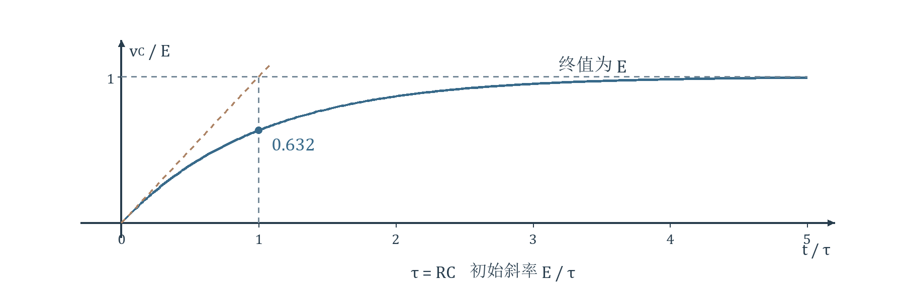
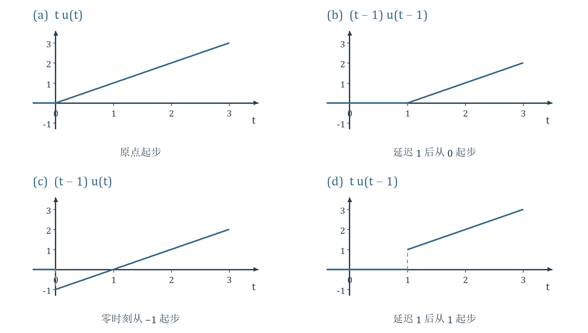
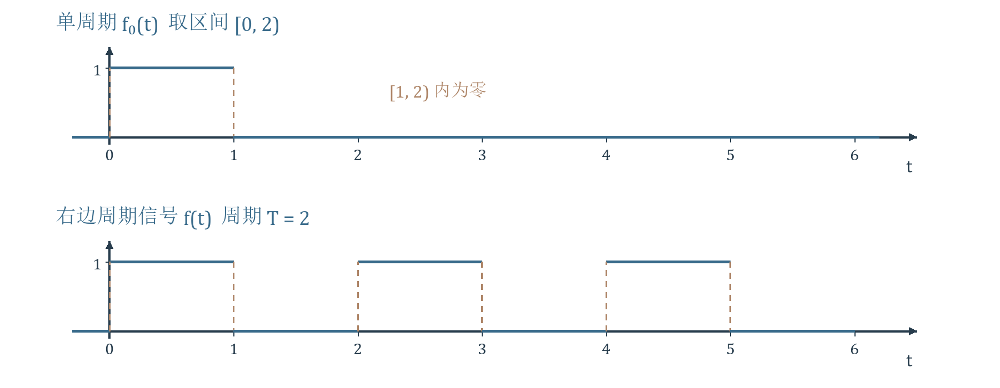
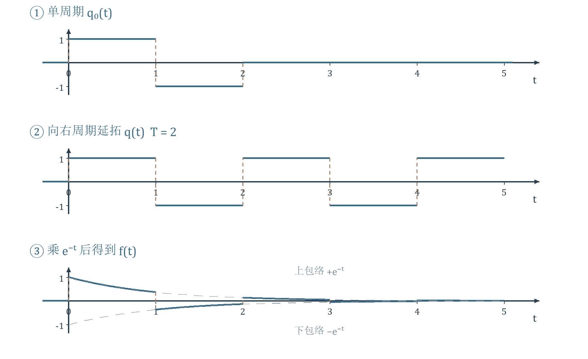
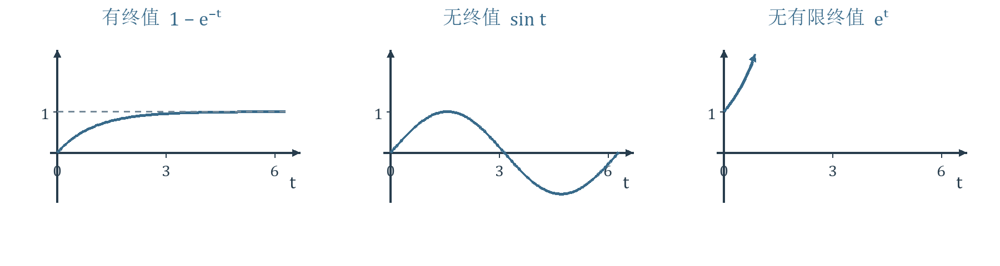
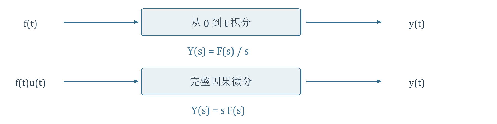

# 第6讲 拉普拉斯变换的性质

!!! tip "本讲配套文件"
    - [Word 下载（第六节课 信号与系统自学笔记.docx）](../文件/第六节课 信号与系统自学笔记.docx)

## 1 本课路线与必要准备
资料内容 讲义第 1—5 页。本课学习拉普拉斯变换的定义、收敛域、常用变换与基本性质，为下一步逆变换和连续时间系统的 s 域分析作准备。它把微分方程变为代数方程，并把初始储能纳入计算；以后可借助系统函数的零极点分析响应与稳定性。
课程位置：连续时间系统的时域分析 → 傅里叶分析 → 拉普拉斯分析；离散时间的对应路线是时域分析 → DTFT 与 z 变换。后续还涉及四种傅里叶变换的关系与 DFT/FFT、滤波器、反馈、状态变量，以及向量空间的模与内积、PCM 和时分复用等应用。这里的 A、D 分别指模拟与数字的课程分支。
历史背景简记：Heaviside 的算子法先用于电工计算，拉普拉斯变换随后为这类运算提供严格基础；本课着眼于连续时间线性时不变系统。
!!! info "录音补充"
    00:00—01:51、64:47—65:17：学习目标同时包括信号的表示和系统对信号的作用。学习本课性质时，与傅里叶性质逐项比较，重点理解初始条件如何进入运算。

{ loading=lazy }
*图 1 依据讲义第 2、5 页整理 本课与后续内容的关系*

读图：上排为本课主体，下排为后续应用；箭头表示使用关系。后续的零极点分析还包括全通系统与最小相移函数。逆变换在本课先通过常用变换对使用，系统方法留待后续。
!!! info "补充讲解"
    本课默认 $j^2=-1$，复频率 $s=\sigma+j\omega$；$\sigma$ 的单位为每秒，$\omega$ 为弧度每秒。$u(t)$ 是单位阶跃，$\delta(t)$ 是单位冲激，$f(0^-)$、$f(0^+)$ 分别为零时刻左右极限。普通函数在单个点的取值不改变积分，但位于原点的冲激不能忽略。
    必要工具：欧拉公式 $e^{j\theta}=\cos\theta+j\sin\theta$；分部积分 $\int u\,dv=uv-\int v\,du$；因果信号卷积 $f*g=\int_0^t f(\tau)g(t-\tau)d\tau$。冲激的筛选与导数规则为

    $$\int_{-\infty}^{\infty}\delta(t-t_0)\varphi(t)dt=\varphi(t_0),\qquad \int_{-\infty}^{\infty}\delta'(t)\varphi(t)dt=-\varphi'(0).$$

    后一个公式来自分布导数的定义，是计算冲激偶变换的依据。不要把冲激当成“某一点取无穷大”的普通函数。

## 2 从傅里叶变换到拉普拉斯变换
资料内容 讲义第 6—9 页。先将信号乘以指数权重，再作傅里叶变换。取 $s=\sigma+j\omega$，有

$$F(s)=\int_{-\infty}^{\infty}f(t)e^{-st}dt=\int_{-\infty}^{\infty}[f(t)e^{-\sigma t}]e^{-j\omega t}dt.$$

这就是双边拉普拉斯变换。实部 $\sigma$ 调整衰减或增长，虚部 $\omega$ 描述振荡；允许选择 $\sigma$ 后，一些普通傅里叶积分不收敛的信号也能变换。
例如右边增长信号 $e^{at}u(t)$，乘权后为 $e^{-(\sigma-a)t}u(t)$。只有 $\sigma>a$ 时向右衰减且绝对可积，变换才由普通积分给出。指数权重不能任意挽救所有双边信号：对全时轴常数，正时间要求 $\sigma>0$，负时间却要求 $\sigma<0$，二者冲突。
!!! warning "资料校核"
    第 6 页“直流信号 $u(t)$”应理解为从零开始接通的常量；它是阶跃，不是全时轴常数。常数和周期正弦可以有广义傅里叶谱；“不满足普通积分条件”不等于“没有任何意义下的傅里叶变换”。第 8 页“实际信号总是因果信号”是本课采用的起始时刻建模约定，并非普遍事实，也不能据此判定系统因果性。

### 单边定义与原点约定
本课采用包含原点冲激的单边变换，以下 $\mathcal L$ 均指这一约定：

$$F(s)=\mathcal L\{f(t)\}=\int_{0^-}^{\infty}f(t)e^{-st}dt.$$

对于因果信号，它与双边变换相同；对非因果信号，它只记录零时刻及以后的部分，零时刻之前的历史通过初始条件进入系统方程。$f(t)$ 叫原函数，$F(s)$ 叫像函数。
### 逆变换从哪里来
固定收敛域内的实数 $c$，先对 $f(t)e^{-ct}$ 作傅里叶逆变换，再乘回 $e^{ct}$：

$$f(t)=\frac{1}{2\pi}\int_{-\infty}^{\infty}F(c+j\omega)e^{(c+j\omega)t}d\omega=\frac{1}{2\pi j}\int_{c-j\infty}^{c+j\infty}F(s)e^{st}ds.$$

其中沿竖直线积分时 $ds=j\,d\omega$，因此系数是 $1/(2\pi j)$。积分线必须位于收敛域内。普通分段光滑函数在连续点恢复原值，在跳变点按通常反演条件得到左右平均；冲激按广义函数理解。它表示以复指数为基元的叠加，而非把不同实部的指数任意相加。
## 3 收敛域决定变换能在哪里使用
资料内容 讲义第 10—11 页。收敛域 ROC 是使变换积分收敛的复数 $s$ 的集合。对本课常见的右边指数型信号，绝对收敛域是某条竖线右侧的半平面；边界是否收敛需另查。
一个常用充分条件：$f(t)$ 在每个有限区间分段连续，且存在 $M,\alpha,t_1$，使 $t\ge t_1$ 时 $|f(t)|\le M e^{\alpha t}$。当 $\sigma>\alpha$ 时，尾部积分被可积的 $M e^{-(\sigma-\alpha)t}$ 控制，所以变换存在。更一般只需局部可积等适当条件；“分段连续且指数阶”不是必要条件。

{ loading=lazy }
*图 2 依据讲义第 10 页重绘 收敛域与反演路径*

读图：横轴为实部，纵轴为虚部；阴影表示 $\sigma>\sigma_0$，虚线边界不自动包含。反演线 $\sigma=c$ 必须在阴影内；改变 $\omega$ 是沿同一竖线移动。
常见例子：$u(t)$、$t^nu(t)$ 和右边正弦的 ROC 为 $\sigma>0$；$e^{at}u(t)$ 为 $\sigma>a$；$e^{-at}u(t)$ 为 $\sigma>-a$。有限宽脉冲 $u(t)-u(t-T)$（$T>0$）只在有限区间积分，因此整个有限 s 平面都可收敛。
!!! info "补充讲解"
    有限脉冲的式子 $(1-e^{-sT})/s$ 在 $s=0$ 看似分母为零，但极限为 $T$，这里是可去奇点，不是极点。相反，$e^{t^2}u(t)$ 对任意固定实数 $\sigma$ 都有 $t^2-\sigma t\to+\infty$，没有普通单边拉普拉斯变换。
    易错提醒｜写出一个代数表达式并不等于说明变换存在；做积分、平移和初终值判断时仍要保留 ROC。对于双边变换，同一个有理式搭配不同 ROC 可对应不同信号；本课固定右边解释，才通常能由式子确定对应波形。

## 4 常用变换对及其推导
资料内容 讲义第 12—17 页。下列普通波形均按右边信号理解；省略 $u(t)$ 时不表示将其延伸到负时间。
### 阶跃 指数与幂函数

$$\mathcal L\{u(t)\}=\int_0^\infty e^{-st}dt=\left[-\frac{e^{-st}}s\right]_0^\infty=\frac1s,\qquad \sigma>0.$$

这里无穷远端为零，依赖于 $|e^{-st}|=e^{-\sigma t}\to0$。同理

$$\mathcal L\{e^{-at}u(t)\}=\frac1{s+a},\qquad \sigma>-a\quad(a\text{ 为实数}).$$

幂函数令 $I_n=\int_0^\infty t^ne^{-st}dt$。对非负整数 $n$，$I_0=1/s$；当 $n\ge1$ 时分部积分，边界项在零点和无穷远均为零：

$$I_n=\left[-\frac{t^ne^{-st}}s\right]_0^\infty+\frac ns\int_0^\infty t^{n-1}e^{-st}dt=\frac ns I_{n-1}=\frac{n!}{s^{n+1}},\qquad \sigma>0.$$

因此斜坡 $tu(t)$ 对应 $1/s^2$，$t^2u(t)$ 对应 $2/s^3$；阶乘不能漏。
### 冲激与线性
原点冲激被 $0^-$ 下限包含，由筛选性质得 $\mathcal L\{\delta(t)\}=e^0=1$，ROC 为整个有限 s 平面。更一般 $\mathcal L\{\delta(t-t_0)\}=e^{-st_0}$（$t_0\ge0$）。
积分的线性直接给出 $\mathcal L\{a f_1+b f_2\}=aF_1+bF_2$。可先在两者 ROC 的公共区域使用；相消后实际 ROC 可能扩大。
### 正弦与余弦
用欧拉公式拆成两个复指数，且二者均要求 $\sigma>0$：

$$\mathcal L\{\sin(\omega_0t)u(t)\}=\frac1{2j}\left(\frac1{s-j\omega_0}-\frac1{s+j\omega_0}\right)=\frac{\omega_0}{s^2+\omega_0^2}.$$

$$\mathcal L\{\cos(\omega_0t)u(t)\}=\frac12\left(\frac1{s-j\omega_0}+\frac1{s+j\omega_0}\right)=\frac{s}{s^2+\omega_0^2}.$$

取非零实数 $\omega_0$；零频率的退化情况单独代回波形判断。正弦分子是频率，余弦分子是 $s$，可用初值区别：正弦零起点，余弦起点为 1。
## 5 与傅里叶谱的关系
资料内容与校核 讲义第 15 页。只有当虚轴位于 ROC 内、相应傅里叶积分存在时，才能直接写 $F(j\omega)=F(s)|_{s=j\omega}$。若虚轴在边界，可能需要取 $s=\varepsilon+j\omega$、$\varepsilon\to0^+$ 的广义极限，不能只把分母中的 $s$ 换掉。
在本课傅里叶约定 $\int f(t)e^{-j\omega t}dt$ 下：

$$\mathcal F\{\delta(t)\}=1,\qquad \mathcal F\{u(t)\}=\operatorname{PV}\frac1{j\omega}+\pi\delta(\omega).$$

$$\mathcal F\{e^{-at}u(t)\}=\frac1{a+j\omega},\qquad a>0.$$

$$\mathcal F\{\sin(\omega_0t)u(t)\}=\operatorname{PV}\frac{\omega_0}{\omega_0^2-\omega^2}+\frac\pi{2j}[\delta(\omega-\omega_0)-\delta(\omega+\omega_0)].$$

$$\mathcal F\{\cos(\omega_0t)u(t)\}=\operatorname{PV}\frac{j\omega}{\omega_0^2-\omega^2}+\frac\pi2[\delta(\omega-\omega_0)+\delta(\omega+\omega_0)].$$
!!! info "补充讲解"
    PV 表示对奇点作对称排除后取极限的柯西主值。傅里叶时域乘 $t$ 对应 $j\,d/d\omega$，所以幂函数的严谨统一写法是

    $$\mathcal F\{t^nu(t)\}=j^n\frac{d^n}{d\omega^n}\left(\operatorname{PV}\frac1{j\omega}+\pi\delta(\omega)\right).$$

    讲义将其简写为 $n!/(j\omega)^{n+1}+j^n\pi\delta^{(n)}(\omega)$；其中高阶倒数项须按分布导数或有限部分理解，不能当作处处有意义的普通函数。这里只需抓住结论：在 ROC 边界直接代值会漏掉冲激谱。
    录音补充｜16:08—18:17：含冲激的广义频谱不能随意作普通函数除法。拉普拉斯变换在收敛域内便于进行代数运算，这也是它适合求解系统微分方程的原因之一。

## 6 时域微分与零时刻跳变
资料内容 讲义第 18—20 页。对普通的右侧可微函数，从 $0^+$ 开始分部积分，假设无穷远边界项消失：

$$\int_{0^+}^\infty f'(t)e^{-st}dt=\left[f(t)e^{-st}\right]_{0^+}^\infty+sF(s)=sF(s)-f(0^+).$$

如果零时刻有跳变 $\Delta f=f(0^+)-f(0^-)$，完整导数中还有 $\Delta f\,\delta(t)$。采用包含原点的 $0^-$ 约定，就应加回这项：

$$\mathcal L\{f'(t)\}=sF(s)-f(0^+)+\Delta f=sF(s)-f(0^-).$$

初始值不是额外“修正技巧”，而是积分下边界留下的项。这正是单边变换能自动纳入初始条件的原因。
!!! info "录音补充"
    58:21—63:09：理解微分性质时，同时看普通导数和启动跳变产生的冲激；对电路，初始项还记录电容、电感在开关动作前的储能。第 8 节把这个数学边界项写成电容的初始电压源。
    对有相应左右初始值的普通部分，逐次应用得到

    $$\mathcal L\{f''(t)\}=s^2F(s)-sf(0^-)-f'(0^-).$$

    $$\mathcal L\{f^{(n)}(t)\}=s^nF(s)-\sum_{r=0}^{n-1}s^{n-1-r}f^{(r)}(0^-).$$

    适用条件：分段光滑、各阶变换及边界项有意义，跳变产生的冲激按分布处理。不要把有原点冲激的函数的“初值”当普通数塞进公式。

### 冲激偶例题
资料例题 求 $\mathcal L\{\delta'(t)\}$。用第 1 节的分布导数规则最直接：

$$\mathcal L\{\delta'(t)\}=-\left.\frac d{dt}e^{-st}\right|_{t=0}=s.$$

若改成从 $0^+$ 积分，则原点的冲激和冲激偶都被排除，对应积分为零。这说明下限约定会改变是否记录开关瞬间。
!!! warning "资料校核"
    第 20 页在套用一阶微分公式时，将初始项印成了 $\delta'(0^\pm)$；形式上原函数应是 $\delta$，但分布本身不宜按普通点值处理。该页最终结论“$0^-$ 得 $s$，$0^+$ 得 0”保留，推导采用上面的分布规则。
    补充检验｜阶跃的完整导数是 $\delta(t)$，因此 $s(1/s)-u(0^-)=1$；如果误减 $u(0^+)=1$，就会把原点冲激漏掉。

## 7 s 域微分 积分与时域积分
资料内容 讲义第 21—23 页。三种运算要分清作用变量。
### 对 s 求导对应时域乘负 t
在 ROC 内可在适当支配条件下交换求导与积分：

$$F'(s)=\int_0^\infty f(t)(-t)e^{-st}dt=\mathcal L\{-tf(t)\}.$$

逐次求导得到 $\mathcal L\{t^nf(t)\}=(-1)^nF^{(n)}(s)$。例如从 $1/(s+a)$ 出发，有 $\mathcal L\{te^{-at}u(t)\}=1/(s+a)^2$，ROC 仍为 $\sigma>-a$。这与时域求导得到 $sF(s)-f(0^-)$ 完全不同。
### 对 s 积分对应时域除以 t
若 $f(t)/t$ 在零点附近可积，且可以交换积分，则

$$\int_s^{s+\infty}F(p)dp=\int_0^\infty f(t)\left[\int_s^{s+\infty}e^{-pt}dp\right]dt=\int_0^\infty\frac{f(t)}t e^{-st}dt.$$

这里路径从 $s$ 水平向右到实部无穷大，虚部保持不变；不是任意跨过极点的路径。内积分为 $e^{-st}/t$。不能直接对 $f(t)=u(t)$ 使用，因为 $1/t$ 在零点不可积。
!!! info "补充例题"
    $a>0$ 时，求 $(1-e^{-at})u(t)/t$ 的变换。分子在零点约为 $at$，除以 $t$ 后极限为 $a$，满足局部可积条件。于是

    $$\int_s^{s+\infty}\left(\frac1p-\frac1{p+a}\right)dp=\left[\ln p-\ln(p+a)\right]_s^{s+\infty}=\ln\frac{s+a}s,\qquad \sigma>0.$$

    对数取与正实轴连续一致的解析分支，不能随意加入不同的 $2\pi j$。

### 时域积分对应除以 s 并保留初始积累
令 $y(t)=\int_{-\infty}^t f(\tau)d\tau$，则 $y'=f$，且 $y(0^-)$ 是零时刻以前的积累。由微分性质直接得

$$sY(s)-y(0^-)=F(s),\qquad Y(s)=\frac{F(s)}s+\frac{y(0^-)}s.$$

零初始积累时 $\mathcal L\{\int_0^t f(\tau)d\tau\}=F(s)/s$；若原点有冲激，积分起点应按包含该冲激的约定写 $0^-$。除以 $s$ 可能引入零极点，ROC 需重新判断，不能机械照搬原 ROC。

## 8 电容模型与 RC 开关例题
资料内容 讲义第 24—25 页。电流参考方向取流入电压正端，电容满足 $i_C=C\,dv_C/dt$。电流的变换为 $I_C(s)$，初始电压记 $v_0=v_C(0^-)$，则

$$I_C(s)=C[sV_C(s)-v_0],\qquad V_C(s)=\frac{I_C(s)}{sC}+\frac{v_0}s.$$

右式可用阻抗 $1/(sC)$ 与初始电压源 $v_0/s$ 串联表示。初始源极性必须与电压参考正端一致；这是 s 域模型中的源，不是时域电压恒为 $v_0/s$。

{ loading=lazy }
*图 3 依据讲义第 24—25 页重绘 电容等效模型与 RC 开关电路*

读图：上排先核对电流流入正端，再看等效串联源的正负号；下排开关在零时刻闭合，电源经电阻向电容充电，输出为电容上正下负的电压。
### 零初始电压的完整计算
!!! info "题设补足"
    $R,C>0$，输入电源为 $E$，开关在 $t=0$ 闭合，且 $v_C(0^-)=0$。讲义的解答隐含了这一零初始条件。
    第一步，列方程。由回路电压 $Ri+v_C=Eu(t)$ 和 $i=Cv_C'$ 得 $RCv_C'+v_C=Eu(t)$。
    第二步，变换并带入初值：

    $$RC[sV_C(s)-0]+V_C(s)=\frac Es,\qquad V_C(s)=\frac E{s(1+RCs)}.$$

    第三步，令 $a=1/(RC)>0$，把常数提干净再作部分分式：

    $$V_C(s)=\frac{Ea}{s(s+a)}=E\left(\frac1s-\frac1{s+a}\right).$$

    核验系数：右侧通分后分子为 $E[(s+a)-s]=Ea$，所以两项系数是 $E$ 与 $-E$。
    第四步，按第 4 节变换对反演：

    $$v_C(t)=E(1-e^{-t/(RC)})u(t).$$

    核验：$v_C(0^+)=0$，$v_C(\infty)=E$，初始斜率为 $E/(RC)$；对 $t>0$ 代回微分方程恰得 $E$。时间常数 $\tau=RC$，到 $t=\tau$ 时达到终值的约 63.2%。

{ loading=lazy }
*图 4 补充图示 RC 零状态充电曲线*

读图：终值虚线是 $E$，零时刻切线的斜率是 $E/\tau$；横坐标归一化为 $t/\tau$。曲线向终值渐近，不能画成有限时刻突然充满。
!!! warning "资料校核"
    第 25 页部分分式前的中间分母误写成 $s(1+1/(RC))$，应为 $s(s+1/(RC))$。最终结果与上式一致。
    补充讲解｜若初始电压为 $v_0$，则 $(RCs+1)V_C=E/s+RCv_0$。整理得 $V_C=E/s+(v_0-E)/(s+1/(RC))$，所以零时刻之后 $v_C(t)=E+(v_0-E)e^{-t/(RC)}$。无冲激电流时电容电压连续，故 $v_C(0^+)=v_0$；非零初值不能在变换时静默删去。

## 9 时域延迟与四种斜坡
资料内容 讲义第 26—27 页。对 $t_0\ge0$ 的延迟，必须同时移动波形和启动时刻：

$$\mathcal L\{f(t-t_0)u(t-t_0)\}=e^{-st_0}F(s).$$

来源：阶跃把下限变为 $t_0$，令 $\tau=t-t_0$，得到

$$\int_{t_0}^\infty f(t-t_0)e^{-st}dt=e^{-st_0}\int_0^\infty f(\tau)e^{-s\tau}d\tau.$$

延迟因子只记录晚了多久，不会把多项式里的 $t$ 自动变成 $t-t_0$。对普通右边信号，有限延迟不改变尾部收敛半平面。

{ loading=lazy }
*图 5 依据讲义第 27 页重绘 四种斜坡必须分别识别*

读图：先看何时离开零轴，再看离开时的高度，最后看斜率。虚线只标示跳变位置，端点单个值不影响普通积分。
!!! info "录音补充"
    72:13—74:55：下面四个波形应分别辨认。先把表达式改写成同一延迟变量的函数，再套公式，可避免只移动阶跃、忘记移动斜坡的错误。
    （a）$tu(t)$ 从原点上升，直接得 $1/s^2$。
    （b）$(t-1)u(t-1)$ 从 $t=1$ 的零高度上升，是整个斜坡延迟 1，得 $e^{-s}/s^2$。
    （c）$(t-1)u(t)=tu(t)-u(t)$ 在零时刻从 $-1$ 起步，得 $1/s^2-1/s$。这里只有竖直减 1，没有延迟启动。
    （d）$tu(t-1)$ 在 $t=1$ 跳到高度 1。先改写 $t=(t-1)+1$，再延迟：

    $$\mathcal L\{tu(t-1)\}=e^{-s}\mathcal L\{(t+1)u(t)\}=e^{-s}\left(\frac1{s^2}+\frac1s\right).$$

    四式的 ROC 均为 $\sigma>0$。可用定义核验最后一式：$\int_1^\infty te^{-st}dt=e^{-s}(1/s+1/s^2)$。

## 10 右边周期信号
资料内容 讲义第 28 页。先取一个周期 $f_0(t)$，只在 $0\le t<T$ 非零；再向右复制。这里“周期信号”指周期波形从零时刻接通，负时间仍为零。

$$f(t)=\sum_{k=0}^\infty f_0(t-kT),\qquad F_0(s)=\int_0^T f_0(t)e^{-st}dt.$$

利用延迟定理和等比级数，当 $|e^{-sT}|=e^{-\sigma T}<1$ 即 $\sigma>0$ 时：

$$F(s)=F_0(s)\sum_{k=0}^\infty e^{-ksT}=\frac{F_0(s)}{1-e^{-sT}}.$$

对于本课的非零有界周期波形，ROC 为 $\sigma>0$。一个周期的边界端点如何赋值，不影响普通积分；但周期内若有冲激，必须明确端点归属，不能重复计入。
### 周期矩形脉冲例题
每周期 $T=2$，前 1 秒幅度为 1，后 1 秒为零。取 $f_0=u(t)-u(t-1)$，则

$$F_0(s)=\frac{1-e^{-s}}s,\qquad F(s)=\frac{1-e^{-s}}{s(1-e^{-2s})}=\frac1{s(1+e^{-s})}.$$

最后一步使用 $1-e^{-2s}=(1-e^{-s})(1+e^{-s})$；在 ROC 内可约去公共因子。检查高实频极限 $sF(s)\to1$，与零时刻右侧高度 1 一致。

{ loading=lazy }
*图 6 依据讲义第 28 页重绘 单周期与向右延拓*

读图：上图仅保留 $[0,2)$ 内的一周期，下图每隔 2 秒复制；空白的后半周期也属于一个周期，不可把周期误读为 1。
!!! info "补充提醒"
    $s\to0^+$ 时 $sF(s)\to1/2$，但这个周期波形没有时间终值；此极限在这里给出周期平均值，不能当作终值定理的合法应用。

## 11 s 域平移与衰减方波
资料内容 讲义第 29—30 页。时间信号乘以指数，对应变换自变量平移：

$$\mathcal L\{e^{-at}f(t)\}=\int_0^\infty f(t)e^{-(s+a)t}dt=F(s+a).$$

若 $a$ 为实数、原 ROC 为 $\sigma>\sigma_0$，新 ROC 为 $\sigma>\sigma_0-a$。当 $a>0$ 时，极点和 ROC 边界均向左移 $a$；不能因为式中是“加 a”就判断向右移。
直接应用：$e^{-at}\sin(\omega_0t)u(t)$ 的变换为 $\omega_0/[(s+a)^2+\omega_0^2]$，ROC 为 $\sigma>-a$。平移应替换表达式里的每一个 $s$。
### 衰减的双极性方波例题
先构造单周期 $q_0(t)=u(t)-2u(t-1)+u(t-2)$：在 $[0,1)$ 为 $+1$，在 $[1,2)$ 为 $-1$，其余为零。

$$Q_0(s)=\frac{1-2e^{-s}+e^{-2s}}s=\frac{(1-e^{-s})^2}s.$$

以 $T=2$ 向右延拓得 $q(t)$，再乘包络 $e^{-t}$ 得题目波形 $f(t)$。分两步变换：

$$Q(s)=\frac{Q_0(s)}{1-e^{-2s}}=\frac{1-e^{-s}}{s(1+e^{-s})},\qquad \sigma>0.$$

$$F(s)=Q(s+1)=\frac{1-e^{-(s+1)}}{(s+1)[1+e^{-(s+1)}]},\qquad \sigma>-1.$$

{ loading=lazy }
*图 7 依据讲义第 29 页重绘 单周期 延拓与指数加权*

读图：第一图要看清 $+1,-1,0$ 三种高度；第二图保持幅度但反复换号；第三图在每个整数时刻换号，所有曲线分别贴着 $+e^{-t}$ 或 $-e^{-t}$。跳变的连接线仅表示瞬间切换。
核验：零时刻右值为 1；正实轴上 $sF(s)\to1$；时间趋于无穷时包络趋于零，故信号终值为零。式子在 $s=-1$ 的表面 $0/0$ 可去，但其他边界极点仍在 $\sigma=-1$，不能据一次约分把 ROC 扩成整个平面。
## 12 尺度变换
资料内容 讲义第 31 页。对正数 $a$，令 $\tau=at$，从而 $dt=d\tau/a$，且积分方向不变：

$$\mathcal L\{f(at)\}=\frac1a\int_0^\infty f(\tau)e^{-(s/a)\tau}d\tau=\frac1aF\left(\frac sa\right),\qquad a>0.$$

当 $a>1$ 时，波形在时间上压缩，变换自变量除以 $a$，同时幅度系数为 $1/a$。若原 ROC 是 $\sigma>\sigma_0$，新 ROC 为 $\sigma>a\sigma_0$。
!!! info "补充例题"
    $f(t)=e^{-2t}u(t)$，取 $a=3$：$(1/3)F(s/3)=(1/3)/(s/3+2)=1/(s+6)$，与直接对 $e^{-6t}u(t)$ 变换一致，ROC 为 $\sigma>-6$。
    易错提醒｜不能把单边公式直接推广为负 $a$：负尺度会调用原函数在负时间的部分，而单边 $F(s)$ 没有记录它。双边变换与傅里叶变换的 $1/|a|$ 规则有各自的积分区间条件，不能机械照搬。

## 13 初值定理与终值定理
资料内容 讲义第 32—34 页。它们帮助在不求完整反变换的情况下检查起点和稳态，但使用前必须先查条件。
### 初值定理
若 $f$ 的右极限有限、原点不含冲激，并满足指数阶等通常条件，则沿正实轴

$$f(0^+)=\lim_{s\to+\infty}sF(s).$$

来源有两种理解。由微分式 $sF(s)=f(0^+)+\int_{0^+}^\infty f'(t)e^{-st}dt$，在允许取极限的条件下，后项趋零。也可令 $x=st$，则 $sF(s)=\int_0^\infty f(x/s)e^{-x}dx$；权重总量为 1，随着 $s$ 增大越来越强调零点附近，故趋向 $f(0^+)$。
!!! info "录音补充"
    82:44—85:38：从微分定理推初值定理时，要先单独处理零时刻的跳变，再对右侧普通导数积分取极限。这就是公式最终出现 $f(0^+)$、而微分定理保留 $f(0^-)$ 的原因。
    这里取的是零时刻之后的值；开关前的 $f(0^-)$ 仍用于包含原点的微分定理。若 $F(s)=1$ 对应冲激，$sF(s)$ 发散，并不意味着冲激有一个普通的无限初值。

### 终值定理
若时间终值存在且满足通常收敛条件，则

$$f(\infty)=\lim_{t\to\infty}f(t)=\lim_{s\to0^+}sF(s).$$

一种充分的推导条件是右侧普通导数绝对可积：令 $s\to0^+$，有 $sF(s)=f(0^+)+\int_0^\infty f'(t)e^{-st}dt\to f(0^+)+\int_0^\infty f'(t)dt=f(\infty)$。
对本课常见的真有理或严格真有理变换、且普通时间响应无原点冲激时，可操作的检验是：约去真正的公共因子后，$sF(s)$ 的所有极点均须严格位于左半平面。等价地，$F(s)$ 除原点可有一个单极点外，其余极点都在左半平面；虚轴振荡极点、右半平面极点、原点高阶极点都会使条件失败。
### 三个并排判断
补充例题 A｜$F(s)=(s+3)/[(s+1)(s+2)]$。初值为 1；$sF$ 极点是 $-1,-2$，故终值为 0。部分分式 $F=2/(s+1)-1/(s+2)$，反演为 $(2e^{-t}-e^{-2t})u(t)$，两端检查一致。
补充例题 B｜$F(s)=1/[s(s+1)]$。$F$ 在原点有单极点，但 $sF=1/(s+1)$ 的极点只有 $-1$，所以允许用终值定理，终值为 1；响应为 $(1-e^{-t})u(t)$。
反例｜$\sin t\,u(t)$ 的变换为 $1/(s^2+1)$，代算 $sF(s)\to0$，但 $sF$ 在 $\pm j$ 有极点，时间响应持续振荡，无终值。$e^tu(t)$ 同样不能用终值定理：右半平面极点 $s=1$ 已经否定条件。

{ loading=lazy }
*图 8 补充图示 收敛 振荡与增长的时间响应*

读图：只有左图趋于确定常数；中图即使有平均值，也没有终值；右图增长。先判断这种长期行为，再看代数极限。
!!! warning "资料校核"
    第 34 页把 $s\to0$、$s\to\infty$ 与低高频作直观联系，可用于理解但不能取代定理：本节极限沿实轴，不能随意改为沿虚轴 $\omega\to0$ 或 $\omega\to\infty$。高实频强调初始时刻，低实频在满足终值条件时反映稳态。

## 14 两种卷积定理与算子意义
资料内容 讲义第 35—37 页。时域卷积与 s 域乘法对应；时域乘法则对应复平面上的竖线卷积，两者不能混写。
### 时域卷积
对因果信号，$h(t)=\int_0^t f_1(\tau)f_2(t-\tau)d\tau$。在绝对收敛等允许交换积分的条件下，将区域 $0\le\tau\le t$ 改写，令 $x=t-\tau\ge0$：

$$H(s)=\int_0^\infty f_1(\tau)e^{-s\tau}\left[\int_0^\infty f_2(x)e^{-sx}dx\right]d\tau=F_1(s)F_2(s).$$

系数为 1，没有傅里叶频域卷积中的 $1/(2\pi)$。ROC 至少包含两个变换 ROC 的交集；如果极点相消，实际 ROC 可能更大。
!!! info "录音补充"
    92:30—93:31：证明能拆成两个积分，关键在指数核满足 $e^{-s(x+\tau)}=e^{-sx}e^{-s\tau}$。记住这一步，就能理解卷积为什么变成乘法。
    补充例题｜计算 $e^{-t}u(t)*e^{-2t}u(t)$。变换相乘得 $1/[(s+1)(s+2)]=1/(s+1)-1/(s+2)$，反演为 $(e^{-t}-e^{-2t})u(t)$。直接核验：$\int_0^t e^{-\tau}e^{-2(t-\tau)}d\tau=e^{-2t}(e^t-1)$，完全一致。

### 复频域卷积
把 $f_1(t)$ 的逆变换代入 $\mathcal L\{f_1f_2\}$，交换积分后，内层变成 $F_2(s-p)$：

$$\mathcal L\{f_1(t)f_2(t)\}=\frac1{2\pi j}\int_{c-j\infty}^{c+j\infty}F_1(p)F_2(s-p)dp.$$

条件：时域乘积有定义、相关积分收敛，且积分线 $\operatorname{Re}p=c$ 位于 $F_1$ 的 ROC，同时 $s-p$ 位于 $F_2$ 的 ROC。若两者右边界为 $\alpha_1,\alpha_2$，应能选到 $\alpha_1<c<\operatorname{Re}s-\alpha_2$，所以通常要求 $\operatorname{Re}s>\alpha_1+\alpha_2$。该式不是沿实轴对 $s$ 的普通卷积，竖直积分路径与系数 $1/(2\pi j)$ 都必须写清；不能随意将两个冲激相乘。
### 积分器与微分器
因果积分等于与阶跃卷积，完整因果导数等于与冲激偶卷积。因此零状态下积分器在 s 域乘 $1/s$，微分器乘 $s$：

$$\int_0^t f(\tau)d\tau=(fu)*u\quad\longleftrightarrow\quad \frac{F(s)}s.$$

$$\frac d{dt}[f(t)u(t)]=f'(t)u(t)+f(0^+)\delta(t)\quad\longleftrightarrow\quad sF(s).$$

{ loading=lazy }
*图 9 依据讲义第 37 页重绘 时域运算及 s 域框图*

读图：两行分别表示积分和完整因果微分；乘 $s$ 的框图包含启动时刻的冲激。若只求 $t>0$ 的普通导数，则应减去 $f(0^+)$；若有系统初始储能，也不能只保留零状态框图。
## 15 性质速查与易错提醒
资料整理｜讲义第 16、38 页。下列各式均沿用本笔记的单边约定；先查相应章节的条件，再使用速查式。

| 运算与条件 | 变换结果 | 正文 |
|---|---|---|
| 线性组合 | $af_1+bf_2\ \longleftrightarrow\ aF_1+bF_2$ | 4 |
| 时域一阶微分 | $f'\ \longleftrightarrow\ sF-f(0^-)$ | 6 |
| 时域二阶微分 | $f''\ \longleftrightarrow\ s^2F-sf(0^-)-f'(0^-)$ | 6 |
| 时域积分 | $Y=F/s+y(0^-)/s$ | 7 |
| 时域乘幂 | $t^nf\ \longleftrightarrow\ (-1)^nF^{(n)}(s)$ | 7 |
| 时域除以 t | $f/t\ \longleftrightarrow\ \int_s^{s+\infty}F(p)dp$ | 7 |
| 延迟 t₀ ≥ 0 | $f(t-t_0)u(t-t_0)\ \longleftrightarrow\ e^{-st_0}F(s)$ | 9 |
| 右边周期延拓 | $F=F_0/(1-e^{-sT})$ | 10 |
| 指数加权 | $e^{-at}f(t)\ \longleftrightarrow\ F(s+a)$ | 11 |
| 正尺度 a > 0 | $f(at)\ \longleftrightarrow\ F(s/a)/a$ | 12 |
| 初值 无原点冲激 | $f(0^+)=\lim_{s\to+\infty}sF(s)$ | 13 |
| 终值 先查极点 | $f(\infty)=\lim_{s\to0^+}sF(s)$ | 13 |
| 时域卷积 | $f_1*f_2\ \longleftrightarrow\ F_1F_2$ | 14 |

易错提醒 1｜先声明从 $0^-$ 还是 $0^+$ 开始，再处理初始项；求终值前先检查极点，不能从极限存在倒推出终值存在。
易错提醒 2｜延迟是整个表达式的时间平移；只移动阶跃不等于整体延迟。指数加权要把每一个 $s$ 替换成 $s+a$。
易错提醒 3｜s 域微分产生负号；时域幂函数有阶乘；尺度变换有 $1/a$；RC 方程有初始项；这四类系数都可用简单变换对核验。
!!! warning "资料校核"
    第 38 页高阶微分汇总的初始项应带各阶导数 $f^{(r)}(0^-)$，不能每项都写成 $f(0)$；s 域积分应使用一致的积分变量。本表已按前文推导统一。

## 16 自测与关键步骤详解
补充练习｜先独立作答，再对照后面的答案。除特别说明外，采用 $0^-$ 单边变换。
1．求 $f(t)=3u(t)-2e^{-2t}u(t)+t^2u(t)$ 的变换及 ROC。
2．求 $e^{3t}u(t)$ 的 ROC；它有普通傅里叶积分吗？再求 $u(t)-u(t-2)$ 的变换在 $s=0$ 的值。
3．已知 $F(s)=1/(s+2)$、$f(0^-)=1$，求完整导数的变换；若改成 $e^{-2t}u(t)$ 的完整因果导数，又是多少？
4．求 $t^2e^{-3t}u(t)$ 与 $(1-e^{-2t})u(t)/t$ 的变换，说明使用的性质和条件。
5．求 $(t+2)u(t-3)$ 的变换，写出变量改写步骤。
6．周期为 3，第一秒为 1、其余两秒为 0，零时刻启动；求变换及 ROC。
7．设 $q(t)$ 是第 11 节从零启动的周期双极性方波，求 $e^{-2t}q(t)$ 的变换，并解释 ROC 的移动。
8．已知 $f(t)=e^{-t}u(t)$，求 $f(4t)$ 的变换；为什么不能仅凭单边 $F(s)$ 通用地求 $f(-t)$？
9．分别判断 $F_1=2/[s(s+2)]$、$F_2=s/(s^2+4)$、$F_3=1/(s-1)$ 能否使用终值定理，并求允许的终值。
10．RC 电路满足 $RC=2$ 秒、$E=5$ 伏、$v_C(0^-)=1$ 伏，求开关闭合后的电压及初始斜率。
11．用卷积定理求 $u(t)*e^{-3t}u(t)$，再用时域积分核验。
12．为什么 $\mathcal L\{d[f(t)u(t)]/dt\}=sF(s)$ 与 $\mathcal L\{f'(t)\}=sF(s)-f(0^-)$ 不矛盾？求 $\mathcal L\{\delta'(t)\}$ 作检验。
### 答案与检验
1．线性相加得 $F=3/s-2/(s+2)+2/s^3$。三项公共 ROC 为 $\sigma>0$，零点的三阶极点未消除，故实际 ROC 仍为 $\sigma>0$。
2．$F=1/(s-3)$，要求 $\sigma>3$，虚轴不在 ROC 内，且时间函数增长，所以没有普通傅里叶积分。有限脉冲为 $(1-e^{-2s})/s$；按原积分在 $s=0$ 得 $\int_0^2 1dt=2$，不是无穷大。
3．第一种是右侧为 $e^{-2t}$ 且左初值为 1 的连续启动情形，导数变换 $s/(s+2)-1=-2/(s+2)$。第二种左初值为 0，完整导数包含 $\delta(t)$，变换为 $s/(s+2)=1-2/(s+2)$；差别恰为原点冲激的变换 1。
4．对 $1/(s+3)$ 求二阶导数得 $2/(s+3)^3$，ROC 为 $\sigma>-3$。第二式由 s 域积分得 $\ln[(s+2)/s]$，ROC 为 $\sigma>0$；零点附近分子约为 $2t$，除以 $t$ 后有限。
5．先写 $t+2=(t-3)+5$，令 $\tau=t-3$，则 $F=e^{-3s}\mathcal L\{(t+5)u(t)\}=e^{-3s}(1/s^2+5/s)$，ROC 为 $\sigma>0$。从 $t=3$ 启动时高度为 5，可据此检查常数项。
6．单周期 $F_0=(1-e^{-s})/s$；向右周期延拓得 $F=(1-e^{-s})/[s(1-e^{-3s})]$，ROC 为 $\sigma>0$。周期是 3，不是非零脉冲的宽度 1。
7．从 $Q(s)=(1-e^{-s})/[s(1+e^{-s})]$ 出发，把全部 $s$ 换成 $s+2$，得到 $F=(1-e^{-(s+2)})/[(s+2)(1+e^{-(s+2)})]$。ROC 左移 2，变为 $\sigma>-2$。
8．$(1/4)F(s/4)=1/(s+4)$，ROC 为 $\sigma>-4$。负尺度会把负时间信息搬到正时间；不同的负时间延拓可有同一个单边 $F(s)$，却有不同的反转结果。题中若额外已知全时轴因果定义，则 $f(-t)$ 在 $t>0$ 为零，这是利用了额外的时域信息。
9．$sF_1=2/(s+2)$ 仅有左半平面极点，终值为 1。$sF_2=s^2/(s^2+4)$ 有 $\pm2j$ 极点，响应为余弦，无终值。$sF_3=s/(s-1)$ 有右半平面极点，响应增长，无有限终值；后两项即使代算极限也不能用。
10．变换方程为 $2[sV-1]+V=5/s$，因此 $V=5/s-4/(s+1/2)$。零时刻之后 $v_C=5-4e^{-t/2}$ 伏，初始斜率 $v_C'(0^+)=2$ 伏每秒；检验 $v_C(0^+)=1$、终值 5，且 $2v_C'+v_C=5$。
11．$H=1/[s(s+3)]=(1/3)[1/s-1/(s+3)]$，故 $h=(1-e^{-3t})u(t)/3$。直接积分 $\int_0^t e^{-3(t-\tau)}d\tau=(1-e^{-3t})/3$；积分器系数不可遗漏。
12．完整因果导数包括 $f(0^+)\delta(t)$，其变换把普通右侧导数的 $-f(0^+)$ 抵消；含原点约定的物理初始项则由 $f(0^-)$ 决定。冲激偶按分布导数作用于 $e^{-st}$ 得 $-(-s)=s$，不需要定义冲激的普通点值。
## 17 作业 复习与资料索引
资料内容 讲义第 39 页布置教材 4-1（1）至（10）、4-2；预习第 4.4 至 4.6 节。本次资料没有给出这些教材题面的完整内容，本笔记不编造题目。第 16 节是另外编写的自测，不替代教材作业。
复习顺序：先不用查表重写阶跃、指数、幂函数、正弦和余弦变换；再独立推导微分、延迟和周期信号公式；最后用 RC 例题串联初始条件、代数求解与初终值核验。
资料范围：高河伟《信号与系统 第 4 章 拉普拉斯变换 连续时间系统的 s 域分析 I》，2026 年秋季学期，40 页。第 40 页说明课件在邢宇翔、赵自然老师原 PPT 讲稿基础上修改，并参考其他教师资料；此处保留来源说明。正文中的页码均指这份教师 PDF。
课堂录音：约 95 分钟，文件名为“第七节课.wav”，已确认属于第六节课。标为“录音补充”的内容是结合课件整理的讲解，时间为录音中的分:秒，不是逐字引文。

| 讲义页码 | 内容与图示覆盖 | 正文位置 |
|---|---|---|
| 1—5 | 课程位置 历史作用 本章路线图 | 1 与图 1 |
| 6—9 | 指数加权 双边与单边定义 反演 | 2 |
| 10—11 | 收敛条件 六类信号 ROC | 3 与图 2 |
| 12—14 | 阶跃 指数 幂函数 冲激 | 4 |
| 15 | 常用傅里叶谱与广义边界 | 5 |
| 16—17 | 性质概览 线性 正余弦例题 | 4 与 15 |
| 18—20 | 各阶微分 零点跳变 冲激偶 | 6 |
| 21—23 | s 域微分积分 时域积分 | 7 |
| 24—25 | 电容初始模型 RC 例题 | 8 与图 3—4 |
| 26—27 | 延迟证明 四种斜坡 | 9 与图 5 |
| 28 | 周期变换 矩形脉冲 | 10 与图 6 |
| 29—30 | 衰减方波 指数加权 | 11 与图 7 |
| 31 | 正尺度及负尺度的限制 | 12 |
| 32—34 | 初终值条件 推导与解释 | 13 与图 8 |
| 35—37 | 两种卷积及积分微分算子 | 14 与图 9 |
| 38 | 性质汇总及排印校核 | 15 |
| 39—40 | 作业 预习与来源说明 | 17 |

