# 第8讲 频率响应与稳定性

!!! tip "本讲配套文件"
    - [Word 下载（信号与系统_第8讲_频率响应与稳定性_学习讲义.docx）](../文件/信号与系统_第8讲_频率响应与稳定性_学习讲义.docx)
    - [PDF 在线阅读（信号与系统_第8讲_频率响应与稳定性_学习讲义.pdf）](../文件/信号与系统_第8讲_频率响应与稳定性_学习讲义.pdf)

## 1 本课主线与必要复习
资料内容 讲义第 1—3、5—7、35 页。本课学习用系统函数的零极点解释频率响应、谐振和稳定性，再用拉普拉斯变换统一求解含初始条件的响应。先掌握“变换求响应”，再掌握“由结构判断性质”。
本课约定 $s=\sigma+j\omega$，$\omega$ 单位 rad/s，$f=\omega/(2\pi)$ 单位 Hz；$u(t)$ 为单位阶跃，$\delta(t)$ 为单位冲激。单边变换从 $0^-$ 起积分；$0^-$ 表示动作前，$0^+$ 表示动作后。普通时域式未写定义域时按 $t\ge0$ 理解，完整因果信号另乘 $u(t)$。
必备变换对：$u(t)\leftrightarrow1/s$，$e^{-at}u(t)\leftrightarrow1/(s+a)$，$t^{n-1}e^{-at}u(t)/(n-1)!\leftrightarrow1/(s+a)^n$；正余弦分别对应 $\omega_0/(s^2+\omega_0^2)$ 与 $s/(s^2+\omega_0^2)$。因果指数的 ROC 为 $\sigma>-\operatorname{Re}a$；正余弦为 $\sigma>0$。常数变换 $1$ 对应冲激，不是阶跃。
来源与条件｜指数积分 $\int_0^\infty e^{-(s+a)t}dt=1/(s+a)$ 给出第一类；对 $s$ 求导产生时间幂，欧拉公式产生正余弦。延迟性质为 $f(t-T)u(t-T)\leftrightarrow e^{-sT}F(s)$，要求 $T\ge0$ 且整个波形一起平移。
不同简单极点的严格真分式可按

$$F(s)=\sum_i\frac{K_i}{s-p_i},\qquad K_i=\lim_{s\to p_i}(s-p_i)F(s),\qquad f(t)=\sum_iK_ie^{p_it}u(t).$$

遮盖法来自乘 $s-p_i$ 后令 $s=p_i$，其余项变零。重根必须列出全部幂次；非真分式先长除法，多项式部分对应原点冲激及其导数。
电路复习｜零状态下 $Z_R=R$、$Z_L=sL$、$Z_C=1/(sC)$。讲义第 3 页图为 $R$ 与 LC 并联支路串联，故

$$I(s)=\frac{E/s}{R+1/[sC+1/(sL)]}.$$

读式提醒｜第 3 页分母中的内层 $sC+1/(sL)$ 是并联导纳，其外层还要取倒数。不能把 $1/(sL)$ 当电感阻抗。存在初始储能时，电感还满足 $V_L=sLI_L-Li_L(0^-)$，电容满足 $I_C=sCV_C-Cv_C(0^-)$，不能只换阻抗。
系统函数与响应｜对 LTI 系统，$H(s)=\mathcal L\{h(t)\}=R_{zs}(s)/E(s)$，$R_{zs}=HE$；$h$ 是单位冲激输入的零状态输出。可以先求 $h$ 再卷积，也可以先乘 $HE$ 再逆变换。有初始条件时 $R=HE+R_{zi}$，全响应与输入的比值通常不是系统函数。
按极点来源，系统极点产生自由／固有模态，输入极点产生强迫模态；按长期行为，衰减项是瞬态，持续部分为稳态。两种分类不能混用。简单极点且互不重合、无相消、乘积严格真时，可将 $HE$ 拆成这两组简单分式；重合会产生时间幂因子。
读极点的条件｜因果有理响应中，左半平面模态最终衰减，简单虚轴模态为常量或等幅振荡，虚轴重根或右半平面极点可产生无界包络。零点改变模态系数、幅相和波形，可能消去某些端口模态；第 6 页“零点不产生实质影响”只能限定为“不相消时不改变既有模态的指数率和频率”。
## 2 课间练习的完整解答
资料例题 讲义第 4 页。三道逆变换均按因果解释；先拆分，再核验。
（a）$F=1/(s^2+2s)=1/[s(s+2)]$，设 $A/s+B/(s+2)$。乘分母得 $1=A(s+2)+Bs$，取 $s=0,-2$ 得 $A=1/2,B=-1/2$。

$$f(t)=\frac12(1-e^{-2t})u(t),\qquad \sigma>0.$$

核验：初值为零，$\lim_{s\to0}sF=1/2$，且 $sF$ 的剩余极点在左半平面，终值可用。
（b）分母配为 $(s+1)^2+4$，分子 $s+4=(s+1)+3$。正弦标准分子是 2，故

$$F=\frac{s+1}{(s+1)^2+4}+\frac32\frac2{(s+1)^2+4},\qquad f=e^{-t}\left(\cos2t+\frac32\sin2t\right)u(t).$$

ROC 为 $\sigma>-1$；初值 $1=\lim sF$。不要把剩下的常数 3 直接当作正弦系数。
（c）$F=s^2/[(s+2)(s+1)^2]$，设 $A/(s+2)+B/(s+1)+C/(s+1)^2$。遮盖得 $A=4$；令 $Q=(s+1)^2F=s^2/(s+2)$，得 $C=Q(-1)=1$、$B=Q'(-1)=-3$。

$$f(t)=(4e^{-2t}-3e^{-t}+te^{-t})u(t),\qquad \sigma>-1.$$

通分核验 $4(s+1)^2-3(s+2)(s+1)+(s+2)=s^2$；初值为 1。二重根的平方分母对应 $te^{-t}$。
两道画图题｜第一题 $F=(1+e^{-s})/s$，由延迟性质直接得到 $f=u(t)+u(t-1)$：先从 0 跳至 1，1 秒后再跳至 2。
第二题先在 $\operatorname{Re}s>0$ 展开收敛几何级数：

$$\frac1{s(1+e^{-s})}=\frac1s\sum_{k=0}^{\infty}(-1)^ke^{-ks},\qquad g(t)=\sum_{k=0}^{\infty}(-1)^ku(t-k).$$

每个有限时刻只有有限个延迟阶跃起作用。因此 $0\le t<1$ 为 1，$1\le t<2$ 为 0，随后每 2 秒重复。用单周期再核验：

$$G(s)=\frac{(1-e^{-s})/s}{1-e^{-2s}}=\frac1{s(1+e^{-s})}.$$

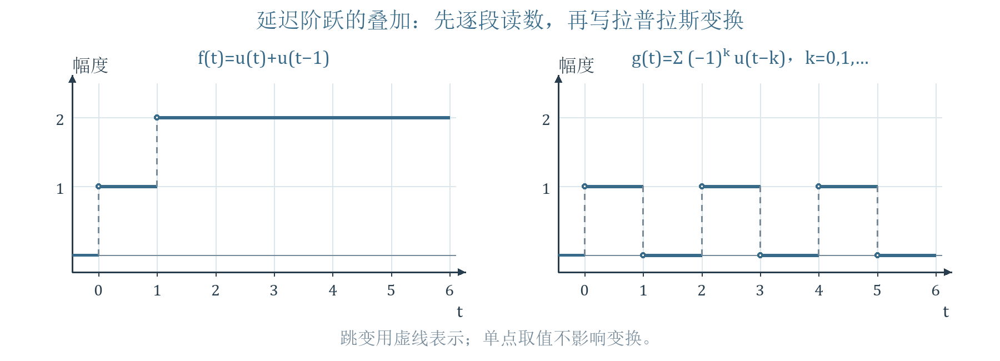{ loading=lazy }
*图 1 依据讲义第 4 页重绘 延迟阶跃叠加与交替矩形波*

读图：左图只增加两次，右图在每个整数秒交替增加 $+1,-1$。右图是 $t\ge0$ 开始的右侧周期延拓；负时间仍为零。跳变点单独取值随 $u(0)$ 约定，不影响变换和区间波形。
## 3 频率响应与正弦稳态从哪里来
资料内容 讲义第 8—9 页。对因果 BIBO 稳定系统，虚轴位于适当的变换存在域内，频率响应为

$$H(j\omega)=H(s)|_{s=j\omega}=|H(j\omega)|e^{j\varphi(\omega)}.$$

$|H|$ 是幅频特性，$\varphi=\arg H$ 是相频特性。系统实系数时 $H(-j\omega)=H^*(j\omega)$，幅值为偶函数、相位可选为奇对称分支。不能把 $|H|$ 与复函数 $H$ 混写。
令输入 $e(t)=E_m\sin(\omega_0t)u(t)$，$E_m$ 为峰值，$\omega_0>0$，则

$$R(s)=\frac{E_m\omega_0H(s)}{(s-j\omega_0)(s+j\omega_0)}.$$

若 $H$ 在 $\pm j\omega_0$ 无极点，输入两极点对应的系数由遮盖法得到

$$a_+=\frac{E_m}{2j}H(j\omega_0),\qquad a_-=-\frac{E_m}{2j}H(-j\omega_0).$$

把 $H(j\omega_0)=H_0e^{j\varphi_0}$ 及共轭关系代入，两项逆变换合并为

$$r_{ss}(t)=\frac{E_mH_0}{2j}\left[e^{j(\omega_0t+\varphi_0)}-e^{-j(\omega_0t+\varphi_0)}\right]=E_mH_0\sin(\omega_0t+\varphi_0).$$

结果解释｜稳态保留输入频率，幅度乘 $H_0$，相位加 $\varphi_0$；输出总响应还含启动瞬态。$t\ge0$ 的分量表达可整体乘 $u(t)$；“稳态”指启动瞬态消退后保留的部分，不表示正弦本身有常数极限。余弦输入同样保持余弦形式。
条件与校核｜上述结论要求系统稳定，才能让自然项衰减。一般 LTI 系统仅有 $h(t)\to0$ 不足以保证 BIBO 稳定，例如 $h=u(t)/(1+t)$ 不绝对可积；本课有限维因果有理系统可用严格左半平面极点判据，并检查适当性。虚轴极点与输入共振时，不能套用有限的同频稳态幅度。
补充计算｜$H=1/(s+2)$、$e=3\sin t\,u(t)$，有 $H(j)=(2-j)/5$，幅度 $1/\sqrt5$、相位 $-\arctan(1/2)$。

$$R=\frac3{(s+2)(s^2+1)}=\frac{3/5}{s+2}-\frac{3/5\,s}{s^2+1}+\frac{6/5}{s^2+1}.$$

$$r(t)=\left[\frac35e^{-2t}-\frac35\cos t+\frac65\sin t\right]u(t).$$

稳态是 $3\sin[t-\arctan(1/2)]/\sqrt5$；初值三项相消为零。这说明直接用 $H(j\omega)$ 只得到稳态，完整启动响应要从 $HE$ 逆变换。
## 4 s 平面几何法与 CR 高通
资料内容 讲义第 11—12 页。已约分的有理式写成 $H(s)=K\prod_j(s-z_j)/\prod_i(s-p_i)$。在观察点 $j\omega$，每个因子都是从零点或极点指向观察点的矢量：

$$j\omega-z_j=N_je^{j\psi_j},\qquad j\omega-p_i=M_ie^{j\theta_i}.$$

复数乘法使模相乘、角相加，除法则模相除、角相减，因此

$$|H(j\omega)|=|K|\frac{\prod_jN_j}{\prod_iM_i},\qquad\varphi(\omega)=\arg K+\sum_j\psi_j-\sum_i\theta_i.$$

角度均相对于正实轴、逆时针为正；用象限正确的 $\operatorname{atan2}$，不要只算斜率反正切。相位可以相差整周，连续曲线通常展开相位。零点落在观察点时幅值为零，该点相位无定义；极点落在观察点时频响可能不存在。

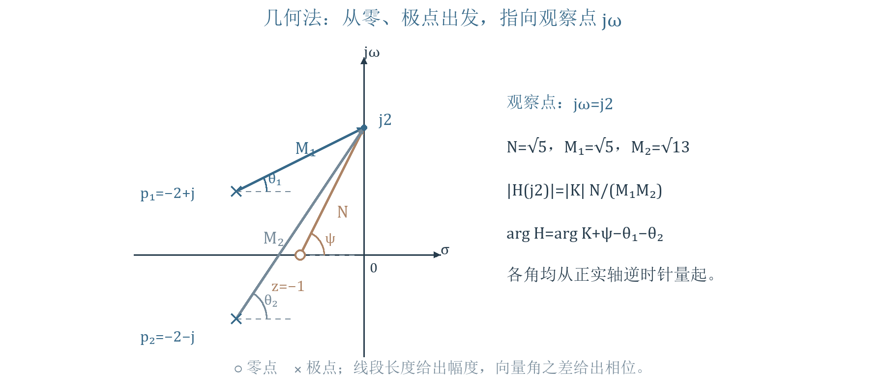{ loading=lazy }
*图 2 依据讲义第 11 页重绘 零极点到观察点的矢量*

读图：从每个叉号或圆圈指向同一个 $j\omega$。先量长度，再按“零点角相加、极点角相减”求相位；移动的是观察点，零极点属于固定系统。
!!! warning "资料校核"
    第 11 页重复的 $\psi_1,\theta_1$ 应为各因子的索引；全部极点角之和都要减去。若 $K$ 为负实数或复数，必须使用 $|K|$ 并加上 $\arg K$。
    CR 电路｜输出取串联电容之后电阻两端，零初始条件下阻抗分压得

    $$H(s)=\frac R{R+1/(sC)}=\frac{s}{s+a},\qquad a=\frac1{RC}>0.$$

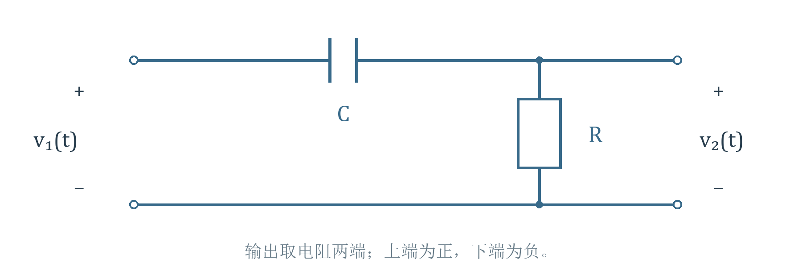{ loading=lazy }
*图 3 教师原图 讲义第 12 页 CR 电路及输入输出参考方向*

有零点 0、极点 $-a$；$\omega>0$ 时 $N=\omega$、$M=\sqrt{a^2+\omega^2}$，零点角为 $\pi/2$，极点角为 $\arctan(\omega/a)$。

$$|H|=\frac\omega{\sqrt{a^2+\omega^2}},\qquad\varphi=\frac\pi2-\arctan\frac\omega a.$$

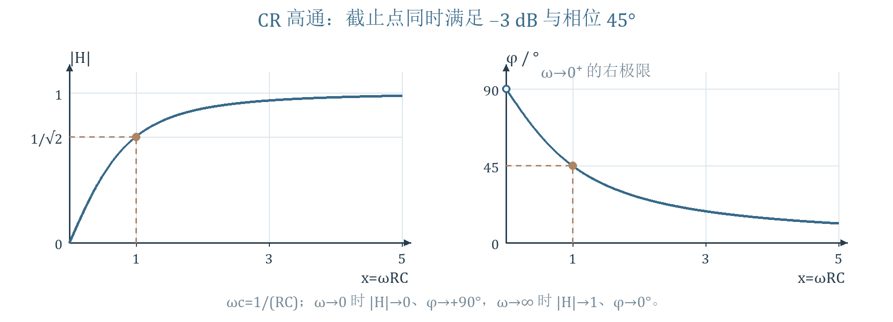{ loading=lazy }
*图 4 依据讲义第 12 页重绘 CR 高通的幅频与相频曲线*

三个核验点：$\omega\to0^+$ 时幅值趋零、相位趋 $90^\circ$；$\omega=a$ 时幅值 $1/\sqrt2$、相位 $45^\circ$；$\omega\to\infty$ 时幅值趋 1、相位趋零。截止频率 $\omega_c=1/(RC)$，对应 $f_c=1/(2\pi RC)$；相对于通带幅值的 $1/\sqrt2$ 约为 $-3.01$ dB。
!!! warning "易错提醒"
    $\omega=0$ 时输出幅值为零，不能说这一点具有确定的 $90^\circ$ 相位；这是右极限。高通只说明低频衰减，不表示所有高频都放大到大于 1。

## 5 滤波器与一二阶系统
资料内容 讲义第 10、13—15 页。滤波器按哪些频率分量较易通过分为低通、高通、带通、带阻。实际曲线有过渡区；截止频率按所用规范定义，不能对所有滤波器都不加条件地套同一个阈值。

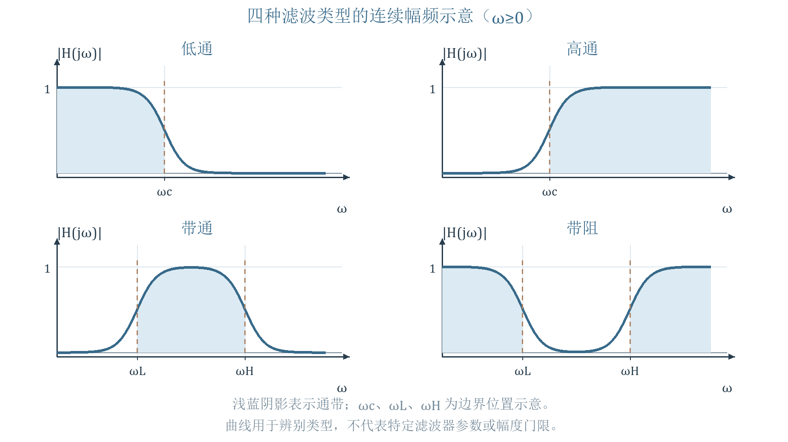{ loading=lazy }
*图 5 依据讲义第 10 页重绘 四类幅频特性示意*

读图：低通靠近零频通过，高通远离零频通过，带通在两界之间通过，带阻在两界之间抑制。图中阴影为主要通带，$\omega_L,\omega_H$ 分别表示下、上边界；边界与曲线只表达滤波形态，具体数值须由所分析系统计算。
一阶典型式｜设稳定极点 $p=-a$，$a>0$，低通为 $K/(s+a)$，高通为 $Ks/(s+a)$；全通可取 $K(s-a)/(s+a)$，其零极点对虚轴镜像。相位还受增益符号影响，第 9 节另算。
补充条件｜对实系数的一阶适当函数 $K(s-z)/(s+a)$，幅值平方为 $K^2(\omega^2+z^2)/(\omega^2+a^2)$，对 $\omega^2$ 的导数符号固定，所以幅频单调或恒定，不能形成有两个转折边界的通常带通、带阻。它还可能是低高频增益不同的搁架形状；“只有一个极点”不等于只有课件列出的三种分子。
二阶典型式｜讲义第 14 页以实负极点 $p_1,p_2$ 的典型 RC／RL 网络为例，分母相同，分子取常数、$s$、$s^2$，分别表现为低通、带通、高通。此处两个同类储能元件的说明有网络假设，不能推广到任意含受控源或任意给定二阶传递函数；RLC 网络还可有共轭复极点。
双实极点带通例｜按第 15 页改用正数 $a\gg b>0$ 表示拐点，$H=Ks/[(s+a)(s+b)]$，实际极点为 $-a,-b$。

$$|H|=\frac{|K|\omega}{\sqrt{(a^2+\omega^2)(b^2+\omega^2)}},\qquad\varphi=\arg K+\frac\pi2-\arctan\frac\omega a-\arctan\frac\omega b.$$

当 $\omega\ll b$，幅值约 $|K|\omega/(ab)$；$b\ll\omega\ll a$ 时约 $|K|/a$；$\omega\gg a$ 时约 $|K|/\omega$。中间能通过、两端衰减，等价于低通与高通级联。分段近似要求频率离拐点足够远。

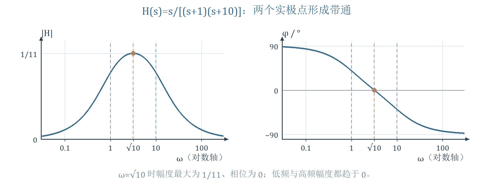{ loading=lazy }
*图 6 依据讲义第 15 页重绘 两个实极点构成的带通*

读图：示例取 $a=10,b=1,K=1$；低频先由原点零点使幅值上升，高频两个极点合起来使幅值下降。精确峰频为 $\omega_p=\sqrt{ab}$，并非两个极点之一；把幅值平方对 $x=\omega^2$ 求导，分子正比于 $a^2b^2-x^2$ 即可得到。
课件级联式 $H=[a/(s+a)]\,[ks/(s+b)]$ 对应 $K=ka$；中频近似增益为 $k$。串接真实电路时须考虑负载，只有模块的传递关系确实可独立级联时才能直接相乘。
## 6 并联 RLC 谐振系统的模型
资料内容 讲义第 16—17 页。电流源激励并联的电导 $G$、电容 $C$、电感 $L$，输出为共同端电压。此处系统函数是转移阻抗，单位为 Ω，并不是无量纲电压增益。

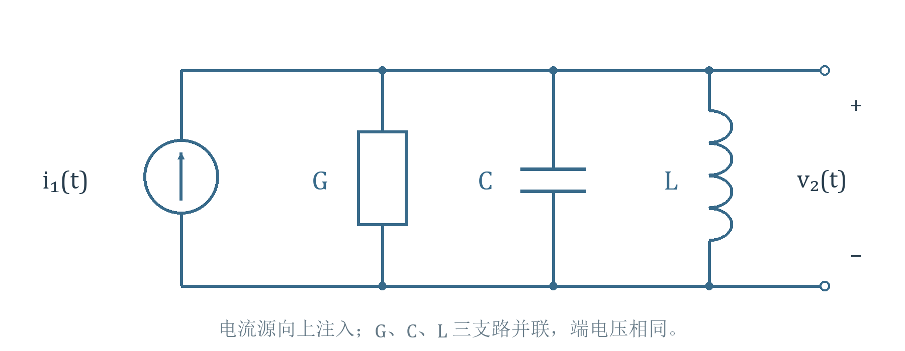{ loading=lazy }
*图 7 教师原图 讲义第 16 页 并联谐振回路*

零初始条件下 KCL 给出 $I_1=[G+sC+1/(sL)]V_2$，于是

$$Z(s)=\frac{V_2}{I_1}=\frac1{G+sC+1/(sL)}=\frac{s/C}{s^2+(G/C)s+1/(LC)}.$$

定义 $\alpha=G/(2C)$、$\omega_0=1/\sqrt{LC}$，均具有每秒的频率量纲；令 $\omega_d=\sqrt{\omega_0^2-\alpha^2}$，后者仅在欠阻尼时取正实数。

$$Z(s)=\frac{s/C}{s^2+2\alpha s+\omega_0^2},\qquad p_{1,2}=-\alpha\pm\sqrt{\alpha^2-\omega_0^2}.$$

欠阻尼时极点写为 $-\alpha\pm j\omega_d$。分子零点在原点，系统还带增益 $1/C$。$\alpha$ 表征损耗，$\omega_0$ 是该并联回路的谐振角频率，$\omega_d$ 是自然衰减振荡频率，两者有区别。
单位与起点核验｜$G$ 单位 S，$C$ 单位 F，$G/C$ 单位 $\mathrm{s}^{-1}$；$LC$ 单位 $\mathrm{s}^2$。单位冲激电流具有单位电荷，给电容造成电压跳变；$\lim_{s\to\infty}sZ(s)=1/C$，因此本例冲激响应的右初值为 $1/C$。
## 7 损耗改变时的极点与自然波形
资料内容 讲义第 18—19 页。固定 $L,C>0$，改变 $G$ 即改变 $\alpha$。欠阻尼极点满足 $|p|^2=\alpha^2+\omega_d^2=\omega_0^2$，所以沿左半圆移动；两极点相遇后再沿负实轴分离。

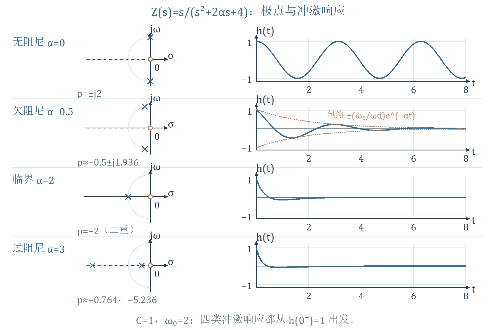{ loading=lazy }
*图 8 依据讲义第 18—19 页校核重绘 极点轨迹与转移阻抗的冲激响应*

读图：示例取 $C=1,\omega_0=2$。圆半径是 $\omega_0$，极点纵坐标是 $\omega_d$，横坐标为 $-\alpha$。时域曲线由本例 $Z(s)$ 精确反演；从初值 1 出发，不是从零出发的纯正弦。
无损时 $\alpha=0$，$p=\pm j\omega_0$，$h_Z=\cos(\omega_0t)u(t)/C$；自然振荡不衰减，但它并非 BIBO 稳定系统。无损回路不会自行从零状态产生非零振荡，须有起始储能或外部激励。
欠阻尼 $0<\alpha<\omega_0$ 时，将分子 $s=(s+\alpha)-\alpha$ 配成变换对：

$$h_Z(t)=\frac1C e^{-\alpha t}\left[\cos(\omega_dt)-\frac\alpha{\omega_d}\sin(\omega_dt)\right]u(t).$$

临界时 $\alpha=\omega_0$，二重极点为 $-\alpha$，分解 $s/(s+\alpha)^2=1/(s+\alpha)-\alpha/(s+\alpha)^2$，得到

$$h_Z(t)=\frac1C(1-\alpha t)e^{-\alpha t}u(t).$$

过阻尼 $\alpha>\omega_0$ 时，两极点 $p_1,p_2$ 都为负实数；无自然正弦振荡，响应为两个实指数的组合：

$$h_Z(t)=\frac{p_1e^{p_1t}-p_2e^{p_2t}}{C(p_1-p_2)}u(t).$$

当 $\alpha\gg\omega_0$，用平方根展开得 $p_1\approx-\omega_0^2/(2\alpha)\to0^-$、$p_2\approx-2\alpha\to-\infty$。原点是极限位置，任何有限的正损耗下两个极点仍严格在左半平面。
若 $\alpha<0$，等效负电导供能，极点进入右半平面，线性模型呈指数增长。实际振荡器最终幅度须由非线性限幅决定，不能由这个线性模型给出有限稳幅。
!!! warning "资料校核"
    第 18 页右侧 $h(t)$ 图若指本例 $Z(s)$，从零起的正弦形状不正确；那类曲线更接近阶跃电流响应 $\mathcal L^{-1}\{Z/s\}=e^{-\alpha t}\sin(\omega_dt)/(C\omega_d)$。图 8 保留极点知识，按指定的输入输出关系重算波形。“不起振”指自然响应无正弦振荡，不等于没有任何受迫频率响应。

## 8 谐振幅频与相频的完整分析
资料内容 讲义第 20—23 页。固定系统、移动观察频率与上一节“改变系统损耗”是两种不同问题。代入 $s=j\omega$ 后，用并联导纳最容易看出幅相：

$$Z(j\omega)=\frac1{G+jB(\omega)},\qquad B(\omega)=\omega C-\frac1{\omega L}\quad(\omega>0).$$

$$|Z(j\omega)|=\frac1{\sqrt{G^2+B^2}}=\frac{\omega/C}{\sqrt{(\omega_0^2-\omega^2)^2+4\alpha^2\omega^2}},\qquad\varphi=-\arctan\frac BG.$$

相位式在 $G>0$ 时处于 $(-90^\circ,90^\circ)$。从导纳可读出：$0<\omega<\omega_0$ 时 $B<0$，阻抗呈感性、相位为正；$\omega=\omega_0$ 时 $B=0$，电感电容电纳抵消；$\omega>\omega_0$ 时 $B>0$，呈容性、相位为负。

$$|Z(j\omega_0)|=\frac1G=\frac1{2C\alpha},\qquad\varphi(\omega_0)=0.$$

因为 $B^2\ge0$ 且在 $\omega_0$ 为零，所以这是 $G>0$ 时的幅值峰，不需要把峰频误认成 $\omega_d$。低频 $|Z|\approx\omega L\to0$、相位趋 $+90^\circ$；高频 $|Z|\approx1/(\omega C)\to0$、相位趋 $-90^\circ$。

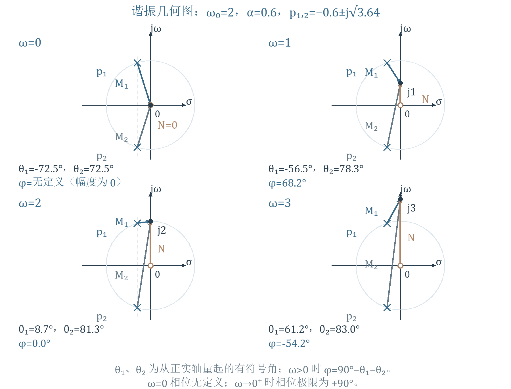{ loading=lazy }
*图 9 依据讲义第 20—22 页重绘 四个观察频率的零极点矢量*

几何核验｜欠阻尼时 $p_{1,2}=-\alpha\pm j\omega_d$，$N=\omega$，$M_{1,2}=\sqrt{\alpha^2+(\omega\mp\omega_d)^2}$；幅值为 $N/(CM_1M_2)$。在 $\omega_0$，$M_1M_2=2\alpha\omega_0$，两极点角之和为 $90^\circ$，与零点角抵消。极点角须按有符号角处理，观察点低于上极点时其矢量角可为负。
!!! warning "资料校核"
    第 20 页“随着 $\omega$ 增加，$M_1$ 减小”只在观察点尚未超过 $\omega_d$ 时成立；$M_1$ 在 $\omega_d$ 最小，随后增大。总幅值的峰仍在 $\omega_0$，不能仅追踪最近极点的距离下结论。第 22 页 $90^\circ$ 的排印不能读成 900 度；$\omega=0$ 的相位仍仅指右极限。

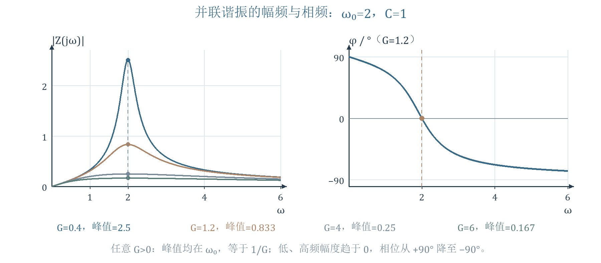{ loading=lazy }
*图 10 依据讲义第 23 页校核重绘 损耗对谐振峰的影响*

读图：$C,\omega_0$ 固定，$G$ 增大时峰高 $1/G$ 降低、曲线变宽；正损耗下幅值都是两端趋零的带通形状。临界和过阻尼也有受迫阻抗峰，虽然自然波形不振荡。$G=0$ 时 $\omega_0$ 处奇异，不能把它画成有限峰并继续套稳定系统的稳态结论。
补充量化｜若用峰值的 $1/\sqrt2$ 定义半功率边界，条件为 $|B|=G$，解得

$$\omega_L=\sqrt{\omega_0^2+\alpha^2}-\alpha,\qquad\omega_H=\sqrt{\omega_0^2+\alpha^2}+\alpha.$$

故 $\Delta\omega=2\alpha=G/C$，$\omega_L\omega_H=\omega_0^2$；品质因数 $Q=\omega_0/\Delta\omega=\omega_0/(2\alpha)$。这些式子专指本节并联转移阻抗，不应照搬成任意二阶低通的峰频公式。
## 9 全通函数及电桥例题
资料内容 讲义第 24—25 页。全通的定义是 $|H(j\omega)|$ 为常数；相位仍可随频率变化。对约分后的稳定、因果、实有理全通函数，极点在左半平面，对应零点是它们关于虚轴的镜像：$z=-p^*$。
原因｜虚轴上的点到一对镜像点等距，因此每一对距离比为 1，只留下常数增益的模。一般可按配对写成 $H_{ap}=K\prod_i(s+p_i^*)/(s-p_i)$，于是 $|H_{ap}(j\omega)|=|K|$。常量系统是无极点的退化情况；纯延迟也有全通幅度，但不属于本节有限阶有理形式。

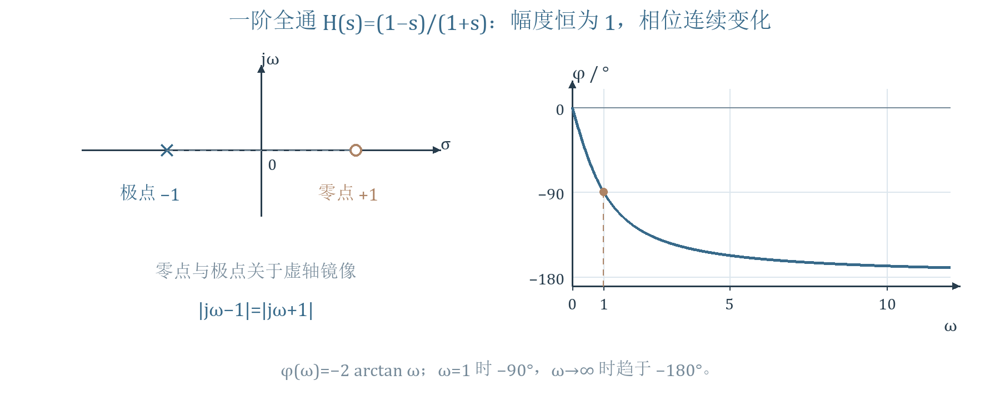{ loading=lazy }
*图 11 依据讲义第 24—25 页重绘 一阶全通的镜像零极点及幅相*

电桥例｜教师给出 LC 格形网络及等效画法。当 $R^2=L/C$、$R,L,C>0$，端口关系化为

$$H(s)=\frac{V_2}{V_1}=\frac{R-sL}{R+sL}=\frac{a-s}{a+s},\qquad a=R/L>0.$$

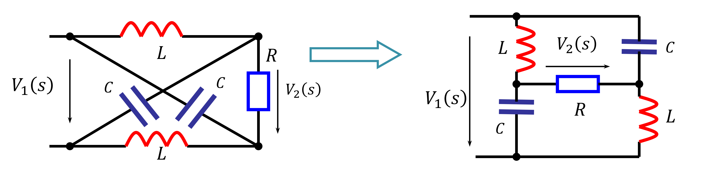{ loading=lazy }
*图 12 教师原图 讲义第 25 页 格形全通网络的两种等效画法*

读图：先认交叉支路与连接节点，交叉线不能都视为接通；左右两图是同一端口关系的不同画法，输出电压方向决定整体符号。给定关系的代数核验是零点 $+R/L$、极点 $-R/L$。
!!! info "补充推导"
    按右图设上端电压 $V_1$、下端为零，左右中点为 $V_A,V_B$，输出 $V_2=V_A-V_B$。记 $Y_L=1/(sL)$、$Y_C=sC$、$Y_R=1/R$，两节点方程为

    $$(Y_L+Y_C+Y_R)V_A-Y_RV_B=Y_LV_1,\qquad -Y_RV_A+(Y_L+Y_C+Y_R)V_B=Y_CV_1.$$

    相减得 $(Y_L+Y_C+2Y_R)(V_A-V_B)=(Y_L-Y_C)V_1$，所以一般传递式为

    $$H=\frac{Y_L-Y_C}{Y_L+Y_C+2Y_R}=\frac{1-LCs^2}{1+2Ls/R+LCs^2}.$$

    匹配条件给出 $LC=L^2/R^2$。令 $q=sL/R$，分式成为 $(1-q^2)/(1+2q+q^2)=(1-q)/(1+q)$，即上面的全通式；不能在未满足匹配条件时直接约成一阶。

    $$|H(j\omega)|=\frac{\sqrt{a^2+\omega^2}}{\sqrt{a^2+\omega^2}}=1,\qquad\varphi(\omega)=-2\arctan(\omega/a).$$

    相位由零频的 0 连续变到高频的 $-180^\circ$，$\omega=a$ 时为 $-90^\circ$。因为 $H(0)=1$、$H(\infty)=-1$，端点也吻合。若改写成 $(s-a)/(s+a)$ 却漏掉前面的负号，幅值不变，相位会整体错 $180^\circ$。
    补充时域｜$H=-1+2a/(s+a)$，所以 $h=-\delta+2ae^{-at}u(t)$。常幅不意味着任意波形都保持形状：不同频率的相位变化不同，会改变多频信号的叠加；全通常用于相位均衡。

## 10 最小相移与全通分解
资料内容 讲义第 26—28 页。相同幅频可以对应不同的零点位置与相频，因为把零点关于虚轴镜像并不改变到虚轴观察点的距离。与稳定极点搭配时，将右半平面零点移至左半平面，可去掉额外的全通相移。
课程口径与条件｜课件把零点在左半平面或虚轴上的网络称最小相移网络。若进一步要求严格意义的因果 BIBO 稳定逆系统，零点也须严格在左半平面；有理系统还须满足逆系统的适当性，双向都适当通常要求分子分母同阶。虚轴零点会使逆系统出现虚轴极点，不能忽略这个边界。
比较相位还需固定增益符号、常数相位与连续展开分支；“最小”指同幅频族中去掉额外非最小相移因素，不能把任意主值角的数值直接比大小。

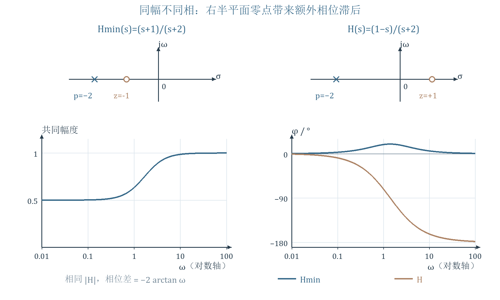{ loading=lazy }
*图 13 依据讲义第 26 页重绘 同幅频系统的不同相频*

读图：补充实例取 $H_{min}=(s+1)/(s+2)$ 与 $H=(1-s)/(s+2)$，极点均为 $-2$，零点分别为 $-1,+1$。两者幅值都是 $\sqrt{1+\omega^2}/\sqrt{4+\omega^2}$；正频率相位分别为 $\arctan\omega-\arctan(\omega/2)$ 与 $-\arctan\omega-\arctan(\omega/2)$，差为 $-2\arctan\omega$。
分解推导｜若一对右半平面零点为 $\sigma_r\pm j\omega_r$、$\sigma_r>0$，先把对应二次因子提出：

$$H(s)=H_1(s)[(s-\sigma_r)^2+\omega_r^2].$$

再乘除镜像因子 $[(s+\sigma_r)^2+\omega_r^2]$，得到

$$H_{min}=H_1[(s+\sigma_r)^2+\omega_r^2],\qquad H_{ap}=\frac{(s-\sigma_r)^2+\omega_r^2}{(s+\sigma_r)^2+\omega_r^2},\qquad H=H_{min}H_{ap}.$$

在 $s=j\omega$ 时，分子分母互为共轭，故 $|H_{ap}|=1$，$|H|=|H_{min}|$，相位相加。若还有其他右半平面零点，须对每个实零点或共轭对重复此操作；只提出一对不能保证剩余 $H_1$ 已无其他右零点。

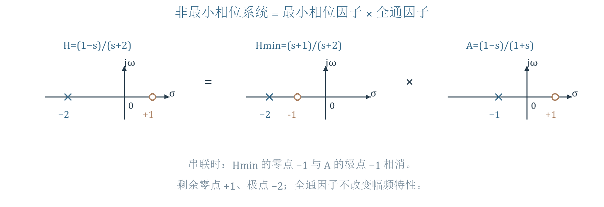{ loading=lazy }
*图 14 依据讲义第 28 页重绘 最小相移与全通级联的零极点相消*

读图：$H=(1-s)/(s+2)=[(s+1)/(s+2)]\,[(1-s)/(s+1)]$。中间左半平面零点 $-1$ 与全通极点 $-1$ 相消，留下原系统的右零点 $+1$。圆圈是零点、叉号是极点；乘起来才能核对原有结构。
## 11 自然模态稳定与外部稳定要区分
资料内容 讲义第 29 页。对本课因果有理系统，考察约分后极点，可先判断端口自然模态：严格左半平面极点给出衰减项；若存在右半平面极点，或虚轴二重及更高极点，可出现无界响应包络；只含简单虚轴极点且其余严格在左半平面时，模态有界但不衰减，课件称临界稳定。
!!! warning "资料校核"
    无界振荡不一定满足普通极限 $\lim h(t)=+\infty$，应说响应或其包络无界。单个响应恰好相消某模态，也不能据此断言系统对所有输入稳定。
    系统稳定性是对一类输入或初始状态的性质，不取决于本次是否碰巧选了零输入。输入输出稳定性通常从零状态考察；内部稳定性还取决于实现和隐藏模态。传递函数中相消的极点可能对应未显示的内部运动，不能由一个端口的 $H$ 判定所有状态。
    补充 ROC 条件｜双边情形下，单看代数极点不够，还须知道 ROC；绝对可积的冲激响应要求虚轴在相应存在域内。只有加上因果、有理、适当等本课假设，才可简化为“约分后的极点全在严格左半平面”。本课不另行展开双边反演。

## 12 BIBO 判据及证明
资料内容 讲义第 30—32 页。BIBO 稳定是：任意有界输入都产生有界零状态输出。若 $|e(t)|\le M_e<\infty$，应存在有限的系统增益界使输出也处处有界；看到某一个有界输出还不能证明系统稳定。
普通冲激响应函数的充要条件为

$$\int_{-\infty}^{\infty}|h(\tau)|d\tau<\infty.$$

因果系统可把积分下限改为 $0$。必须积绝对值；正负抵消后积分有限不够。
充分性｜由卷积、三角不等式和输入界逐步得到

$$|r(t)|=\left|\int h(\tau)e(t-\tau)d\tau\right|\le\int|h(\tau)|\,|e(t-\tau)|d\tau\le M_e\int|h(\tau)|d\tau.$$

右边与 $t$ 无关且有限，即给出所有时刻的输出上界。它还说明 $\int|h|$ 是一个可用的最坏情况增益界。
必要性｜按课件实信号口径，若 $\int|h|=\infty$，选有界输入 $e(t)=\operatorname{sgn}[h(-t)]$；当 $h(-t)=0$ 时取 0。于是

$$r(0)=\int h(\tau)e(-\tau)d\tau=\int|h(\tau)|d\tau,$$

无法得到有限输出，与对每个有界输入都必须有界矛盾。这是反向配符号的构造；不应把 $h(t)$ 与 $h(-t)$ 的位置写反。这里证明采用允许任意有界时间信号的定义；普通卷积存在条件按上述判据理解。
直接传递的补充｜高通和全通可有 $h=D\delta+g$。冲激不是普通函数，不能机械地算普通积分 $\int|\delta|$；可直接写 $r=De+g*e$，若 $D$ 有限且 $g$ 绝对可积，就有 $|r|\le(|D|+\int|g|)M_e$。例如第 9 节全通虽含 $-\delta$ 仍稳定。
有理判据的完整条件｜对约分后的因果有理系统，分子次数不高于分母且全部极点严格在左半平面，即可判为 BIBO 稳定。次数更高会出现微分器：$H=s$ 虽无有限极点，但对有界 $e=\sin(t^2)$ 输出 $2t\cos(t^2)$ 无界，所以“无右半平面极点”本身不够。
课件例题｜$H=1/s$、$e=u(t)$，则 $R=1/s^2$，$r=tu(t)$。输入有界而输出无界，故非 BIBO 稳定；按自然模态只是临界稳定。类似地，$H=1/(s^2+1)$ 对 $e=\sin t\,u(t)$ 的输出为 $(\sin t-t\cos t)u(t)/2$，共振造成增长，等幅冲激响应并不保证 BIBO。
## 13 负反馈如何移动极点
资料例题 讲义第 33—34 页。前向 $G(s)=1/[(s-1)(s+2)]$，反馈增益 $K\ge0$，在求和点作负反馈。这里 $G(s)$ 是前向传递函数，勿与前面电导 $G$ 混淆。

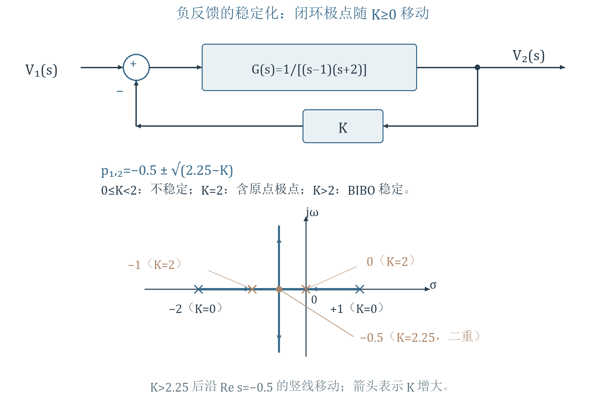{ loading=lazy }
*图 15 依据讲义第 33—34 页重绘 负反馈框图与闭环极点轨迹*

第一步，先根据箭头和负号列方程 $V_2=G(V_1-KV_2)$；把输出项移到左边，得

$$H(s)=\frac{V_2}{V_1}=\frac G{1+KG}=\frac1{(s-1)(s+2)+K}=\frac1{s^2+s+K-2}.$$

第二步，用求根公式或配方求极点：

$$p_{1,2}=-\frac12\pm\sqrt{\frac94-K}.$$

| 反馈增益 K | 闭环极点 | 稳定性 |
|---|---|---|
| 0 | $-2,+1$ | 不稳定 |
| $0<K<2$ | 一正一负实极点 | 不稳定 |
| 2 | $-1,0$ | 自然模态临界 非 BIBO |
| $2<K<9/4$ | 两个严格负实极点 | BIBO 稳定 |
| $9/4$ | $-1/2$ 二重极点 | BIBO 稳定 |
| $K>9/4$ | $-1/2\pm j\sqrt{K-9/4}$ | BIBO 稳定 |

读图：从开环的 $-2,+1$ 出发，两根沿实轴靠近，在 $K=9/4$ 合为 $-1/2$ 二重根，再沿 $\operatorname{Re}s=-1/2$ 上下分开。$K>2$ 才全部进入左半平面；“重根”若在左半平面，仍可稳定。
第三步，核验边界。$K=2$ 时 $H=1/[s(s+1)]$；对单位阶跃，

$$R=\frac1{s^2(s+1)}=\frac1{s^2}-\frac1s+\frac1{s+1},\qquad r=(t-1+e^{-t})u(t).$$

所以 $K=2$ 只是模态临界，不是 BIBO 稳定。还可用两根之和 $-1$、乘积 $K-2$ 核验：$K<2$ 乘积负，必有一正根；$2<K<9/4$ 两实根和负积正，均为负；更大时共轭根实部固定为负。
## 14 带初始条件的三类响应综合题
资料例题 讲义第 36—40 页。给定 $y''+3y'+2y=4x'+3x$，$y(0^-)=-2$、$y'(0^-)=3$，$x=u(t)$。求零输入、零状态及全响应。$x(0^-)=0$，因此 $x'$ 包含单位冲激。
第一步，单边微分性质来自分部积分，带入动作前的初值：

$$\mathcal L\{y'\}=sY-y(0^-),\qquad\mathcal L\{y''\}=s^2Y-sy(0^-)-y'(0^-).$$

$$[s^2+3s+2]Y=[4s+3]X+s\,y(0^-)+y'(0^-)+3y(0^-).$$

分母 $(s+1)(s+2)$ 保持相同；由初始状态产生的部分与输入产生的部分分别为

$$Y_{zi}=\frac{-2s-3}{(s+1)(s+2)},\qquad Y_{zs}=\frac{4s+3}{(s+1)(s+2)}\frac1s.$$

第二步，求零输入。设 $Y_{zi}=A/(s+1)+B/(s+2)$，遮盖得 $A=-1,B=-1$，故

$$y_{zi}(t)=(-e^{-t}-e^{-2t})u(t).$$

右初值 $-2$、右导数初值 $1+2=3$，与这部分的初始条件相符。这里乘 $u(t)$ 是表示零时刻后的波形，不能据此把真实动作前初始储能误当作零。
第三步，求零状态。$Y_{zs}=A/s+B/(s+1)+C/(s+2)$，分别代 $s=0,-1,-2$：

$$A=\frac32,\qquad B=\frac{-1}{(-1)\cdot1}=1,\qquad C=\frac{-5}{(-2)(-1)}=-\frac52.$$

$$y_{zs}(t)=\left(\frac32+e^{-t}-\frac52e^{-2t}\right)u(t).$$

零状态的动作前初值为零，右初值仍为零，但右导数为 $-1+5=4$。系统函数 $H=(4s+3)/[(s+1)(s+2)]=-1/(s+1)+5/(s+2)$，所以 $h=(-e^{-t}+5e^{-2t})u(t)$；对阶跃输入，$y_{zs}=\int_0^t h(\tau)d\tau$，也能得到同一式。
第四步，相加并整理：

$$y(t)=y_{zi}+y_{zs}=\left(\frac32-\frac72e^{-2t}\right)u(t).$$

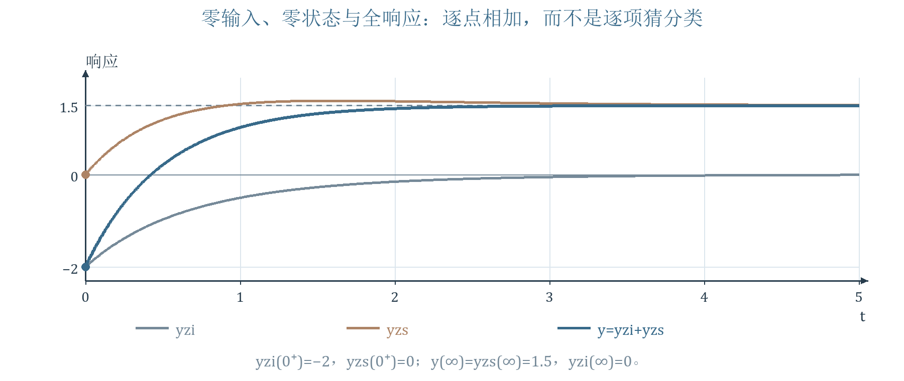{ loading=lazy }
*图 16 依据讲义第 36—40 页补充绘制 零输入 零状态与全响应*

读图：零输入从 $-2$ 衰减到 0；零状态从 0 到 $3/2$；全响应从 $-2$ 到 $3/2$。本组初始状态使两部分的 $e^{-t}$ 项相消，这并非系统函数中 $-1$ 极点被零点相消。
关键核验一｜$y(0^+)=-2$ 连续，$y'(0^+)=7$，与 $y'(0^-)=3$ 不相等。对原方程跨过零时刻积分：若 $y$ 跳变，$y''$ 会有右侧没有的 $\delta'$，故 $\Delta y=0$；再比较 $\delta$ 权重，$\Delta y'+3\Delta y=4\Delta x=4$，所以 $\Delta y'=4$。不要强制把两个初始时刻混用。
关键核验二｜在 $t>0$，$x'=0$，代 $y=3/2-(7/2)e^{-2t}$ 得 $y''+3y'+2y=3$，与右边 $3x=3$ 一致。$\lim y=3/2$；约分后的 $sY$ 极点在 $-2$，终值定理可用。
分类核验｜全响应的 $-(7/2)e^{-2t}$ 为自由／瞬态项，常数 $3/2$ 为强迫／稳态项；零输入和零状态则按“初始状态或输入”划分。零状态中也含自由模态，不应把它全称为强迫响应。
## 15 易错提醒与自测详解
!!! warning "易错提醒"
    用 $H(j\omega)$ 前检查稳定和存在条件；幅值是模，复数和相位都认象限；零频零幅值处不能硬给相位；$\omega_0$ 与 $\omega_d$ 分开；全通保幅仍会变相；最小相移的虚轴边界和稳定逆另检查；虚轴简单极点不满足 BIBO；闭环重根要看位置；含输入导数时检查 $0^-\to0^+$ 的跳变。

### 自测
1．求 $F=(2+3e^{-2s})/s$ 的逆变换并画关键区间；它是否为周期波？
2．$H=2/(s+3)$，输入 $4\cos2t\,u(t)$，求稳态幅度与相位，再写完整零状态响应。
3．CR 高通取 $R=2\ \Omega,C=1/4\ \mathrm F$，求角截止频率、Hz 截止频率及 $\omega=2$ 的幅相；说明零频相位。
4．$H=-2(s+1)/[(s+2)(s+3)]$，用零极点几何公式求 $\omega=1$ 时幅度和主值相位，说明负增益的影响。
5．$H=s/[(s+9)(s+1)]$ 的精确峰频和峰值是多少？两个极点均为实数，为什么仍能带通？
6．并联回路 $L=1,C=1/4,G=1/2$，求 $\alpha,\omega_0,\omega_d$、极点、谐振峰值和 $h_Z(0^+)$；写冲激响应。
7．保持上一题 $L,C$，取 $G=1$ 和 $G=2$，分别判断阻尼类型；是否还存在受迫阻抗峰？
8．$H=(2-s)/(2+s)$，求幅相与冲激响应；它为什么是稳定全通？
9．将 $H=(1-s)/(s+4)$ 分为一个最小相移因子和一个单位模全通因子，核对 DC 增益与相位。
10．判断 $1/(s+1)^2$、$1/s$、$1/(s^2+4)$、$s$ 的因果系统是否 BIBO 稳定，各给理由。
11．第 13 节取 $K=9/4$，写 $h(t)$；取 $K=2$ 时用有界输入证明它非 BIBO 稳定。
12．第 14 节方程及输入相同，改为 $y(0^-)=1,y'(0^-)=0$，求三类响应、$y(0^+)$ 与 $y'(0^+)$。
### 答案与关键步骤
1．延迟性质给 $f=2u(t)+3u(t-2)$，负时间 0，$0<t<2$ 为 2，$t>2$ 为 5；只发生有限次跳变，不能按非零周期无限重复。
2．$H(j2)=2/(3+2j)$，稳态为 $8\cos[2t-\arctan(2/3)]/\sqrt{13}$，幅度约 2.219、相位约 $-33.69^\circ$。$R=8s/[(s+3)(s^2+4)]$ 分解为 $(-24/13)/(s+3)+(24s/13+32/13)/(s^2+4)$；逆变换为 $[-24e^{-3t}/13+24\cos2t/13+16\sin2t/13]u(t)$，起点相消为零。
3．$RC=1/2$ 秒，$\omega_c=2$ rad/s、$f_c=1/\pi$ Hz。$\omega=2$ 时 $|H|=1/\sqrt2$、相位 $45^\circ$；零频幅值为零，相位无定义，正频右极限为 $90^\circ$。
4．零点 $-1$，极点 $-2,-3$，距离分别 $\sqrt2,\sqrt5,\sqrt{10}$，故幅度 $2\sqrt2/\sqrt{50}=2/5$。相位 $180^\circ+45^\circ-\arctan(1/2)-\arctan(1/3)=180^\circ$，因为后两个角之和正好 $45^\circ$；主值也可取 $-180^\circ$。直接代入 $H(j)=-2/5$ 可核验，不能漏掉 $\arg(-2)$。
5．$a=9,b=1$，$\omega_p=\sqrt{ab}=3$ rad/s；代入幅值为 $3/\sqrt{(81+9)(1+9)}=1/10$。低频原点零点抑制 DC，高频两个极点给出净下降；时域不振荡和频域能带通是两回事。
6．$\alpha=G/(2C)=1$，$\omega_0=2$、$\omega_d=\sqrt3$，极点 $-1\pm j\sqrt3$；$Z(j2)=1/G=2\ \Omega$。$h_Z(0^+)=1/C=4$，且 $h_Z=4e^{-t}[\cos(\sqrt3t)-\sin(\sqrt3t)/\sqrt3]u(t)$。用初值定理与 $G+sC+1/(sL)$ 可分别核验。
7．$G=1$ 时 $\alpha=2=\omega_0$，临界；$G=2$ 时 $\alpha=4>\omega_0$，过阻尼。两者 $G>0$，幅值仍在 $\omega=2$ 达到 $1/G$，分别为 1 Ω 与 $1/2$ Ω；只是自然波形不呈正弦振荡。
8．极点 $-2$、零点 $+2$，$|H|=1$，$\varphi=-2\arctan(\omega/2)$；$H=-1+4/(s+2)$，所以 $h=-\delta+4e^{-2t}u(t)$。稳定性由有限直接传递和可积尾项保证；右半平面零点不使原系统的极点不稳定，但会影响逆系统。
9．$H_{min}=(s+1)/(s+4)$，$H_{ap}=(1-s)/(s+1)$，相乘还原。两者 DC 增益分别 $1/4$、1，故原系统 DC 增益 $1/4$；额外相位为 $-2\arctan\omega$，幅值不变。若选 $(s-1)/(s+1)$，必须相应补整体负号。
10．第一式 $h=te^{-t}u(t)$ 绝对可积，稳定；第二式单位阶跃产生斜坡，非 BIBO；第三式在共振输入下可出现线性增长，非 BIBO；第四式是微分器，对有界 $\sin(t^2)$ 的输出无界。第 2、3 式含虚轴简单极点，可称模态临界，但均非 BIBO 稳定。
11．$K=9/4$ 时 $H=1/(s+1/2)^2$，$h=te^{-t/2}u(t)$，二重极点仍在左半平面，稳定。$K=2$ 对 $e=u(t)$ 输出 $(t-1+e^{-t})u(t)$ 无界，故不满足 BIBO。
12．初始项为 $s+3$，$Y_{zi}=(s+3)/[(s+1)(s+2)]=2/(s+1)-1/(s+2)$；$y_{zi}=(2e^{-t}-e^{-2t})u(t)$。零状态不受本次初始条件改变，仍为 $[3/2+e^{-t}-(5/2)e^{-2t}]u(t)$。全响应为 $[3/2+3e^{-t}-(7/2)e^{-2t}]u(t)$；$y(0^+)=1$、$y'(0^+)=-3+7=4$，正好比动作前导数增加 4。
## 16 复习作业与资料索引
资料内容 讲义第 41 页：教材 4-32；4-38（a、c）、4-39（f）；4-45、4-47。预／复习第 4.12—4.13 节及第 3 章傅里叶变换。教材题面以教材为准，本笔记自测是补充练习，不能代替这些作业。
复习建议｜先把同一个 $H$ 的极点图、冲激响应、幅频和相频连起来；再练全通分解与稳定性反例；最后独立重做综合题，逐项检查 $0^-$、$0^+$ 和原点冲激。含有频率的题先统一 Hz 与 rad/s，含有增益的题先分清幅度、复数值与相位。
资料来源｜高河伟《信号与系统 第 4 章 拉普拉斯变换 连续时间系统的 s 域分析 III》，本次 PDF 共 42 页，封面标注 2025 年秋季学期；配套录音为“10月20日 信号处理与考试指导.m4a”。第 42 页注明课件基于邢宇翔、赵自然老师原讲稿修改，并参考其他教师课件。文中页码均指本次 PDF；教师原图保留原字体和颜色，重绘图与新增说明遵循本笔记样式。

| 讲义页码 | 知识 例题 与教学图 | 笔记位置 |
|---|---|---|
| 1—2 | 课程位置与本章路线 | 1、16 |
| 3 | 逆变换 系统函数及电路复习 | 1 |
| 4 | 三道逆变换及两道延迟波形题 | 2 图 1 |
| 5—7 | 系统函数 模态与响应极点来源 | 1 |
| 8—9 | 正弦稳态推导 幅频与相频 | 3 |
| 10 | 低通高通带通带阻曲线 | 5 图 5 |
| 11 | 零极点矢量法 乘积模与角 | 4 图 2 |
| 12 | CR 电路与幅相三个核验点 | 4 图 3—4 |
| 13—14 | 一阶与双实极点二阶滤波器 | 5 |
| 15 | 双实极点带通 几何与级联 | 5 图 6 |
| 16—17 | 并联谐振模型 参数与极点 | 6 图 7 |
| 18—19 | 损耗变化 极点轨迹 自然波形 | 7 图 8 |
| 20—22 | 频率移动 四个矢量位置 | 8 图 9 |
| 23 | 谐振幅频和相频曲线 | 8 图 10 |
| 24—25 | 全通镜像 电桥两种画法与推导 | 9 图 11—12 |
| 26 | 同幅频的最小相移比较 | 10 图 13 |
| 27—28 | 全通分解 级联与零极点相消 | 10 图 14 |
| 29 | 自然模态稳定与临界情形 | 11 |
| 30—31 | BIBO 定义 绝对可积充要证明 | 12 |
| 32 | 判据 积分器的反例 | 12 |
| 33—34 | 反馈框图 根轨迹 K 区间 | 13 图 15 |
| 35 | 拉氏变换作用与方法总结 | 1、14、16 |
| 36—40 | 零输入零状态全响应综合例题 | 14 图 16 |
| 41—42 | 课程小结 作业预复习 资料来源 | 16 |

