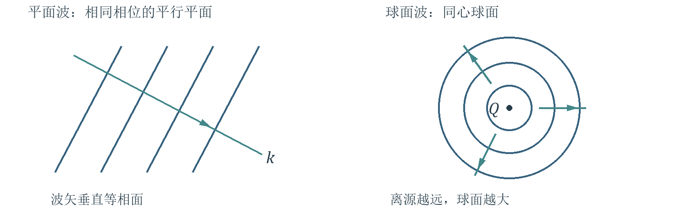
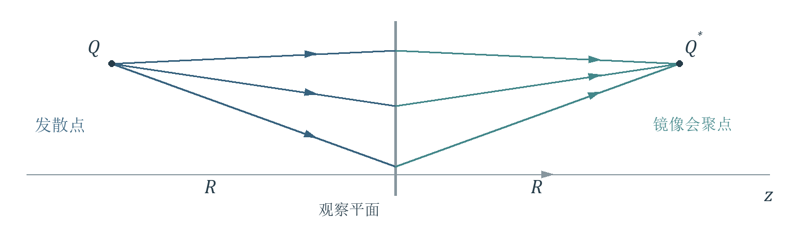
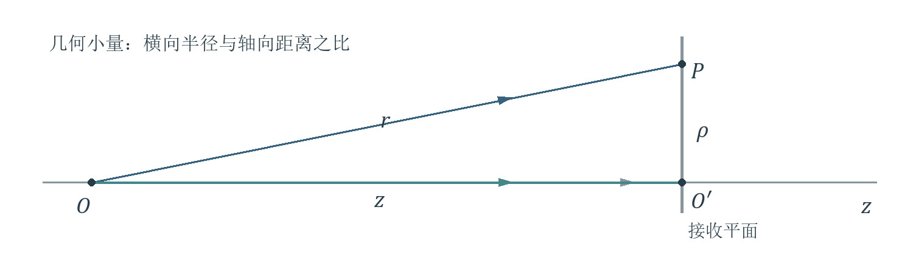
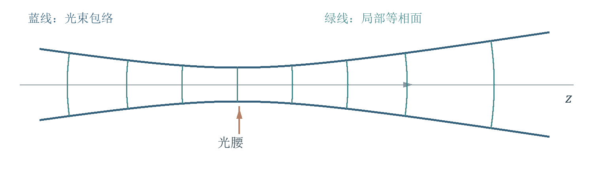
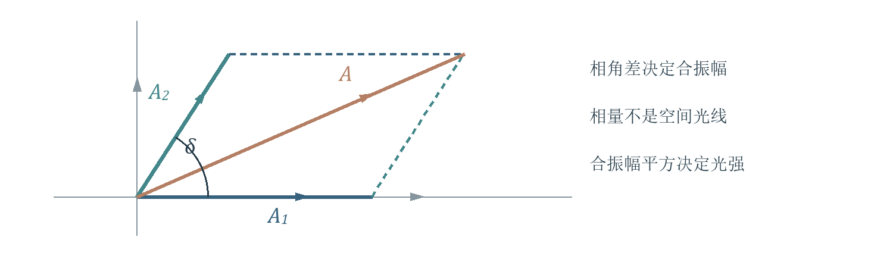
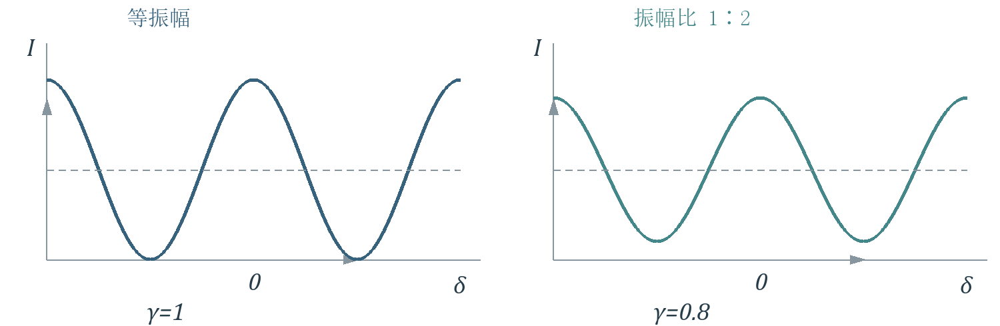
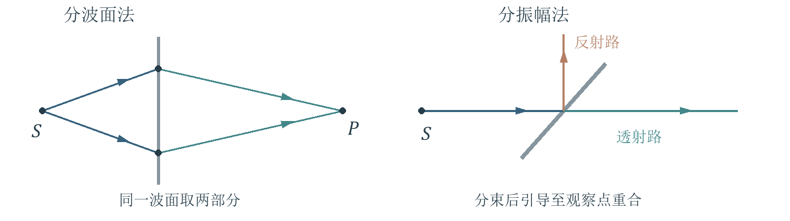
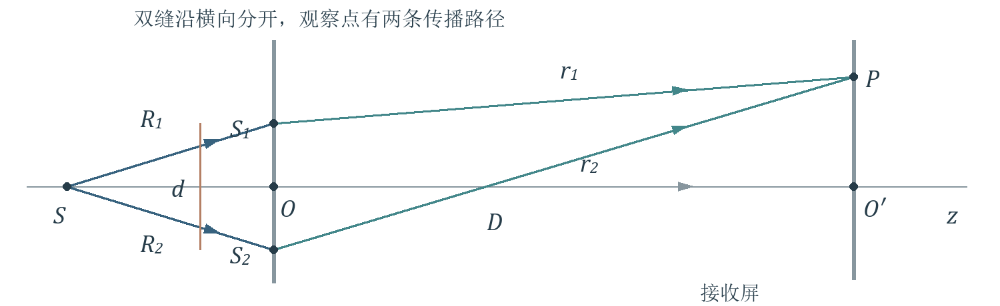
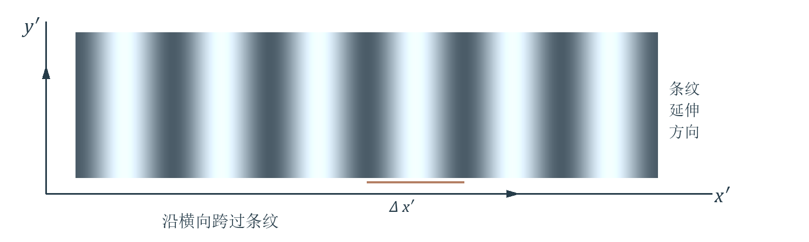
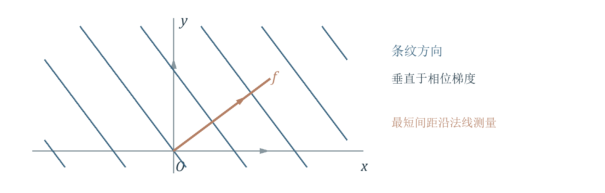

# 第2讲 波动光学基本原理（一）

!!! tip "本讲配套文件"
    - [PDF 在线阅读（基础物理学2_第2讲_波动光学基本原理（一）_学习讲义.pdf）](../文件/基础物理学2_第2讲_波动光学基本原理（一）_学习讲义.pdf)
    - [Word 下载（基础物理学2_第2讲_波动光学基本原理（一）_学习讲义.docx）](../文件/基础物理学2_第2讲_波动光学基本原理（一）_学习讲义.docx)
    - [知识点总结 PDF（基础物理学2_第2讲_波动光学基本原理（一）_知识点总结.pdf）](../文件/基础物理学2_第2讲_波动光学基本原理（一）_知识点总结.pdf)
    - [知识点总结 Word（基础物理学2_第2讲_波动光学基本原理（一）_知识点总结.docx）](../文件/基础物理学2_第2讲_波动光学基本原理（一）_知识点总结.docx)

## 本讲知识地图

> **资料范围**：课件 PDF 第 1—45 页　教材第二章 §1—§4

### 本讲解决什么问题
PPT重点先用复振幅把光波的振幅和相位放进同一个数学对象，再研究某一平面上的波前分布，最后由两波的相位差得到可观察的干涉条纹。
定态光波 → 复振幅 → 波前函数 → 傍轴与远场近似 → 相干叠加 → 两点源与两平面波干涉。
### 三条贯穿全讲的关系

$$U(P,t)=\operatorname{Re}[\tilde U(P)e^{-i\omega t}],\quad \tilde U(P)=A(P)e^{i\varphi(P)}$$

$$I=|\tilde U|^2,\quad I=I_1+I_2+2\sqrt{I_1I_2}\cos\delta$$

$$\Delta x'=\frac{D\lambda}{d},\quad f_x=\frac{\sin\theta_1-\sin\theta_2}{\lambda}$$

第一式固定本课程的时间符号约定；第二组说明“先叠加振幅，再求强度”；第三组把相位的空间变化转化为条纹间距。公式均须和相应条件一起使用。
### 阅读导航
第 3—7 页：定态波、复振幅、平面波与球面波，以及波前共轭。
第 8—13 页：轴上与轴外点源，傍轴和远场近似，高斯光束简介。
第 14—18 页：叠加、相干条件、光源、对比度与两点源干涉。
第 19—23 页：杨氏双缝、两束平行光与课堂计算题。
第 24—25 页：公式速查；第 26 页：易错清单；第 27—28 页：自测与答案；第 29 页：课件校读与来源索引。
### 与第一讲的联系
理解补充第一讲用光线和光程描述传播；本讲给光程配上相位，使“多条光路到同一点”成为可以计算的振幅叠加问题。明暗不是由光路是否存在决定，而是由到达波之间的相位关系决定。
!本讲只覆盖课件中的 §2.1—§2.4。高斯光束按“介绍”处理；衍射和偏振的后续章节不在本讲展开。

## 定态光波与复振幅

> **资料范围**：课件 PDF 第 2、5、9 页　教材印刷页 105—108

### 定态不等于静止
PPT重点定态波场中，各点做同频率的简谐振动；振幅及各点之间的相位关系形成稳定的空间分布。标量波写为

$$U(P,t)=A(P)\cos[\omega t-\varphi(P)]$$

场点为 $P$，$A(P)$ 为非负振幅，$\omega$ 为角频率。$A(P)$ 与 $\varphi(P)$ 不随时间变，但真实扰动仍随 $t$ 周期振荡。
教材补充严格单色定态波是无限长波列的理想化。实际波列有限长，在波列持续时间远大于振动周期、且暂不研究相干性细节时，可以近似按定态波处理。
### 固定本课程的符号约定
PPT重点采用时间因子 $e^{-i\omega t}$：

$$\tilde U(P,t)=A(P)e^{i\varphi(P)}e^{-i\omega t}=\tilde U(P)e^{-i\omega t}$$

$$\tilde U(P)=A(P)e^{i\varphi(P)},\quad U(P,t)=\operatorname{Re}[\tilde U(P)e^{-i\omega t}]$$

复振幅的模给出振幅，辐角给出空间相位；省去共同时间因子，是为了集中研究空间分布，并非令时间为零。
教材补充教材在此约定下把真实余弦中 $t=0$ 的初相位写成 $-\varphi(P)$。读到“初相位”时，应检查它指余弦中的初相位还是复振幅的辐角。
### 由复振幅得到光强
PPT重点只比较同介质内相对强度时，采用归一化记法：

$$I(P)=A^2(P)=|\tilde U(P)|^2=\tilde U(P)\tilde U^*(P)$$

星号表示复共轭。若 $\tilde U=Ae^{i\varphi}$，则 $\tilde U^*=Ae^{-i\varphi}$。相乘后相位消去，但相位在多波叠加时仍决定干涉。
!物理光强的比例系数与场量和介质有关。本讲的 $I=A^2$ 已吸收该系数，不能直接把任意电场数值的平方当作国际单位制光强。

## 平面波与波矢

> **资料范围**：课件 PDF 第 3、6、8 页　教材印刷页 106—108

### 识别平面波的两个条件
PPT重点均匀介质中的理想平面波，振幅为常数，空间相位为坐标的线性函数：

$$\tilde U(\vec r)=A\exp[i(\vec k\cdot\vec r+\varphi_0)]$$

$$\vec k=k_x\hat x+k_y\hat y+k_z\hat z,\quad k=|\vec k|=\frac{2\pi}{\lambda}$$

这里 $\lambda$ 是介质中的波长。等相面 $\vec k\cdot\vec r=\mathrm{constant}$ 是以 $\vec k$ 为法线的平面；波沿 $\vec k$ 方向传播。

{ loading=lazy }
*图 1 平面波的等相面彼此平行；球面波的等相面以点源为中心。箭头表示传播方向。*

### 课堂例题 2.1.1 从相位反推方向和波长
PPT重点已知 $\varphi(P)=lx+my+nz+p$。在本题平面波模型下，对照线性相位系数，而不是对相位取模：

$$\vec k=l\hat x+m\hat y+n\hat z,\quad k=\sqrt{l^2+m^2+n^2}$$

$$\cos\alpha=\frac{l}{k},\quad\cos\beta=\frac{m}{k},\quad\cos\gamma=\frac{n}{k},\quad\lambda=\frac{2\pi}{k}$$

$l,m,n$ 的量纲为长度的倒数；本题的 $n$ 是相位系数，不是折射率。常数 $p$ 只改变整体相位，不改变传播方向和波长。
教材补充给定频率和介质后，$k$ 已确定，三个波矢分量不能任意独立取值，必须满足 $k_x^2+k_y^2+k_z^2=k^2$。
!只见线性相位还应检查振幅是否均匀；振幅随横向变化时，不能直接称为无限均匀平面波。

## 球面波的发散 会聚与强度

> **资料范围**：课件 PDF 第 4、7、9 页　教材印刷页 106—109

### 发散球面波
PPT重点点源位于 $Q(x_0,y_0,z_0)$，场点 $P(x,y,z)$ 到源的距离为

$$r=\sqrt{(x-x_0)^2+(y-y_0)^2+(z-z_0)^2}$$

$$\tilde U(P)=\frac{a}{r}\exp[i(kr+\varphi_0)]$$

取 $a$ 为实常量，源的相位单独写入 $\varphi_0$。等相面是同心球面；实际振动为 $a\cos(\omega t-kr-\varphi_0)/r$。
理解补充沿同一相位点追踪，有 $kr-\omega t=\mathrm{constant}$，所以 $dr/dt=\omega/k>0$，可直接判断它向外传播。
### 回答课件问题 向同一点会聚怎样写
PPT重点 问题保持时间因子 $e^{-i\omega t}$ 不变，改为负的径向空间相位：

$$\tilde U_{\mathrm{in}}(P)=\frac{a}{r}\exp[i(-kr+\varphi_c)]$$

此时 $-kr-\omega t=\mathrm{constant}$，故 $dr/dt=-\omega/k$，表示朝球心会聚。$\varphi_c$ 是任意常相位。
### 振幅为何按距离的倒数衰减
教材补充在无吸收、各向同性且向各方向均匀辐射的模型中，穿过同心球面的总功率相同；球面积随 $r^2$ 增大，因此

$$I(r)\propto\frac{1}{r^2},\quad A(r)\propto\frac{1}{r}$$

不要把“振幅减半”和“光强减半”混淆：距离加倍，振幅变为原来一半，光强变为原来四分之一。
!点源理想式在 $r=0$ 处奇异；不应用它计算真实光源内部或会聚焦点处的无限光强。

## 波前与倾斜平面波的共轭

> **资料范围**：课件 PDF 第 10—12 页　教材印刷页 109—110

### 本讲的波前是一个取样曲面
PPT重点通常“波前”指等相面；本讲按教材的较宽含义，也指记录介质、屏幕、透镜前后等选定曲面。波前函数是在该曲面上取出的复振幅分布。因此，$z=0$ 波前上不一定处处同相。
### 课堂例题 2.2.1 写出倾斜入射波前
PPT重点光沿 $+z$ 一侧传播，传播方向在 $x-z$ 平面内，与 $z$ 轴成有向角 $\theta$，原点处空间相位为零：

$$k_x=k\sin\theta,\quad k_y=0,\quad k_z=k\cos\theta$$

$$\tilde U(x,y,z)=A\exp[ik(x\sin\theta+z\cos\theta)]$$

令 $z=0$，得到 $\tilde U(x,y)=A\exp(ikx\sin\theta)$。倾角越大，沿 $x$ 的相位变化越快；与 $y$ 无关。

{ loading=lazy }
*图 2 在同向通过观察平面的约定下，波前共轭使横向波矢反号，倾角由正变负。*

### 课堂例题 2.2.2 共轭后为何是负倾角
PPT重点$A$ 为实振幅，波前共轭为

$$\tilde U^*(x,y)=A\exp(-ikx\sin\theta)=A\exp[ikx\sin(-\theta)]$$

教材补充教材脚注约定波从波前同一侧到来，即仍选 $k_z>0$，所以 $k_x$ 反号、$k_z$ 不变，得到 $\theta'=-\theta$。
!若共轭的是完整三维函数 $\tilde U(x,y,z)$，则所有空间相位系数都反号，波矢成为 $-\vec k$。这与只给定一个平面的共轭分布、再指定向前传播，是不同的问题。

## 轴上与轴外点源的波前共轭

> **资料范围**：课件 PDF 第 13—14 页　教材印刷页 110—111

### 课堂例题 2.2.3 先写距离再写波前
PPT重点两个点源到观察平面 $z=0$ 的轴向距离均为 $R>0$，初相位取零。轴上点为 $(0,0,-R)$，轴外点为 $(x_1,y_1,-R)$。先定义

$$r=\sqrt{x^2+y^2+R^2},\quad r_1=\sqrt{(x-x_1)^2+(y-y_1)^2+R^2}$$

代入发散球面波式，分别得到

$$\tilde U(x,y)=\frac{a}{r}e^{ikr},\quad\tilde U_1(x,y)=\frac{a}{r_1}e^{ikr_1}$$

### 课堂例题 2.2.4 共轭波的会聚位置
PPT重点对以上平面上的分布取共轭：

$$\tilde U^*(x,y)=\frac{a}{r}e^{-ikr},\quad\tilde U_1^*(x,y)=\frac{a}{r_1}e^{-ikr_1}$$

{ loading=lazy }
*图 3 取向右传播的共轭波，轴外发散点与会聚点关于观察平面镜像对称；横坐标保持不变。*

教材补充继续采用“从波前同一侧传播”的约定，两束共轭波分别向 $(0,0,+R)$ 和 $(x_1,y_1,+R)$ 会聚。轴外情形只把纵坐标的符号变为正，不能把横向坐标也反号。
### 判断会聚比记忆负号更可靠
理解补充在观察平面右侧选取候选会聚点，求平面上各点到该点的距离；若波前相位是距离乘以 $-k$，沿传播向焦点接近，距离减小，时间演化与会聚方向相符。
!单个平面上的复振幅本身不能独自指定传播朝哪一侧。先声明传播半空间，再判断镜像会聚点，可避免把“波前共轭”误读成“必定沿原路返回”。

## 轴上点源 从精确距离到傍轴式

> **资料范围**：课件 PDF 第 15—18 页　教材印刷页 111—113

### 关键推导 必须掌握
PPT重点点源放在原点，观察平面到源的轴向距离为 $z>0$。场点的横向距离为 $\rho=\sqrt{x'^2+y'^2}$，则

$$r=\sqrt{z^2+\rho^2},\quad\tilde U(x',y')=\frac{a}{r}e^{ikr}$$

{ loading=lazy }
*图 4 轴向距离为 z，横向观测半径为 ρ。小倾角约束几何形状，相位误差还须与波长比较。*

以 $\rho^2/z^2$ 为小量，对平方根展开：

$$r=z\sqrt{1+\frac{\rho^2}{z^2}}=z+\frac{\rho^2}{2z}-\frac{\rho^4}{8z^3}+\cdots$$

若先保留二次项，得到

$$\tilde U\approx\frac{a}{z(1+\rho^2/(2z^2))}\exp[ik(z+\frac{\rho^2}{2z})]$$

PPT重点振幅分母的相对变化很小时，可令振幅约为 $a/z$，但保留相位中的二次项：

$$\tilde U(x',y')\approx\frac{a}{z}e^{ikz}\exp[\frac{ik}{2z}(x'^2+y'^2)]$$

理解补充这一步的振幅误差相对量级为 $\rho^2/(2z^2)$；相位截断误差量级为 $k\rho^4/(8z^3)$。高精度计算还应保证后者远小于允许的相位误差，例如远小于 1 弧度。
!不要在同一步里把振幅和相位的二次项一并删除。相位前有很大的波数 $k$，几何上很小的路程差也可能对应明显相位差。

## 傍轴条件与远场条件怎样区分

> **资料范围**：课件 PDF 第 17—18 页　教材印刷页 112—113

### 傍轴主要控制振幅的相对变化
PPT重点轴上点源的傍轴条件为

$$\frac{\rho^2}{z^2}\ll1\quad\mathrm{or}\quad z^2\gg\rho^2$$

几何上等价于观测方向与轴的夹角很小。结果是观察平面内振幅近似为常数；波前上仍可有二次相位，因此仍能保留球面波的曲率信息。
### 远场主要控制被丢掉的二次相位
PPT重点进一步把平面中心与边缘的二次相位差也忽略，按课件的量级标准要求

$$\frac{k\rho^2}{2z}\ll\pi\quad\Rightarrow\quad z\gg\frac{\rho^2}{\lambda}$$

傍轴与远场同时满足时，得到观察范围内近似正入射的平面波：

$$\tilde U(x',y')\approx\frac{a}{z}e^{ikz}$$

这里“远场”总是相对于指定的横向范围和波长而言。距离不变时，扩大观测范围会破坏远场条件；只说“离得很远”不够。
### 为什么光学中远场通常要求更严格
教材补充比较两个长度尺度 $\rho$ 与 $\rho^2/\lambda$，其比值为 $\rho/\lambda$。实验中的横向范围通常远大于光波长，所以远场距离常远大于傍轴距离。
理解补充不是所有波、所有尺度下都能说远场必然包含傍轴；若 $\rho$ 与 $\lambda$ 的大小关系不同，应分别检查两个无量纲量。
### 解题时按目的选择
只需近似振幅均匀 → 先检查傍轴；需要把球面波在整个观察范围上看成平面波 → 还要检查二次相位；计算相干叠加 → 优先检查相位近似是否可靠。
!课件的“远小于 π”是量级判据，不是固定误差容限。若题目指定相位误差上限，应直接用该上限检验 $k\rho^2/(2z)$。

## 课堂例题 2.2.5 两种距离差多少

> **资料范围**：课件 PDF 第 19 页　教材同类例题见印刷页 113

### 题目判断与已知条件
PPT重点单色点源波长 $\lambda=0.500\,\mu\mathrm m$，横向观测范围的全宽为 $2\rho=1.00\,\mathrm{mm}$。估算傍轴距离与远场距离。按课件约定，以不等式两侧相差 50 倍为估算标准。
第一步先把全宽换成半径：

$$\rho=0.500\,\mathrm{mm}=0.500\times10^{-3}\,\mathrm m$$

### 傍轴 在平方量之间取 50 倍
条件写成 $z^2\gg\rho^2$，按约定令 $z_1^2=50\rho^2$，故

$$z_1=\sqrt{50}\rho\approx3.54\,\mathrm{mm}$$

这里是 $\sqrt{50}$ 倍横向半径，不是 $50$ 倍半径。数值只表示本题所选的量级标准，不是傍轴区的严格边界。
### 远场 在长度量之间取 50 倍
条件写成 $z\gg\rho^2/\lambda$，令

$$z_2=50\frac{\rho^2}{\lambda}=50\frac{(0.500\times10^{-3})^2}{0.500\times10^{-6}}\,\mathrm m=25.0\,\mathrm m$$

理解补充在 $z_1$ 处，振幅相对变化仅约 $1\%$，但边缘二次相位约为 $444$ 弧度，离“相位近似常数”仍很远。在 $z_2$ 处，二次相位降到 $\pi/50\approx0.0628$ 弧度。
### 与教材例题数据的区别
教材补充教材同类例题取横向尺度 $\rho\sim1\,\mathrm{mm}$，得到约 $7\,\mathrm{mm}$ 与 $100\,\mathrm m$。本讲课件给的是全宽 $2\rho=1\,\mathrm{mm}$，所以本题应采用上面的 $3.54\,\mathrm{mm}$ 与 $25\,\mathrm m$。
!先确认题目给的是“半径”还是“全宽”。远场尺度与半径平方成正比，半径误差两倍会使距离误差达到四倍。

## 轴外点源 三类相位项从哪里来

> **资料范围**：课件 PDF 第 20—22 页　教材印刷页 113—114

### 先固定物平面与场平面的坐标
PPT重点物点为 $Q(x,y,0)$，场点为 $P(x',y',z)$，两平面平行且相距 $z>0$。这里未加撇的量是源的位置，加撇的量是接收位置。

$$r=\sqrt{z^2+(x'-x)^2+(y'-y)^2}$$

$$r_0=\sqrt{z^2+x'^2+y'^2},\quad r_0'=\sqrt{z^2+x^2+y^2}$$

$r$ 是物点到场点的距离；$r_0$ 是物平面中心到场点的距离；$r_0'$ 是物点到接收面中心的距离。
### 关键推导 必须掌握
PPT重点源与场均满足傍轴条件时，将 $r$ 展开并整理：

$$r\approx z+\frac{x'^2+y'^2}{2z}+\frac{x^2+y^2}{2z}-\frac{xx'+yy'}{z}$$

平方差展开产生三部分：场点平方项、源点平方项、源场交叉项。最后一项的负号来自 $(x'-x)^2$ 中的 $-2xx'$。
把振幅近似为 $a/z$，将三类相位分开写：

$$\tilde U\approx\frac{a}{z}e^{ikz}\exp[\frac{ik(x'^2+y'^2)}{2z}]\exp[\frac{ik(x^2+y^2)}{2z}]\exp[-\frac{ik(xx'+yy')}{z}]$$

理解补充为避免只记一长串公式，可以把波前记成“共同传播相位 × 场点曲率 × 源点相位 × 源场耦合”。
### 哪一项随什么坐标改变
固定一个点源时，$x,y$ 为常数；源点平方项对整个接收面只是共同相位。场点平方项决定曲率；交叉项对场点是线性的，决定轴外点源造成的倾斜。
教材补充在需要叠加多个源点的波时，源点平方项随源点改变，不能因为它对一个固定点源是常数就一律删除。
!二次距离展开用于复振幅时，还需控制遗漏的高阶相位；仅验证横向距离远小于 $z$，不足以保证任意精度的相位计算。

## 轴外点源 三种近似的对应关系

> **资料范围**：课件 PDF 第 22—23 页　教材印刷页 114—115

### 情形一 源点与场点都傍轴
PPT重点只作傍轴近似时，两组平方相位与交叉相位全部保留。可等价写成

$$\tilde U\approx\frac{a}{z}\exp[ik(r_0+\frac{x^2+y^2}{2z})]\exp[-\frac{ik(xx'+yy')}{z}]$$

或把前一括号写成 $r_0'+(x'^2+y'^2)/(2z)$。两种写法只是同一距离展开的重新分组。
### 情形二 源点还满足远场条件
PPT重点在双方傍轴基础上，若 $(x^2+y^2)/\lambda\ll z$，可忽略源点平方相位：

$$\tilde U\approx\frac{a}{z}e^{ikr_0}\exp[-\frac{ik(xx'+yy')}{z}]$$

仍保留随接收位置改变的 $r_0$，因此场点平方相位通常还在。不能据此就说接收面上一定是平面波。
### 情形三 场点还满足远场条件
PPT重点在双方傍轴基础上，若 $(x'^2+y'^2)/\lambda\ll z$，可忽略场点平方相位：

$$\tilde U\approx\frac{a}{z}e^{ikr_0'}\exp[-\frac{ik(xx'+yy')}{z}]$$

对固定源点，$r_0'$ 是常数，剩下随场点变化的只有线性相位。比较平面波式可读出

$$k_x\approx-\frac{kx}{z},\quad k_y\approx-\frac{ky}{z}$$

教材补充方向正是由轴外源点指向接收面中心的方向：源点在正 $x$ 侧，光线朝中心传播时横向分量为负。
### 统一的理解方法
问“哪个点满足远场”时，就检查哪一组平方相位允许略去；源场交叉项承担位置与方向的联系，不要随意删掉。
!“对某个场点是常相位”和“对所有源点也是同一个相位”不等价。只有真正共同的单位模因子，才可在求同一合成场的强度时整体消去。

## 高斯光束 了解即可

> **资料范围**：课件 PDF 第 24 页　教材印刷页 116

### 光束最细处是光腰
PPT重点 介绍激光器谐振腔内及其输出光束常用高斯光束描述。它既不是处处等幅的理想平面波，也不是以同一个点为中心的普通球面波。

{ loading=lazy }
*图 5 高斯光束的包络与局部波面示意。光腰最细，腰部波面近似平面；离开光腰后波面逐渐弯曲。*

光腰附近光束最细。傍轴范围内，同相面近似球面，但不同位置波面的球心一般不重合；在远场范围，课件将其描述为以光腰附近为光锥中心的球面波型传播。
### “高斯型”到底修饰什么
教材补充教材用复振幅的指数二次形式描述光束。横向振幅按高斯函数衰减，典型形式为

$$A(\rho,z)\propto\exp[-\frac{\rho^2}{w^2(z)}],\quad\rho^2=x^2+y^2$$

其中 $w(z)$ 描述光束的横向尺度；在 $\rho=w$ 处，振幅为轴上值的 $1/e$，光强为轴上值的 $1/e^2$。
理解补充横向相位本身通常含二次项，其相位因子是“虚指数中的二次函数”。不要把课件中的简略说法读成“相位角也按实高斯曲线衰减”。
### 本讲只保留三个物理图像
振幅：中间强、两侧弱。宽度：沿传播变化，光腰处最小。波面：腰部较平，远离光腰逐渐呈球面特征。
!本讲不要求推导光束传播参数。判断一道题是否能直接用无限平面波或理想点源球面波，应先看给出的振幅分布和相位结构。

## 由振幅叠加推导干涉强度

> **资料范围**：课件 PDF 第 25—27 页　教材印刷页 118—120

### 先叠加场 再求平均强度
PPT重点线性介质中，各波引起的扰动按标量或矢量相加。对于同频、同振动方向的两列波，共同时间因子可提出，得到

$$\tilde U=\tilde U_1+\tilde U_2=A_1e^{i\varphi_1}+A_2e^{i\varphi_2}$$

线性是对场的响应和传播而言；光强是场的二次量，一般不满足简单相加。
### 关键推导 必须掌握
PPT重点令 $\delta=\varphi_1-\varphi_2$，展开模平方：

$$I=(\tilde U_1+\tilde U_2)(\tilde U_1^*+\tilde U_2^*)$$

$$I=A_1^2+A_2^2+A_1A_2(e^{i\delta}+e^{-i\delta})$$

利用 $e^{i\delta}+e^{-i\delta}=2\cos\delta$，得到

$$I=I_1+I_2+2\sqrt{I_1I_2}\cos\delta$$

{ loading=lazy }
*图 6 复平面内先作相量矢量和，再取合相量模的平方。相位差改变合振幅，进而改变光强。*

### 干涉是光强的重新分布
PPT重点交叉项 $2\sqrt{I_1I_2}\cos\delta$ 为干涉项。它可以为正，也可以为负，使部分位置更亮、部分位置更暗。
理解补充“独立传播”指各波在给定线性介质中的传播不因另一波而改变；“存在干涉”指合成场的强度含交叉项，二者并不矛盾。
!本页先假设振幅和相位差稳定。若相位随时间变化，探测器记录的量还要对干涉项作时间平均。

## 相干条件与普通光源

> **资料范围**：课件 PDF 第 27—30 页　教材印刷页 120—122

### 稳定干涉条纹需要什么
PPT重点本讲讨论稳定可观测的干涉场：两波频率相同，有相互平行的振动分量，并且相位差在观测时间内足够稳定。
若振幅近似稳定而相位差变化，探测到的强度为

$$I=I_1+I_2+2\sqrt{I_1I_2}\langle\cos\delta(t)\rangle_T$$

相位差稳定时可保留余弦项；相位差快速、无规则变化且平均抵消时，$\langle\cos\delta\rangle_T=0$，得到非相干叠加 $I=I_1+I_2$。
教材补充振动方向正交时，矢量内积的交叉项为零；若只有部分分量平行，则只有相应分量产生干涉。因此“同频”还不够。
### 普通光源为什么难以直接相干
PPT重点普通光源以自发辐射为主，不同原子以及同一原子不同次发出的波列，起始时刻、初相位和振动方向等通常没有固定联系。

$$\nu=\frac{E_2-E_1}{h},\quad L=c\tau$$

课件取波列持续时间量级 $\tau\sim10^{-8}\,\mathrm s$，对应真空波列长度量级 $L\sim3\,\mathrm m$。这是所用微观发光模型的量级，不是所有实际光源都具有同一相干长度。
### 激光光源的物理入口
PPT重点受激辐射使新增辐射与诱发辐射具有相关的频率、方向、相位和振动方向；激光通常单色性和相干性较好。本讲用它解释为什么容易获得稳定干涉。
理解补充“频率不同就看不到干涉”在本讲指稳定条纹及通常时间平均的情境。不同频率会引入随时间变化的交叉项；能否探测到它，还取决于频差和探测器响应时间。
!判断相干性，应比较相位变化与实际观测时间。不能把“瞬时叠加发生”和“长时间曝光留下清晰条纹”当成同一件事。

## 明暗条件与条纹对比度

> **资料范围**：课件 PDF 第 31—32 页　教材印刷页 122

### 明与暗来自相位差
PPT重点完全相干、振动方向相同且各束强度在局部近似不变时，令整数级次为 $m$：

$$\delta=2m\pi:\quad I_{\max}=(A_1+A_2)^2$$

$$\delta=(2m+1)\pi:\quad I_{\min}=(A_1-A_2)^2$$

暗纹不一定全黑；只有 $A_1=A_2$ 时，最小强度才为零。奇数倍 $\pi$ 才是相消条件，不能遗漏系数 2。
### 对比度怎样量化条纹清晰程度
PPT重点沿用课件符号 $\gamma$，定义条纹衬比度（对比度）：

$$\gamma=\frac{I_{\max}-I_{\min}}{I_{\max}+I_{\min}}=\frac{2A_1A_2}{A_1^2+A_2^2}=\frac{2\sqrt{I_1I_2}}{I_1+I_2}$$

$$I=I_0(1+\gamma\cos\delta),\quad I_0=I_1+I_2$$

{ loading=lazy }
*图 7 在相同平均光强下，等振幅的暗纹可到零；振幅比为 1∶2 时，对比度为 0.8，暗纹仍有光。*

教材补充相干条件保证可以出现干涉，并不保证条纹显著。在上述理想条件下，两束振幅越接近，对比度越高；任一束远强于另一束，条纹会变浅。
!这里由振幅比得到的 $\gamma$ 公式以完全相干、同振动方向为前提。相位波动、偏振不匹配和背景光也会降低实测对比度，不能全部归因于强度不等。

## 怎样从普通光源获得相干光

> **资料范围**：课件 PDF 第 33、36 页　教材印刷页 121、126—127

### 核心方法 让两路来自同一波列
PPT重点两个独立普通光源的相位通常没有稳定联系。实验中常把同一束光分为两路，使两路保留相关的相位变化，再让它们在观察点重叠。

{ loading=lazy }
*图 8 分波面法在同一波面取出两部分；分振幅法使同一入射波分成透射和反射等两路。图为原理示意。*

### 分波面法
PPT重点在同一波面上取出两部分，使其成为次级光源。杨氏双缝就是本讲的典型例子：同一源照亮两缝，缝后的光在屏幕上叠加。
### 分振幅法
PPT重点通过部分反射、部分透射等过程把同一入射波分为两路。两路振幅可以不同，但保留可比较的相位关系。本讲只掌握取得相干光的原理，不展开薄膜干涉计算。
### 同源仍需要满足光程与观测条件
理解补充若两路传播时间相差太大，到达观察点的可能已不是同一相关波列的两部分，条纹会减弱。因此“出自同一源”是构造方法，不能代替对相干条件的检查。
教材补充教材在杨氏实验中把共有的源相位相减消去，说明两次级源的相位差可稳定。实际理解时还应保留两路延迟足够接近、装置稳定的前提。
!明暗条纹由两路的相位差决定。共同改变两路相位不会移动条纹；只改变一路的相位会使条纹整体平移。

## 两相干点源的干涉场

> **资料范围**：课件 PDF 第 34—35 页　教材印刷页 124—125

### 两条路程怎样进入相位差
PPT重点两点源 $Q_1,Q_2$ 到场点 $P$ 的距离为 $r_1,r_2$，同介质波数为 $k$，则

$$\varphi_1=kr_1+\varphi_{10},\quad\varphi_2=kr_2+\varphi_{20}$$

$$\delta=\varphi_1-\varphi_2=\frac{2\pi}{\lambda}(r_1-r_2)+\delta_0,\quad\delta_0=\varphi_{10}-\varphi_{20}$$

各束强度还随传播距离变化。若源强相同，且观测距离远大于两源间距，可在局部取 $A_1\approx A_2=A$，于是

$$I=2A^2(1+\cos\delta)=4A^2\cos^2\frac{\delta}{2}$$

### 光程差与几何路程差要配套
理解补充本页 $\lambda$ 是介质波长，所以使用几何路程差 $r_1-r_2$。若改用真空波长 $\lambda_0$，应使用光程差：

$$\Delta L=n(r_1-r_2),\quad\delta=\frac{2\pi\Delta L}{\lambda_0}+\delta_0$$

课件把 $r_1-r_2$ 简记为 $\Delta L$；使用时须确认它在该公式中表示哪种路程，避免多乘或少乘一个折射率。
### 等初相位时的明暗位置
PPT重点仅当 $\delta_0=0$ 时，明暗条件可直接写成

$$r_1-r_2=m\lambda\quad(\mathrm{bright})$$

$$r_1-r_2=(m+\frac{1}{2})\lambda\quad(\mathrm{dark})$$

教材补充两焦点到空间点的距离差为常数，对应回转双曲面；距离差为零的中间面是垂直平分面。与屏幕相交后，才得到所观察到的条纹。
!一般屏上的条纹并非严格直线、严格等距。后面的杨氏等距直条纹来自特定观察几何下的傍轴近似。

## 杨氏双缝 装置与相位差

> **资料范围**：课件 PDF 第 36—37 页　教材印刷页 125—127

### 从一个源构造两个相关的次级源
PPT重点普通单色源经窄缝 $S$ 照亮两缝 $S_1,S_2$，再在接收屏上形成条纹。实际三缝互相平行；双孔实验可用来理解同一几何模型。

{ loading=lazy }
*图 9 坐标沿课件：双缝沿 x 方向分开，接收屏位于 z=D。源、两路传播和观察点共同决定相位差。*

设 $S$ 到两缝的距离为 $R_1,R_2$，课件的同源简化模型给出

$$\varphi_{10}=\varphi_0(t)+kR_1,\quad\varphi_{20}=\varphi_0(t)+kR_2$$

相减时共同源相位消去，得 $\delta_0=k(R_1-R_2)$。对称照明时 $R_1=R_2$，两缝等初相位。
### 先用几何得到符号
PPT重点取 $S_1=(d/2,0,0)$、$S_2=(-d/2,0,0)$，屏幕点为 $P(x',y',D)$。在傍轴条件下：

$$r_1\approx D+\frac{(x'-d/2)^2+y'^2}{2D},\quad r_2\approx D+\frac{(x'+d/2)^2+y'^2}{2D}$$

$$r_1-r_2\approx-\frac{dx'}{D},\quad\delta\approx\delta_0-\frac{kdx'}{D}$$

理解补充正 $x'$ 一侧更靠近上面的 $S_1$，所以 $r_1<r_2$，负号可由图直接检查。等初相位时余弦为偶函数，强度不受整体正负号影响；讨论条纹移动时，符号必须保持一致。
!对称双缝题应先写两缝坐标，再按同一顺序相减。不要把几何路程差与初相位差分开时用了相反顺序。

## 杨氏双缝 复振幅推导

> **资料范围**：课件 PDF 第 37—38 页　教材印刷页 127

### 关键推导 必须掌握
PPT重点在对称照明、相同振幅以及傍轴近似下，取 $A=a/D$，先把两束共有的相位记为

$$\Phi=k[D+\frac{d^2/4+x'^2+y'^2}{2D}]$$

两缝的波前分别为

$$\tilde U_1=Ae^{i\Phi}e^{-ikdx'/(2D)},\quad\tilde U_2=Ae^{i\Phi}e^{ikdx'/(2D)}$$

用 $e^{-iq}+e^{iq}=2\cos q$ 相加：

$$\tilde U=2Ae^{i\Phi}\cos\frac{kdx'}{2D}$$

然后取模平方，得到本讲核心结论：

$$I(x',y')=4A^2\cos^2\frac{kdx'}{2D}=4A^2\cos^2\frac{\pi dx'}{\lambda D}$$

这里 $A^2$ 是单独打开一缝时在局部观察区产生的光强；双缝明纹极大值是它的四倍。
### 为什么共同的曲率相位可以消去
理解补充$e^{i\Phi}$ 的模为 1，所以它在求强度时与其共轭相消。它包含 $x'^2+y'^2$，并不需要事先把它假定为常相位。
这说明：即使两束波各自仍带有球面曲率，只要该部分相位完全相同，就不会进入二者的相位差。
### 与几何路线的核对
将前页 $\delta=-kdx'/D$ 代入等强度公式 $I=4A^2\cos^2(\delta/2)$，得到完全相同的结果。几何路程法适合快速定位条纹，复振幅法解释了哪些相位为何能被消去。
!推导只在使用的观察范围内近似成立。这里不把单缝宽度导致的衍射包络加入公式，它属于后续衍射内容。

## 条纹方向 间距与白光

> **资料范围**：课件 PDF 第 39—41 页　教材印刷页 128—129

### 强度沿哪一方向变化
PPT重点杨氏式只依赖 $x'$，与 $y'$ 无关，因此同一条纹满足 $x'=\mathrm{constant}$，沿 $y'$ 轴延伸。强度沿 $x'$ 方向周期变化。

{ loading=lazy }
*图 10 屏幕正视图：沿 x′ 移动会跨过明暗条纹，沿 y′ 移动保持在同一条纹上。条纹与双缝连线垂直。*

### 从余弦平方的周期得到间距
PPT重点$\cos^2q$ 的周期是 $\pi$，相邻同类条纹的间距满足

$$\frac{kd}{2D}\Delta x'=\pi,\quad\Delta x'=\frac{D\lambda}{d}$$

等初相位时，明纹位置 $x'_m=mD\lambda/d$；相邻明纹与暗纹之间的距离只有 $\Delta x'/2$。
双缝对屏幕中心张角 $\Delta\theta\approx d/D$，所以

$$\Delta x'\approx\frac{\lambda}{\Delta\theta}$$

缝距增大，条纹变密；屏距或波长增大，条纹变疏。增大屏距同时会降低照度，实际观察还受亮度限制。
### 白光为什么有白色中央纹和彩色侧纹
PPT重点零总光程差处，各波长的中央明纹重合，呈白色。两侧同级明纹位置随波长增大而离中心更远，因此分出颜色；高阶不同波长的条纹逐渐重叠。
理解补充课件图片中从较低级次开始出现重叠；具体重叠程度取决于光谱范围和分辨条件，不宜把“第二级”当作所有白光装置的固定阈值。
!本页已按强度表达式校正课件的方向表述：条纹平行 $y'$，强度沿 $x'$ 变化。两句话必须区分。

## 两束平行光 空间频率与条纹方向

> **资料范围**：课件 PDF 第 42—44 页　教材印刷页 128—129

### 一次相位差产生平行直条纹
PPT重点两同频相干平面波照射 $z=0$ 平面，方向余弦分别为 $(\cos\alpha_j,\cos\beta_j,\cos\gamma_j)$。固定同一相位差顺序：

$$\delta=\varphi_1-\varphi_2=\Delta k_x x+\Delta k_y y+\delta_0$$

$$\Delta k_x=k(\cos\alpha_1-\cos\alpha_2),\quad\Delta k_y=k(\cos\beta_1-\cos\beta_2)$$

定义带符号的空间频率分量

$$f_x=\frac{\Delta k_x}{2\pi},\quad f_y=\frac{\Delta k_y}{2\pi}$$

则 $\delta=2\pi(f_xx+f_yy)+\delta_0$，强度为 $I=I_0(1+\gamma\cos\delta)$。空间频率的单位是每单位长度的周期数，与时间频率不同。

{ loading=lazy }
*图 11 条纹平行于等相位差线，空间频率矢量垂直于条纹。沿坐标轴测得的周期与最短条纹间距通常不同。*

### 方向 周期和最短间距
理解补充等相位差线为 $f_xx+f_yy=\mathrm{constant}$，法向量为 $(f_x,f_y)$。若分量非零，沿坐标轴测得的正周期为

$$\Delta x=\frac{1}{|f_x|},\quad\Delta y=\frac{1}{|f_y|},\quad\Lambda=\frac{1}{\sqrt{f_x^2+f_y^2}}$$

$\Lambda$ 是沿法线量出的最短条纹间距。若 $f_y=0$，沿 $y$ 不出现周期变化，可记 $\Delta y=\infty$；这表示条纹平行 $y$。
!方向余弦之差可以有正负，频率分量可带符号；几何距离应取正值。若两个横向波矢完全相同，则此平面上强度均匀，没有空间明暗条纹。

## 课堂例题 2.4.1 平行光干涉

> **资料范围**：课件 PDF 第 45 页　教材对应方法见印刷页 129

### 题目判断与已知条件
PPT重点波长 $\lambda=0.600\,\mu\mathrm m$，两束相干平行光均在 $x-z$ 平面内传播，与 $z$ 轴的有向夹角为 $\theta_1=15^\circ$、$\theta_2=-30^\circ$，振幅比 $A_1:A_2=1:2$。求 $z=0$ 平面上条纹的空间频率。
模型：两个平面波的横向波矢之差。选取传播方向在 $+z$ 半空间，不必使用小角近似。
### 第一步 由角度写横向分量

$$k_{x1}=k\sin15^\circ,\quad k_{x2}=k\sin(-30^\circ),\quad k_{y1}=k_{y2}=0$$

于是

$$f_x=\frac{\sin15^\circ-\sin(-30^\circ)}{0.600\,\mu\mathrm m}\approx1.26470\,\mu\mathrm m^{-1}$$

$$f_x\approx1265\,\mathrm{mm}^{-1},\quad f_y=0$$

### 第二步 求条纹间距并判断方向

$$\Delta x=\frac{1}{|f_x|}\approx0.7907\,\mu\mathrm m,\quad\Delta y=\infty$$

条纹平行 $y$ 轴，沿 $x$ 方向变化。每毫米约有 1265 个周期；这不是每秒振动的频率。
### 第三步 计算对比度
在课件默认同振动方向、完全相干的条件下：

$$\gamma=\frac{2(A_1/A_2)}{1+(A_1/A_2)^2}=\frac{2(1/2)}{1+(1/2)^2}=0.8$$

若令 $A_1=A$、$A_2=2A$，则 $I_{\max}=9A^2$、$I_{\min}=A^2$。较暗的条纹不为零。
!振幅比 $1:2$ 对应强度比 $1:4$。先保留角度的正负号，再作差；本题 15° 与 −30° 不能都当成正角处理。

## 公式速查一 波场 波前与近似

> **资料范围**：使用前确认时间符号、传播半空间与观察范围

### 复振幅与强度

$$U=\operatorname{Re}[\tilde Ue^{-i\omega t}],\quad\tilde U=Ae^{i\varphi},\quad I=\tilde U\tilde U^*=A^2$$

强度式采用同介质内归一化相对强度。空间相位与实际余弦中的初相位符号相反。
### 平面波与球面波

$$\tilde U_{\mathrm{plane}}=Ae^{i(\vec k\cdot\vec r+\varphi_0)},\quad k=\frac{2\pi}{\lambda}$$

振幅常数、相位线性；线性相位系数给出波矢分量。

$$\tilde U_{\mathrm{out}}=\frac{a}{r}e^{i(kr+\varphi_0)},\quad\tilde U_{\mathrm{in}}=\frac{a}{r}e^{i(-kr+\varphi_c)}$$

$r$ 分别从发散点或会聚点量起；符号判断依赖共同时间因子 $e^{-i\omega t}$。
### 轴上点源到接收平面

$$r=\sqrt{z^2+\rho^2}\approx z+\frac{\rho^2}{2z},\quad\rho^2=x'^2+y'^2$$

$$\tilde U\approx\frac{a}{z}e^{ikz}e^{ik\rho^2/(2z)}$$

傍轴条件 $\rho^2/z^2\ll1$ 使振幅近似均匀；还须确认忽略的四次相位足够小。进一步满足 $z\gg\rho^2/\lambda$ 时，可在指定范围内忽略二次相位。
### 轴外点源到接收平面

$$r\approx z+\frac{x'^2+y'^2}{2z}+\frac{x^2+y^2}{2z}-\frac{xx'+yy'}{z}$$

$$\tilde U\approx\frac{a}{z}e^{ikr}$$

此处后一式中的 $r$ 取上一行的二次近似距离。源点远场删源点平方相位；场点远场删场点平方相位；交叉项刻画位置与方向的关联。
### 波前共轭

$$Ae^{i\varphi(x,y)}\to Ae^{-i\varphi(x,y)}$$

同侧向前传播时，倾斜平面波的横向波矢反号；点源的发散波前变为向镜像点会聚的波前。完整三维共轭则对应整个波矢反号。

## 公式速查二 相干叠加与条纹

> **资料范围**：条纹公式默认同频、相位差稳定，且取可相干的同向振动分量

### 两波叠加

$$\tilde U=\tilde U_1+\tilde U_2,\quad I=I_1+I_2+2\sqrt{I_1I_2}\cos\delta$$

$$\delta=\varphi_1-\varphi_2,\quad I_{\max,\min}=(\sqrt{I_1}\pm\sqrt{I_2})^2$$

明：$\delta=2m\pi$；暗：$\delta=(2m+1)\pi$。非相干时间平均时，干涉项消失。
### 对比度

$$\gamma=\frac{I_{\max}-I_{\min}}{I_{\max}+I_{\min}}=\frac{2\sqrt{I_1I_2}}{I_1+I_2},\quad I_0=I_1+I_2$$

$$I=I_0(1+\gamma\cos\delta)$$

对比度的后一个表达式要求完全相干、同振动方向。等振幅时 $\gamma=1$；不等振幅的暗纹通常不黑。
### 两点源与杨氏双缝

$$\delta=\frac{2\pi}{\lambda}(r_1-r_2)+\delta_0$$

$$r_1-r_2\approx-\frac{dx'}{D},\quad I=4A^2\cos^2\frac{\pi dx'}{\lambda D},\quad\Delta x'=\frac{D\lambda}{d}$$

采用课件坐标 $S_1$ 在正 $x$ 侧；强度的余弦平方式要求等初相位、等强度与傍轴近似。条纹沿 $y'$，明暗相邻距离为半个条纹周期。
### 两平面波的空间频率

$$f_x=\frac{\cos\alpha_1-\cos\alpha_2}{\lambda},\quad f_y=\frac{\cos\beta_1-\cos\beta_2}{\lambda}$$

$$\delta=2\pi(f_xx+f_yy)+\delta_0,\quad\Lambda=\frac{1}{\sqrt{f_x^2+f_y^2}}$$

两波均在 $x-z$ 面内时，$f_x=(\sin\theta_1-\sin\theta_2)/\lambda$，$f_y=0$。相位梯度方向垂直条纹；几何周期取绝对值。
!做题顺序：选符号与坐标 → 写各路复振幅或相位 → 按固定顺序求差 → 检查相干及近似条件 → 求强度、位置、间距或对比度。

## 本讲易错清单

> **资料范围**：对照公式与几何逐项检查

### 1 混用两个时间因子约定
本课程用 $e^{-i\omega t}$，向外传播的径向空间因子为 $e^{+ikr}$。若只改一个符号，会把传播方向判断反。
### 2 只用线性相位判断理想平面波
还应确认振幅为常数。相位控制波面，振幅控制强弱，二者共同定义完整波场。
### 3 把取样平面当作等相面
本讲“波前”允许是指定平面。倾斜平面波在 $z=0$ 上相位通常随 $x$ 变化。
### 4 共轭时忘记传播半空间
波前共轭并选向前传播，与完整三维场共轭不同。会聚点的镜像判断依赖教材的同侧入射约定。
### 5 把傍轴直接等同于远场
傍轴近似后仍有二次相位。相位误差要与 1 弧度或题设容限比较，不能只看距离相对误差。
### 6 全宽当半径 或把平方比较读错
例 2.2.5 给出 $2\rho=1\,\mathrm{mm}$；$z^2=50\rho^2$ 对应 $z=\sqrt{50}\rho$，不是 $50\rho$。
### 7 直接把相干光强相加
应先叠加复振幅，再取模平方；正交振动分量或非相干时间平均才可直接作相应强度相加。
### 8 相消就一定没有光
相位差为奇数倍 $\pi$ 时达到最小值；只有两束相关振幅相等，最小值才为零。
### 9 把条纹方向与变化方向混淆
若 $I$ 只随 $x'$ 变，条纹沿 $y'$；空间频率矢量是条纹的法向量。
### 10 把周期或振幅比用错
相邻明暗只隔半周期。振幅比 $1:2$ 对应强度比 $1:4$；求空间频率后，注意把每微米正确换成每毫米。

## 自测题

> **资料范围**：以下为理解补充题　建议先独立作答，再翻页核对

### 题 1 波前识别与共轭
在时间因子 $e^{-i\omega t}$ 下，某波在 $z=0$ 面的复振幅为 $A\exp(i\sqrt{3}kx/2)$，$A$ 为常量。已知它是向 $+z$ 传播的平面波，求与 $z$ 轴的倾角及 $k_z$。取该平面函数的共轭后，若仍向 $+z$ 传播，方向如何改变？若改为完整三维场共轭，又会怎样？
### 题 2 条件估算
点源波长 $\lambda=0.500\,\mu\mathrm m$，观察半径 $\rho=0.500\,\mathrm{mm}$，轴向距离 $z=0.100\,\mathrm m$。分别算 $\rho^2/z^2$ 和二次相位 $k\rho^2/(2z)$；判断能否把振幅看作常数，以及能否忽略相位曲率。
### 题 3 振幅与对比度
两束同频、同振动方向的完全相干光，单独照射时的相对强度分别为 1 和 9。求最大强度、最小强度、对比度，以及相位差为 $\pi/2$ 时的强度。若只把其中一束强度调节到与另一束相等，对比度如何变化？
### 题 4 双缝与初相位
双缝间距 $d=0.500\,\mathrm{mm}$，屏距 $D=2.00\,\mathrm m$，波长 $\lambda=0.600\,\mu\mathrm m$，满足傍轴与相干条件。求条纹间距和相邻明暗间距。按本讲 $\delta=\delta_0-kdx'/D$ 的约定，若将 $\delta_0$ 从 0 增加到 $\pi/2$，原中央明纹向哪侧移动，移动多少？
### 题 5 两维空间频率
某平面上的强度分布为 $I=I_0[1+0.8\cos2\pi(3x+4y)]$，其中 $x,y$ 均以毫米为单位。求两个空间频率分量、沿两坐标轴的周期、最短条纹间距以及条纹斜率。若完全相干且无背景，求可能的振幅比。
### 作答检查
每题至少写出一个成立条件。涉及方向的题目先画坐标，再由相位差或波矢判断；不要用“有一个负号所以向左”代替几何分析。
!第 2 题检验“振幅近似常数”和“相位近似常数”是否能区分；第 5 题检验轴向周期与条纹最短距离是否能区分。

## 自测答案与解析

> **资料范围**：自测解析为理解补充　所有相位符号沿用本讲约定

### 题 1
由 $k_x/k=\sqrt3/2$ 得 $\theta=60^\circ$，且 $k_z=k/2>0$。平面函数共轭并保持向前传播时，$k_x$ 反号、$k_z$ 不变，倾角成为 $-60^\circ$；完整三维共轭时 $\vec k$ 整体反号，改为反向传播。
### 题 2

$$\frac{\rho^2}{z^2}=2.50\times10^{-5},\quad\frac{k\rho^2}{2z}=\frac{\pi\rho^2}{\lambda z}=5\pi$$

振幅相对变化很小，可近似为常数；二次相位并不小，不能在整个观测圆面上删去相位曲率。此例中四次截断相位约为 $9.82\times10^{-5}$ 弧度，保留二次相位的近似则很好。
### 题 3
振幅比为 $1:3$。$I_{\max}=(1+3)^2=16$，$I_{\min}=(1-3)^2=4$，所以 $\gamma=(16-4)/(16+4)=0.6$。当 $\delta=\pi/2$ 时干涉项为零，$I=10$。理想条件保持不变、两束调到等强度后，$\gamma=1$。
### 题 4

$$\Delta x'=\frac{D\lambda}{d}=2.40\,\mathrm{mm},\quad\frac{\Delta x'}{2}=1.20\,\mathrm{mm}$$

追踪原来的零相位差明纹，始终令 $\delta=0$，得

$$x'_0=\frac{D\delta_0}{kd}=\frac{\Delta x'}{2\pi}\delta_0$$

因此向正 $x'$ 侧平移 $\Delta x'/4=0.600\,\mathrm{mm}$。所有条纹间距不变。
### 题 5
$f_x=3\,\mathrm{mm}^{-1}$、$f_y=4\,\mathrm{mm}^{-1}$。沿轴周期分别为 $1/3\,\mathrm{mm}$ 与 $1/4\,\mathrm{mm}$；最短间距为 $1/\sqrt{3^2+4^2}=0.200\,\mathrm{mm}$。条纹满足 $3x+4y=\mathrm{constant}$，斜率为 $-3/4$。
令振幅比为 $q>0$，有 $0.8=2q/(1+q^2)$，解得 $q=1/2$ 或 $q=2$。交换两束标签不改变对比度。

## 课件校读与来源索引

> **资料范围**：保留课程主线，并用公式、几何及教材相互核对

### 对照课件时需要留意的四处笔误
理解补充 校读PDF 第 27 页的干涉项在一处写成两次 $I_1$，应为 $2\sqrt{I_1I_2}\langle\cos\delta\rangle_T$；由前页模平方展开即可核对。
PDF 第 31 页相消相位应为奇数倍 $\pi$，即 $(2m+1)\pi$，不能把所有整数倍都列为相消。教材印刷页 122 的条件可作核对。
PDF 第 36 页两次级源初相位相减的一处下标重复，正确应为 $\varphi_{10}-\varphi_{20}=k(R_1-R_2)$。
PDF 第 39 页由 $I(x',y')$ 与 $y'$ 无关，应推出条纹平行 $y'$，不是平行 $x'$。本书印刷页 128 也有同类方向表述笔误，应以强度函数及等强度线几何为准。
### 三处容易误读的简略说法
例 2.2.5 的 $3.54\,\mathrm{mm}$ 来自 $\sqrt{50}\rho$，原课件图页中的根号存在，文字提取可能漏掉；本讲按图页核对后保留。
共轭波的负倾角和镜像会聚位置，都采用教材印刷页 110 脚注的“从波前同一侧传播”约定；本讲明确写出此前提。
高斯光束的横向振幅是高斯型，相位因子含横向二次项。课件对“高斯型”的简写按教材公式结构加以解释，本讲不展开其传播推导。
### 资料索引
教师课件：《2 26秋基物2 光学.第2章 波动光学基本原理(部分) part1》，共 45 个 PDF 页面，内页原幻灯片编号不连续，末页标 47。正文引用统一使用 PDF 页序。
教材：赵凯华、钟锡华《光学（重排本）》，北京大学出版社，2017。主要对应第二章 §1 印刷页 105—108；§2 印刷页 109—116；§3 印刷页 118—122；§4 印刷页 124—129。
本地教材扫描件在所用正文范围内，PDF 页序等于印刷页码加 13。正文中的来源标签区分课件内容、教材补充和为理解而作的解释；重绘示意图及自测题为理解补充。
!复习时优先使用第 24—25 页速查公式，但遇到共轭、近似和条纹方向问题，应返回对应正文检查约定和成立条件。

