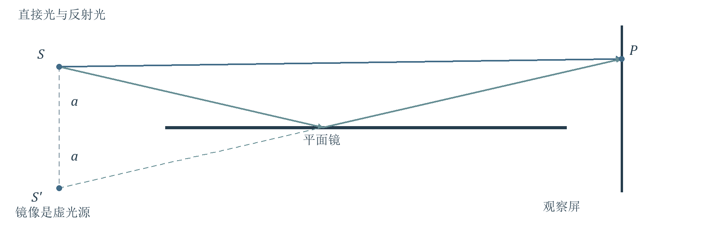
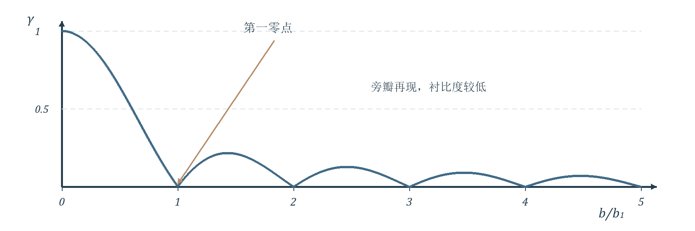
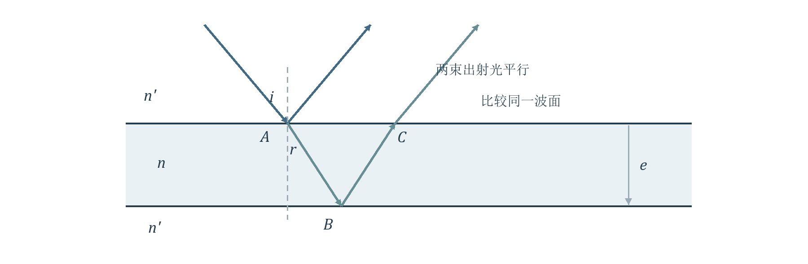
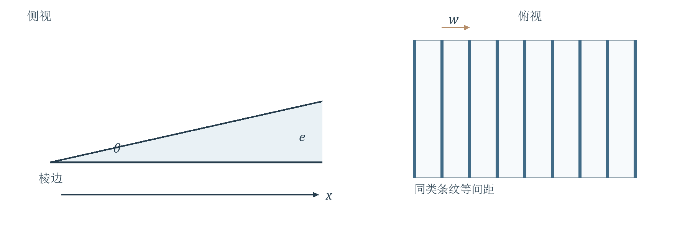
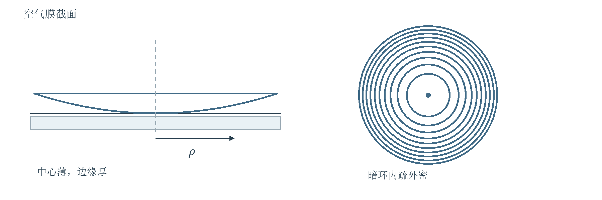
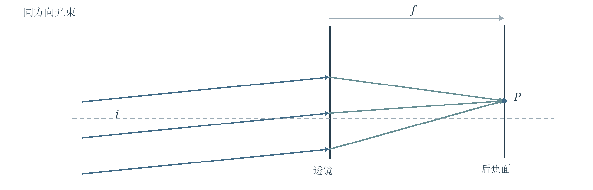
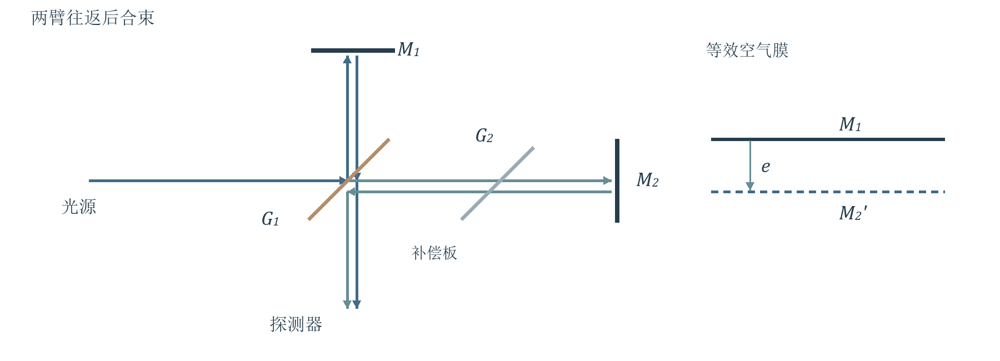
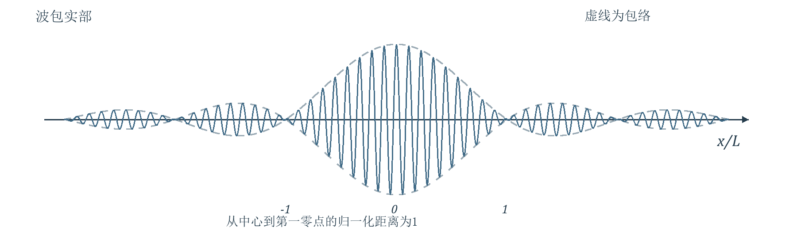
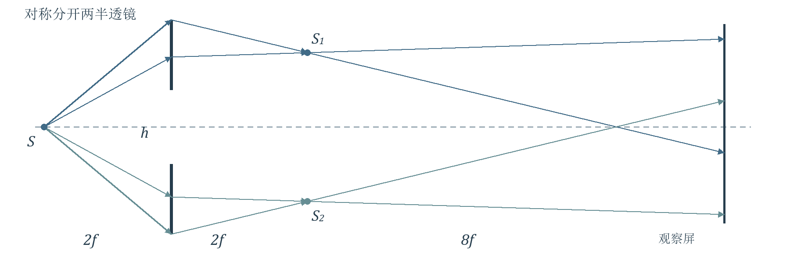
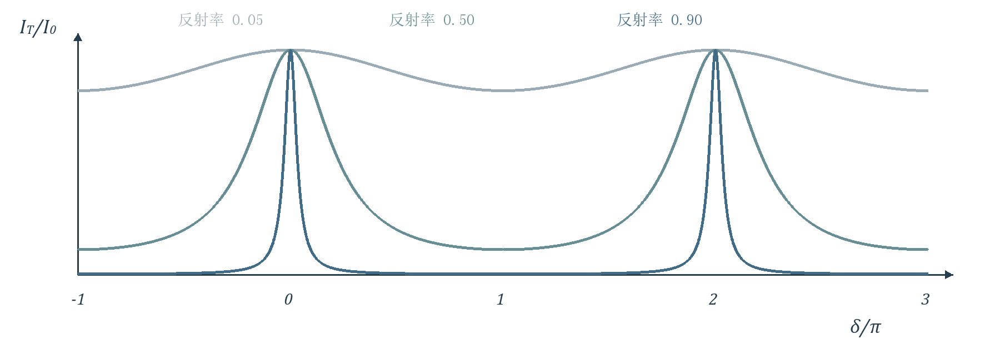

# 第3讲 光的干涉与时空相干性

!!! tip "本讲配套文件"
    - [PDF 在线阅读（基础物理学2_第3讲_光的干涉与时空相干性_学习讲义.pdf）](../文件/基础物理学2_第3讲_光的干涉与时空相干性_学习讲义.pdf)
    - [Word 下载（基础物理学2_第3讲_光的干涉与时空相干性_学习讲义.docx）](../文件/基础物理学2_第3讲_光的干涉与时空相干性_学习讲义.docx)
    - [知识点总结 PDF（基础物理学2_第3讲_光的干涉与时空相干性_知识点总结.pdf）](../文件/基础物理学2_第3讲_光的干涉与时空相干性_知识点总结.pdf)
    - [知识点总结 Word（基础物理学2_第3讲_光的干涉与时空相干性_知识点总结.docx）](../文件/基础物理学2_第3讲_光的干涉与时空相干性_知识点总结.docx)

## 0 本讲知识地图

> **资料范围**：课件 PDF 第1–2页；本讲按课件§3.1至§3.6展开。

本讲把上一讲的“两束光怎样叠加”落实到实际装置：先找出两束光的共同来源，再计算相位差，最后判断条纹的位置、移动和可见程度。空间相干性限制取光的横向间隔，时间相干性限制两路的光程差。
### 学习路径
PPT重点分波前装置 → 等效双光源 → 条纹间距与移动 → 光源宽度 → 空间相干范围。
PPT重点分振幅装置 → 薄膜往返光程与反射相位 → 等厚条纹、等倾条纹 → 迈克耳孙精密测量。
PPT重点有限谱宽 → 有限相干长度 → 多光束叠加 → 法布里—珀罗的锐峰与选频。
### 统一解题入口
先明确两路光、比较起点和终点以及符号约定；再写传播光程差，并单独检查反射带来的附加相位。

$$\delta=\frac{2\pi}{\lambda}\Delta L_{\mathrm{prop}}+\phi_{\mathrm{ref}}$$

这里 $\lambda$ 默认是真空波长，空气中取近似相同；$\Delta L_{\mathrm{prop}}$ 是传播光程之差，$\phi_{\mathrm{ref}}$ 是两路反射相位之差。相位相差整数个 $2\pi$ 的表达等效。
!同一级条纹移动：保持相位条件不变，求位置变化。固定点数条纹：保持位置不变，求相位改变了多少个周期。
### 阅读与复习顺序
必须掌握：光源位移、均匀宽光源积分、薄膜光程差、劈尖与牛顿环、迈克耳孙往返因子、相干长度、艾里公式及半高全宽。
建议理解：虚光源等效、条纹定域、斯托克斯倒逆关系、谱宽与波包的傅里叶联系。
了解即可：双棱镜介绍、迈克耳孙—莫雷实验背景、OCT应用。课件未标“自学”任务，不额外扩展后续章节。

## 1 分波前装置与等效光源

> **资料范围**：课件 PDF 第3–8页。

### 同一波前怎样被分成两路
PPT重点分波前法截取同一光源波前的不同部分，经反射或折射后在同一区域叠加。共同光源提供相关的相位变化；屏上还必须有实际光束交叠，只有虚光源位置正确并不足以保证能看见条纹。
理解补充把出射光线反向延长，找出等效光源。实际折线路径的相位问题便可转化为两个球面波的路程差问题；附加反射相位仍要另算。
### 菲涅耳双面镜
两平面镜夹角 $\alpha$ 很小，狭缝光源平行于镜的交线。两个镜像是相干虚光源。按课件几何，光源到交线的距离为 $B$，交线到屏的轴向距离为 $C$。

$$d\approx 2B\alpha,\qquad D\approx B+C$$

$$\Delta x=\frac{D\lambda}{d}\approx\frac{(B+C)\lambda}{2B\alpha}$$

条件：小镜角、近轴观察、屏距远大于源间距；只在反射光束的交叠区域内使用。两路具有相同类型的反射，不能只给其中一路额外加半波损失。
### 菲涅耳双棱镜  介绍
PPT重点双棱镜的两个小棱角使光束向中间偏折，形成两个虚光源。薄棱镜偏向角近似为 $(n-1)\alpha$，$n$ 是棱镜相对空气的折射率。

$$d\approx2(n-1)B\alpha,\qquad \Delta x\approx\frac{(B+C)\lambda}{2(n-1)B\alpha}$$

此处记住“折射产生双虚源”和条纹间距即可，不展开棱镜完整成像推导。

## 2 劳埃德镜与条纹相位

> **资料范围**：课件 PDF 第6–9页。

PPT重点一个真实狭缝光源与它在平面镜中的像构成等效双光源。一束光直接到屏，另一束掠入射反射后到屏。光源离镜面高度为 $a$，等效源间距为 $2a$。

{ loading=lazy }
*图1  劳埃德镜的实光源、虚光源与实际反射路径。虚线只用于几何等效，不代表光在镜后传播。*

$$d=2a,\qquad \Delta x\approx\frac{D\lambda}{2a}$$

### 等光程点为什么是暗纹
在课件讨论的掠入射条件下，反射光相对直达光有 $\pi$ 的附加相位。因此几何路程相等时，两路反相。若把屏移到与镜面接触，接触点为暗纹。

$$\delta=\frac{2\pi}{\lambda}(r_{\mathrm{ref}}-r_{\mathrm{dir}})+\pi$$

理解补充附加 $\pi$ 把原本的明暗位置对换，条纹间距并不改变。若两路强度不等，暗纹是极小值而未必严格为零。
### 与上一讲的公式衔接
同偏振、充分相干且在观察范围内单束强度近似不变时，

$$I=I_1+I_2+2\sqrt{I_1I_2}\cos\delta$$

两束等强时可写为 $I=4I_1\cos^2(\delta/2)$。杨氏双缝正轴入射对应中心明纹；劳埃德镜要先计入反射相位。
!条纹位置由总相位差决定；条纹间距由相位随位置的变化率决定。恒定附加相位只平移图样。

## 3 课堂例题一  光源移动

> **资料范围**：课件 PDF 第10–11页，例3.1.1。

### 题目判断与已知条件
PPT重点杨氏双缝间距 $d$，源到双缝距离 $R$，双缝到屏距离 $D$。源原在轴上，现沿负 $x$ 方向移动距离 $\delta s$。求零级明纹的位移。这里 $\delta s$ 为正的位移大小。
思路：零级明纹仍满足从光源出发、经两缝到观察点的总光程相等；必须同时计算“源到缝”和“缝到屏”。
### 步骤一  先统一有向坐标
令光源坐标为 $s$，上缝坐标为 $d/2$，下缝为 $-d/2$。定义第二路减第一路。近轴条件为 $|s|,d\ll R$，$|x|,d\ll D$。

$$R_2-R_1\approx\frac{ds}{R},\qquad r_2-r_1\approx\frac{dx}{D}$$

$$\Delta L\approx\frac{ds}{R}+\frac{dx}{D}$$

这些结果由路程平方根展开至横向坐标的二次项得到，再相减；更高阶横向项被忽略。
### 步骤二  令总光程差为零

$$\Delta L=0\quad\Rightarrow\quad x_0=-\frac{D}{R}s$$

代入 $s=-\delta s$，得到课件结果：

$$\delta x=\frac{D}{R}\delta s\qquad\text{沿正方向}$$

结果：光源向下，整套条纹向上，方向相反；条纹间距 $D\lambda/d$ 不变。非零级明纹也整体平移同样的距离。
理解补充源移到下方后，下缝的入射光程更短；零级位置必须移向上方，让下缝到屏的路程相对变长，补回这段差。
!易错点：只比较缝后两段路程，会误判中心明纹仍在轴上；把有向位移 $s$ 与位移大小 $\delta s$ 混用，会丢掉负号。

## 4 宽光源的衬比度推导

> **资料范围**：课件 PDF 第12–16页；教材第三章§1.4，印刷第201–202页。

PPT重点必须掌握均匀单色线光源沿 $x$ 方向宽度为 $b$。不同源点互不相干，但每个源点经两缝产生的两束子波彼此相干。必须“每个点先叠加振幅，不同点再相加强度”。
令 $s\in[-b/2,b/2]$。每点的条纹中心 $x_0=-Ds/R$，条纹空间频率 $f_x=d/(D\lambda)$。源的亮度均匀，且两路强度平衡。

$$I(x)=C\int_{-b/2}^{b/2}[1+\cos(\alpha+\beta s)]\,ds$$

$$\alpha=\frac{2\pi d x}{D\lambda},\qquad\beta=\frac{2\pi d}{R\lambda}$$

对称区间上，正弦的奇函数项积分为零；余弦项给出：

$$\int_{-b/2}^{b/2}\cos(\alpha+\beta s)\,ds=\frac{2\sin(\beta b/2)}{\beta}\cos\alpha$$

定义 $u=\pi bd/(R\lambda)$，$\bar I=Cb$，得到

$$I(x)=\bar I[1+\frac{\sin u}{u}\cos(2\pi f_xx)]$$

$$\gamma=\frac{I_{\max}-I_{\min}}{I_{\max}+I_{\min}}=\left|\frac{\sin u}{u}\right|$$

最大、最小强度分别为 $\bar I(1+|\sin u/u|)$、$\bar I(1-|\sin u/u|)$；$u=0$ 处用极限值1。
教材补充教材第201–202页明确保留绝对值，并说明越过第一次消失后出现衬比度较低的再现。负的正弦比表示明暗位置倒置，不能称为“负衬比度”。
!该式针对均匀矩形源的一维模型。源形状、亮度分布或两路强度比改变时，不能直接套用同一函数。

## 5 空间相干范围与源宽例题

> **资料范围**：课件 PDF 第15–20页。

{ loading=lazy }
*图2  均匀线光源的衬比度随归一化宽度变化；第一次为零之后仍有较弱旁瓣。*

### 第一次消失与相干尺度
PPT重点固定 $d$，第一次消失满足 $u=\pi$；固定 $b$，同一关系也给出横向相干间隔的尺度。

$$b_1=\frac{R\lambda}{d},\qquad d_1=\frac{R\lambda}{b},\qquad\theta_0=\frac{d_1}{R}=\frac{\lambda}{b}$$

$\theta_0$ 是相干孔径角；$b/R$ 才是光源对双缝所张的角宽度，两者不可混同。较小的源宽有利于空间相干，但通光量也会下降。
### 课堂例题二  光源狭缝有多窄
已知 $\lambda=0.600\,\mu\mathrm{m}$，$R=1.00\,\mathrm{m}$，$d=1.00\,\mathrm{mm}$。模型判断：均匀宽光源照明双缝，求第一次消失对应的源宽。

$$b_1=\frac{1.00\times0.600\times10^{-6}}{1.00\times10^{-3}}\,\mathrm{m}=0.600\,\mathrm{mm}$$

结果：课件给出 $b<0.600\,\mathrm{mm}$。这只保证位于第一零点之前；若要清晰，应留出余量。例如 $b=b_1/2$ 时 $\gamma=2/\pi\approx0.637$。
理解补充“相干范围”是实用尺度，不是边界内完全相干、边界外永远零相干的硬开关。激光在本讲的理想单横模模型下具有良好横向相干性；实际相干性仍取决于模式和光束质量。

## 6 课堂例题三  测星干涉仪

> **资料范围**：课件 PDF 第21–22页。

### 已知条件与模型判断
PPT重点课件给出猎户座α星的观测波长 $\lambda=570\,\mathrm{nm}$，条纹第一次消失时的基线 $d_1=3.07\,\mathrm{m}$。求星体的角直径 $\varphi$。
思路：星体各点互不相干；增大两路采光点间距，扩展源使条纹可见度下降。第一次零点将角直径与基线联系起来。四块反射镜用于增大有效基线，并把光束送入后续干涉系统。
### 步骤一  选择源形状对应的系数
一维均匀线源模型为 $\varphi=\lambda/d_1$。对课件采用的均匀圆盘近似，

$$\varphi\approx1.22\frac{\lambda}{d_1}$$

理解补充系数1.22来自圆形亮度分布对应的可见度第一零点。本讲只使用课件给出的修正，不展开衍射积分；不能对任意形状光源都用1.22。
### 步骤二  代入并换算

$$\varphi\approx\frac{1.22\times570\times10^{-9}}{3.07}=2.265\times10^{-7}\,\mathrm{rad}$$

$$\varphi\approx0.0467\,\mathrm{arcsec}\approx0.047\,\mathrm{arcsec}$$

物理解释：直接成像难以分辨的极小角尺寸，可通过“何种基线下干涉消失”间接测得。若已知距离，还可用小角公式把角直径换成线直径。
!易错点：基线是两个有效采光点的间距；角直径不是半径角。弧度转角秒的换算系数约为206265。
理解补充空间相干实验测的是扩展源的角尺度；移动迈克耳孙反射镜测相干长度时，改变的是两路纵向光程差。两类“相干性测量”不能混为一谈。

## 7 薄膜光程差的几何来源

> **资料范围**：课件 PDF 第23–28、42–43页。

PPT重点必须掌握薄膜折射率为 $n$，两侧介质为 $n'$；外部入射角 $i$，膜内折射角 $r$，膜厚 $e$。先求传播光程差，再计反射相位。

{ loading=lazy }
*图3  平行薄膜的两束反射光。比较到同一出射波面时，必须扣除外部的投影段。*

两束反射光中，一束多走膜内往返路径，另一束先走了一段外部路程。几何关系和折射定律为

$$AB=BC=\frac{e}{\cos r},\quad AC=2e\tan r,\quad n'\sin i=n\sin r$$

$$\Delta L_{\mathrm{prop}}=\frac{2ne}{\cos r}-2n'e\tan r\sin i=2ne\cos r$$

在课件的单次相对半波损失情形，等效光程差可写为

$$\Delta L_{\mathrm{eff}}=2ne\cos r+\frac{\lambda}{2}=2e\sqrt{n^2-n'^2\sin^2i}+\frac{\lambda}{2}$$

这里 $\lambda/2$ 代表附加相位，并非实际多走的几何距离。取负的 $\lambda/2$ 也相差一个完整波长，明暗条件等价。
!误写成 $2ne/\cos r$ 是只数膜内长度、漏掉外部投影段。变厚薄膜还要求局部近似平行，源到膜的距离远大于两反射点间距。

## 8 半波损失与条纹定域

> **资料范围**：课件 PDF 第24–30页；教材第三章§2.2，印刷第209–210页。

### 先判断反射相位  再判断明暗
PPT重点本讲薄膜默认两束主要反射光相干叠加，介质透明，近法向入射。由低折射率介质射向高折射率界面反射时有 $\pi$ 相位改变；反向情形没有这种相位翻转。
膜折射率同时高于两侧，或同时低于两侧时，两路中恰有一路发生翻转，存在相对半波损失。例如“玻璃—空气—玻璃”的空气膜同样属于此情形。

$$2ne\cos r=(m+\frac{1}{2})\lambda\quad\text{反射明纹}$$

$$2ne\cos r=m\lambda\quad\text{反射暗纹}\qquad m=0,1,2,\cdots$$

若两次相关反射都翻转或都不翻转，附加相位差为零，上述明暗互换。不要把空气膜机械代入“膜折射率大于外界”的示意图条件。
教材补充教材第210页指出，是否计半波损失改变绝对级次与明暗位置，但不改变同类相邻条纹的厚度差。教材常先省略这项讨论相对运动；与PPT对照时应统一约定。
### 为什么要选观察平面
PPT重点点源照明时，交叠区内可存在较广范围的干涉场；扩展源各点的图样叠加后，只有某些平面附近仍有清晰条纹，这称为条纹定域。
等厚条纹：膜厚随位置变化，采用近法向、近固定角照明，把观察系统对准薄膜表面附近。
等倾条纹：膜厚固定，不同方向对应不同相位；两束平行出射光在无穷远叠加，可用透镜后焦面观察。
!“膜要薄”是相对于光源相干长度而言。关键比较实际光程差与相干长度，不存在对所有光源统一的膜厚上限。

## 9 劈尖的等厚条纹

> **资料范围**：课件 PDF 第29–32页。

PPT重点两个夹角很小的平面形成劈形膜。取垂直棱边的坐标 $x$，棱边处厚度为零，$e(x)\approx\theta x$；$\theta$ 以弧度计。以下讨论正入射、有一次相对半波损失的反射条纹。

{ loading=lazy }
*图4  劈尖侧视与俯视。等厚线平行棱边；图中角度为便于观察作了放大。*

### 必须掌握的推导
暗纹满足 $2ne_m=m\lambda$，所以

$$e_m=\frac{m\lambda}{2n},\qquad x_m=\frac{m\lambda}{2n\theta}$$

$$\Delta e=\frac{\lambda}{2n},\qquad w=\Delta x=\frac{\lambda}{2n\theta}$$

相邻同类条纹间距为 $w$；相邻一明一暗相隔 $w/2$。沿斜面的严格几何用 $\sin\theta$，沿底面用 $\tan\theta$，小角时二者都近似 $\theta$。
### 条纹形状与棱边
等厚线是平行于棱边的直线，因厚度随 $x$ 线性增大，条纹等间距。理想接触处传播光程差为零，但有反射附加 $\pi$，所以棱边是零级暗纹。
理解补充课件暗纹级次的列表从1写起时，不能因此漏掉接触处的零级暗纹。实际接触不良、灰尘或变形会改变中央条纹。
!角度越小，条纹越疏；“更薄”若只指整块膜平移降低而斜率不变，条纹会平移，间距并不会改变。

## 10 劈尖测量与课堂思考

> **资料范围**：课件 PDF 第31–35页；教材第三章§2.3，印刷第212页。

### 从条纹测微小长度
PPT重点已知 $n,\theta$ 可测波长；已知 $\lambda,\theta$ 可测折射率。长度为 $\ell$ 的空气劈尖末端放入细丝，直径记为 $t$，则 $\theta\approx t/\ell$。

$$t\approx\frac{\ell\lambda}{2nw}$$

同一位置处膜厚改变 $\Delta e$，若经历 $N$ 个完整明暗周期，

$$|\Delta e|=\frac{N\lambda}{2n}$$

课件的块规比较、微小工件厚度及干涉膨胀仪，都把微小长度变化转化成条纹位置或条纹数变化。膨胀仪需考虑参考支撑件自身的膨胀，不能把全部信号都归给样品。
### 思考  怎样确定棱边方位
教材补充教材第212页建议轻压平板的一端，看条纹变疏还是变密：若原接触端基本不动，压低厚端会减小劈角，间距增大。静止、等间距的直条纹只给出棱边的平行方向，不能单独确定哪侧较薄。
### 思考  整体抬高上平板后往哪里移
理解补充设 $e=e_0+\theta x$，跟踪同一级暗纹，

$$x_m=\frac{m\lambda/(2n)-e_0}{\theta},\qquad\Delta x_m=-\frac{\Delta e_0}{\theta}$$

膜整体增厚时，条纹移向原来的薄端；减薄时反向。膜厚等高线发生弯曲，说明局部表面并非理想平面。
白光肥皂膜的颜色来自不同波长的极大、极小条件不同；单色照明下主要看到明暗等厚线。曲线形条纹不是“干涉失败”，而是膜厚形状的记录。

## 11 牛顿环的半径与测量

> **资料范围**：课件 PDF 第36–40页。

PPT重点必须掌握曲率半径 $R$ 很大的平凸透镜与平晶形成空气膜。此页用 $\rho$ 表示环半径，避免与薄膜折射角混淆；空气膜近法向反射，有一次相对半波损失。

{ loading=lazy }
*图5  牛顿环的空气膜截面与暗环分布。图中膜厚被夸大；半径平方等差，半径本身不等差。*

几何关系从球面方程得到：

$$\rho^2=R^2-(R-e)^2=2Re-e^2\approx2Re$$

条件 $e\ll R$，忽略 $e^2$ 相对 $2Re$ 的贡献。故 $e\approx\rho^2/(2R)$，并有

$$\rho_m^2=mR\lambda\quad\text{暗环}\qquad m=0,1,2,\cdots$$

$$\rho_k^2=(k-\frac{1}{2})R\lambda\quad\text{明环}\qquad k=1,2,\cdots$$

内圈级次低，外圈级次高；中心理想接触点为零级暗纹。由于 $\rho_m\propto\sqrt m$，环纹内疏外密。
### 实用的平方差公式

$$\rho_{m+p}^2-\rho_m^2=pR\lambda$$

只需知道两环之间的级次差 $p$，不必知道绝对级次。若测量的是直径 $D_m$，应使用 $D_{m+p}^2-D_m^2=4pR\lambda$。若间隙填充折射率 $n$ 的介质，满足同一反射相位条件时，右侧半径平方差改为 $pR\lambda/n$。

## 12 牛顿环的移动与验规判断

> **资料范围**：课件 PDF 第38–41页；教材第三章§2.4，印刷第213–214页。

### 思考一  抬起透镜会怎样
PPT重点理解补充设中心额外间隙为 $e_0$，则空气膜厚度为 $e=e_0+\rho^2/(2R)$。固定某一级暗纹：

$$2e_0+\frac{\rho_m^2}{R}=m\lambda$$

$$\rho_m^2=R(m\lambda-2e_0)$$

抬起透镜使 $e_0$ 增大，同级环半径减小，向中心收缩并消失。只有右侧非负时该级环存在。中心强度会交替明暗，不会始终保持暗点。
### 思考二  白光和透射光
白光照明时，各波长理想接触点的反射条件同为相消，中心近似暗；周围形成彩色环，高级次因不同波长的图样错开而趋于模糊。
无吸收、收集对应反射与透射能量的理想模型中，两者强度互补：反射暗处对应透射亮。低反射率时，透射光有强背景，条纹通常不如反射条纹明显。
### 思考三  验规下两种相似圆环怎样区分
教材补充教材第214页用轻压验规、观察环纹扩张或收缩判断曲率偏差。单张圆环图不能唯一判断空气隙是中心薄还是中心厚。
理解补充若轻压使整体气隙降低，令 $e(\rho)=e_0+a\rho^2$，固定级次满足

$$\Delta(\rho^2)=-\frac{\Delta e_0}{a}$$

中心薄、边缘厚时 $a>0$，减小气隙使环扩大；中心厚、边缘薄时 $a<0$，减小气隙使环收缩。判断前必须知道按压造成的间隙变化方向。
!检验球面时，偏离圆形反映局部不规则；同类环之间对应空气隙厚度变化 $\lambda/2$。圆环数量反映曲率失配的程度，不能直接把环数当作曲率半径。

## 13 等倾条纹与扩展光源

> **资料范围**：课件 PDF 第42–44、48–49页；教材第三章§3.2，印刷第224页。

PPT重点平行平板厚度 $e$ 固定，折射率和波长也固定。相位只随入射方向改变。两束反射光平行，在透镜后焦面会聚到同一点；相同倾角、不同方位角构成同心圆环。

{ loading=lazy }
*图6  平行出射光经透镜汇聚到焦面同一点。焦面的位置对应传播方向，而非薄膜上的位置。*

有一次相对半波损失时，

$$\Delta L_{\mathrm{eff}}=2ne\cos r+\frac{\lambda}{2}$$

$$\rho=f\tan i\approx fi$$

$f$ 为观察透镜焦距，$i$ 是外部角，$r$ 是膜内角，二者通过折射定律联系。若观察系统光轴垂直平板，条纹为圆环。
### 级次为何内高外低
从中心向外，$i$ 和 $r$ 增大，$\cos r$ 减小，传播光程差减小。因此中心附近级次最高，向外级次降低；这与牛顿环的级次顺序相反。
### 面光源为什么不把条纹抹掉
教材补充教材第224页说明：理想平行板在后焦面观察时，不同源点发出的同倾角光束形成重合图样，各点的强度相加提高亮度，衬比度不会因源的横向扩展而降低。
理解补充“更亮”不等于衬比度必然更高。理想情况下衬比度保持；关键是不同源点的条纹是否重合。膜不平行、焦面选错或像差明显时，这种结论不能照搬。

## 14 等倾圆环的疏密与移动

> **资料范围**：课件 PDF 第45–47页；教材第三章§3.1，印刷第224页。

### 建议理解  为什么内疏外密
理解补充近轴时 $\sin i\approx i$，折射定律给出 $r\approx n'i/n$。展开到角度二次项：

$$2ne\cos r\approx2ne-ne r^2\approx2ne-\frac{en'^2}{n}i^2$$

由 $\rho\approx fi$，相邻同类圆环的半径平方差的大小近似为

$$|\Delta(\rho^2)|\approx\frac{n f^2\lambda}{en'^2}$$

因此越往外，半径的间隔越小。这个“平方差近似恒定”要求近轴，不能用来替代任意角度的精确余弦条件。
### 必须掌握  膜厚增加时同级环扩张
PPT重点跟踪同一级亮环，$2ne\cos r=(k-1/2)\lambda$ 固定。$e$ 增大，$\cos r$ 必须减小，故 $r,i,\rho$ 都增大：环从中心产生后向外扩张。膜厚减小时反向。
在固定中心点处，光程变化为 $2n\Delta e$。中心每经历一个完整亮暗周期，

$$|\Delta e|=\frac{\lambda}{2n}$$

### 波长增加时怎样变化
固定 $e,n,k$，波长增加要求 $\cos r$ 增大，于是同级环的倾角和半径减小。这里还假定折射率随波长的变化可忽略。
!牛顿环抬起透镜：同级环收缩。等倾平板增厚：同级环扩张。前者以位置改变膜厚，后者以方向改变余弦因子；必须写出对应的“固定级次”条件。
PPT重点薄膜应用还包括增透膜与增反膜。它们利用多次反射的相位关系抑制或增强特定波长的反射；课件只作应用展示，本讲不展开多层膜设计。

## 15 迈克耳孙干涉仪的等效薄膜

> **资料范围**：课件 PDF 第52–54页；教材第三章§4.1，印刷第228页。

PPT重点分束板把光分成两臂，分别到反射镜后返回，在分束板处重合。将一面镜经分束面成像，可把两路等效为实际镜与另一面镜的像之间的空气膜。

{ loading=lazy }
*图7  迈克耳孙装置示意。两臂均往返传播；右图所示等效间距由镜面与另一镜的虚像决定。*

等效镜面平行：产生等倾圆环。等效镜面有很小夹角：形成劈形空气层，可观察等厚条纹。不能把两块实际镜彼此垂直，误认为等效膜不可能平行。

$$\Delta L_{\mathrm{prop}}\approx2e\cos i$$

式中 $e$ 是等效空气膜厚度；中心近法向时为 $2e$。总相位还可有分束面引入的常量，测位移时其变化为零，不影响计数公式。
### 补偿板的作用
教材补充教材第228页的具体镀膜位置下，两臂原本穿过分束玻璃的次数不同；补偿板使两路在玻璃中的总路程相同。教材按全部路径数为三次与一次，课件第54页按差额说明相差两次；本质一致。
单色光可调空气臂长补偿固定光程差；白光中折射率随波长变化，单靠空气距离难使所有波长同时平衡。补偿板主要补偿玻璃引入的光程及色散。
!补偿板不是让任意臂长自动相等。寻找白光条纹仍要把两臂调到接近等光程，并保证光束重合。

## 16 迈克耳孙的两类测量

> **资料范围**：课件 PDF 第55–59页。

### 动镜位移与条纹计数
PPT重点必须掌握一臂反射镜沿近法向移动 $\Delta d$，光经过该段两次，光程差改变量为 $2\Delta d$。固定一点数过 $N$ 个同类条纹：

$$2|\Delta d|=N\lambda,\qquad|\Delta d|=\frac{N\lambda}{2}$$

空气折射率近似取1；若整段在均匀介质中，光程改变还要乘折射率。斜方向观察时也需考虑余弦因子。若可判读十分之一条纹，课件对应位移分辨量为 $\lambda/20$。
### 插入介质测折射率
长度 $\ell$ 的介质代替一臂中同长空气，往返后附加光程差为

$$\Delta L=2(n-1)\ell=N\lambda$$

$$n=1+\frac{N\lambda}{2\ell}$$

一般地，两种状态折射率差为 $|n_2-n_1|=N\lambda/(2\ell)$。
### 课堂问题  测试步骤怎样安排
理解补充先调出稳定条纹，固定一个计数位置；保持镜位和介质有效长度不变，连续改变待测臂内介质状态，同时计数条纹。记录变化方向、总周期数与终态，代入往返公式。
测气体时，可使用固定气室逐步充气或抽气，窗口保持不变。若直接插入整块固体且过程不可连续计数，仅比较前后静态图样不能知道跳过了多少完整周期，需要额外的连续测量设计。
PPT重点气流折射率不均匀会造成条纹形变，可用于观察气流。迈克耳孙—莫雷实验按课件“略”保留背景：实验未得到所预期的以太风效应；不在此展开推导或将其说成对所有光速命题的单独证明。

## 17 时间相干性与非单色光

> **资料范围**：课件 PDF 第60–65、69–72页。

PPT重点同一束光分成两路后，在观察点相遇的部分对应光源不同时刻的发光状态。时间相干性问的是：两路延迟相差多大时，仍能保留稳定干涉项。

$$\tau=\frac{L_0}{c}=\frac{\ell_0}{v},\qquad L_0=n\ell_0$$

$L_0$ 为以光程表示的相干长度，$\ell_0$ 为介质中的波列几何长度，$v\approx c/n$。这里采用弱色散近似；空气中二者近似相等。
### 准单色光怎样描述
准单色光具有中心真空波长 $\lambda_0$ 和有限谱宽 $\Delta\lambda_0$；相对谱宽越小，单色性越好。强度谱密度表示各波段对总强度的贡献。

$$I=\int_0^\infty i(\lambda)\,d\lambda$$

自然线宽与能级寿命有关；能级宽度造成跃迁频率分布。多普勒展宽来自发光粒子的速度分布，对同种粒子有线宽随 $\sqrt T$ 增大的趋势。此处保留课件的机制说明，不展开量子推导。
### 谱宽为什么使远处条纹模糊
杨氏条纹间距正比于波长。不同频率在通常探测时间下按强度叠加：中央低级次附近图样较一致，离中心越远，各波长条纹偏移越大，综合可见度下降。
理解补充“超过相干长度就不干涉”是用于估算的简化表述。实际可见度随延迟连续变化，形状取决于光谱；相干长度的数值还依赖所用宽度定义。
!缩窄源的空间宽度主要改善空间相干；缩窄光谱主要改善时间相干。两者可以分别调节，不能把“光源小”直接等同于“波列长”。

## 18 相干长度与最大可见级次

> **资料范围**：课件 PDF 第66、68–71页；教材第三章§4.6，印刷第237–239页。

### 必须掌握  从谱宽估计相干尺度
PPT重点中心波长 $\lambda_0$，准单色条件 $\Delta\lambda_0\ll\lambda_0$。课件用长波的第 $M$ 级与短波的第 $M+1$ 级重合，估计条纹难分辨的级次：

$$M(\lambda_0+\frac{\Delta\lambda_0}{2})=(M+1)(\lambda_0-\frac{\Delta\lambda_0}{2})$$

$$M=\frac{\lambda_0}{\Delta\lambda_0}-\frac{1}{2}\approx\frac{\lambda_0}{\Delta\lambda_0}$$

课件的最终式是窄谱近似，省略了相对很小的半级项。这是连续谱宽模型下的量级估计，不能把仅两条离散谱线的条纹再现也解释成“永久消失”。

$$L_0\sim M\lambda_0\sim\frac{\lambda_0^2}{\Delta\lambda_0}$$

由 $\nu=c/\lambda_0$ 微分并取宽度的正值，

$$\Delta\nu\approx\frac{c\Delta\lambda_0}{\lambda_0^2},\qquad\tau\sim\frac1{\Delta\nu},\qquad L_0\sim\frac c{\Delta\nu}$$

### 物理解释与适用条件
两臂时间延迟越大，各频率积累的相位差越不一致；频率范围越窄，这种失配积累越慢，所以允许的光程差越大。
教材补充教材第239页脚注说明，不同线型可带来不同数值因子；该处忽略量级为1的系数。因此这些相干尺度应写成近似或量级关系，而不是不依赖谱形的精确恒等式。
!用真空波长计算 $L_0$，再除以 $n$ 才是弱色散介质中的几何长度。把介质内波长代入真空公式而又乘一次折射率，会混乱。

## 19 矩形谱到有限波包

> **资料范围**：课件 PDF 第62–63、67–68页；教材第三章§4.6，印刷第239页。

PPT重点建议理解傅里叶分解把复杂振动写成简谐分量。周期方波可由常量和奇次谐波合成；非周期波包则需要连续频谱。此页沿用课件的一维数学模型。
设波数在 $k_0\pm\Delta k/2$ 内，振幅谱为常量；频带外为零。把整体归一化吸收入 $\tilde A$，

$$\tilde U(x)=\frac{\tilde A}{\Delta k}\int_{k_0-\Delta k/2}^{k_0+\Delta k/2}e^{ikx}\,dk$$

$$=\tilde A e^{ik_0x}\frac{e^{i\Delta kx/2}-e^{-i\Delta kx/2}}{i\Delta kx}$$

$$=\tilde A\frac{\sin(\Delta kx/2)}{\Delta kx/2}e^{ik_0x}$$

{ loading=lazy }
*图8  矩形振幅谱对应的波包实部及包络。这里采用归一化坐标，只表示宽谱对应短包络的关系。*

包络第一零点满足 $|x|=2\pi/\Delta k$。在窄谱条件下 $\Delta k\approx2\pi\Delta\lambda_0/\lambda_0^2$，所以空间尺度为 $\lambda_0^2/\Delta\lambda_0$。若取两侧第一零点之间的全宽，会多出因子2；这不改变课件讨论的量级。
理解补充振幅谱不是强度谱本身。上式是展示傅里叶关系的波包模型，不应把它直接当作任意热光源某次发光的严格波形；统计光的可见度由强度谱与延迟的关系决定。

## 20 课堂例题四  介质中的相位差

> **资料范围**：课件 PDF 第73–74页；光程概念按课件“略”作简要回顾。

### 题目判断与已知条件
PPT重点两束同相光从双缝出发，经几何路程 $r_1,r_2$ 到 $P$。第二路中长度为 $t$ 的空气被折射率 $n$ 的介质替代。课件用 $d$ 表示该长度，本页改用 $t$ 以免与双缝间距混淆。
思路：相位的传播积累由光程决定，不能把几何路程直接乘统一波数后再忘掉介质段。假定介质不会改变所比较的几何路径，并忽略额外反射。
### 步骤一  分段计算光程

$$L_1=r_1,\qquad L_2=(r_2-t)+nt=r_2+(n-1)t$$

### 步骤二  统一用真空波长
以第二路减第一路为约定，

$$\Delta\varphi=\frac{2\pi}{\lambda}(L_2-L_1)=\frac{2\pi}{\lambda}[(r_2-r_1)+(n-1)t]$$

结果与课件一致。若初相位不同，还要加上对应初相位差；若定义反过来，整式变号，干涉强度中的余弦保持不变。
### 物理解释
同长介质替换空气使光程增加 $(n-1)t$，不是 $nt$。在杨氏装置中，覆盖某一缝后的光路后，零级条纹会移向被覆盖的那一侧，以较短的缝后几何路程抵消增加的光程。
理解补充把此例与迈克耳孙对照：这里介质被经过一次，附加量为 $(n-1)t$；迈克耳孙同一臂往返经过介质两次，附加量为 $2(n-1)t$。
!易错点：同一题中不要同时用介质波长和光程再重复乘 $n$。选“真空波长配光程”，全题坚持到底。

## 21 课堂思考  切开透镜的双光源

> **资料范围**：课件 PDF 第75页；按完整例题补足光路和推导。

### 题目判断与已知条件
PPT重点焦距为 $f$ 的薄透镜从光心切开，两半沿横向分开，总间隙为 $h$；源在透镜前 $2f$，屏在透镜后 $10f$。两半对称移动到 $\pm h/2$，求等效光源和光程差。

{ loading=lazy }
*图9  两半透镜把同一源成像为两个相干实像，像后光束在交叠区域形成条纹；图示纵横比例经过调整。*

### 步骤一  找到像平面
薄透镜公式 $1/f=1/u+1/v$，由 $u=2f$ 得 $v=2f$，横向放大率为 $-1$。某半片光心位于 $y_c$，物点相对它的高度为 $-y_c$，像相对它的高度为 $+y_c$，故像的绝对高度为 $2y_c$。

$$y_1=h,\quad y_2=-h,\quad d_{\mathrm{eq}}=2h,\quad D_{\mathrm{eq}}=10f-2f=8f$$

### 步骤二  在两像之后作双源干涉
理解补充理想对称装置中两像的源端相位相同，两路同样经过聚焦。近轴屏点坐标为 $x$，取下像路径减上像路径：

$$\Delta L\approx\frac{d_{\mathrm{eq}}x}{D_{\mathrm{eq}}}=\frac{hx}{4f}$$

$$\Delta x=\frac{D_{\mathrm{eq}}\lambda}{d_{\mathrm{eq}}}=\frac{4f\lambda}{h}$$

易错点：$h$ 是两半的相对分开量，若每半分别移动 $h$，等效源间距就会变成 $4h$。观察屏距应从像平面量起，不能直接用 $10f$。实际条纹还受两半透镜通光口径形成的交叠范围限制。

## 22 多光束的振幅序列

> **资料范围**：课件 PDF 第76–78页。

PPT重点薄膜每次遇到界面都会分出反射和透射光。低反射率时较高次项很弱；高反射率时许多束都不可忽略，必须先叠加复振幅。
本节沿课件改用 $h$ 表示膜厚、$i$ 表示膜内倾角。$r,t$ 为从外侧入膜的振幅反射比、透射比，$r',t'$ 为反向传播的对应比。不要把这里的 $r$ 当作折射角。
### 建议理解  斯托克斯倒逆关系
对透明、无吸收且满足光路可逆条件的界面，逆向合成应恢复原来的入射光，同时另一方向的分量抵消：

$$Art+Atr'=0,\qquad Ar^2+Att'=A$$

$$r'=-r,\qquad r^2+tt'=1$$

这也表明反向界面的振幅反射比可以相差一个符号。强度反射率记为 $\mathcal R=|r|^2$；本讲实系数情形为 $r^2$。
### 逐束追踪
忽略公共传播相位，各透射束依次具有振幅系数

$$Att',\quad Att'r'^2,\quad Att'r'^4,\quad\cdots$$

各反射束依次为 $Ar,\ Atr't',\ Atr'^3t',\cdots$。第一反射束与后续束的符号关系须由反射系数本身决定，不能额外再随意加一次半波损失。
对于两侧外介质相同的平行膜，相邻透射束的传播光程差和相位差为

$$\Delta L=2nh\cos i,\qquad\delta=\frac{4\pi nh\cos i}{\lambda}$$

!有效参与的多次往返光束还必须在相干长度范围内，并在探测方向上重叠；理想无限级数是这一模型下的近似描述。

## 23 艾里公式的关键推导

> **资料范围**：课件 PDF 第79–81页。

PPT重点必须掌握取 $I_0=A^2$，$\mathcal R=r^2$，薄膜两侧介质相同、无吸收、界面一致。透射光的复振幅是等比级数：

$$\tilde U_T=Att'\sum_{j=0}^{\infty}(\mathcal R e^{i\delta})^j=\frac{Att'}{1-\mathcal R e^{i\delta}}$$

由 $tt'=1-\mathcal R$，分母与其复共轭相乘得到

$$\frac{I_T}{I_0}=\frac{(1-\mathcal R)^2}{1-2\mathcal R\cos\delta+\mathcal R^2}$$

把分母重写为 $(1-\mathcal R)^2+4\mathcal R\sin^2(\delta/2)$，定义艾里系数 $F$，

$$F=\frac{4\mathcal R}{(1-\mathcal R)^2},\qquad\frac{I_T}{I_0}=\frac1{1+F\sin^2(\delta/2)}$$

无吸收时用能量守恒得

$$\frac{I_R}{I_0}=\frac{F\sin^2(\delta/2)}{1+F\sin^2(\delta/2)}$$

### 两个重要极限
透射极大：$\delta=2m\pi$，理想条件下 $I_T=I_0$、$I_R=0$。透射极小：$\delta=(2m+1)\pi$，$I_T/I_0=1/(1+F)$，一般不为零。
当 $\mathcal R\ll1$，只保留反射率一次项，

$$I_R\approx2\mathcal R I_0(1-\cos\delta),\qquad I_T\approx I_0-I_R$$

理解补充低反射率下“反射可用两束近似”不等于透射出现同样深的明暗变化；透射有很强的背景。高反射率时，只有接近谐振相位的光能高效透射，峰显著变窄。

## 24 法布里—珀罗与半高全宽

> **资料范围**：课件 PDF 第82–83页。

PPT重点两块精密平面板的相对面平行并具有较高反射率，形成法布里—珀罗腔。多次反射后的透射光经透镜会聚，形成细锐的等倾条纹，可用于光谱精细结构分析和选频。

{ loading=lazy }
*图10  艾里透射曲线。反射率提高时峰间距不变，而单个峰变窄；各曲线按同一入射强度归一化。*

### 必须掌握  半值宽度是全宽
课件的 $\varepsilon$ 是峰两侧半高点之间的相位间隔，即半高全宽。半高点为 $\delta=2m\pi\pm\varepsilon/2$。

$$F\sin^2(\varepsilon/4)=1$$

$$\varepsilon=4\arcsin\frac{1-\mathcal R}{2\sqrt{\mathcal R}}\approx\frac{2(1-\mathcal R)}{\sqrt{\mathcal R}}$$

近似条件为高反射率、窄峰，此时 $\sin(\varepsilon/4)\approx\varepsilon/4$。只有曲线确实下降到半峰值时，绝对半高全宽才存在；课件聚焦于满足此条件的高反射率腔。
理解补充相邻峰相隔 $2\pi$。可用 $\mathcal F=2\pi/\varepsilon\approx\pi\sqrt{\mathcal R}/(1-\mathcal R)$ 表示峰间距相对峰宽的比值，称为精细度。它与艾里系数 $F$ 不同，本笔记用不同符号区分。

## 25 课堂例题五  透射亮纹角宽度

> **资料范围**：课件 PDF 第84页。

### 题目判断与已知条件
PPT重点法布里—珀罗腔 $\mathcal R=0.90$，$h=5\,\mathrm{cm}$，$\lambda=0.6\,\mu\mathrm{m}$，某透射峰方向满足 $n\sin i_k\approx1/2$。求该亮纹的角宽度。
思路：先求相位的半高全宽，再用相位随角度的变化率将它换成角度全宽。$i$ 是膜内角；若需要外部观察角宽度，还需用折射定律换算。
### 步骤一  对相位作局部线性展开

$$\delta=\frac{4\pi nh\cos i}{\lambda},\qquad\left|\frac{d\delta}{di}\right|=\frac{4\pi nh|\sin i|}{\lambda}$$

在峰窄且 $i_k$ 不接近零的情况下，

$$\Delta i\approx\frac{\lambda\varepsilon}{4\pi nh|\sin i_k|}=\frac{\lambda(1-\mathcal R)}{2\pi nh|\sin i_k|\sqrt{\mathcal R}}$$

### 步骤二  数值代入

$$\varepsilon\approx\frac{2(1-0.90)}{\sqrt{0.90}}=0.2108\,\mathrm{rad}$$

$$\Delta i\approx\frac{0.6\times10^{-6}\times0.2108}{4\pi\times0.05\times0.5}=4.03\times10^{-7}\,\mathrm{rad}$$

换成角分约为 $1.38\times10^{-3}\,\mathrm{arcmin}$，与课件约 $0.001\,\mathrm{arcmin}$ 的量级一致。极小角宽体现透射峰的方向选择性。
!易错点：不能把全宽再乘2；不能把 $\sqrt{\mathcal R}$ 漏写成 $\mathcal R$。在正轴 $i_k=0$，一阶导数为零，上式失效，应从 $\cos i\approx1-i^2/2$ 的二次项讨论。

## 26 纵模间距与单模线宽

> **资料范围**：课件 PDF 第85–86页。

### 透射哪些频率
PPT重点固定膜内方向，透射极大满足 $2nh\cos i=m\lambda_m$。正入射、折射率在窄频段内近似不变时，

$$\nu_m=\frac{mc}{2nh},\qquad\Delta\nu_{\mathrm{FSR}}=\frac{c}{2nh}$$

相邻透射共振的频率等间隔，称自由光谱范围；波长间隔一般不严格相等。课件将这些共振称为纵模。单独的被动腔是滤波器，激光振荡还需要增益等条件。
### 每个峰本身有多宽
相位随波长变化率为 $|d\delta/d\lambda|=4\pi nh\cos i/\lambda^2$，故高反射率下的半高全宽为

$$\Delta\lambda_{\mathrm{FWHM}}\approx\frac{\lambda^2}{2\pi nh\cos i}\frac{1-\mathcal R}{\sqrt{\mathcal R}}$$

$$\Delta\nu_{\mathrm{FWHM}}\approx\frac{c}{2\pi nh\cos i}\frac{1-\mathcal R}{\sqrt{\mathcal R}}$$

这两个宽度均取正值。正入射时，与峰间距比较可得 $\Delta\nu_{\mathrm{FSR}}/\Delta\nu_{\mathrm{FWHM}}\approx\mathcal F$。
### 物理图像
增大反射率：峰间距基本不变，峰变窄，精细度提高。增大腔长：峰间距和峰宽都减小；在理想模型、反射率不变时精细度不变。
理解补充用上一页参数并取空气腔正入射，可得峰间距约 $3.00\,\mathrm{GHz}$，单峰宽约 $1.01\times10^8\,\mathrm{Hz}$。它们相差约30倍，绝不是同一个“谱线间隔”。此数值是教学核算，不是新增课堂原题。
!本节 $\Delta\lambda_{\mathrm{FWHM}}$ 描述腔的透射峰宽；上一节的光源 $\Delta\lambda_0$ 描述入射谱宽，代入相干长度公式时须明确是哪一束光的光谱。

## 27 OCT应用介绍

> **资料范围**：课件 PDF 第87–92页，标记为“介绍”。

PPT重点了解即可光学相干断层成像利用参考光与样品不同深度返回光的干涉，识别不同层面的光程。这里保留课件展示的时间域扫描图像，不展开具体仪器算法。
### 深度为何对应延迟
样品中两反射层相距 $\Delta z$，在均匀、弱色散近似下，往返的延迟差为

$$\Delta t\approx\frac{2n\Delta z}{c}$$

微米尺度的层间距对应极短延迟。课件用短脉冲示意说明：参考光和某一层的返回光，在光程匹配的窄范围内产生明显干涉信号。
### 怎样形成断层图
移动参考镜，改变参考臂延迟；各深度对应不同的匹配位置，从而获取纵向的一维信息。再横向扫描，结合位置与信号强度形成截面或三维图像。
课件的光纤实现将分束与合束交给光纤耦合器，分别连接参考镜、样品和探测器。所示大葱表皮实例为约 $10\,\mathrm{mm}\times4\,\mathrm{mm}$ 的区域，展示层状结构。
理解补充短相干长度在普通远光程差干涉中是限制，在这里却成为区分深度的条件；只有光程足够匹配的层面产生显著信号。核心是低相干门控，并非所有实现都必须直接分辨飞秒时间或使用同一种激光脉冲。
### 回到本讲主线
分波前装置展示横向取样的限制；迈克耳孙装置把两路延迟变成可调量；法布里—珀罗把多次往返的相位选择变成窄透射峰。三者都从“分光、传播、叠加”出发，却测量不同的物理量。

## 公式速查一  几何与薄膜
### 双源干涉与空间相干

$$\Delta x=\frac{D\lambda}{d},\qquad x_0=-\frac{D}{R}s$$

近轴、等效源到屏距离为 $D$。源的横向位移与条纹位移反向。

$$\gamma=\left|\frac{\sin u}{u}\right|,\quad u=\frac{\pi bd}{R\lambda},\quad b_1=\frac{R\lambda}{d},\quad d_1=\frac{R\lambda}{b}$$

均匀一维非相干扩展源、两路平衡；第一零点是尺度，不能视为硬截止。
### 薄膜与劈尖

$$\Delta L_{\mathrm{prop}}=2ne\cos r,\qquad\delta=\frac{2\pi}{\lambda}\Delta L_{\mathrm{prop}}+\phi_{\mathrm{ref}}$$

先判断 $\phi_{\mathrm{ref}}$。一次相对半波损失时：反射暗纹 $2ne\cos r=m\lambda$，亮纹 $2ne\cos r=(m+1/2)\lambda$。

$$\Delta e=\frac{\lambda}{2n},\qquad w=\frac{\lambda}{2n\theta}$$

正入射劈尖，$w$ 为相邻同类条纹间距；$\theta$ 用弧度。
### 牛顿环与等倾环

$$\rho_m^2=\frac{mR\lambda}{n},\qquad\rho_{m+p}^2-\rho_m^2=\frac{pR\lambda}{n}$$

牛顿环暗环：理想接触、近轴、间隙折射率 $n$，且有一次相对半波损失。$R$ 为曲率半径。直径平方差还需乘4。

$$\rho=f\tan i\quad\text{等倾条纹}$$

等倾：中心级次高，增厚则同级环扩张。牛顿环：中心级次低，抬起透镜则同级环收缩。
### 迈克耳孙测量

$$|\Delta d|=\frac{N\lambda}{2},\qquad|n_2-n_1|=\frac{N\lambda}{2\ell}$$

空气中近法向动镜；介质长度 $\ell$ 被往返两次。计数 $N$ 为完整条纹周期数。

## 公式速查二  相干与多光束
### 时间相干尺度

$$M\sim\frac{\lambda_0}{\Delta\lambda_0},\quad L_0\sim\frac{\lambda_0^2}{\Delta\lambda_0}\sim\frac c{\Delta\nu},\quad\tau\sim\frac1{\Delta\nu}$$

准单色、真空中心波长；具体数值因子依赖谱线形状与宽度定义。弱色散介质内几何长度为 $\ell_0\approx L_0/n$。
### 艾里公式

$$\delta=\frac{4\pi nh\cos i}{\lambda},\quad F=\frac{4\mathcal R}{(1-\mathcal R)^2}$$

$$\frac{I_T}{I_0}=\frac1{1+F\sin^2(\delta/2)},\qquad I_R=I_0-I_T$$

膜内角 $i$、强度反射率 $\mathcal R$；相同无吸收界面，两侧介质一致，相关各束充分相干。透射峰条件为 $2nh\cos i=m\lambda$。
### 高反射率时的峰宽

$$\varepsilon\approx\frac{2(1-\mathcal R)}{\sqrt{\mathcal R}},\qquad\mathcal F\approx\frac{\pi\sqrt{\mathcal R}}{1-\mathcal R}$$

前者是相位半高全宽；后者是精细度。艾里系数 $F$ 与精细度 $\mathcal F$ 不同。

$$\Delta i\approx\frac{\lambda\varepsilon}{4\pi nh|\sin i_k|}$$

用于非轴上窄峰的膜内角全宽；$i_k=0$ 不能使用一阶导数换算。

$$\Delta\nu_{\mathrm{FSR}}=\frac{c}{2nh},\qquad\Delta\nu_{\mathrm{FWHM}}\approx\frac{c}{2\pi nh}\frac{1-\mathcal R}{\sqrt{\mathcal R}}$$

以上频率式为正入射、折射率近似不变；分别表示相邻峰间距与一个峰的全宽。题目先分清问“间距”还是问“宽度”。

## 本讲易错清单
### 1 光程与相位不可重复补偿
用真空波长配光程。已用复反射系数计入的符号，不要再另加同一半波损失。
### 2 宽光源要按来源分组
同一源点的两路子波先相干叠加，不同普通源点再相加强度。把所有源点的振幅直接相加会得到错误衬比度。
### 3 衬比度非负  第一零点不是硬边界
均匀线源取正弦比的绝对值。第一零点后的微弱再现与明暗倒置，不代表出现负光强。
### 4 条纹移动有两种不同问法
跟踪同一级时相位固定；固定屏点数条纹时相位变化。把两种约束混用，方向往往判断相反。
### 5 薄膜要扣外部投影段
斜入射往返光程差为 $2ne\cos r$；$2ne/\cos r$ 只算了内部路径。
### 6 明暗判据取决于相对反射相位
空气劈尖也有一次相对半波损失。不能见到“薄膜”就无条件给光程差加 $\lambda/2$。
### 7 圆环相似不等于物理机制相同
牛顿环等厚、内低外高；等倾环内高外低。两者都可能内疏外密，仅看疏密不能区分。
### 8 往返因子与直径因子各算一次
迈克耳孙动镜的光程变化是位移的2倍；牛顿环直径平方是半径平方的4倍。不要相互混用。
### 9 谱宽要说明对象与定义
源谱宽决定源的时间相干；腔透射线宽决定滤波选择性。半高全宽不是半宽，也不是自由光谱范围。
### 10 符号须随章节重置
源距 $R$、牛顿环曲率半径 $R$ 是不同量；本笔记用 $\mathcal R$ 专指强度反射率。F-P的 $i$ 是膜内角，薄膜前节的 $i$ 是外部角。

## 自测题
以下为理解补充自编练习；答案集中放在后文。先画简图、写条件，再代入数值。
### 1 概念题  两种相干性
均匀单色宽光源照明杨氏双缝。为什么不同源点互不相干，每个源点仍能形成干涉图样？缩小源宽和缩小谱宽，分别主要改善什么？在理想等倾条纹观察中，扩展源为何不产生同样的“抹纹”？
### 2 公式应用  源位移与衬比度
已知 $\lambda=600\,\mathrm{nm}$，$d=1.00\,\mathrm{mm}$，$R=1.00\,\mathrm{m}$，$D=2.00\,\mathrm{m}$。均匀源宽 $b=0.300\,\mathrm{mm}$。求条纹间距和衬比度；若源整体向正方向移 $0.100\,\mathrm{mm}$，条纹中心怎样移动？
### 3 推导分析  两种圆环的移动
空气牛顿环在波长 $600\,\mathrm{nm}$ 下观察，透镜曲率半径 $R=1.00\,\mathrm{m}$。由理想接触状态把透镜抬高 $0.300\,\mu\mathrm{m}$，原第10级暗环的半径如何变化？说明中心经历了几个完整强度周期，并与等倾平板增厚比较。
### 4 综合测量  迈克耳孙与相干长度
波长 $600\,\mathrm{nm}$，一臂空气室长 $50.0\,\mathrm{mm}$。缓慢改变气体状态，数到50个完整条纹周期。求折射率变化量。若光源谱宽约 $0.0200\,\mathrm{nm}$，估计 $L_0$、$\tau$；由等光程位置出发，动镜可移动的相干尺度约多大？
### 5 多光束综合  间距不等于线宽
正入射空气F-P腔长 $h=5.00\,\mathrm{cm}$、反射率 $\mathcal R=0.900$，取 $c=3.00\times10^8\,\mathrm{m/s}$。求自由光谱范围、精细度与单峰频率半高全宽。只增大反射率时，哪个量基本不变？只将腔长加倍时，三个量各怎样变化？

## 资料索引与复习定位
### 教师课件
《3 26秋基物2 光学.第3章.光的干涉.pdf》，共92个PDF页面。正文引用“课件PDF第几页”均为阅读器中的物理页序，不采用不连续的PPT页脚编号。
第3–22页：分波前装置、移动、宽光源和测星。第23–41页：薄膜等厚条纹、劈尖、牛顿环。第42–51页：等倾条纹与薄膜应用。第52–59页：迈克耳孙干涉仪。第60–75页：时间相干性、光程例题、切透镜思考。第76–86页：多光束与F-P。第87–92页：OCT介绍。
### 教材核对位置
赵凯华、钟锡华《光学（重排本）》，复用第一节课所附扫描PDF。本笔记引用印刷页码；该文件对应PDF页码为印刷页码加13。
第三章§1.4，第201–202页（PDF214–215）：均匀宽光源、衬比度绝对值与旁瓣。§1.5，第204页（PDF217）：空间相干范围的几何解释。
第三章§2.2，第209–210页（PDF222–223）：薄膜光程差、半波损失约定与等厚间隔。§2.3，第212页（PDF225）：劈尖方向判断、相对位移。§2.4，第213–214页（PDF226–227）：牛顿环与验规检验。
第三章§3.1–3.2，第224–225页（PDF237–238）：等倾环疏密、移动与扩展源。§4.1，第228页（PDF241）：迈克耳孙结构与补偿板。§4.6，第237–240页（PDF250–253）：相干长度、波包和线宽。
第三章§5.1–5.2，第242–247页（PDF255–260）：多光束叠加、艾里曲线、F-P结构与半值宽度。
### 标签含义
PPT重点表示课件讲解、公式、课堂例题或思考所涉及的内容；教材补充为核对上述教材后的补充；理解补充为本笔记的推理、图像解释或自编练习，不冒充教师原话或教材原文。
重绘示意图用于解释本讲几何与公式，均不按实物比例。推导中增加的成立条件用于明确模型边界。

## 自测答案一
### 第1题  概念
每个源点分出的两路来自同一发光过程，在相干长度范围内可相干；不同普通源点彼此独立，强度相加。横向宽源各点的杨氏条纹发生不同平移，叠加后可见度下降。缩小源宽主要改善空间相干，缩小谱宽主要改善时间相干。
理想平行膜的等倾条纹在后焦面按方向成像：不同源点同倾角光束的图样重合，故扩展源增亮而不产生同样的相位平均抹纹。两种装置的图样重合条件不同。
### 第2题  杨氏计算

$$\Delta x=\frac{D\lambda}{d}=1.20\,\mathrm{mm}$$

$$u=\frac{\pi bd}{R\lambda}=\frac\pi2,\qquad\gamma=\frac2\pi\approx0.637$$

$$\Delta x_0=-\frac DR\Delta s=-0.200\,\mathrm{mm}$$

条纹向负方向移动，间距和衬比度在所用近轴、均匀源模型下不变。
### 第3题  牛顿环移动
初态第10级暗环满足 $\rho_{10}^2=10R\lambda$；抬高后仍跟踪原来的第10级，而不是重新从中心数第10个环：

$$\rho_{10,\mathrm{old}}=\sqrt{6.00\times10^{-6}}\,\mathrm{m}=2.449\,\mathrm{mm}$$

$$\rho_{10,\mathrm{new}}=\sqrt{R(10\lambda-2e_0)}=\sqrt{5.40\times10^{-6}}\,\mathrm{m}=2.324\,\mathrm{mm}$$

同级环收缩约 $0.126\,\mathrm{mm}$。中心传播光程增加 $2e_0=600\,\mathrm{nm}=\lambda$，经历一个完整强度周期，最后又为暗。等倾平板增厚时，同级环向外扩张，虽然固定中心的强度也周期变化。

## 自测答案二
### 第4题  折射率变化与相干尺度
往返通过气室，

$$|\Delta n|=\frac{N\lambda}{2\ell}=\frac{50\times600\times10^{-9}}{2\times50.0\times10^{-3}}=3.00\times10^{-4}$$

仅给条纹数确定变化量大小；折射率增减还需结合改变气体的过程或条纹方向。相干长度与时间的量级为

$$L_0\sim\frac{(600\times10^{-9})^2}{0.0200\times10^{-9}}=1.80\times10^{-2}\,\mathrm{m}$$

$$\tau\sim\frac{L_0}{c}=6.00\times10^{-11}\,\mathrm{s}$$

从等光程开始，反射镜位移导致两倍光程变化，所以动镜位移尺度约为 $L_0/2=9.00\,\mathrm{mm}$。实际“看不见”的位置取决于可见度阈值与谱线形状，不是严格的9毫米硬截止。
### 第5题  F-P腔

$$\Delta\nu_{\mathrm{FSR}}=\frac c{2h}=3.00\times10^9\,\mathrm{Hz}$$

$$\mathcal F\approx\frac{\pi\sqrt{0.900}}{1-0.900}=29.8$$

$$\Delta\nu_{\mathrm{FWHM}}\approx\frac{\Delta\nu_{\mathrm{FSR}}}{\mathcal F}=1.01\times10^8\,\mathrm{Hz}$$

只增加反射率：自由光谱范围基本不变，精细度增大，单峰宽度减小。只将腔长加倍：自由光谱范围减半，单峰宽度减半，精细度不变。
理解补充以上忽略色散、吸收和镜面不平行等实际因素，使用课件的理想对称高反射率模型。先列出模型条件，再谈公式精度。

