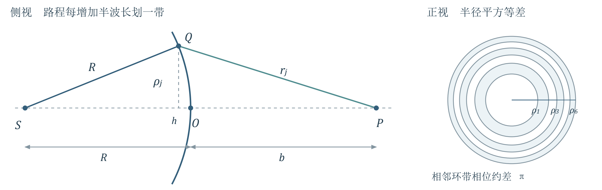
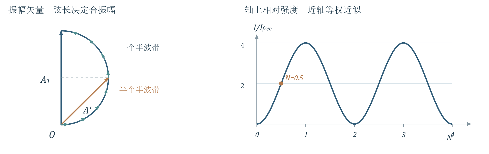
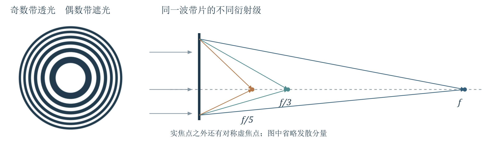
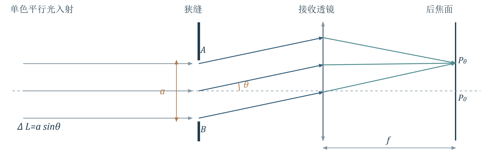
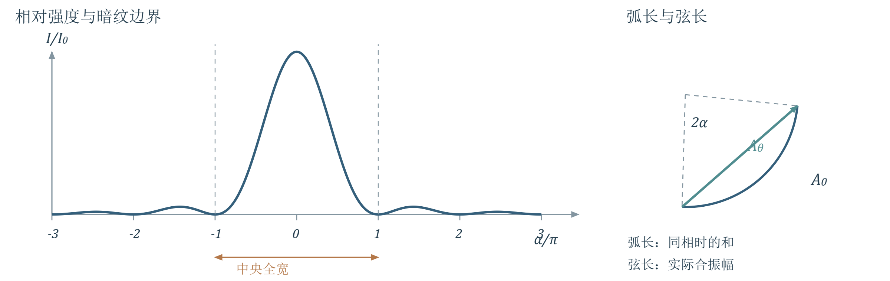
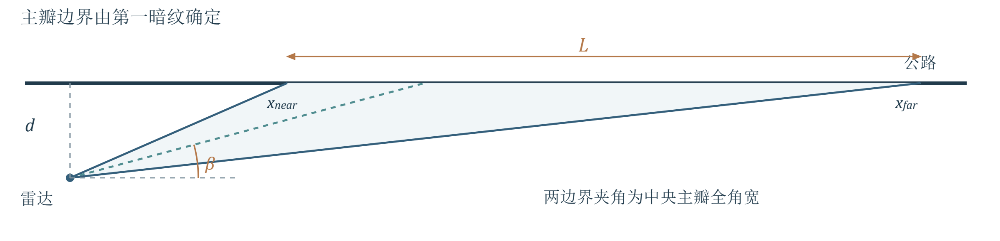
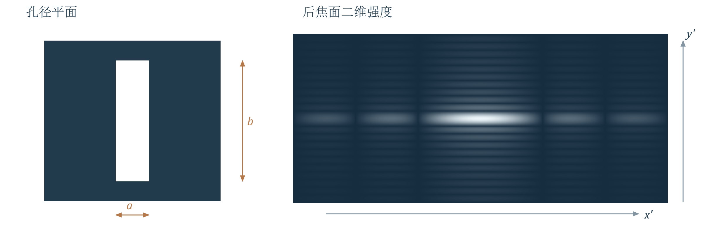
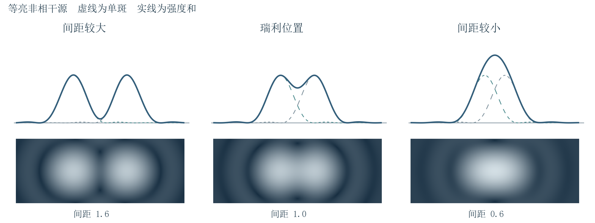

# 第4讲 光的衍射与分辨本领

!!! tip "本讲配套文件"
    - [PDF 在线阅读（基础物理学2_第4讲_光的衍射与分辨本领_学习讲义.pdf）](../文件/基础物理学2_第4讲_光的衍射与分辨本领_学习讲义.pdf)
    - [Word 下载（基础物理学2_第4讲_光的衍射与分辨本领_学习讲义.docx）](../文件/基础物理学2_第4讲_光的衍射与分辨本领_学习讲义.docx)
    - [知识点总结 PDF（基础物理学2_第4讲_光的衍射与分辨本领_知识点总结.pdf）](../文件/基础物理学2_第4讲_光的衍射与分辨本领_知识点总结.pdf)
    - [知识点总结 Word（基础物理学2_第4讲_光的衍射与分辨本领_知识点总结.docx）](../文件/基础物理学2_第4讲_光的衍射与分辨本领_知识点总结.docx)

## 1 衍射原理与计算方法

> **资料范围**：课件 PDF 2–12页；教材第二章§5，印刷135–139页。

### 1.1 从两束光叠加到整个孔径叠加
PPT重点衍射是光绕过障碍物边缘进入几何阴影区，并在空间重新分布光强的现象。干涉和衍射都来自相干叠加；本讲将第三讲的分立光束叠加推广为孔径内连续次波的积分。
窄缝沿哪个方向最窄，衍射就沿哪个方向展开得最宽；旋转狭缝，图样随之旋转。矩孔在两个正交方向都有展宽，圆孔形成轴对称图样。课件给出的孔径约为数十至数千波长只是实验尺度，是否明显还取决于传播距离和观察方式。
### 1.2 惠更斯 菲涅耳原理
PPT重点波面上每个面元都可视作次波源，观察点的复振幅是这些次波的相干叠加。先相加复振幅，再求模平方；不能直接把各面元强度相加。

$$\tilde U(P)=-\frac{i}{\lambda}\iint_{\Sigma_0}\tilde U_0(Q)F(\theta_0,\theta)\frac{e^{ikr}}{r}\,d\Sigma$$

$$F(\theta_0,\theta)=\frac{\cos\theta_0+\cos\theta}{2},\qquad k=\frac{2\pi}{\lambda}$$

其中 $\Sigma_0$ 为透光区域，$Q$ 为孔径上的次波源，$r=QP$；$\theta_0$、$\theta$ 分别是入射、出射方向与面元法线的夹角。这里 $\lambda$ 为传播介质中的波长，默认空气；采用空间因子 $e^{ikr}$、时间因子 $e^{-i\omega t}$。
各因子的作用：$\tilde U_0$ 给出入射振幅和相位，$d\Sigma$ 给出面积权重，$1/r$ 表示球面波振幅衰减，$e^{ikr}$ 给出传播相位，$F$ 表示方向权重。$-i$ 对应共同的 $-\pi/2$ 相位，不改变归一化强度分布。
必须掌握傍轴时可令 $F\approx1$，振幅分母用共同距离 $r_0$，得到

$$\tilde U(P)\approx-\frac{i}{\lambda r_0}\iint_{\Sigma_0}\tilde U_0(Q)e^{ikr}\,d\Sigma$$

但指数中的 $r$ 必须保留足够精度：很小的路程差也可能对应显著相位差。不能因为 $r\approx r_0$ 就把所有次波相位也设成相同。
### 1.3 巴比涅原理与适用范围
PPT重点互补屏的透光与遮光区域恰好互换。在相同入射场、相同观察点下，积分的线性性给出

$$\tilde U_a(P)+\tilde U_b(P)=\tilde U_{\mathrm{free}}(P)$$

教材补充教材139页强调：在光源的几何像平面上，几何像点以外自由场为零，因此 $\tilde U_a=-\tilde U_b$，两种互补屏才有相同的衍射强度。一般位置只有复振幅和关系，不能写成 $I_a+I_b=I_{\mathrm{free}}$，也不能断言处处 $I_a=I_b$。
### 1.4 近场和远场怎样区分
PPT重点菲涅耳衍射保留波前曲率影响；夫琅禾费衍射在孔径处采用平行入射，并观察各出射方向的强度。用准直透镜和平行光、接收透镜的后焦面，可在有限实验距离实现远场图样。
理解补充从孔径点到观察点的距离作近轴展开，除了随孔内坐标线性变化的项，还存在二次项。二次项带来的相位变化不可忽略时按菲涅耳处理；足够小时才可作夫琅禾费近似。不能只凭“几米远”判断近场或远场。

## 2 菲涅耳圆孔与圆屏衍射

> **资料范围**：课件 PDF 13–23页；教材第二章§6.1–6.3，印刷142–146页。

### 2.1 半波带如何划分
PPT重点点源 $S$ 到波面顶点 $O$ 的距离为 $R$，轴上观察点 $P$ 到 $O$ 的距离为 $b$。以 $P$ 为中心作半径依次增加 $\lambda/2$ 的辅助球面，将以 $S$ 为中心的波面切成环带。第 $j$ 条边界满足

$$r_j=b+\frac{j\lambda}{2},\qquad j=1,2,3,\cdots$$

这里 $j$ 表示带序号，避免与波数 $k$ 混淆。相邻带对应次波的相位约差 $\pi$；带内相位也连续变化，整个带的贡献已经是带内相干叠加的结果。

{ loading=lazy }
*图1 半波带的几何与正视分区。半径平方近似等差，外侧环带更窄；右图为波面的近轴投影，并非额外设置的实体环。*

### 2.2 为什么相邻带贡献近似相等
建议理解球帽面积 $\Sigma=2\pi R^2(1-\cos\alpha)$，其中 $\alpha$ 为 $SQ$ 与轴线夹角。由三角形 $SQP$ 的余弦定理，

$$r^2=R^2+(R+b)^2-2R(R+b)\cos\alpha$$

微分并消去 $\sin\alpha\,d\alpha$：

$$\frac{d\Sigma}{r}=\frac{2\pi R}{R+b}\,dr\quad\Rightarrow\quad\frac{\Delta\Sigma_j}{r_j}\approx\frac{\pi R\lambda}{R+b}$$

每带的面积与传播振幅衰减恰好近似补偿。因此 $A_j\propto F(\theta_j)\Delta\Sigma_j/r_j$ 主要随倾斜因子缓慢减小；靠近轴的少量波带可取 $A_1\approx A_2\approx\cdots$。
### 2.3 圆孔中心为何忽明忽暗
必须掌握去掉共同相位后，透过前 $n$ 个完整带的合振幅近似为交错和：

$$A(P)=|A_1-A_2+A_3-\cdots+(-1)^{n+1}A_n|$$

由于中间各项可近似两两抵消，

$$A(P)\approx\frac{1}{2}|A_1+(-1)^{n+1}A_n|,\qquad A_{\mathrm{free}}\approx\frac{A_1}{2}$$

少量近轴波带且贡献近似等大时：奇数个带给出 $A\approx A_1$、$I\approx4I_{\mathrm{free}}$；偶数个带给出 $A\approx0$、中心近暗。增大孔径会依次放入更多带，所以中心强度不是单调增加。固定孔径、改变 $b$，带数也改变。
理解补充轴上某点变亮是能量重新分布，不表示总透射能量增加四倍。“奇亮偶暗”是整带、轴上及近似等幅条件下的结论，偏轴点需重新划带。
### 例2.6.1 圆屏与泊松亮点
PPT重点圆屏遮住前 $j$ 个半波带，求轴上 $P$ 点振幅。剩余带仍按相位交替叠加：

$$A(P)=|A_{j+1}-A_{j+2}+\cdots|\approx\frac{A_{j+1}}{2}$$

因此圆屏几何阴影中心仍有亮点，称泊松亮点。它来自屏外各带的剩余合振幅；不能套用圆孔“遮住偶数带就暗”的判断。若被遮区域近轴且 $A_{j+1}\approx A_1$，亮点强度约为自由传播时的强度。
### 2.4 非整数带用振幅矢量图
PPT重点把每个半波带再细分，子带相位逐渐增加；其振幅矢量首尾相接，极限下形成弧线。总振幅是起点到终点的弦长，不是弧长。考虑倾斜因子缓慢减小后，轨迹逐渐收拢成螺线。

{ loading=lazy }
*图2 左为少量近轴波带的等幅近似：半个半波带对应四分之一圆弧，一个半波带对应半圆。右为同一近似下轴上强度随透过带数的变化。*

### 例2.6.2 只透过半个半波带
PPT重点圆孔只包含第一个半波带的前一半，孔中心与边缘的相位差为 $\pi/2$。令矢量圆半径为 $c$，完整第一带的弦长为 $A_1=2c$；四分之一圆弧对应弦长 $\sqrt{2}c$。

$$A'=\frac{A_1}{\sqrt{2}}=\sqrt{2}A_{\mathrm{free}},\qquad I'=2I_{\mathrm{free}}$$

关键是先求矢量和：面积减半不代表振幅减半，更不代表强度减半。
理解补充若用连续带数 $N$ 表示孔边缘相对中心的光程差为 $N\lambda/2$，在近轴等权近似下，弧的总转角为 $\pi N$，有

$$\frac{I(N)}{I_{\mathrm{free}}}\approx4\sin^2\left(\frac{\pi N}{2}\right)$$

此式统一解释半带、整带结果；不把它外推到很大倾角或大量不等幅波带。

## 3 半波带半径与波带片

> **资料范围**：课件 PDF 24–30页；教材第二章§6.4，印刷147–148页。

### 3.1 半波带半径的关键推导
必须掌握图1中第 $j$ 条边界的横向半径为 $\rho_j$，波面相对顶点后退 $h$。两直角三角形给出

$$\rho_j^2=R^2-(R-h)^2\approx2Rh$$

$$\rho_j^2+(b+h)^2=\left(b+\frac{j\lambda}{2}\right)^2$$

在 $h\ll R,b$、$j\lambda\ll b$ 时忽略 $h^2$ 与 $(j\lambda)^2$，代入第一式得到

$$2(R+b)h\approx jb\lambda\quad\Rightarrow\quad\rho_j^2\approx\frac{Rb}{R+b}j\lambda$$

$$\rho_j=\sqrt{j}\rho_1,\qquad\rho_1=\sqrt{\frac{Rb\lambda}{R+b}}$$

平面波入射时 $R\to\infty$，$\rho_j\approx\sqrt{jb\lambda}$。固定圆孔半径 $\rho$ 时，包含的带数近似为 $N=\rho^2(1/R+1/b)/\lambda$，可不为整数。
### 例2.6.4 计算波带半径
PPT重点给定 $\lambda=0.500\,\mu\mathrm m$、$R=1.00\,\mathrm m$、$b=4.00\,\mathrm m$，求前四带及第100带半径。

$$\rho_1=\sqrt{\frac{1.00\times4.00}{1.00+4.00}\times0.500\times10^{-6}}\,\mathrm m=0.632\,\mathrm{mm}$$

由 $\rho_j=\sqrt{j}\rho_1$ 得 $\rho_2=0.894\,\mathrm{mm}$、$\rho_3=1.095\,\mathrm{mm}$、$\rho_4=1.265\,\mathrm{mm}$、$\rho_{100}=6.325\,\mathrm{mm}$。这些是各带外边界到中心的半径，不是各环带自身的宽度。
### 3.2 波带片为何能聚光
PPT重点按设计观察点的半波带边界制片，交替遮住奇数带或偶数带。留下的各带贡献近似同相，避免相邻带相消，因而增强轴上指定点的光强。

{ loading=lazy }
*图3 奇数带透光的振幅型波带片，以及平面波照明时的几个实焦点。各焦点对应不同衍射级，示意位置按比例给出。*

### 例2.6.3 二十带波带片的增强倍数
PPT重点波带片覆盖前20个半波带，奇数带透光、偶数带不透光，共有10个透光带。在各带贡献近似相等时，

$$A'\approx A_1+A_3+\cdots+A_{19}\approx10A_1=20A_{\mathrm{free}}$$

$$I'\approx400I_{\mathrm{free}}$$

400倍是同一轴上场点相对于无遮挡自由场的强度比，不是整束光的功率增益。数透光带时不要把20个总带误当成20个透光带。
### 3.3 主焦距与次焦点
PPT重点由带半径公式移项，

$$\frac{1}{R}+\frac{1}{b}=\frac{j\lambda}{\rho_j^2}=\frac{1}{f},\qquad f=\frac{\rho_1^2}{\lambda}$$

形式类似薄透镜成像公式。对固定波带片，$\rho_1$ 固定，故 $f\propto1/\lambda$；换波长就会改变焦点位置。
教材补充教材148页给出实焦点 $f,f/3,f/5,\cdots$，并有对称的虚焦点 $-f,-f/3,\cdots$。波带片的出射场包含会聚、发散等成分，不能只画成单一折射光束。
理解补充为什么有奇数级次焦点？在 $f/3$ 处，原来一个半波带范围被分成三个新的半波带，其贡献近似为 $A-A+A$；相邻透光环仍给出同相的净贡献。换成任意奇数个细带同理。偶数细分时正负近乎抵消，理想振幅型波带片没有对应的偶数级聚焦峰。
### 3.4 菲涅耳透镜 了解即可
PPT重点课件的菲涅耳透镜由同心环形折射面构成，保持各处所需的折射方向并减薄材料，可用于大口径照明、投影与放大。它与交替遮光、依靠衍射聚焦的波带片不同。
理解补充几何光学菲涅耳透镜的减薄不必满足“切除整数波长光程”；以整波长相位延迟进行减薄属于相位型衍射元件的设计思路。两种机制不要混用。

## 4 夫琅禾费单缝衍射

> **资料范围**：课件 PDF 31–43、47–55页；教材第二章§7.1–7.2、§7.4，印刷153–159页。

### 4.1 装置与光程差
PPT重点令缝宽沿 $x$ 方向为 $a$，长边沿 $y$，光轴沿 $z$。单色平面波正入射；接收透镜将同一衍射角 $\theta$ 的光会聚到后焦面同一点，位置 $x'=f\tan\theta$。

{ loading=lazy }
*图4 单缝到后焦面的光路。蓝色光线具有相同出射方向，在焦面会聚；孔径内不同位置的传播相位差仍需计入。*

缝上边缘与下边缘到同一观察方向的光程差大小为 $a\sin\theta$。取孔内坐标原点在缝中心，孔内点 $Q(x)$ 相对中心点的光程差为

$$\Delta r=-x\sin\theta,\qquad\Delta\varphi=-kx\sin\theta$$

正 $x$ 一侧更靠近正角度方向的观察点，因此路程更短；这解释了负号。改变整体符号约定不改变强度，但积分内必须自洽。
### 4.2 半波带法判断暗纹
PPT重点当 $a\sin\theta=\lambda$，把缝分成两条等宽带，上下对应点相距 $a/2$，光程差均为 $\lambda/2$，逐点抵消，形成第一暗纹。一般有

$$a\sin\theta=\pm m\lambda,\qquad m=1,2,3,\cdots$$

此时可分成 $2m$ 个半波带。$\theta=0$ 时所有次波同相，形成中央主极大；不能把 $m=0$ 代入暗纹公式。
奇数个半波带会有未抵消的贡献，但给出的次极大位置仅近似。精确极大值必须由强度函数求导，不能把 $3\lambda/2$ 当成严格的第一副峰条件。
### 4.3 复振幅积分推导 必须掌握
均匀照明、长缝且只讨论垂直缝方向时，将与 $x$ 无关的因子合并为 $C$：

$$\tilde U(\theta)=C\int_{-a/2}^{a/2}e^{-ikx\sin\theta}\,dx$$

$$=C\frac{e^{-ika\sin\theta/2}-e^{ika\sin\theta/2}}{-ik\sin\theta}=aC\frac{\sin\alpha}{\alpha}$$

$$\alpha=\frac{\pi a\sin\theta}{\lambda},\qquad\tilde U(0)=aC$$

所以

$$I(\theta)=I_0\left(\frac{\sin\alpha}{\alpha}\right)^2,\qquad I_0=|\tilde U(0)|^2$$

在 $\alpha=0$ 处取极限 $\sin\alpha/\alpha\to1$。振幅比可以为负，表示相位反转；强度比始终非负。
### 4.4 振幅矢量法 建议理解
PPT重点将缝等分为 $N$ 条，每条贡献大小 $\Delta A_0$，相邻贡献的相位差为 $\delta=2\pi a\sin\theta/(N\lambda)$。$N\to\infty$ 时首尾相接成圆弧，总转角 $N\delta=2\alpha$。令圆弧半径为 $c$，则

$$A_0=2c\alpha,\qquad A_\theta=2c|\sin\alpha|\quad\Rightarrow\quad\frac{A_\theta}{A_0}=\left|\frac{\sin\alpha}{\alpha}\right|$$

弧长对应同相时的振幅和，弦长对应实际合振幅。当转过完整一周，弦长为零，正好对应第一暗纹。与圆孔半波带法相比，这里的带是狭缝内的窄条，不能混用圆环半径公式。
### 4.5 极值与宽度
PPT重点主极大为 $\alpha=0$。暗纹为 $\alpha=\pm m\pi$；除这些点外，令强度导数为零，

$$\frac{dI}{d\alpha}=2I_0\frac{\sin\alpha(\alpha\cos\alpha-\sin\alpha)}{\alpha^3}=0$$

非零次极大满足 $\tan\alpha=\alpha$，前三个正根约为 $1.430\pi,2.459\pi,3.471\pi$；相对强度分别约为 $0.0472,0.0165,0.0083$。

{ loading=lazy }
*图5 单缝归一化强度曲线及振幅圆弧。中央亮纹两侧第一暗纹之间的全宽，是相邻其他暗纹间距的两倍。*

必须掌握第一暗纹 $\sin\theta_1=\lambda/a$。若 $\lambda/a\ll1$，

$$\Delta\theta_0\approx\frac{2\lambda}{a},\qquad\Delta x_0\approx\frac{2f\lambda}{a}$$

$$x'_m\approx\frac{mf\lambda}{a},\qquad\Delta x_{\mathrm{side}}\approx\frac{f\lambda}{a}$$

这里宽度按两侧暗纹定义，不是半高全宽。缝越窄、波长越长，图样越宽；$f$ 只把角宽映射成线宽，不改变衍射角分布。
理解补充当 $a$ 接近 $\lambda$，第一暗纹趋向大角度，近轴公式失效，不能据此说整屏严格等亮；当 $a\gg\lambda$，衍射角很小，几何光学近似更适用。均匀入射振幅不变时，单缝中央强度还随 $a^2$ 改变，比较归一化曲线时不要混淆绝对亮度。
### 例2.7.1 雷达监视的公路长度
PPT重点$\lambda=30\,\mathrm{mm}$，天线宽 $a=0.20\,\mathrm m$，雷达距公路垂直距离 $d=15\,\mathrm m$，波束中心与公路夹角 $\beta=15^\circ$。按单缝中央明纹求监视长度 $L$。
先求主瓣半角，再求两条边界与公路的交点；不能直接用垂直截面的光斑宽度作为沿公路长度。

$$\theta_1=\arcsin\frac{0.030}{0.20}=8.627^\circ$$

{ loading=lazy }
*图6 雷达波束在公路上的截取范围。近、远边界与公路分别成较大、较小角，图中横纵方向采用相同尺度。*

以雷达在公路上的垂足为原点，两个交点距离为

$$x_{\mathrm{near}}=\frac{d}{\tan(\beta+\theta_1)}=34.29\,\mathrm m$$

$$x_{\mathrm{far}}=\frac{d}{\tan(\beta-\theta_1)}=134.30\,\mathrm m$$

$$L=x_{\mathrm{far}}-x_{\mathrm{near}}\approx100.0\,\mathrm m$$

该结果使用准确的反正弦和三角几何。角度约 $8.6^\circ$，不必为省一步强行采用小角近似。若改变条件使 $\beta\le\theta_1$，远边界不再按上述有限交点解释。

## 5 矩孔衍射与两个方向的展宽

> **资料范围**：课件 PDF 44–46页；教材第二章§7.3，印刷156–157页。

PPT重点矩孔沿 $x,y$ 的边长为 $a,b$。令出射方向在两轴上的方向余弦分别为 $\sin\theta_1,\sin\theta_2$，孔内点到观察方向的相对光程为

$$\Delta r=-(x\sin\theta_1+y\sin\theta_2)$$

必须掌握矩形积分域和均匀入射场使两个方向可分离：

$$\tilde U=C\int_{-a/2}^{a/2}e^{-ikx\sin\theta_1}\,dx\int_{-b/2}^{b/2}e^{-iky\sin\theta_2}\,dy$$

$$\tilde U=abC\frac{\sin\alpha}{\alpha}\frac{\sin\beta}{\beta},\qquad\alpha=\frac{\pi a\sin\theta_1}{\lambda},\quad\beta=\frac{\pi b\sin\theta_2}{\lambda}$$

$$I=I_0\left(\frac{\sin\alpha}{\alpha}\right)^2\left(\frac{\sin\beta}{\beta}\right)^2,\qquad I_0=a^2b^2|C|^2$$

本节的 $b$ 是矩孔边长，$\beta$ 是相位参数，与前文距离和雷达角度不同。此处 $\alpha,\beta$ 不再表示课件图中的空间方向角。

{ loading=lazy }
*图7 矩孔与对应二维衍射。左侧孔沿横向窄、纵向长，右侧中央亮斑沿横向宽、纵向窄；为显示弱副瓣，图像采用非线性亮度显示。*

任一个方向的衍射因子为零，就出现暗线。小角度后焦面上，中央亮斑两向全宽为

$$\Delta x'_0\approx\frac{2f\lambda}{a},\qquad\Delta y'_0\approx\frac{2f\lambda}{b}$$

理解补充两向因子相乘，不是两张单缝图样相加。公式要求孔径上的入射振幅近似均匀；若光源扩展，其不同源点图样的强度叠加会改变最终清晰度。

## 6 圆孔衍射与分辨本领

> **资料范围**：课件 PDF 56–66页；教材第二章§8.1–8.2，印刷165–167页。

### 6.1 艾里斑及其大小
PPT重点圆孔正入射远场衍射具有轴对称性。令圆孔直径为 $D$，使用无量纲参数 $v$ 避免与空间坐标混淆：

$$v=\frac{\pi D\sin\theta}{\lambda},\qquad I(\theta)=I_0\left[\frac{2J_1(v)}{v}\right]^2$$

$J_1$ 为一阶贝塞尔函数，$v=0$ 时取极限1。本讲记住结果和零点的物理意义，不展开特殊函数积分。第一正零点约 $v=3.832$，所以

$$D\sin\theta_1\approx1.22\lambda,\qquad\theta_1\approx\frac{1.22\lambda}{D}$$

第一暗环围成的中央亮斑称艾里斑，约含总衍射光能量的84%。$\theta_1$ 是角半径；在焦距 $f$ 的后焦面，半径 $r_1\approx1.22f\lambda/D$，直径为 $2r_1$。
### 6.2 瑞利判据 必须掌握
PPT重点几何光学把物点成像为点，有限孔径实际把物点成像为衍射斑。对等亮、互不相干的两个点源，其像强度相加：当一个斑的中心落在另一斑的第一暗环上，按瑞利判据认为刚可分辨。

$$\theta_{\min}\approx\frac{1.22\lambda}{D},\qquad\mathcal R=\frac{1}{\theta_{\min}}=\frac{D}{1.22\lambda}$$

这里 $\mathcal R$ 为分辨本领，角度用弧度；它越大越好，最小可分辨角则越小越好。

{ loading=lazy }
*图8 两个等亮非相干点源的像。上方虚线为各自强度、实线为强度之和；下方为同一模型的二维图样。间距以单斑第一暗环半径为单位。*

教材补充教材167页给出瑞利位置的合成曲线和中心凹陷；刚可分辨并不要求两个光斑完全分开。该判据是约定的分辨标准，实际成像还受像差、噪声和物点亮度差影响。
理解补充远处两点横向距离 $s$、观察距离 $L$ 满足 $s\ll L$ 时，张角约为 $s/L$。因此刚可分辨时 $s_{\min}\approx L\theta_{\min}$。图样在屏上的斑直径不能直接充当物方最小分辨距离。
### 例2.8.1 人眼的艾里斑与课件数值核对
PPT重点把瞳孔视为理想圆孔，取 $D=2.0\,\mathrm{mm}$、$\lambda=0.55\,\mu\mathrm m$、$f=20\,\mathrm{mm}$。

$$\theta_1=\frac{1.22\times0.55\times10^{-6}}{2.0\times10^{-3}}=3.355\times10^{-4}\,\mathrm{rad}\approx1.15'$$

$$d_{\mathrm{Airy}}=2f\theta_1=2\times20\times10^{-3}\times3.355\times10^{-4}\,\mathrm m\approx13.4\,\mu\mathrm m$$

教材补充教材166页对应例题给出约 $14\,\mu\mathrm m$。课件 PDF 65页写成 $1.34\,\mu\mathrm m$，与其给定参数相差十倍，应按上式更正。
若按每个斑占边长约为斑直径的方格作粗估，$1\,\mathrm{mm}^2$ 面积对应约 $1/(0.0134)^2\approx5.6\times10^3$ 个方格，与课件约 $5.5\times10^3$ 同量级。这不是视网膜实际细胞数，也不是可独立分辨点数的严格计数。
### 例2.8.2 三毫米间距能看多远
PPT重点沿用上题的 $\theta_{\min}\approx3.355\times10^{-4}\,\mathrm{rad}$，两点横向相距 $s=3.0\,\mathrm{mm}$。由 $s/L=\theta_{\min}$ 得

$$L_{\max}\approx\frac{3.0\times10^{-3}}{3.355\times10^{-4}}\,\mathrm m=8.94\,\mathrm m\approx9\,\mathrm m$$

两点移近时张角增大，较易分辨；远处车灯从一个亮点变成两个亮点就是这一现象的直观例子。这里计算的是理想孔径模型的估计。
### 6.3 提高分辨能力的方向
PPT重点在相同波长下增大有效孔径 $D$，或在相同孔径下缩短波长 $\lambda$，都可降低衍射角尺度。望远镜的大口径、电子显微镜利用很短的物质波波长，体现的是这个共同思路。
理解补充单纯放大图像不会恢复已经混在一起的细节。课件中的望远镜案例用于说明孔径作用，不将设备历史排名作为本讲结论；显微镜的精细分辨公式不在本次课件展开范围内。

## 7 公式速查
@break
### 衍射积分与近场圆孔
复振幅先相加，强度后取模平方；巴比涅原理为 $\tilde U_a+\tilde U_b=\tilde U_{\mathrm{free}}$。

$$\tilde U(P)\approx-\frac{i}{\lambda r_0}\iint_{\Sigma_0}\tilde U_0(Q)e^{ikr}\,d\Sigma$$

傍轴时只把振幅因子近似为常量，保留指数中的相对路程。

$$\rho_j^2\approx\frac{Rb}{R+b}j\lambda,\qquad N\approx\frac{\rho^2}{\lambda}\left(\frac{1}{R}+\frac{1}{b}\right)$$

少量近轴完整带：奇数带中心亮、偶数带中心近暗；$A_{\mathrm{free}}\approx A_1/2$。圆屏遮住前 $j$ 带后，轴上振幅约 $A_{j+1}/2$。

$$\frac{1}{R}+\frac{1}{b}=\frac{1}{f},\qquad f=\frac{\rho_1^2}{\lambda},\qquad f_q=\frac{f}{2q+1}\quad(q=0,1,2,\cdots)$$

波带片半径平方等差；上述 $f_q$ 为平行入射时的实焦点。
### 单缝与矩孔

$$\alpha=\frac{\pi a\sin\theta}{\lambda},\qquad\frac{I}{I_0}=\left(\frac{\sin\alpha}{\alpha}\right)^2$$

暗纹 $a\sin\theta=\pm m\lambda$，$m\ge1$；次极大 $\tan\alpha=\alpha$，取非零且非暗纹的根。

$$\Delta\theta_0\approx\frac{2\lambda}{a},\qquad\Delta x'_0\approx\frac{2f\lambda}{a},\qquad x'_m\approx\frac{mf\lambda}{a}$$

这些宽度指小角度下两侧暗纹间的全宽。矩孔用两向单缝因子相乘，另一方向把 $a$ 换成 $b$。
### 圆孔与分辨

$$\frac{I}{I_0}=\left[\frac{2J_1(v)}{v}\right]^2,\qquad v=\frac{\pi D\sin\theta}{\lambda}$$

$$\theta_1\approx\theta_{\min}\approx\frac{1.22\lambda}{D},\qquad d_{\mathrm{Airy}}\approx\frac{2.44f\lambda}{D}$$

$$\mathcal R=\frac{1}{\theta_{\min}},\qquad s_{\min}\approx L\theta_{\min}$$

$D$ 为直径；瑞利判据对应等亮非相干点源和理想圆孔。单缝系数1与圆孔系数1.22不可混用。

## 8 易错点与自测
### 本讲易错清单
1. 相位不能随振幅分母一起近似；把 $e^{ikr}$ 全改成共同常数会消掉衍射。
2. 巴比涅原理相加的是复振幅；互补图样等强需要自由场在该观察点为零。
3. 半波带由观察点定义；移动观察点，分区也改变。半波带不是固定刻在波面上的实体。
4. “奇亮偶暗”针对圆孔透过完整带；圆屏阴影中心仍可能有泊松亮点。
5. 圆孔半径 $\rho_j\propto\sqrt j$；环带宽度不等，不能写成 $\rho_j=j\rho_1$。
6. 单缝的 $m=0$ 是主极大，不是暗纹；副峰的半整数位置只是近似。
7. 中央亮纹全宽、艾里斑角半径、半高全宽是不同量；先明确边界再代公式。
8. 非相干物点相加强度，相干次波相加复振幅；瑞利判据不能无条件套到相干源。
### 自测题
以下为理解补充自编练习。先写模型与条件，再计算；答案在文末。
1. 概念：互补圆孔和圆屏在任意观察平面是否有相同强度？为什么圆屏中心有亮点并不违反几何阴影的概念？
2. 半波带：平面波波长 $\lambda=500\,\mathrm{nm}$，观察点距圆孔 $b=2.00\,\mathrm m$。求第一带半径；当孔半径分别为 $\rho_1/\sqrt2,\rho_1,\sqrt2\rho_1$ 时，轴上强度约为自由场的几倍？
3. 单缝：$a=0.20\,\mathrm{mm}$、$\lambda=600\,\mathrm{nm}$、$f=0.50\,\mathrm m$。求中央明纹全宽和第一副峰位置。若缝宽减半且入射振幅不变，中央宽度与中央强度如何变化？
4. 矩孔：$a=0.10\,\mathrm{mm}$、$b=0.40\,\mathrm{mm}$、$\lambda=500\,\mathrm{nm}$、$f=0.20\,\mathrm m$，求两向中央亮斑全宽，并说明哪一向展宽更强。
5. 分辨：圆孔直径 $D=5.0\,\mathrm{cm}$，波长 $\lambda=550\,\mathrm{nm}$，观察 $L=1.0\,\mathrm{km}$ 处两个等亮非相干点源。求最小可分辨间距；直径加倍后怎样变化？
### 资料定位
教师课件共66个PDF页面，正文引用均为PDF页序，非不连续的幻灯片页脚编号。重点对应：原理2–12页，半波带与波带片13–30页，单缝及矩孔31–55页，圆孔与分辨56–66页。
教材为赵凯华、钟锡华《光学（重排本）》：第二章§5，135–139页；§6，142–148页；§7，153–159页；§8，165–167页。页码为印刷页，提供的教材PDF页序需加13。标签PPT重点标课程主线，教材补充标已核对的教材信息，理解补充标解释、纠偏或自编练习。

## 9 自测答案
@break
### 第1题 概念
不一定。始终成立的是 $\tilde U_a+\tilde U_b=\tilde U_{\mathrm{free}}$；当自由场在该点为零时，才有 $\tilde U_a=-\tilde U_b$、$I_a=I_b$。圆屏外的次波能够进入几何阴影并相干叠加；几何阴影只描述直线光线被挡住的区域，不保证波动光强严格为零。
### 第2题 半波带

$$\rho_1=\sqrt{b\lambda}=\sqrt{2.00\times500\times10^{-9}}\,\mathrm m=1.00\,\mathrm{mm}$$

三种孔径分别对应 $N=1/2,1,2$。由矢量弦长或 $I/I_{\mathrm{free}}\approx4\sin^2(\pi N/2)$ 得到强度比约为2、4、0。前提是近轴且波带贡献近似等权。
### 第3题 单缝

$$\Delta x'_0\approx\frac{2f\lambda}{a}=3.00\,\mathrm{mm}$$

第一副峰 $a\sin\theta\approx1.430\lambda$，故 $x'\approx\pm1.430f\lambda/a=\pm2.145\,\mathrm{mm}$。缝宽减半，中央全宽加倍至 $6.00\,\mathrm{mm}$；在相同均匀入射振幅下，$I_0\propto a^2$，降为原来的四分之一。
### 第4题 矩孔

$$\Delta x'_0\approx\frac{2f\lambda}{a}=2.00\,\mathrm{mm},\qquad\Delta y'_0\approx\frac{2f\lambda}{b}=0.500\,\mathrm{mm}$$

孔在 $x$ 向更窄，衍射在 $x'$ 向更宽，两向宽度比为4。求的是两侧第一暗线之间的全宽。
### 第5题 分辨

$$\theta_{\min}\approx\frac{1.22\lambda}{D}=1.342\times10^{-5}\,\mathrm{rad}$$

$$s_{\min}\approx L\theta_{\min}=1.342\times10^{-2}\,\mathrm m=1.34\,\mathrm{cm}$$

直径加倍，最小分辨角和最小间距均减半，间距约 $0.671\,\mathrm{cm}$；分辨本领加倍。增加后续放大倍率不会产生同样的分辨改善。

