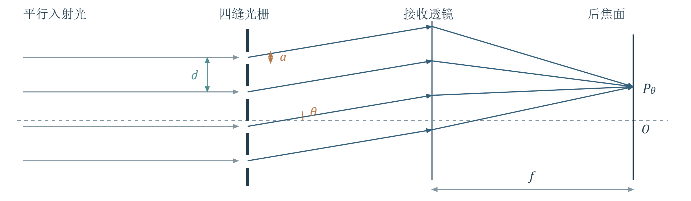
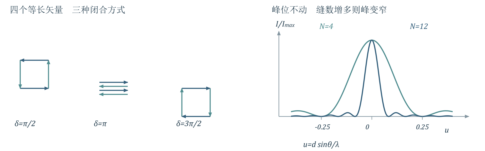
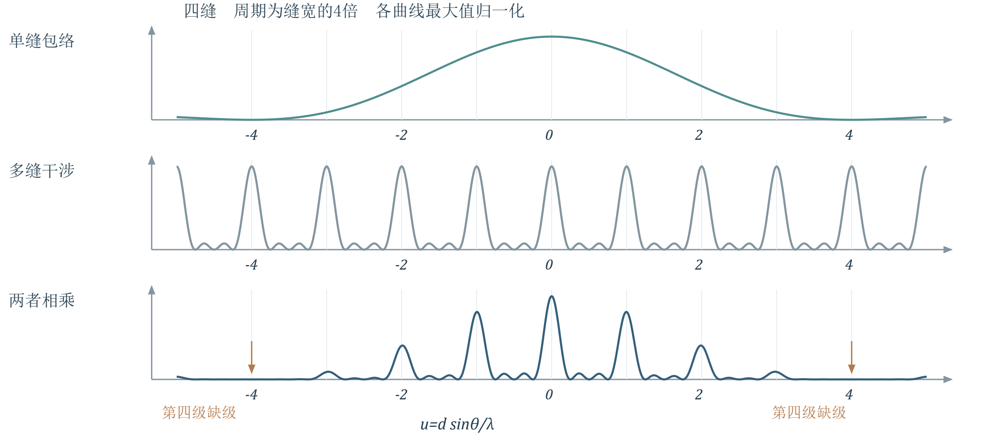
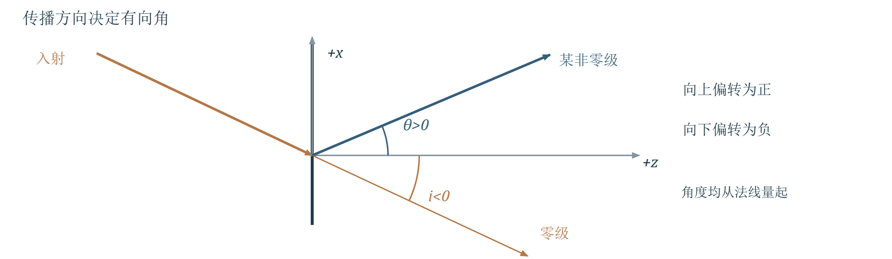
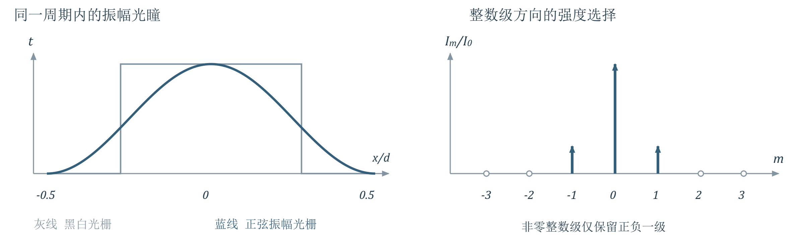
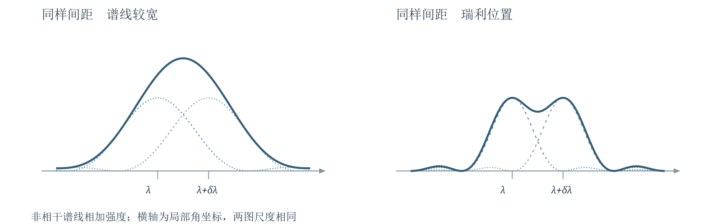
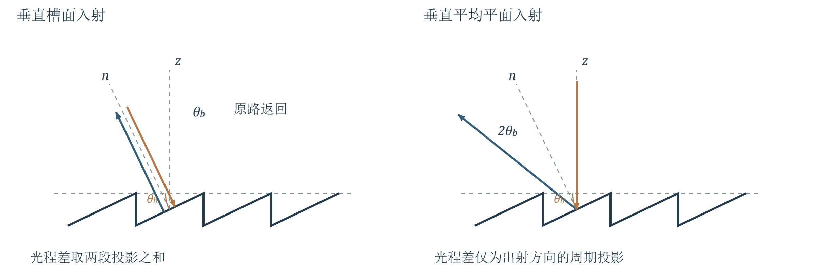
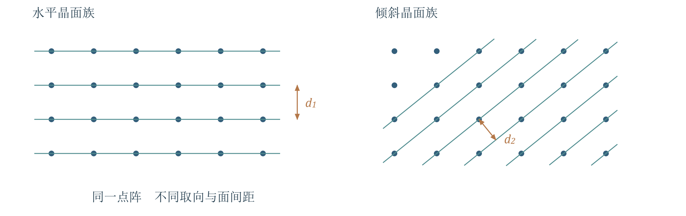
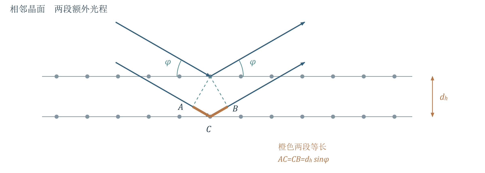
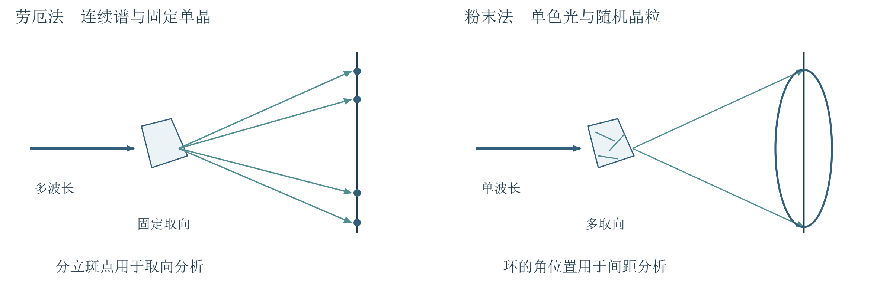

# 第5讲 衍射光栅与晶体衍射

!!! tip "本讲配套文件"
    - [PDF 在线阅读（基础物理学2_第5讲_衍射光栅与晶体衍射_学习讲义.pdf）](../文件/基础物理学2_第5讲_衍射光栅与晶体衍射_学习讲义.pdf)
    - [Word 下载（基础物理学2_第5讲_衍射光栅与晶体衍射_学习讲义.docx）](../文件/基础物理学2_第5讲_衍射光栅与晶体衍射_学习讲义.docx)
    - [知识点总结 PDF（基础物理学2_第5讲_衍射光栅与晶体衍射_知识点总结.pdf）](../文件/基础物理学2_第5讲_衍射光栅与晶体衍射_知识点总结.pdf)
    - [知识点总结 Word（基础物理学2_第5讲_衍射光栅与晶体衍射_知识点总结.docx）](../文件/基础物理学2_第5讲_衍射光栅与晶体衍射_知识点总结.docx)

## 1 从单缝到多缝衍射

> **资料范围**：课件 PDF 2–15页；教材第四章§1.1–1.3，印刷253–259页。

### 1.1 光栅的三个结构量
PPT重点光栅是具有空间周期性的衍射结构。普通一维透射光栅由等宽、等间距的平行狭缝组成；反射光栅则由周期排列的反射单元组成。记透光缝宽为 $a$、遮光宽为 $b$，则光栅常数（周期）为 $d=a+b$；$N$ 为实际被相干照明的缝数，刻线密度为 $1/d$。
理解补充本讲始终区分：$a$ 决定单缝包络，$d$ 决定相邻级次的位置，$N$ 决定干涉峰的细锐程度。给定照明宽度 $W$ 时，$N\approx W/d$，不能把整块光栅的刻线总数直接当成有效缝数。
### 1.2 各缝的图样为什么重叠
PPT重点单色平面波照射光栅，接收透镜把同一出射方向的光会聚到后焦面的同一点。依次只开放一个缝，各缝的单缝强度图样重合；同时开放多个缝时，各缝之间还存在固定相位关系，必须相加复振幅。

{ loading=lazy }
*图1 四缝远场装置。相同衍射角的光在焦面同一点会聚；不同缝贡献的相位不同，不能把四个单缝强度直接相加。*

若各缝互不相干，强度只有单缝图样的 $N$ 倍；相干且同相时振幅为 $N$ 倍，强度为 $N^2$ 倍。后者只是峰值增强，伴随峰宽变窄，不代表总能量增加为 $N^2$ 倍。
### 1.3 主极大与暗纹
必须掌握正入射时，相邻缝沿同一出射方向的光程差及相位差为

$$\Delta L=d\sin\theta,\qquad\delta=\frac{2\pi d\sin\theta}{\lambda}$$

这里 $\theta$ 从光栅法线量起；采用有正负号的级次 $m=0,\pm1,\pm2,\cdots$。课件用 $k$ 表示级次，笔记改用 $m$，避免与后文波数混淆。
主极大对应所有矢量同向，即 $\delta=2m\pi$：

$$d\sin\theta_m=m\lambda$$

该式给出干涉因子的主极大位置；若该方向的单缝振幅为零，仍会缺级。存在传播方向还要求 $|m\lambda/d|\le1$，等号对应掠射边界，实际装置通常收不到。
暗纹对应振幅矢量首尾闭合，即 $N\delta=2q\pi$，同时排除 $\delta=2m\pi$：

$$d\sin\theta=\frac{q\lambda}{N},\qquad q\ne Nm$$

在两个相邻主极大之间，$q=Nm+1,\cdots,Nm+N-1$，因此有 $N-1$ 条暗纹、$N-2$ 个次极大。这个计数针对未乘单缝包络的干涉因子；课件把次极大位置标为“不重要”，这里只保留计数，不展开求根。
### 例4.1.1 四缝之间有几条暗纹
PPT重点$N=4$，求0级与1级主极大之间的暗纹数及相位差。模型是四束等幅、等相位差的相干叠加。

$$\sin\theta=\frac{\lambda}{4d},\frac{2\lambda}{4d},\frac{3\lambda}{4d}\quad\Rightarrow\quad\delta=\frac{\pi}{2},\pi,\frac{3\pi}{2}$$

共3条暗纹。$\delta=\pi$ 时，两两反向相消；其余两个相位差使四个矢量组成闭合方形。$\delta=2\pi$ 已是1级主极大，不属于暗纹。

{ loading=lazy }
*图2 四缝的三种暗纹相量图，以及不同缝数的归一化干涉峰。峰高统一归一化为1，以便只比较宽度；实际同相峰值随缝数平方增长。*

### 1.4 主极大半角宽
必须掌握半角宽是主极大中心到相邻第一暗纹的角间隔，不是半高宽。对第 $m$ 级，

$$d\sin\theta_m=m\lambda,\qquad d\sin(\theta_m+\Delta\theta)=\left(m+\frac{1}{N}\right)\lambda$$

两式相减。若 $\Delta\theta$ 很小且不接近掠射，保留一阶项：

$$d\cos\theta_m\,\Delta\theta\approx\frac{\lambda}{N}\quad\Rightarrow\quad\Delta\theta\approx\frac{\lambda}{Nd\cos\theta_m}$$

两侧第一暗纹间全宽约为 $2\Delta\theta$。相邻级次在 $\sin\theta$ 坐标中的间隔为 $\lambda/d$，暗纹间隔为 $\lambda/(Nd)$；只有小角度时，才能直接把这些间隔理解为角度间隔。

## 2 单缝包络与光栅强度公式

> **资料范围**：课件 PDF 16–23页；教材第四章§1.2–1.4，印刷255–260页。

### 2.1 两个因子相乘
PPT重点设单缝正前方强度为 $I_{0s}$，令

$$\alpha=\frac{\pi a\sin\theta}{\lambda},\qquad\beta=\frac{\delta}{2}=\frac{\pi d\sin\theta}{\lambda}$$

每缝沿 $\theta$ 方向的振幅含单缝因子 $\sin\alpha/\alpha$。把相邻转角为 $2\beta$ 的 $N$ 个等长矢量首尾相接，外接圆半径为 $r$，单矢量长度与合矢量长度分别为 $2r|\sin\beta|$、$2r|\sin N\beta|$，故

$$I(\theta)=I_{0s}\left(\frac{\sin\alpha}{\alpha}\right)^2\left(\frac{\sin N\beta}{\sin\beta}\right)^2$$

前一项描述“每个缝向哪里送光”，后一项描述“周期排列使哪些方向相干增强”。$\alpha=0$ 或 $\beta=m\pi$ 时要取极限；尤其 $\sin N\beta/\sin\beta$ 的模趋于 $N$，不是0。

{ loading=lazy }
*图3 同一横坐标下的单缝因子、归一化干涉因子及其乘积。取四缝、周期为缝宽的4倍，第四级恰落在包络零点而缺级。*

理解补充课件所说“包络不改变位置与宽度”，指干涉因子的峰位和第一暗纹尺度。对有限 $N$，总强度是乘积，变化较快的包络可使实际局部峰顶略偏；常用的窄主峰近似下忽略这种偏移。
### 2.2 缺级条件与中央包络内的条纹数
必须掌握同时满足干涉增强和单缝相消时出现缺级：

$$d\sin\theta=m\lambda,\qquad a\sin\theta=p\lambda\quad(p=\pm1,\pm2,\cdots)$$

$$m=\frac{d}{a}p$$

只保留右侧算出为整数且方向可传播的 $m$。若 $d/a=r/s$ 为最简正整数比，则缺 $m=\pm r,\pm2r,\cdots$；不要求 $d/a$ 本身一定是整数。
课堂图例：$d=4a$ 时缺 $\pm4,\pm8,\cdots$ 级；中央包络内满足 $|m|<4$，保留 $0,\pm1,\pm2,\pm3$，共7个。$d=10a$ 时同理有19个；边界上的 $\pm10$ 级已经消失。这里默认这些方向都在可传播范围内。
理解补充当比值不是整数时，直接列出满足 $|m|<d/a$ 的整数最稳妥，避免机械套用 $2d/a-1$。若 $a=d$，屏成为连续开口，各个非零整数级位置相消，不能再把它看成有独立遮光间隔的多缝。
### 2.3 改变参数时先判断什么不变
固定 $a$ 而减小 $d$：包络不变，主极大间距增大，中央包络内级数减少。固定 $d$ 而减小 $a$：主极大方向不变，包络变宽，中央包络可容纳更多级次。
固定 $a,d$ 而增加 $N$：级次方向和单缝包络不变，干涉峰变窄；在每缝入射振幅不变时，峰值增长。不要把“刻线更密”与“照明缝数更多”混为同一个操作。

## 3 斜入射与一般周期结构

> **资料范围**：课件 PDF 24–36页；教材第四章§1.5及§1习题，印刷260–264页。

### 3.1 先定角度符号 再写光程差
PPT重点以从入射侧指向透射侧的法线为 $+z$，缝排列方向为 $+x$。入射、出射传播方向向 $+x$ 偏转时，对应的有向角 $i,\theta$ 为正。沿 $+x$ 的相邻点具有入射相位增量，传播到同一远场方向则产生相反符号的相位增量。

{ loading=lazy }
*图4 有向角取决于光的传播方向。图中入射光向右下传播，入射角为负；向右上传播的衍射光取正角。零级沿原传播方向透射。*

必须掌握扣除入射阶段的路程差，斜入射光栅方程为

$$d(\sin\theta-\sin i)=m\lambda,\qquad m=0,\pm1,\pm2,\cdots$$

判断可见级次时先写 $\sin\theta=\sin i+m\lambda/d$，再筛选

$$-1\le\sin i+\frac{m\lambda}{d}\le1$$

理解补充斜入射可以让某一侧出现更高的级次，但正负级次不再对称。允许的整数区间长度仍为 $2d/\lambda$，其平移会改变端点内的整数数目，因此课件“条纹总数不变”不能理解为任意角度下都严格成立；还要排除缺级与装置收不到的方向。
### 例4.1.2 零级方向与相位扫描
PPT重点令 $m=0$，得 $\sin\theta=\sin i$，即零级沿原入射方向传播。若相邻阵元的激励相位沿 $+x$ 方向递增 $\delta_{\mathrm{in}}$，远场传播相位沿该方向递减 $2\pi d\sin\theta/\lambda$，主瓣满足两者抵消：

$$\sin\theta=\frac{\lambda\delta_{\mathrm{in}}}{2\pi d}$$

改变相位差便可扫描波束方向，这就是课件相控阵的物理入口；在相位差固定时改变波长也会改变方向。必须满足右侧绝对值不大于1；阵元间距较大时还可能出现其他干涉主瓣，不能把上式当作唯一波束保证。
课件的一维射电阵列例子说明“单元方向性 × 阵列干涉”也适用于微波。这里只保留原理，不展开天线工程或历史设备参数。
### 3.2 一般周期光瞳的复振幅分解
必须掌握只要 $N$ 个单元完全相同、等间距且相干照明，就能先算一个单元，再算单元之间的叠加。正入射时，令波数 $k_0=2\pi/\lambda$，单元局部坐标为 $x$，单元波前复振幅为 $\tilde U_0(x)$，有

$$\tilde u(\theta)=C\int_{-d/2}^{d/2}\tilde U_0(x)e^{-ik_0x\sin\theta}\,dx$$

沿课件从上到下的单元编号，$L_j=L_1+(j-1)d\sin\theta$。每个单元的局部积分相同，因此

$$\tilde U(\theta)=\tilde u(\theta)\sum_{j=1}^{N}e^{ik_0L_j}$$

令 $\beta=\pi d\sin\theta/\lambda$，用等比数列求和：

$$\sum_{j=1}^{N}e^{ik_0L_j}=e^{ik_0L_1}\frac{1-e^{i2N\beta}}{1-e^{i2\beta}}=e^{i\Phi(\theta)}\frac{\sin N\beta}{\sin\beta}$$

$$\Phi(\theta)=k_0L_1+(N-1)\beta=k_0L_0$$

其中 $L_0$ 为光栅中心到观察点的相应光程。于是

$$\tilde U=\tilde u\,e^{i\Phi}\frac{\sin N\beta}{\sin\beta},\qquad I=|\tilde u|^2\left(\frac{\sin N\beta}{\sin\beta}\right)^2$$

共同相位不影响本图样的强度。光瞳函数描述的是复振幅，不是强度透射率；改变单元内部结构会改变 $\tilde u$，却不改变由周期性决定的干涉因子。
### 3.3 黑白光栅与正弦振幅光栅
PPT重点黑白光栅在单元中 $|x|<a/2$ 区域透光，其余遮光，故积分只剩这一宽度，得到 $\tilde u\propto\sin\alpha/\alpha$。
正弦振幅光栅的单元光瞳为 $\tilde U_0(x)\propto1+\cos(2\pi x/d)$。先把余弦展开为两个复指数，再逐项积分：

$$1+\cos\frac{2\pi x}{d}=1+\frac{1}{2}e^{i2\pi x/d}+\frac{1}{2}e^{-i2\pi x/d}$$

$$\tilde u(\theta)\propto\frac{\sin\beta}{\beta}+\frac{1}{2}\frac{\sin(\beta-\pi)}{\beta-\pi}+\frac{1}{2}\frac{\sin(\beta+\pi)}{\beta+\pi}$$

三个分量具有相同的宽度尺度，中心分别在 $\beta=0,\pm\pi$；课件“缝宽和中心位置不同”的表述应以这条公式为准，三项只发生平移并有不同系数。

{ loading=lazy }
*图5 黑白与正弦振幅光瞳，以及正弦光栅在整数级方向的相对强度。右图只标各级方向的峰值，不表示有限长度光栅处处只有三根无限细谱线。*

教材补充教材263页指出：正弦光栅保留0、±1级，±1级振幅为0级的一半，强度为四分之一。因为在 $\beta=m\pi$ 处，单元因子只在 $m=0,\pm1$ 不为零，其余整数级均被消去。
理解补充有限 $N$ 使各峰仍有宽度和旁瓣。“只有三种级次”指上述整数级的选择结果，并不是三个方向之外的强度严格为零；这个结论也不能套用于正弦相位光栅。

## 4 光栅光谱仪

> **资料范围**：课件 PDF 37–44页；教材第四章§2.1–2.3，印刷266–269页。

### 4.1 怎样把不同波长分开
PPT重点正入射时，同一级 $m$ 满足 $\sin\theta_m=m\lambda/d$。非零级中，波长越长，离零级的角距离越大，因此同一级光谱中紫光靠内、红光靠外；零级位置与波长无关，复色光在此重合。
棱镜利用折射率随波长改变来分光，光栅利用周期结构的相干叠加分光。线状光谱的每个波长形成一条谱线；不同级次之间可能重叠，因此“颜色分开”与“确定级次”都很重要。
### 4.2 色散本领控制谱线间隔
必须掌握固定入射角和级次，对光栅方程微分：

$$d\cos\theta_m\,d\theta=m\,d\lambda$$

$$D_\theta=\left|\frac{d\theta}{d\lambda}\right|=\frac{|m|}{d\cos\theta_m}$$

角色散本领表示单位波长差对应多大角间隔。对在中心光线附近工作的焦距 $f$ 的接收系统，局部像面距离 $\delta\ell\approx f\delta\theta$，故

$$D_\ell\approx fD_\theta=\frac{|m|f}{d\cos\theta_m}$$

理解补充这里采用局部近轴成像。若始终用相对于固定光栅法线的平面坐标 $x=f\tan\theta$，则微分还会带来 $1/\cos^2\theta$；不要把课件的局部关系外推到任意大角度固定平面。
### 4.3 色分辨本领还取决于谱线宽度
PPT重点间隔大未必分得开，还要看峰是否足够窄。对接近的两个波长，按瑞利判据，当一个主峰中心与另一谱线的第一暗纹重合时，认为刚可分辨。

$$\delta\theta=D_\theta\delta\lambda_{\min}\approx\Delta\theta$$

代入角色散与半角宽，

$$\delta\lambda_{\min}=\frac{\lambda}{Nd\cos\theta_m}\frac{d\cos\theta_m}{|m|}=\frac{\lambda}{|m|N}$$

$$\mathcal R\equiv\frac{\lambda}{\delta\lambda_{\min}}=|m|N$$

必须掌握$D_\theta$ 衡量分开多远，$\mathcal R$ 衡量最小可分辨波长差。增大 $N$ 会使谱线更窄；增大焦距会同时放大谱线间距和线宽，因此单独增加 $f$ 不提高理想光栅的色分辨本领。

{ loading=lazy }
*图6 两条谱线的合成强度。左为线宽较大时的重叠，右为同样中心间距下的瑞利位置；虚线是各自谱线，实线是两者强度之和。*

教材补充教材269页说明，仪器设计还需匹配角色散、接收系统和记录能力；$|m|N$ 是理想光栅的分辨上限。实际入射狭缝过宽、像差或探测器采样不足，都可能使分辨能力低于该值。
### 例4.2.1 分辨钠黄双线需要多少缝
PPT重点$\lambda_1=589.0\,\mathrm{nm}$、$\lambda_2=589.6\,\mathrm{nm}$，分别用2级、3级光谱分辨。取平均波长 $\bar\lambda=589.3\,\mathrm{nm}$，双线间隔为 $0.6\,\mathrm{nm}$。

$$\mathcal R_{\mathrm{req}}=\frac{589.3}{0.6}\approx982.17,\qquad |m|N\ge982.17$$

2级要求 $N\ge491.083\cdots$，故至少492缝；3级要求 $N\ge327.389\cdots$，故至少328缝。必须向上取整。课件将所需分辨本领约写为983，最终缝数相同。
同时检查该级次是否存在、是否缺级，以及有效照明是否覆盖这些缝；只满足缝数而没有相应出射方向，也无法观测。
### 4.4 量程与自由光谱范围
PPT重点正入射时，第 $|m|$ 级存在要求 $|m|\lambda\le d$；课件“最大波长不超过光栅常数”是对正入射一级的判断。斜入射应重新用有向角方程筛选，不能沿用这一上限。
不同波长不同级次重合的条件是

$$m\lambda=m'\lambda'$$

课堂重叠例：8000埃的一级与4000埃的二级重合，即800 nm与400 nm。二者可处于同一出射方向，不能仅凭谱线位置区分波长。
只考察给定波段的正一级和二级，为使整段光谱不重叠，需

$$\lambda_{\max}<2\lambda_{\min}$$

理解补充一般相邻 $m,m+1$ 级（$m\ge1$）的无重叠条件为 $m\lambda_{\max}<(m+1)\lambda_{\min}$。在短波端 $\lambda_{\min}$ 附近，可容纳带宽小于约 $\lambda_{\min}/m$。这是级次重叠限制，与分辨两个近邻波长的 $\delta\lambda_{\min}$ 完全不同；波段外杂散光仍需滤除。

## 5 闪耀光栅与选波长

> **资料范围**：课件 PDF 45–49页；教材第四章§2.4，印刷269–272页。

### 5.1 让单槽最强方向对准目标级次
PPT重点普通透射光栅常把较多能量分配到无色散的零级。闪耀光栅将反射槽面做成锯齿形，槽面相对光栅平均平面倾斜 $\theta_b$（闪耀角），使单槽的几何反射方向对准需要的非零级干涉主极大。
关键仍是“单元衍射 × 周期干涉”：周期决定允许的级次方向，槽面的倾斜把单元包络移到目标级次。它主要改善目标波段的能量利用，理想分辨本领仍由 $|m|N$ 决定。

{ loading=lazy }
*图7 两种照明几何必须分开。左为垂直槽面入射，入射与出射沿同一槽面法线反向；右为垂直光栅平均平面入射，出射与平均法线夹角为闪耀角的两倍。*

### 5.2 两种闪耀条件
必须掌握垂直槽面入射时，几何反射沿原路返回；入射、出射光线相对于光栅平均法线的几何夹角均为 $\theta_b$。相邻槽的光程差为 $2d\sin\theta_b$，第 $m$ 级闪耀条件为

$$m\lambda_b=2d\sin\theta_b$$

一级闪耀波长为 $\lambda_{1b}=2d\sin\theta_b$，二级为 $\lambda_{2b}=d\sin\theta_b$。不要与晶面间的布拉格条件混为一个模型。
建议理解课件以槽面法线 $\hat n$ 和平均法线 $\hat z$ 分别描述单槽包络、槽间干涉。垂直槽面照明时，槽间增强满足 $d(\sin\theta_b+\sin\theta)=m\lambda$，一级闪耀时 $\theta=\theta_b$，零级在 $\theta=-\theta_b$。
单槽的暗纹相对槽面法线满足 $a\sin\vartheta=p\lambda$。在 $a\approx d$ 且闪耀角较小时，其他级次接近单槽暗纹，零级等被明显抑制；有限角度下并不保证严格消失。课件的高效率描述是特定设计表现，不是由光栅方程独自保证的常数。
教材补充教材271页还区分了垂直平均平面入射的第二种方式：几何反射方向与平均法线成 $2\theta_b$，此时

$$m\lambda_b=d\sin(2\theta_b)$$

两条公式的差异来自入射方向不同；做题前先画平均法线、槽面法线和光线。
### 例4.2.2 红外闪耀光栅的刻槽密度
PPT重点目标为 $10.0\,\mu\mathrm m$ 附近的一级光谱，闪耀角为 $30^\circ$。按课堂解答采用垂直槽面入射：

$$\frac{1}{d}=\frac{2\sin30^\circ}{10.0\times10^{-6}\,\mathrm m}=1.00\times10^5\,\mathrm m^{-1}=100\,\mathrm{mm}^{-1}$$

即每毫米100槽。教材271页的对应例题也采用这一结果。
理解补充课件同页上方先介绍“垂直光栅平面入射”，下方例题却沿用垂直槽面的公式；这两个条件不能混用。若题目明确指定垂直平均平面入射，则应得 $1/d=\sin60^\circ/\lambda_b\approx86.6\,\mathrm{mm}^{-1}$。
### 5.3 光谱仪怎样选出一个波长
PPT重点入射狭缝限定光源宽度，准直反射镜形成平行光，光栅按波长分开方向，成像反射镜把各方向汇聚成不同位置的谱线，出射狭缝选择窄波段，探测器记录强度。
课件示意中通过联动保持相对照明几何，再转动光栅将不同波长送到固定出射狭缝。用于分析输入光时是光谱仪；配合光源输出窄波段时可作为单色仪。出射狭缝越宽，通光越多，但输出波段也更宽。

## 6 晶体作为三维光栅

> **资料范围**：课件 PDF 50–64页；教材第四章§3.1–3.3，印刷276–281页。

### 6.1 晶体为什么能衍射 X 射线
PPT重点高压加速的电子轰击金属靶可产生 X 射线。其典型晶体衍射波长约为0.1 nm，与原子间距同量级；晶体的空间周期性便可充当天然三维光栅。原子中的电子在入射场驱动下散射出同频次波，观测图样来自这些次波的相干叠加。
点阵是平移周期性的数学骨架；在每个格点放置同一组原子（基元），得到晶体结构。晶面是周期排列的原子层面，同取向的一组平行晶面构成课件所称的晶面族；不同取向的面族有不同面间距。

{ loading=lazy }
*图8 同一点阵可以按不同取向划分成平行晶面族。图为二维截面示意，线对应晶面与截面的交线；面间距沿垂直于晶面的方向测量。*

### 6.2 布拉格条件的两步推导
必须掌握第一步，同一晶面内的散射在镜面反射方向可以同相相加。第二步，比较相邻平行晶面产生的这两束光：下层的一束在入射、出射阶段各多走一段路程。

{ loading=lazy }
*图9 布拉格几何。掠射角从晶面量起，两段额外路程各为面间距乘掠射角的正弦；入射传播方向与出射方向的夹角为两倍掠射角。*

令晶面间距为 $d_h$，掠射角为 $\varphi$，则

$$\Delta L=2d_h\sin\varphi$$

所有相邻晶面同相叠加要求 $\Delta L=n\lambda$，所以

$$2d_h\sin\varphi=n\lambda,\qquad n=1,2,3,\cdots$$

$d_h$ 对应课件的 $d$，加下标只是为了区别一维光栅周期。$\varphi$ 从晶面量起，若给的是与法线夹角 $i$，需用 $\sin\varphi=\cos i$。仪器常报告散射角 $2\varphi$，代公式前必须除以2。
理解补充这里的“反射”是大量原子散射的相干结果，不是每一层都独立成为普通镜面。布拉格式给出可能增强的几何方向；不同基元内部还可能相消，所以满足几何条件也不保证峰强足够大。
### 6.3 一个晶体包含许多布拉格条件
PPT重点固定晶体和入射方向后，每个面族各有确定的 $d_h,\varphi_h$。对固定单色波长，它们通常不能同时满足整数倍光程差；改变晶体取向、波长或采用多晶粉末，可让更多条件得到满足。
教材补充教材280页说明，某一面族的非零级面内衍射，只要与层间叠加共同增强，其方向可以改由另一取向面族的镜面反射与布拉格条件表示。因此对所有可能面族讨论镜面反射，不会遗漏几何增强方向。
### 6.4 为什么换一个晶面族就能描述 非零级推导
建议理解保留课件 PDF 62–63页的关键证明。取二维矩形点阵，水平间距为 $b_0$、竖直间距为 $a_0$。设新晶面与水平面的夹角为 $\gamma$，入射与出射相对新面的掠射角均为 $\varphi$。水平和竖直相邻点的相长条件分别化为

$$2b_0\sin\varphi\sin\gamma=p\lambda,\qquad2a_0\sin\varphi\cos\gamma=q\lambda$$

两式相除得

$$\tan\gamma=\frac{pa_0}{qb_0}$$

方向斜率由点阵间距的整数倍决定，因而可找到经过格点的新晶面。令 $g$ 是 $|p|,|q|$ 的最大公因数，$p=gp_1,q=gq_1$，其中 $p_1,q_1$ 互素（不同时为零）。新面族间距为

$$d_h=\left(\frac{q_1^2}{a_0^2}+\frac{p_1^2}{b_0^2}\right)^{-1/2}$$

平方相加消去 $\gamma$，得到

$$4\sin^2\varphi=g^2\lambda^2\left(\frac{q_1^2}{a_0^2}+\frac{p_1^2}{b_0^2}\right)\quad\Rightarrow\quad2d_h\sin\varphi=g\lambda$$

这正是新面族的布拉格条件。理解重点是“换取向后把一般衍射写成镜面反射”，不必把 $p,q,g$ 与一维光栅的级次混用。

## 7 劳厄法与粉末法

> **资料范围**：课件 PDF 65–66页；教材第四章§3.4，印刷281–282页。

PPT重点固定单色光和固定单晶时，几何条件太苛刻，可能几乎无峰。实验可分别放宽波长或晶体取向，使更多允许方向出现。
劳厄法：用连续波长的 X 射线照射固定单晶。每个面族的间距、掠射角固定，从入射谱中选择满足 $2d_h\sin\varphi_h=n\lambda_h$ 的波长，在探测屏上形成分立劳厄斑；主要用于判断晶体取向。
粉末法：用固定波长 $\lambda_0$ 照射大量随机取向的小晶粒。同一面族在不同晶粒中有不同取向，总能有一部分晶粒接近合适掠射角。绕入射轴的等价方向形成衍射圆锥，平面探测屏上出现环状图样，可据峰位分析面间距和晶格常数。

{ loading=lazy }
*图10 两种实验改变的变量不同。左为连续谱加固定单晶，右为单色光加随机取向晶粒；屏上斑点与圆环为原理示意，不冒充具体样品的实验照片。*

理解补充课件“所有晶面族都满足”是说明增加衍射机会的简化说法。实际还受到波长范围、$n\lambda\le2d_h$、结构消光和探测角度的限制，不能据此保证所有面族都有可见斑点或衍射环。

## 8 公式速查
@break
### 多缝衍射与级次

$$\alpha=\frac{\pi a\sin\theta}{\lambda},\quad\beta=\frac{\pi d\sin\theta}{\lambda},\quad I=I_{0s}\left(\frac{\sin\alpha}{\alpha}\right)^2\left(\frac{\sin N\beta}{\sin\beta}\right)^2$$

正入射：$d\sin\theta=m\lambda$；斜入射：$d(\sin\theta-\sin i)=m\lambda$。先用 $|\sin\theta|\le1$ 检查传播方向，再查单元因子是否为零。

$$d\sin\theta=\frac{q\lambda}{N}\ (q\ne Nm),\qquad\Delta\theta\approx\frac{\lambda}{Nd\cos\theta_m}$$

相邻主极大间有 $N-1$ 个干涉暗纹、$N-2$ 个次极大；半角宽按主峰到第一暗纹定义。缺级满足 $m=(d/a)p$，$p$ 为非零整数，且 $m$ 必须为整数。
### 周期结构与相位控制

$$\tilde U(\theta)=\tilde u(\theta)e^{i\Phi(\theta)}\frac{\sin N\beta}{\sin\beta},\qquad\tilde u=C\int_{-d/2}^{d/2}\tilde U_0(x)e^{-ik_0x\sin\theta}\,dx$$

正弦振幅光栅保留0、±1整数级，强度比为 $1:1/4:1/4$。相控阵主瓣满足 $\sin\theta=\lambda\delta_{\mathrm{in}}/(2\pi d)$，符号对应沿排列正方向的激励相位增量。
### 光谱仪与闪耀

$$D_\theta=\frac{|m|}{d\cos\theta_m},\qquad D_\ell\approx fD_\theta,\qquad\mathcal R=|m|N=\frac{\lambda}{\delta\lambda_{\min}}$$

色散看间隔，分辨看间隔与线宽之比；$N$ 是实际照明缝数。局部近轴条件下用 $D_\ell\approx fD_\theta$。级次重合：$m\lambda=m'\lambda'$；正一级与二级无重叠：$\lambda_{\max}<2\lambda_{\min}$。

$$m\lambda_b=2d\sin\theta_b\quad\mathrm{(A)},\qquad m\lambda_b=d\sin2\theta_b\quad\mathrm{(B)}$$

A为垂直槽面入射；B为垂直平均平面入射。闪耀改变能量分配，不改变周期干涉的基本级次条件。
### 晶体衍射

$$2d_h\sin\varphi=n\lambda,\qquad d_h=\frac{n\lambda}{2\sin\varphi}$$

掠射角从晶面量起，散射角为 $2\varphi$；$n\lambda\le2d_h$ 为必要条件。劳厄法改变可选波长，粉末法提供不同晶粒取向。

## 9 易错点与自测
@break
### 易错清单
1. $d$ 是相邻单元周期，$a$ 是缝宽；只用其中一个无法同时判断峰位和包络。
2. 干涉因子在 $\beta=m\pi$ 为极限峰值，不是把“0除以0”判成暗纹。
3. 缺级必须同时满足主极大和单元零点；整数级次还需检查传播方向。
4. $\Delta\theta$ 是第一暗纹定义的半角宽，不是半高半宽；全宽需乘2。
5. 斜入射先统一传播方向的有向角，不能凭图中角度的绝对值乱加减。
6. 正弦振幅光栅的光瞳是振幅分布，不能换成强度分布或相位分布仍用同一结论。
7. 色散大不等于分辨率高；放大焦距会同时放大间距与线宽。
8. 垂直槽面与垂直光栅平均平面是不同条件，闪耀公式不可混用。
9. 布拉格角从晶面量起；仪器给出 $2\varphi$ 时先除以2，面间距也不是任意原子间距。
### 自测题
以下为理解补充自编练习。先写模型和条件，再计算；答案在文末。
1. 概念：同样的多缝装置，为什么相干同相时峰值可达单缝的 $N^2$ 倍，而互不相干时只有 $N$ 倍？这是否违反能量守恒？
2. 级次与缺级：正入射光栅为500条/mm，$a=d/3$，$\lambda=600\,\mathrm{nm}$。列出可传播的整数级次、缺级及中央单缝包络内实际保留的级次。
3. 色散与分辨：用600条/mm光栅的一级观察500.0 nm和500.2 nm谱线，有效照明宽度5.0 mm。求 $N$、理想最小可分辨波长差，判断能否分辨；若接收焦距加倍，结论如何变化？
4. 斜入射：$d=2.0\,\mu\mathrm m$、$\lambda=0.50\,\mu\mathrm m$、$i=30^\circ$。忽略缺级，求零级方向和满足 $|\sin\theta|<1$ 的整数级范围。与正入射比较，某侧能达到的最高级次如何变化？
5. 晶体衍射：$\lambda=0.154\,\mathrm{nm}$，某峰的散射角为 $40.0^\circ$，按一级布拉格反射求面间距。若同一面族的二级允许出现，其散射角约是多少？
### 资料定位
教师课件共66个PDF页面，含页脚编号跳号；本笔记引用均按PDF页序。多缝与周期结构2–36页，光谱仪37–49页，晶体衍射50–66页。保留4道编号课堂例题及缺级、谱线重叠等课堂图例。
教材为赵凯华、钟锡华《光学（重排本）》第四章：§1，253–263页；§2.1–2.4，266–272页；§3，276–282页。均为印刷页，现有扫描PDF页序加13。PPT重点标课堂主线，教材补充标核对过的教材信息，理解补充标解释、条件澄清与自编练习。

## 10 自测答案
@break
### 第1题 相干叠加
同相时振幅相加，$A=NA_s$，故峰值 $I=N^2I_s$；互不相干时干涉交叉项平均为零，$I=NI_s$。相干图样把光能集中到更窄主峰，总能量仍由实际入射和透射功率决定。
### 第2题 先筛方向 再查缺级

$$d=\frac{1}{500}\,\mathrm{mm}=2.00\,\mu\mathrm m,\qquad\frac{d}{\lambda}=3.333\cdots$$

可传播的级次是 $m=0,\pm1,\pm2,\pm3$。由于 $d/a=3$，$\pm3$ 级缺失；中央包络内 $|m|<3$，实际保留 $0,\pm1,\pm2$，共5个。
### 第3题 理想光栅能否分辨

$$N=600\times5.0=3000,\qquad\delta\lambda_{\min}\approx\frac{500.1}{3000}\,\mathrm{nm}=0.167\,\mathrm{nm}$$

两线相差0.200 nm，大于理想分辨限，按瑞利判据可以分辨。一级在约 $\theta=17.46^\circ$，角色散约 $6.29\times10^{-4}\,\mathrm{rad/nm}$。焦距加倍会同时将像面间距和线宽加倍，理想分辨结论不变。
### 第4题 有向角与整数范围

$$\sin\theta=\frac{1}{2}+\frac{m}{4},\qquad-1<\frac{1}{2}+\frac{m}{4}<1\quad\Rightarrow\quad-6<m<2$$

故 $m=-5,-4,\cdots,0,1$，零级 $\theta=i=30^\circ$。$m=-6,2$ 对应掠射边界而不计。正入射同样排除边界后为 $m=-3,\cdots,3$；此例两者均为7个，但斜入射一侧可达 $|m|=5$，不能由这一特例推出总数永远相同。
### 第5题 从散射角得到掠射角

$$\varphi_1=20.0^\circ,\qquad d_h=\frac{0.154}{2\sin20.0^\circ}\,\mathrm{nm}\approx0.225\,\mathrm{nm}$$

同一面族二级满足 $\sin\varphi_2=2\sin20.0^\circ\approx0.6840$，故 $\varphi_2\approx43.16^\circ$，散射角 $2\varphi_2\approx86.3^\circ$。这是几何允许位置，能否看到还取决于该反射的强度与实验范围。

