# 第6讲 偏振态与菲涅耳公式

!!! tip "本讲配套文件"
    - [PDF 在线阅读（基础物理学2_第6讲_偏振态与菲涅耳公式_学习讲义.pdf）](../文件/基础物理学2_第6讲_偏振态与菲涅耳公式_学习讲义.pdf)
    - [Word 下载（基础物理学2_第6讲_偏振态与菲涅耳公式_学习讲义.docx）](../文件/基础物理学2_第6讲_偏振态与菲涅耳公式_学习讲义.docx)
    - [知识点总结 PDF（基础物理学2_第6讲_偏振态与菲涅耳公式_知识点总结.pdf）](../文件/基础物理学2_第6讲_偏振态与菲涅耳公式_知识点总结.pdf)
    - [知识点总结 Word（基础物理学2_第6讲_偏振态与菲涅耳公式_知识点总结.docx）](../文件/基础物理学2_第6讲_偏振态与菲涅耳公式_知识点总结.docx)

## 1 光的横波性与五种偏振态

> **资料范围**：课件 PDF 2–15 页；教材第二章§9.1–9.7，印刷172–178页。

### 1.1 偏振描述的是电矢量怎样振动
PPT重点干涉与衍射说明光具有波动性，但不能单独区分横波与纵波。两片偏振片的透振方向平行时透光、正交时消光，说明光的振动具有横向方向性。用与物质相互作用较显著的电场矢量 $\vec E$ 描述光振动。
对本讲的均匀、各向同性介质中的平面波，$\vec E\perp\vec k$。偏振态描述固定空间点处，电矢量在垂直传播方向的平面内如何随时间变化；不要把它与光线的空间轨迹混淆。
PPT重点二向色性是材料对两个振动方向的选择吸收。理想偏振片仅保留沿透振方向的电场投影；电气石中沿光轴的振动较易透过。线栅起偏器的透振方向应按其作用判断，不能把栅丝方向直接当作透振方向。

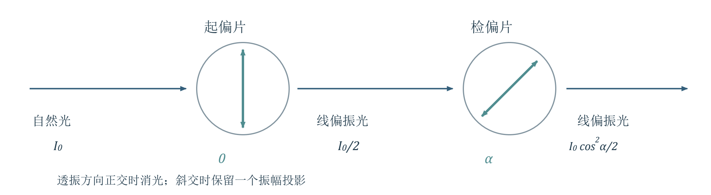{ loading=lazy }
*图1 起偏与检偏。光沿纸面向右传播；小圆内的线表示各偏振片在横截面中的透振方向。第一片把自然光变为线偏振光，第二片选择它的一个投影。*

### 1.2 用两个正交分量统一描述完全偏振光
必须掌握设光沿 $+z$ 传播，取 $\psi=\omega t-kz$，两个振幅 $A,B\ge0$，相位差为“$y$ 分量减 $x$ 分量”，则

$$E_x=A\cos\psi,\qquad E_y=B\cos(\psi+\delta)$$

其中 $k=2\pi/\lambda$，$\lambda$ 为该介质中的波长。$A,B,\delta$ 固定时，电矢量轨迹确定，为完全偏振光。线、圆、椭圆均属于完全偏振光，而非偏振程度依次降低。
线偏振：$\delta=0$ 或 $\pi$ 时，$E_y=\pm(B/A)E_x$，端点沿直线往复；任一分量为零也为线偏振。圆偏振：$A=B\ne0$ 且 $\delta=\pm\pi/2$，端点沿圆运动。其余非退化情形一般为椭圆；$\delta=\pm\pi/2$ 且 $A\ne B$ 时，椭圆主轴恰沿坐标轴。
建议理解由 $E_x/A=\cos\psi$，将 $E_y/B$ 展开为 $\cos\psi\cos\delta-\sin\psi\sin\delta$，消去 $\psi$，得到

$$\frac{E_x^2}{A^2}+\frac{E_y^2}{B^2}-\frac{2E_xE_y}{AB}\cos\delta=\sin^2\delta$$

此式用于看轨迹形状；旋向仍须根据时间顺序判断。它写成上述形式时要求 $A,B\ne0$；线偏振可由原始分量式直接判断。

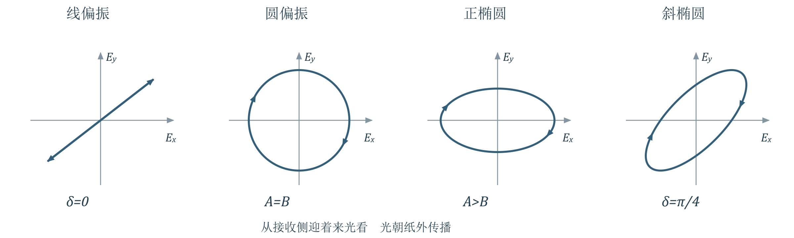{ loading=lazy }
*图2 同一分量模型产生线、圆、正椭圆和斜椭圆。箭头表示固定位置处随时间的运动方向；圆与椭圆示例均取正相位差。图中的横纵轴采用相同比例。*

### 1.3 旋向必须同时说明观察方向和时间方向
PPT重点沿用课件与教材的光学约定：迎着来光、朝光源看，顺时针为右旋，逆时针为左旋。在上面的余弦表达式及右手坐标系中，$0<\delta<\pi$ 为右旋，$-\pi<\delta<0$ 为左旋；相位差按 $2\pi$ 等价归入该区间。
以 $\delta=+\pi/2$ 为例，固定 $z$，从 $\psi=0$ 开始：$(E_x,E_y)=(A,0)$，随后 $E_y<0$，所以由图中右端向下运动，是右旋。换到光源一侧顺着光看，视觉上的顺逆时针会反过来。
教材补充教材177页脚注明确提醒：光学与部分电磁波文献的左右旋命名约定相反。遇到不同资料，优先核对观察方向和分量表达式。
理解补充圆偏振的电矢量方向以角速度 $\omega$ 匀速转动；一般椭圆偏振只有相位 $\psi$ 匀速变化，电矢量的几何方位角并不匀速。课件把圆与椭圆并写为“匀速旋转”时，应作这一区分。
### 课堂作图题 相位差为四十五度
PPT重点课件 PDF 10 页取 $\delta=\pi/4$。固定 $z=z_0$，依次令 $\psi=0,\pi/4,\cdots,7\pi/4$。下列为归一化点 $(E_x/A,E_y/B)$：

$$ (1,\frac{\sqrt2}{2}),\ (\frac{\sqrt2}{2},0),\ (0,-\frac{\sqrt2}{2}),\ (-\frac{\sqrt2}{2},-1) $$

$$ (-1,-\frac{\sqrt2}{2}),\ (-\frac{\sqrt2}{2},0),\ (0,\frac{\sqrt2}{2}),\ (\frac{\sqrt2}{2},1) $$

按顺序连成光滑闭合曲线并标箭头，就得到右旋斜椭圆。振幅决定外接矩形的边界，相位差决定倾斜与形状；不能只画一个椭圆而不说明转动方向。

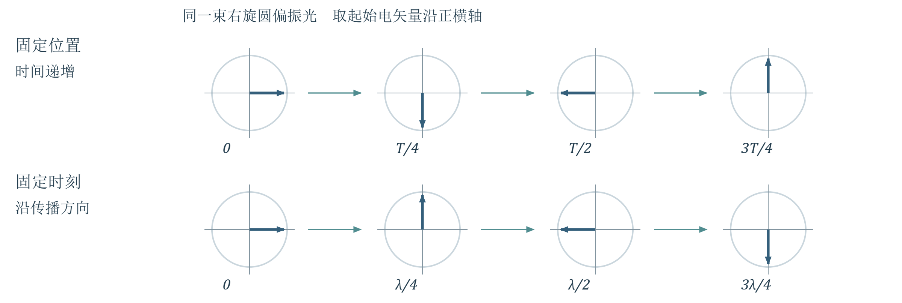{ loading=lazy }
*图3 右旋圆偏振中，固定位置看时间推进，与固定时刻看沿传播方向的位置变化，转动次序相反。各小图均从同一观察侧画出；标注的是时间或位置，不是光线绕轴行走。*

课堂思考课件 PDF 8 页应读右端同一波面的时间箭头：从下方依次向左下、左方转动，在其观察约定下为右旋。不要仅根据某一时刻空间中画出的螺旋外形判断。对圆偏振，相距 $\Delta z$ 的相位差大小为 $k|\Delta z|$；相距 $\lambda/2$ 的电矢量反向。
### 1.4 自然光 部分偏振光与偏振度
PPT重点自然光没有优势横向振动方向，可分解成任意一对正交方向上平均强度相等、彼此不相干的分量，$I_x=I_y=I/2$。这里的“不相干”是关键；两分量若保持确定的相位差，可能合成完全偏振光。
部分偏振光可视为自然光与完全偏振光的非相干混合。课件主要讨论“自然光＋线偏振光”，也列出自然光与圆偏振、椭圆偏振的混合。用 $I_{\mathrm{pol}}$ 表示其中完全偏振部分的强度，$I_n$ 表示自然光部分，有

$$P=\frac{I_{\mathrm{pol}}}{I_n+I_{\mathrm{pol}}}$$

完全偏振光 $P=1$，自然光 $P=0$，部分偏振光 $0<P<1$。五种偏振态即线、圆、椭圆、自然光与部分偏振光；前三者内部的振幅比和相位差稳定，后两者须用统计强度描述。
## 2 偏振片的起偏与检偏

> **资料范围**：课件 PDF 11–19 页；教材第二章§9.4–9.7，印刷175–178页。

### 2.1 先投影振幅 再求平均强度
必须掌握线偏振光的振动方向与理想偏振片透振方向成 $\alpha$，出射振幅为 $A=A_0\cos\alpha$，故马吕斯定律为

$$I=I_0\cos^2\alpha$$

$\alpha=0$ 时透过最大，$\alpha=\pi/2$ 时消光。它直接适用于入射线偏振光；自然光通过第一片时，对所有取向平均，$\langle\cos^2\alpha\rangle=1/2$，故 $I=I_0/2$。
多片连续使用时，每通过一片，出射光的振动方向都沿该片透振方向。后一个余弦角是相邻两片的夹角；不要始终对着最初振动方向计算。
### 课堂问题 圆偏振和椭圆偏振通过偏振片
PPT重点课件 PDF 11 页问出射偏振态与振幅。设透振方向与 $x$ 轴成 $\alpha$，先把两个分量投到同一方向：

$$E_\alpha=A\cos\alpha\cos\psi+B\sin\alpha\cos(\psi+\delta)$$

必须掌握将同频振动合成为 $C\cos(\psi+\varepsilon)$，振幅平方为

$$C^2=A^2\cos^2\alpha+B^2\sin^2\alpha+2AB\cos\alpha\sin\alpha\cos\delta$$

出射光沿透振方向振动，非零时一定是线偏振光。在同一介质中令强度比例常数为 $K$，则 $I_\alpha=KC^2$，入射总强度 $I_{\mathrm{in}}=K(A^2+B^2)$。
圆偏振满足 $A=B=E_0$、$\cos\delta=0$，所以 $C=E_0$，$I_\alpha=I_{\mathrm{in}}/2$，与偏振片方位无关。非圆的椭圆偏振通常有强弱变化，但没有完全消光；变化来自轨迹在透振方向上的投影。
PPT重点反向旋转、等振幅且相位配合的两束圆偏振光可合成线偏振光：取两束的 $x$ 分量同为 $E_0\cos\psi$，$y$ 分量分别为 $\pm E_0\sin\psi$，相加后 $y$ 分量抵消，得 $\vec E=2E_0\cos\psi\,\hat x$。这是相干叠加，不能把两束不相干圆偏振光作同样处理。
### 2.2 旋转偏振片能识别到哪一步
PPT重点保持入射光强稳定，旋转理想检偏片一周，观察三类结果：
光强恒定：可能是自然光、圆偏振光，或自然光与圆偏振光的混合，单片无法区分。
光强变化且能完全消光：判为线偏振光。
光强变化但不能消光：可能是椭圆偏振光，或自然光与线偏振、椭圆偏振的混合，也不能凭这一现象唯一判定。

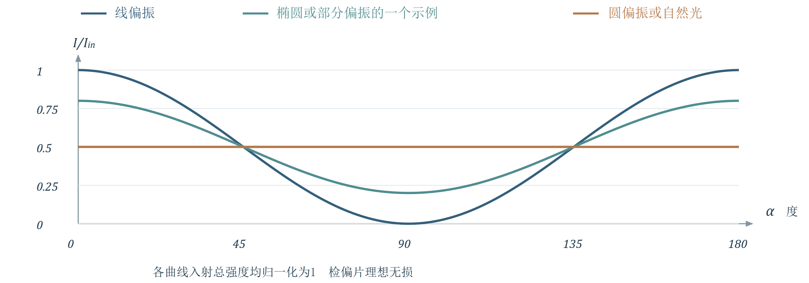{ loading=lazy }
*图4 相同入射总强度下的检偏曲线。圆偏振与自然光的曲线重合；椭圆偏振也可能与部分偏振光产生完全相同的曲线。单片检偏器只测投影强度。*

建议理解仅当已知待测光为“自然光＋线偏振光”时，取 $\alpha$ 从线偏振部分方向量起，有

$$I(\alpha)=\frac{I_n}{2}+I_{\mathrm{pol}}\cos^2\alpha$$

$$I_{\max}=\frac{I_n}{2}+I_{\mathrm{pol}},\qquad I_{\min}=\frac{I_n}{2},\qquad P=\frac{I_{\max}-I_{\min}}{I_{\max}+I_{\min}}$$

教材补充教材176页的极值式是在所讨论的线性部分偏振模型下给出。本讲圆偏振虽有 $I_{\max}=I_{\min}$，其总偏振度仍为1；不能把极值式推广到所有偏振态。
## 3 菲涅耳公式与坐标约定

> **资料范围**：课件 PDF 20–26 页；教材第二章§10.1、10.6，印刷179–180、188–190页。

### 3.1 先分解为平行与垂直入射面的分量
PPT重点界面不仅改变传播方向，还重新分配能流，改变相位与偏振。设介质1、2的折射率分别为 $n_1,n_2$，入射、反射、折射角为 $i_1,i'_1,i_2$，均从界面法线量起：

$$i'_1=i_1,\qquad n_1\sin i_1=n_2\sin i_2$$

本节先限于平整界面、均匀各向同性、无吸收的非磁性介质，$\mu_1\approx\mu_2\approx\mu_0$。入射与法线构成入射面；$s$ 分量垂直入射面，$p$ 分量在入射面内且垂直本束光的传播方向。
必须掌握沿用课件：$+z$ 从介质1指向2，$+x$ 沿界面，$+y$ 垂直纸面向外。每束光各自建立右手局部基底：$\hat p\times\hat s=\hat k$，三束光的 $\hat s=\hat y$，但 $\hat p$ 方向不同。

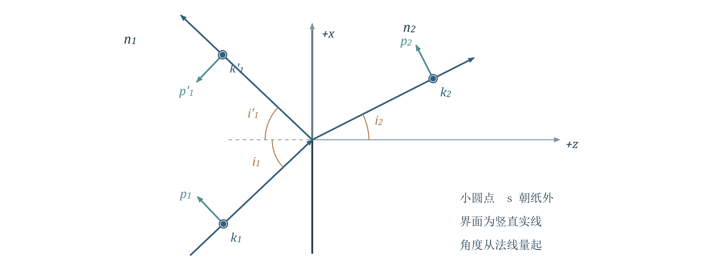{ loading=lazy }
*图5 与课件一致的局部坐标。蓝色为波矢方向，绿色为各自的正向 p 基矢；小圆点表示 s 方向朝纸外。反射光的 p 正向不能沿用入射光的 p 正向。*

### 3.2 四个振幅系数
令 $r_p=E'_{1p}/E_{1p}$、$t_p=E_{2p}/E_{1p}$，$s$ 分量同理。这里的场分量是对各自正向基矢的有符号投影；也可作为复振幅使用。

$$r_p=\frac{n_2\cos i_1-n_1\cos i_2}{n_2\cos i_1+n_1\cos i_2},\qquad t_p=\frac{2n_1\cos i_1}{n_2\cos i_1+n_1\cos i_2}$$

$$r_s=\frac{n_1\cos i_1-n_2\cos i_2}{n_1\cos i_1+n_2\cos i_2},\qquad t_s=\frac{2n_1\cos i_1}{n_1\cos i_1+n_2\cos i_2}$$

用折射定律可改写反射系数：

$$r_p=\frac{\tan(i_1-i_2)}{\tan(i_1+i_2)},\qquad r_s=\frac{\sin(i_2-i_1)}{\sin(i_2+i_1)}$$

理解补充正入射时上面的三角形式出现零比零，应取极限或直接使用折射率形式。$p,s$ 分量在各向同性平面界面上互不耦合；可分别乘以对应系数，再合成实际电矢量。
### 3.3 边界条件怎样产生反射系数
了解即可课件明确标注电磁推导“过程不要求”。保留 $p$ 分量的两条关键边界关系，理解符号来源即可。由切向电场与磁场连续，有

$$\cos i_1(E_{1p}-E'_{1p})=\cos i_2E_{2p},\qquad n_1(E_{1p}+E'_{1p})=n_2E_{2p}$$

第一式的减号来自反射光 $\hat p'_1$ 的切向投影反向。除以入射振幅，得到 $(1-r_p)\cos i_1=t_p\cos i_2$ 与 $n_1(1+r_p)=n_2t_p$；消去 $t_p$ 即得上式 $r_p$。不必展开所有电磁场分量和三角恒等变形。
## 4 振幅 光强与能流不能混用

> **资料范围**：课件 PDF 27–32 页；教材第二章§10.2–10.3，印刷180–184页。

### 4.1 三种比率及能量守恒
必须掌握在本讲透明非磁性介质中，平面波平均光强为

$$I=\frac{n}{2c\mu_0}|E|^2\propto n|E|^2$$

这里 $c$ 为真空光速，$E$ 为电场复振幅。只有介质相同时，才可把强度比直接写成振幅模平方比。对 $j=p,s$ 分别有：

$$R_j=\frac{I'_{1j}}{I_{1j}}=|r_j|^2,\qquad T_j=\frac{I_{2j}}{I_{1j}}=\frac{n_2}{n_1}|t_j|^2$$

课件的 $T$ 是沿各自光束方向的光强比；能流是整个光束每秒通过的能量，$W=IS$，$S$ 为垂直该光束的截面积。同一界面覆盖面积对应 $S_2/S_1=\cos i_2/\cos i_1$，因此

$$\mathcal R_j=R_j,\qquad \mathcal T_j=\frac{\cos i_2}{\cos i_1}T_j=\frac{n_2\cos i_2}{n_1\cos i_1}|t_j|^2$$

无吸收、存在传播折射波时，能量守恒写成

$$\mathcal R_j+\mathcal T_j=1\quad\Rightarrow\quad |r_j|^2+\frac{n_2\cos i_2}{n_1\cos i_1}|t_j|^2=1$$

理解补充一般斜入射不能写成 $R+T=1$，也不能写成 $|r|^2+|t|^2=1$。不同资料有时用 $T$ 直接代表能流透射率；本笔记保留课件三套符号，使用前先核对定义。

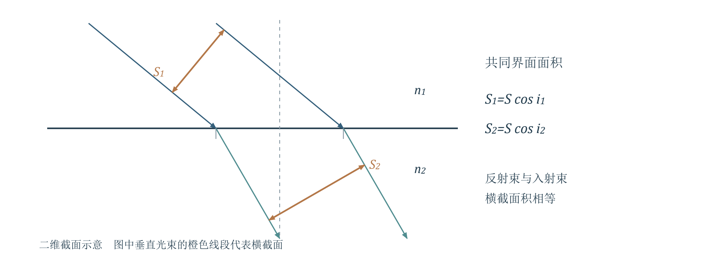{ loading=lazy }
*图6 同一界面面积对应不同的光束横截面。面积投影带来余弦因子，因此功率守恒比较的是能流，而非两个方向上的光强直接相加。*

### 例 2.10.1 空气正入射玻璃
PPT重点$n_1=1.0,n_2=1.5,i_1=i_2=0$。先代入振幅系数，再换成强度与能流：

$$r_p=\frac{n_2-n_1}{n_2+n_1}=0.20,\qquad r_s=-0.20,\qquad t_p=t_s=\frac{2n_1}{n_1+n_2}=0.80$$

$$R_p=R_s=0.04,\qquad T_p=T_s=\mathcal T_p=\mathcal T_s=1.5\times0.80^2=0.96$$

每个分量的能量都是4%反射、96%透射；自然光总体比例也相同。$r_p$ 与 $r_s$ 异号不表示两分量在固定空间坐标中有不同的反相规律，坐标解释见第6节。
### 4.2 斜入射与斯托克斯倒逆关系
PPT重点从低折射率介质向高折射率介质入射时，$R_s$ 随入射角增大而上升；$R_p$ 先下降，在布儒斯特角降为零，再上升。掠入射极限下两者均趋于1。由高折射率向低折射率入射，还会遇到全反射临界角。

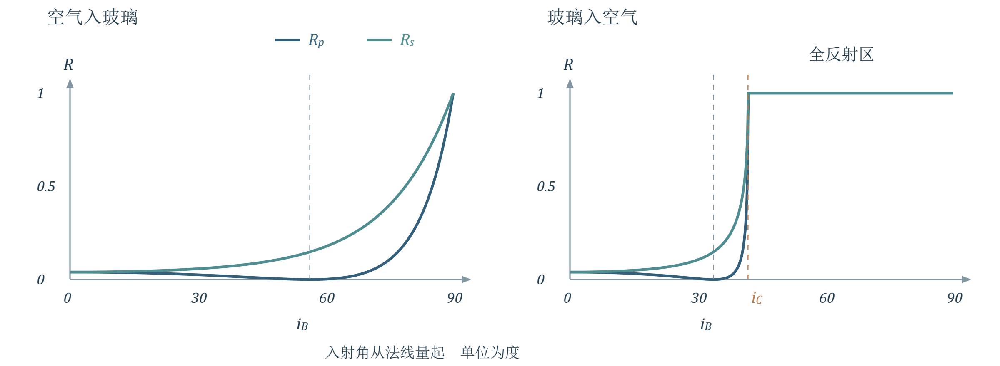{ loading=lazy }
*图7 用菲涅耳公式计算的能量反射率。左为空气入玻璃，右为玻璃入空气；布儒斯特角处仅 p 分量反射率为零，全反射区两分量反射率均为1。*

建议理解课件回顾光路可逆。对同一偏振分量，以 $r,t$ 表示1到2的系数，$r',t'$ 表示沿对应折射光路反向入射的系数。两束逆向入射光相干合成时，无原先来光的通道须抵消，有原先来光的通道须恢复：

$$Art+Atr'=0,\qquad Ar^2+Att'=A$$

$$r'=-r,\qquad r^2+tt'=1$$

这是一组振幅关系，适用于此处可逆、无吸收且双方均有传播通道的界面；$r^2$ 不要擅自换成 $|r|^2$。反向入射角应为原折射角，而非照抄原入射角。
## 5 布儒斯特角与反射起偏

> **资料范围**：课件 PDF 33–38 页；教材第二章§10.4–10.5，印刷184、187–188页。

### 5.1 为什么反射光偏向 s 分量
PPT重点自然光入射时，初始 $p,s$ 强度各占一半。一般非零斜入射、非全反射情形中，$R_s>R_p$，反射光的 $s$ 分量较强；透射光则 $p$ 分量较强。因此二者通常都成为部分偏振光。
必须掌握若 $n_1\ne n_2$，令 $r_p=0$，得到 $n_2\cos i_B=n_1\cos r_B$。与折射定律联立可得

$$i_B+r_B=\frac{\pi}{2},\qquad \tan i_B=\frac{n_2}{n_1}$$

$i_B$ 为布儒斯特角（起偏角），$r_B$ 是此时的折射角。反射与折射光线互相垂直；自然光的反射光为纯 $s$ 线偏振光，透射光仍含 $p,s$ 两分量，并非纯 $p$ 偏振。

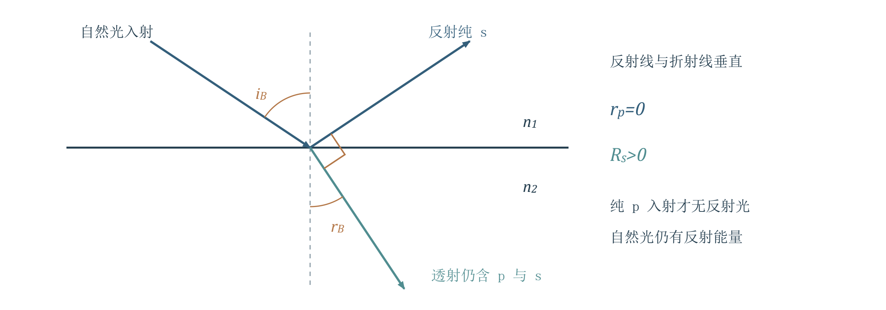{ loading=lazy }
*图8 布儒斯特角处的几何与分量选择。只有 p 入射分量完全不反射；自然光仍有 s 反射分量。反射光与折射光之间的直角是计算入口。*

理解补充对自然光，可写反射光的线性偏振度 $P_r=(R_s-R_p)/(R_s+R_p)$；在 $i_B$ 处为1。若入射本来就是纯 $p$ 光，则反射光消失，此时不能给“零强度的反射光”指派偏振态。
### 课堂思考 反向入射与折射率测量
PPT重点沿原折射光线反向送入自然光，此时入射角为 $r_B$，且

$$\tan r_B=\frac{n_1}{n_2}$$

它正是2到1的布儒斯特角，所以反射光仍为 $s$ 线偏振光。这个结论依赖两侧对应的几何角，而不是“任何反向入射都能起偏”。
理解补充只观察反射光即可确定起偏角，因而不需要收集透射光，也可估计 $n_2=n_1\tan i_B$。但若所谓“不透明”来自强吸收或金属响应，就不满足本讲实折射率、无吸收假设，未必有严格的零 $p$ 反射；不能无条件套用该式。
### 5.2 玻璃片堆与布儒斯特窗
课堂数值例空气入 $n=1.50$ 的玻璃，精确取 $i_B=\arctan1.50=56.31^\circ$，$r_B=33.69^\circ$。此时

$$R_s=\left(\frac{n_2^2-n_1^2}{n_2^2+n_1^2}\right)^2=0.14793,\qquad \frac{I_{\mathrm{r}}}{I_{\mathrm{in}}}=\frac{R_s}{2}=7.40\%$$

课件角度粗写为57°、33°，而14.7%与7.4%对应未粗舍入的计算。算题宜保留精确角度，避免把57°与33°直接代入后得到不一致数值。
PPT重点单界面的反射光偏振纯但能量少。用平行玻璃片堆，让光在多界面上均以对应起偏角通过：$p$ 分量理想情况下不受反射损耗，$s$ 分量逐次被反射剔除，主透射束的偏振度提高并接近 $p$ 线偏振。
忽略吸收和多次反射返回主束，经过 $M$ 个相同作用的界面，主透射束可估计为 $I_p\approx I_0/2$，$I_s\approx(I_0/2)(1-R_s)^M$。这里 $M$ 是界面数，不是玻璃片数。
布儒斯特窗利用同一机制降低激光腔内 $p$ 分量损耗，从而选择线偏振激光。摄影偏振片则选择较少含反射眩光的方向；当反射接近布儒斯特条件时效果明显，不能保证任意表面的反射都完全消除。
## 6 反射相位与半波损失

> **资料范围**：课件 PDF 39–43 页；教材第二章§10.4，印刷184–187页。

### 6.1 系数的相位先相对于局部基矢定义
必须掌握对普通传播折射波，$t_p,t_s>0$，对应局部分量无额外的正负号翻转；$r_p,r_s$ 可正可负。为与课件的相位延迟图一致，记

$$r_j=|r_j|e^{-i\delta_j},\qquad \delta_j=-\operatorname{arg}r_j\quad(j=p,s)$$

正实系数对应 $\delta_j=0$，负实系数对应 $\pi$（按 $2\pi$ 等价）。课件同页同时写过正指数与负辐角，笔记统一为上式，避免进入复数反射系数时混用符号。
外反射 $n_1<n_2$：$s$ 分量始终为负，$\delta_s=\pi$；$p$ 分量在 $i_1<i_B$ 时为正、$i_1>i_B$ 时为负，故相位延迟由0变为 $\pi$。
内反射 $n_1>n_2$ 且尚未全反射：$s$ 分量始终为正，$\delta_s=0$；$p$ 分量在 $i_1<i_B$ 时为负、$i_B<i_1<i_C$ 时为正。$i_1=i_B$ 处反射 $p$ 振幅为零，其相位本身没有定义。

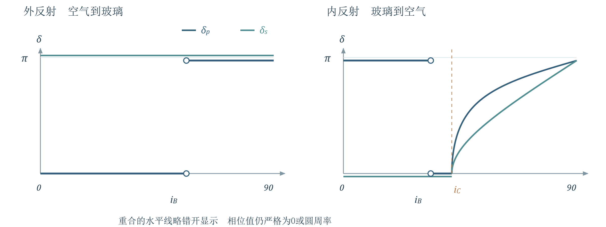{ loading=lazy }
*图9 局部分量的反射相位延迟。采用 r 的负辐角；布儒斯特角处的空心点表示零振幅、相位无定义。内反射越过临界角后，相位连续变化，且 p 与 s 通常不同。*

### 例 2.10.2 正入射为什么两个分量同样反相
PPT重点正入射时 $\hat p'_1=-\hat p_1$，但 $\hat s'_1=\hat s_1$。所以须把“系数”乘回“基矢”，再比较实际电场：

$$\vec E'_{1p}=r_pE_{1p}\hat p'_1=-r_pE_{1p}\hat p_1,\qquad \vec E'_{1s}=r_sE_{1s}\hat s_1$$

当 $n_1<n_2$，$r_p>0,r_s<0$，于是 $-r_p=r_s<0$，两个实际电场分量都相对入射反向；当 $n_1>n_2$，二者都同向。因此正入射由光疏到光密反射有半波损失，由光密到光疏反射没有。

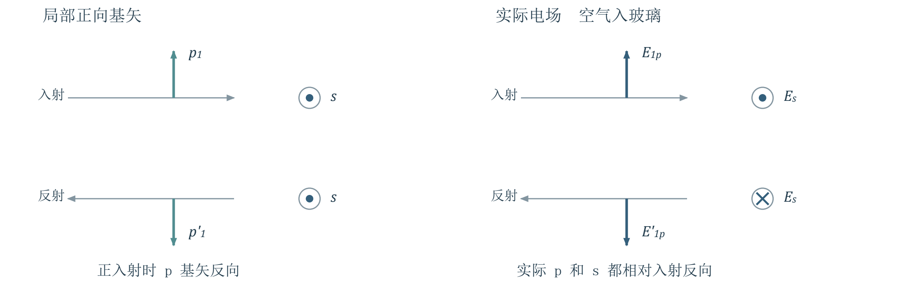{ loading=lazy }
*图10 正入射时，局部 p 基矢反向。左图是所选正向基矢，右图为空气入玻璃时的实际场方向；p 系数为正仍可对应实际电矢量反向。s 基矢朝纸外保持不变。*

### 例 2.10.3 光疏到光密的掠入射
PPT重点取 $n_1<n_2$ 且 $i_1\to90^\circ$，由菲涅耳公式有 $r_p\to-1,r_s\to-1$。此时入射与反射的 $p$ 基矢趋于同向，两实际场分量都与入射反向，体现 $\pi$ 相位跃变。
必须掌握“半波损失”是反射相位差 $\pi$ 的等效说法，不是能量损失一半。比较可相干叠加的两束光时，应把传播相位与反射相位一起计入；$\pi$ 等效于附加光程差 $\pm\lambda_0/2$，这里 $\lambda_0$ 为用于 $2\pi\Delta L/\lambda_0$ 的真空波长。
教材补充教材186–187页强调，斜入射的两束光传播方向不同，不能脱离分量方向只说“整束光有或没有半波损失”。薄膜干涉要比较最终传播方向相同、投影到相同偏振方向的两束光；不要单看一个局部 $r_p$ 的正负就下结论。
## 7 全反射与衰逝波

> **资料范围**：课件 PDF 41、44 页；教材第二章§10.4、10.7，印刷185、191页。衰逝波按课件作介绍。

### 7.1 反射率为一不代表相位不变
PPT重点仅当 $n_1>n_2$ 才有临界角，

$$i_C=\arcsin\frac{n_2}{n_1},\qquad i_B=\arctan\frac{n_2}{n_1}<i_C$$

$i_1=i_C$ 时折射方向沿界面，法向透射能流为零；$i_1>i_C$ 时没有向介质2深处传播的折射平面波，$|r_p|=|r_s|=1$。反射系数成为复数，其相位差仍会改变含两个分量的入射光的偏振态。
建议理解令 $q=n_2/n_1<1$，$u=\sqrt{\sin^2i_1-q^2}$。在上节相位延迟约定下，课件的全反射相位式可简写为

$$\delta_s=2\arctan\frac{u}{\cos i_1},\qquad \delta_p=2\arctan\frac{u}{q^2\cos i_1}$$

两式仅用于 $i_C<i_1<90^\circ$；$\delta_p-\delta_s$ 一般不为零。含 $p,s$ 分量的线偏振光全反射后通常成为椭圆偏振光，纯 $p$ 或纯 $s$ 入射仍为线偏振。
### 7.2 介质二中仍有靠近界面的场
了解即可选界面为 $z=0$，介质2在 $z>0$。课件给出的透射场可写成

$$\tilde E_2(x,z,t)=E_{20}e^{-\kappa z}e^{i(k_xx-\omega t)}$$

它沿界面 $x$ 方向具有行波相位，沿法线 $z$ 方向指数衰减，称为衰逝波（教材称隐失波）。这与普通吸收导致的衰减不同：此处介质无吸收。

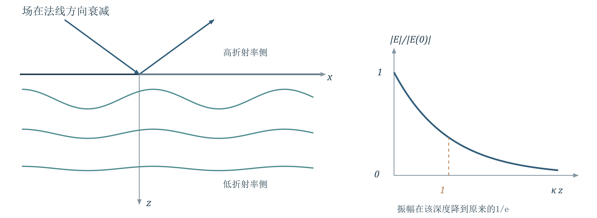{ loading=lazy }
*图11 全反射时，低折射率侧仍有近界面场。左示固定时刻不同深度的场截面，振幅随深度减小；右为指数包络。波纹是场值示意，不是折射光线。*

教材补充教材191页定义振幅衰减至 $1/e$ 的深度为 $d_E=1/\kappa$；时间平均的法向透射能流为零，不能据此说界面外电场也为零。按本讲符号，$\kappa=(2\pi/\lambda_0)\sqrt{n_1^2\sin^2i_1-n_2^2}$。
通常穿透深度为波长量级，但接近临界角时 $\kappa$ 很小，深度可明显增大。“进入一定深度再反射”是近界面场的形象解释，不应理解为一条普通折射光线在介质2内走一段后突然掉头。
## 8 公式速查
@break
### 偏振态与理想检偏片

$$E_x=A\cos\psi,\quad E_y=B\cos(\psi+\delta),\quad \psi=\omega t-kz$$

线：$\delta=0,\pi$ 或一分量为零；圆：$A=B\ne0,\delta=\pm\pi/2$；其余非退化情形为椭圆。迎着来光看，正相位差 $0<\delta<\pi$ 对应右旋。

$$I_{\mathrm{linear}}=I_0\cos^2\alpha,\qquad I_{\mathrm{natural}}=I_{\mathrm{circular}}=\frac{I_0}{2}$$

上式后三类分别表示对应入射态通过理想偏振片后的强度，$I_0$ 都是入射总强度。一般完全偏振光投影后的振幅平方为

$$C^2=A^2\cos^2\alpha+B^2\sin^2\alpha+2AB\sin\alpha\cos\alpha\cos\delta$$

$$P=\frac{I_{\mathrm{pol}}}{I_n+I_{\mathrm{pol}}}$$

仅对自然光与线偏振光混合：$P=(I_{\max}-I_{\min})/(I_{\max}+I_{\min})$。圆偏振与自然光都可有恒定的检偏强度，不能由此判定 $P=0$。
### 界面振幅与能量分配

$$n_1\sin i_1=n_2\sin i_2,\qquad \hat p\times\hat s=\hat k$$

$$r_p=\frac{n_2\cos i_1-n_1\cos i_2}{n_2\cos i_1+n_1\cos i_2},\quad t_p=\frac{2n_1\cos i_1}{n_2\cos i_1+n_1\cos i_2}$$

$$r_s=\frac{n_1\cos i_1-n_2\cos i_2}{n_1\cos i_1+n_2\cos i_2},\quad t_s=\frac{2n_1\cos i_1}{n_1\cos i_1+n_2\cos i_2}$$

$$R=|r|^2,\quad T=\frac{n_2}{n_1}|t|^2,\quad \mathcal T=\frac{\cos i_2}{\cos i_1}T,\quad \mathcal R+\mathcal T=1$$

对 $p,s$ 分别使用；以上能流换算针对传播折射波。正入射：$r_p=-r_s=(n_2-n_1)/(n_2+n_1)$，$t_p=t_s=2n_1/(n_2+n_1)$。
### 特殊角度与相位

$$\tan i_B=\frac{n_2}{n_1},\quad i_B+r_B=90^\circ;\qquad \sin i_C=\frac{n_2}{n_1}\ (n_1>n_2)$$

布儒斯特角：$r_p=0$；全反射：$|r_p|=|r_s|=1$，但相位可不同。相位延迟统一写作 $r=|r|e^{-i\delta}$；实际电场还须乘局部基矢。正入射光疏到光密反射反相，反向入射同相。
## 9 易错点与自测
@break
### 易错清单
1. 线、圆、椭圆都是完全偏振光；圆偏振不是因为“方向不断变”就成为自然光。
2. 两个正交分量的强度相等还不够：固定相位差与不相干会给出不同偏振态。
3. 判旋向先固定观察方向，再看固定位置处随时间的转动；不要把空间螺旋当时间轨迹。
4. 马吕斯定律直接用于线偏振入射；自然光通过第一片先乘 $1/2$，后续再乘相邻夹角的余弦平方。
5. 转动检偏片不变光强不能唯一判为自然光；无消光的强弱变化也不能唯一判为部分偏振光。
6. $r,t$ 为振幅比，$R,T$ 为光强比，$\mathcal R,\mathcal T$ 为能流比；一般只有最后一对直接相加为1。
7. 布儒斯特角消掉反射 $p$ 分量；自然光的反射光为纯 $s$，透射光通常仍为部分偏振。
8. $r_p$ 正负是相对局部 $p$ 基矢而言；先还原矢量，才能比较实际场是否反向。
9. 半波损失是相位改变，不是功率减半；全反射也不是“外侧无场且相位不变”。
### 自测题
以下为理解补充自编练习。先判断偏振态、坐标与适用条件，再计算；答案放在文末。
1. 光沿 $+z$ 传播，$E_x=2E_0\cos\psi$，$E_y=E_0\cos(\psi+\pi/2)$。判断偏振态与旋向；通过与 $x$ 轴成45°的理想偏振片，出射态和强度比例分别是什么？
2. 自然光强为 $I_0$，依次通过透振方向为0°、30°、90°的三片理想偏振片，最终强度是多少？若去掉中间一片会怎样？
3. 已知待测光是自然光与线偏振光的混合，旋转检偏片得到 $I_{\max}=8$、$I_{\min}=2$（相同单位）。求入射总强度、两部分强度与偏振度。若没有“已知混合模型”这一条件，结果能否唯一判定偏振态？
4. 空气中自然光射向 $n=1.50$ 玻璃，入射角为布儒斯特角。求两个几何角、反射能量比例及反射偏振态；求透射光的线性偏振度，并判断能否直接写 $R+T=1$。
5. 光从 $n_1=1.50$ 玻璃射向空气。先求 $i_B,i_C$；再令 $i_1=45^\circ$，计算 $p,s$ 反射相位延迟。若入射为含等振幅 $p,s$ 分量的线偏振光，反射后为何通常不再是线偏振？
### 资料定位
教师课件共44个 PDF 页面，页脚编号存在跳号。本笔记采用 PDF 页序：偏振态与检偏为2–19页；菲涅耳公式和能流为20–32页；反射起偏为33–38页；相位与全反射为39–44页。保留例2.10.1–2.10.3、偏振作图与投影问题、反向起偏思考及玻璃数值例。
教材为赵凯华、钟锡华《光学（重排本）》第二章：§9印刷172–178页，§10.1–10.5印刷179–188页，§10.6印刷188–190页，§10.7印刷191页；该扫描版 PDF 页序为印刷页加13。PPT重点标课堂主线，教材补充标已核对的教材信息，理解补充标解释、条件澄清与自编练习。
## 10 自测答案
@break
### 第1题 椭圆偏振的投影
两分量相差 $+\pi/2$ 且不等幅，为主轴沿坐标轴的右旋椭圆偏振（迎着来光看）。投影后为45°方向线偏振。振幅平方 $C^2=4E_0^2/2+E_0^2/2=5E_0^2/2$，入射总强度正比于 $5E_0^2$，故 $I_{\mathrm{out}}/I_{\mathrm{in}}=1/2$。此处恰为一半，不代表任意检偏角都一样。
### 第2题 逐片更新振动方向

$$I_{\mathrm{out}}=\frac{I_0}{2}\cos^2 30^\circ\cos^2 60^\circ=\frac{3I_0}{32}$$

去掉中间一片，首末透振方向正交，最终为零。插入中间片改变了后续光的振动方向，并未产生能量；原来的正交投影被分成两步。
### 第3题 混合模型的偏振度

$$I_n=2I_{\min}=4,\quad I_{\mathrm{pol}}=I_{\max}-I_{\min}=6,\quad I_t=10,\quad P=0.60$$

没有给定混合模型时，不能唯一判态：适当椭圆偏振光也能产生相同极值，但其总偏振度为1。检偏器强度极值只提供部分信息。
### 第4题 起偏角与能流

$$i_B=56.31^\circ,\quad r_B=33.69^\circ,\quad R_p=0,\quad R_s=0.14793$$

自然光反射能量比例 $\mathcal R=(R_p+R_s)/2=0.07396$，反射光为 $s$ 线偏振。透射的两分量能流比例分别为 $\mathcal T_p=1$、$\mathcal T_s=0.85207$，因此

$$P_t=\frac{\mathcal T_p-\mathcal T_s}{\mathcal T_p+\mathcal T_s}=0.07987\approx7.99\%$$

透射光以 $p$ 为优势方向，仍远未完全偏振。因为处于同一透射束，求偏振度时两分量共同的面积因子抵消。总能流透射率为0.92604；普通光强比 $T\approx0.61736$，故不能写 $R+T=1$，应写 $\mathcal R+\mathcal T=1$。
### 第5题 全反射保能量但改变相位

$$i_B=\arctan\frac{2}{3}=33.69^\circ,\qquad i_C=\arcsin\frac{2}{3}=41.81^\circ$$

45°大于临界角，发生全反射。取 $q=2/3$，$u=\sqrt{1/2-4/9}=\sqrt2/6$，得

$$\delta_s=2\arctan\frac{1}{3}=36.87^\circ,\qquad \delta_p=2\arctan\frac{3}{4}=73.74^\circ$$

反射分量模长均不变，但相位延迟相差36.87°，所以原来同相的两个局部分量不再同相或反相，合成为椭圆偏振。在 $e^{i(\vec k\cdot\vec r-\omega t)}$ 约定下，$y=s$ 相对于 $x=p$ 的反射复振幅相位差为 $\delta_p-\delta_s$；判左右旋还须结合明确的观察方向。

