# 第7讲 双折射与偏振光应用

!!! tip "本讲配套文件"
    - [PDF 在线阅读（基础物理学2_第7讲_双折射与偏振光应用_学习讲义.pdf）](../文件/基础物理学2_第7讲_双折射与偏振光应用_学习讲义.pdf)
    - [Word 下载（基础物理学2_第7讲_双折射与偏振光应用_学习讲义.docx）](../文件/基础物理学2_第7讲_双折射与偏振光应用_学习讲义.docx)

## 1 双折射与单轴晶体

> **资料范围**：课件 PDF 2–8 页；教材第七章 §1.1–1.2，印刷 378–381 页。以透明单轴晶体为主要模型。

### 1.1 一束入射光对应两种传播模式
PPT重点各向异性介质对不同振动方向的响应不同，通常出现寻常光（$o$ 光）与非常光（$e$ 光）。两种模式各为线偏振光；若其中一种未被激发，或两束方向重合，未必看见两条分开的光线。
寻常光的折射率 $n_o$ 不随传播方向改变，光线遵守 $n_1\sin i=n_o\sin r_o$。非常光的速度随方向改变，其能量传播方向一般不能用一个固定折射率代入光线的折射定律，且可能偏出入射面。
理解补充边界上仍须满足相位匹配；“$e$ 光不遵守通常的光线折射定律”不等于波的折射没有规律。后面要区分波面法线与光线方向。
### 1.2 光轴 主平面与主截面
PPT重点光轴是使两种线双折射模式不再有速度差的特殊方向，并非晶体内唯一一根直线。单轴晶体有一个这样的轴方向，如方解石、石英；双轴晶体有两个，如云母。本讲主要讨论单轴晶体。
主平面由某一路光的传播方向与光轴构成；$o$ 光的电矢量垂直自身主平面，$e$ 光的电矢量在自身主平面内。主截面则由晶体表面法线与光轴构成；入射面由入射光线与表面法线构成。三个概念的参照对象不同。
PPT重点主截面与入射面重合时，两条折射光线也在这个平面内，它同时是两路光的主平面，因而两路振动方向互相垂直。
课堂思考  当主截面与入射面不重合：$o$ 光仍在入射面内，但该面通常不是其主平面；$e$ 光可能偏出入射面，其主平面要用自身光线与光轴确定。因此不能笼统断言两束不同方向光的电矢量总互相垂直。
方解石双像演示中，以入射方向为轴转动晶体，$e$ 光像可绕 $o$ 光像转动；再转检偏片，两像分别消光。主平面重合时，两个消光方向相差 $90^\circ$。
### 1.3 主折射率与正负晶体
PPT重点设 $v_o$ 为 $o$ 光速度，$v_e$ 为 $e$ 光垂直光轴传播时的速度，定义两个主折射率

$$n_o=\frac{c}{v_o},\qquad n_e=\frac{c}{v_e}.$$

这里 $n_e$ 专指主值，不是任意方向非常光的折射率。沿光轴时两模式折射率均为 $n_o$；垂直光轴时，非常光折射率才取 $n_e$。
正晶体：$n_e>n_o$，故 $v_e<v_o$，如石英、冰。负晶体：$n_e<n_o$，故 $v_e>v_o$，如方解石。不要用非常光“总比寻常光快”来记忆。
PPT重点点光源的 $o$ 子波面是球面，$e$ 子波面是以光轴为旋转对称轴的椭球面；两者在光轴方向相切。固定时间的波面反映沿各条射线传播到的位置。

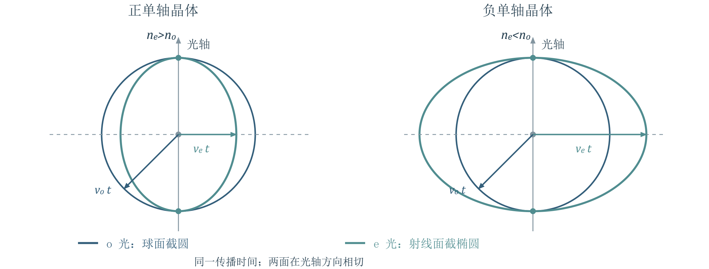{ loading=lazy }
*图 1 单轴晶体的子波面截面。图示为射线面随固定时间扩展的波面；正负由主折射率的大小关系定义。*

## 2 惠更斯作图与非常光走离

> **资料范围**：课件 PDF 9–17 页；教材第七章 §1.3–1.4，印刷 381–385 页。

### 2.1 先画波面 再找光线
PPT重点取同一入射波面上的两点：先到界面的 $A$ 点发出子波，另一路经过时间 $t$ 到达界面的 $B'$ 点。分别以 $A$ 为中心画半径 $v_ot$ 的 $o$ 子波截圆和相应 $e$ 子波椭圆，再由 $B'$ 作包络切线。切线代表折射波面，从 $A$ 指向切点的连线代表折射光线。
理解补充圆的半径与切线垂直，椭圆的一般矢径却不垂直于切线；这正是非常光的光线可偏离波面法线的几何原因。实际三维问题使用球面、椭球面与切平面。
课件的三个负晶体情形：① 光轴平行表面、正入射，两模式共线但速度不同；② 光轴平行表面且垂直入射面、斜入射，两模式分别以固定 $n_o,n_e$ 满足通常折射定律；③ 光轴斜置、正入射，$o$ 光沿法线，$e$ 光发生走离。

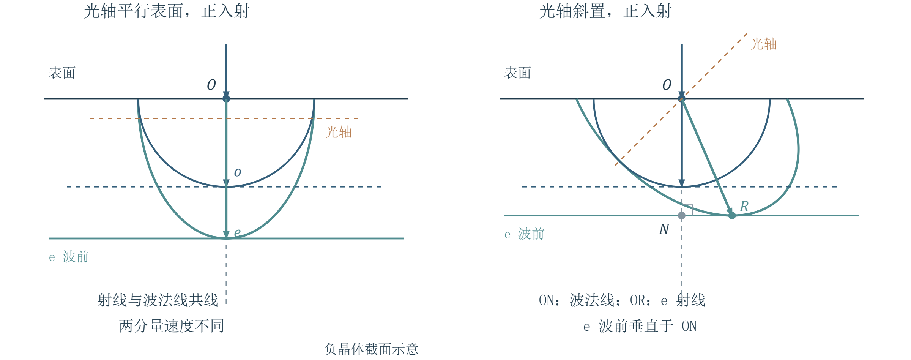{ loading=lazy }
*图 2 两种正入射情形。是否看见两束光分开，取决于光轴取向；共线时仍可积累相位差。*

### 2.2 法线速度与射线速度
PPT重点波面是同相面，波矢 $\vec k$ 指向波面法线。射线方向对应能量输运方向，在本讲忽略色散的模型中用射线速度 $v_r$ 描述。令同一时间内 $ON=d$、$OR=l$，二者夹角为走离角 $\alpha$，则

$$v_N=\frac{d}{t},\qquad v_r=\frac{l}{t},\qquad v_N=v_r\cos\alpha.$$

$o$ 光的两方向一致；$e$ 光通常不一致。折射率应由相速度定义为 $n(\theta)=c/v_N$，不能用 $c/v_r$ 替代。
### 2.3 波法面 射线面与方向关系
PPT重点以各方向法线速度矢量的端点作轨迹，得到波法面；以各方向射线速度矢量的端点作轨迹，得到射线面。两者都不是折射率曲面。波法面上矢径端点所作的垂面，与射线面相切。
设 $\theta$ 是波面法线与光轴的夹角，$\xi$ 是射线与光轴的夹角，在图示同侧分支中 $\alpha=\xi-\theta$。非常光满足

$$\frac{v_N^2}{c^2}=\frac{\cos^2\theta}{n_o^2}+\frac{\sin^2\theta}{n_e^2},\qquad \frac{c^2}{v_r^2}=n_o^2\cos^2\xi+n_e^2\sin^2\xi.$$

因此

$$n(\theta)=\frac{n_on_e}{\sqrt{n_e^2\cos^2\theta+n_o^2\sin^2\theta}},\qquad \tan\xi=\frac{n_o^2}{n_e^2}\tan\theta.$$

必须掌握由射线面的切线求方向关系。以 $z$ 沿光轴，取无量纲坐标 $z=(v_r/c)\cos\xi$、$x=(v_r/c)\sin\xi$，截面方程与切线斜率为

$$n_o^2z^2+n_e^2x^2=1,\qquad \frac{\mathrm{d}x}{\mathrm{d}z}=-\frac{n_o^2z}{n_e^2x}=-\cot\theta.$$

再用 $z/x=\cot\xi$，即得 $\cot\theta=(n_o^2/n_e^2)\cot\xi$。法线倾角由切线的垂线确定，不能把矢径当成法线。

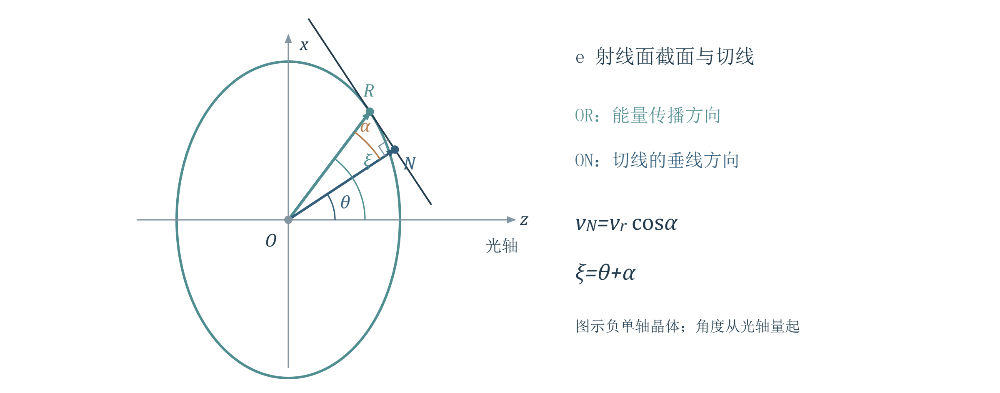{ loading=lazy }
*图 3 非常光射线面与其切线。射线指向切点，波面法线垂直切线；夹角即走离角。*

### 2.4 课堂例题 ADP 晶片的走离与光程差
PPT重点课件 PDF 17 页：负晶体 ADP，$n_o=1.5246$、$n_e=1.4792$，光轴与表面成 $45^\circ$，厚度 $d=1.00\,\mathrm{cm}$，光正入射。求走离角和 $e$ 光相对 $o$ 光的光程差。
思路：正入射固定了波面法线，因此 $\theta=45^\circ$；先求射线方向，再用相折射率计算两平行表面之间的相位光程。

$$\xi=\arctan\left(\frac{n_o^2}{n_e^2}\tan45^\circ\right)\approx46.73^\circ,\qquad \alpha\approx1.73^\circ\approx1^\circ44'.$$

$$n(45^\circ)\approx1.50139,\qquad L_e-L_o=[n(45^\circ)-n_o]d\approx-0.02321\,\mathrm{cm}.$$

负号表示非常光的相位光程更小。课件将 $n(45^\circ)$ 取四位小数后给出 $-0.0232\,\mathrm{cm}$，与上式一致。
理解补充这里比较的是同一出射波面上的相位；应使用 $n(\theta)d$。非常光虽沿斜射线通过晶片，却不能把 $n(\theta)$ 再乘斜路程 $l$。
## 3 双折射偏振棱镜

> **资料范围**：课件 PDF 18–20 页；教材第七章 §2.1，印刷 391–392 页。掌握选光与分束原理。

PPT重点格兰汤姆孙棱镜利用方解石与加拿大树胶的折射率次序 $n_o=1.65836>n_g\approx1.55>n_e=1.48641$。在适当入射角下，$o$ 光在胶层处全反射并被吸收，$e$ 光通过，输出高偏振度线偏振光。图示光轴取向使非常光使用主值 $n_e$。
尼科耳棱镜同样利用胶合面的选择性全反射；课件给出的 $o$ 光临界角为 $i_c=\arcsin(n_g/n_o)\approx69^\circ$。其细长几何结构限制了可接受的入射角范围。
沃拉斯顿棱镜由两块光轴互相垂直的晶体组成。第一块的 $o$ 光进入第二块成为 $e$ 光，第一块的 $e$ 光则成为 $o$ 光；两束在内部斜界面受到不同折射，最终输出方向分开的两束正交线偏振光。该器件保留两路，适合偏振分束。

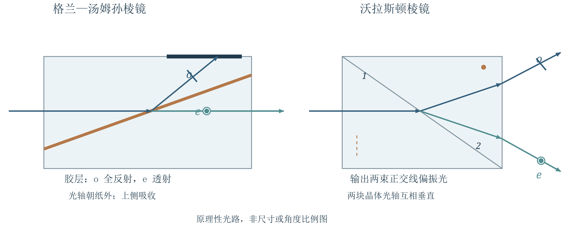{ loading=lazy }
*图 4 两类棱镜的功能比较。格兰汤姆孙选择一路；沃拉斯顿保留两路。光路为原理示意，不按器件尺寸绘制。*

## 4 波片控制相位与偏振态

> **资料范围**：课件 PDF 21–35 页；教材第七章 §2.2、§3.1–3.4，印刷 392–401 页。默认正入射，忽略反射与吸收。

### 4.1 波片的快慢轴和相位约定
PPT重点光轴平行表面的平行平面晶片，在正入射时使 $o,e$ 两模式共线传播；出射后它们重新叠加。取晶片光轴为横向 $x=e$ 轴，垂直它的横向方向为 $y=o$ 轴。线偏振与 $x$ 轴夹角为 $\alpha$，则

$$A_e=A\cos\alpha,\qquad A_o=A\sin\alpha,\qquad L_e=n_ed,\quad L_o=n_od.$$

折射率小的方向为快轴，折射率大的方向为慢轴。因此负晶体的光轴方向是快轴，正晶体的光轴方向是慢轴。
必须掌握沿用第六讲的时间约定 $\cos(\omega t-kz)$。设 $k_0=2\pi/\lambda$，其中 $\lambda$ 是真空波长；在晶片前表面令 $z=0$。先取 $0\le\alpha\le\pi/2$，使两振幅非负；一般偏振的入射相角差单独记为 $\delta_{\mathrm{in}}=\arg E_o-\arg E_e$。出射面有

$$E_e=A\cos\alpha\cos(\omega t-k_0n_ed),$$

$$E_o=A\sin\alpha\cos(\omega t+\delta_{\mathrm{in}}-k_0n_od).$$

定义课件使用的有符号延迟差 $\Gamma$，则实际合成所用的相角差为

$$\Gamma=\frac{2\pi}{\lambda}(n_o-n_e)d,\qquad \delta_{\mathrm{out}}=\delta_{\mathrm{in}}-\Gamma.$$

理解补充“$o$ 比 $e$ 多落后 $\Gamma$”表示相角减少 $\Gamma$。课件部分页面把延迟差与相角差都写成相位差；判断左右旋时必须回到上面两分量表达式。只算干涉光强时，$\cos\Gamma$ 对正负号不敏感。

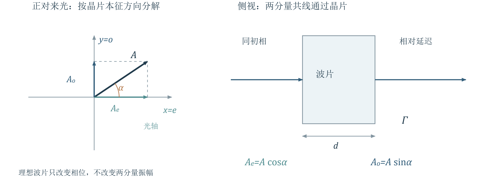{ loading=lazy }
*图 5 波片使两个本征方向积累不同相位。理想波片保留两个分量，偏振片则只保留透振方向的投影。*

### 4.2 四分之一波片 半波片与全波片
PPT重点波片只对设计波长 $\lambda_0$ 具有标称相位延迟。最薄四分之一波片、半波片与一个全波延迟晶片的厚度分别为

$$d_{1/4}=\frac{\lambda_0}{4|n_o-n_e|},\qquad d_{1/2}=\frac{\lambda_0}{2|n_o-n_e|},\qquad d_1=\frac{\lambda_0}{|n_o-n_e|}.$$

更一般地，四分之一波片要求 $\Gamma$ 模 $2\pi$ 等于 $\pm\pi/2$；半波片要求等于 $\pi$；全波片要求等于 $0$。教材补充较厚的多级波片也可满足这些条件，但四分之一波片的 $+\pi/2$ 与 $-\pi/2$ 会产生相反旋向，不能互换（教材 393 页脚注）。
理解补充若改变波长，$n_o,n_e$ 也可能随波长变化，应重算 $\Gamma(\lambda)$。课件所列石英、方解石折射率表说明了这种色散；不能把一块波片在所有颜色下都当成四分之一波片。
### 4.3 四分之一波片的状态变换
PPT重点线偏振入射时，两个分量初始同相或反相。波片引入四分之一周期的相对延迟，输出轨迹满足

$$\frac{E_e^2}{A^2\cos^2\alpha}+\frac{E_o^2}{A^2\sin^2\alpha}=1.$$

若 $\alpha=0^\circ$ 或 $90^\circ$，只激发一个本征分量，输出仍是原方向的线偏振；若与两轴均成 $45^\circ$，两振幅相等，输出为圆偏振；其余非退化角度输出椭圆偏振，椭圆主轴沿晶片两轴。
圆偏振通过任意取向的理想四分之一波片都会变为线偏振。非圆椭圆偏振只有在其长、短轴分别对准波片两轴时才变为线偏振；其他取向仍为非圆椭圆偏振。
教材补充本讲统一在接收端迎着来光观察旋向：按 $E_x=A_x\cos\psi$、$E_y=A_y\cos(\psi+\delta)$，$0<\delta<\pi$ 为右旋，$-\pi<\delta<0$ 为左旋（教材 395–397 页；先把相差化到此区间）。交换快慢轴或将输入线偏振从光轴一侧换到另一侧，旋向会反转。
课堂分析  线偏振与两轴成 $30^\circ$ 时，四分之一波片输出椭圆的半轴比为 $|A_o/A_e|=\tan30^\circ=1/\sqrt3$。若改为 $45^\circ$ 则成为圆；若沿光轴则保持线偏振。
课堂分析  课件 PDF 33 页的右旋椭圆，若长轴与波片光轴平行或垂直，两分量原有 $\pm\pi/2$ 相差，经四分之一波片后变为 $0$ 或 $\pi$，输出线偏振；轴未对准时仍为椭圆。应按“分解振幅 → 相角减去 $\Gamma$ → 合成轨迹”的顺序判断。
### 4.4 半波片使线偏振关于本征轴镜像
必须掌握半波片使两分量相对反相。去掉共同相位，输入振幅 $(A\cos\alpha,A\sin\alpha)$ 变为 $(A\cos\alpha,-A\sin\alpha)$，仍为线偏振。
若快轴在固定坐标中的方向为 $\beta$，输入偏振方向为 $\gamma$，则

$$\gamma_{\mathrm{out}}=2\beta-\gamma\quad(\operatorname{mod}\pi).$$

所以课件所说“转过 $2\alpha$”是偏振方向关于波片轴的反射，转角方向须结合几何判断；并非所有输入都固定向同一侧转动。圆偏振通过半波片旋向反转，椭圆偏振的旋向也反转。理想全波片则恢复原偏振态。

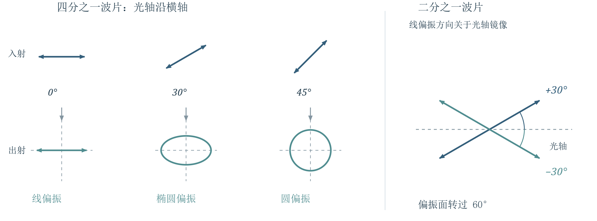{ loading=lazy }
*图 6 四分之一波片与半波片的典型变换。图中波片两轴固定；线偏振方向按无向直线理解，角度相差 180° 等价。*

## 5 用波片与偏振片检偏

> **资料范围**：课件 PDF 30、36–38 页；教材第七章 §3.3–3.5，印刷 399–402 页。

### 5.1 先转检偏片 再加入四分之一波片
PPT重点仅转动一片检偏片：强度有变化且可完全消光，是线偏振；强度不变，可能是圆偏振、自然光或两者的混合；强度变化却不能消光，可能是椭圆偏振或部分偏振。后两种情况需要波片辅助。
圆偏振与自然光：加入任意取向的理想四分之一波片，圆偏振变成线偏振，转检偏片可消光；自然光仍为自然光，输出强度不随检偏片转动而变。
椭圆偏振与自然光加线偏振：先用检偏片找强度最大、最小方向，它们给出椭圆主轴或混合光中线偏振方向；把四分之一波片轴对准其中之一。完全椭圆偏振变为线偏振，可消光；含自然光的部分偏振仍留下非零背景，无法完全消光。

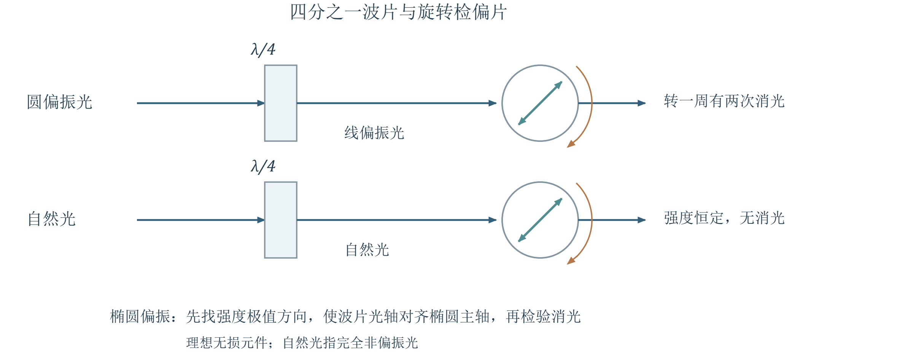{ loading=lazy }
*图 7 检偏的基本步骤。先定位主轴，再插入波片；“不能消光”须在轴对准、器件理想的条件下解释。*

### 5.2 课堂思考 两种部分偏振怎样区分
PPT重点题一：如何区分“自然光＋椭圆偏振”与“自然光＋线偏振”？题二：如何区分“自然光＋圆偏振”与自然光？以下混合均指彼此不相干的强度叠加。
理解补充题一可比较加入对准主轴的四分之一波片前后，转检偏片得到的调制幅度 $D=I_{\max}-I_{\min}$。设自然光强为 $I_n$，椭圆两个主轴方向的分量强度为 $I_a,I_b$，且 $I_a\ge I_b>0$，则

$$D_{\mathrm{before}}=I_a-I_b,\qquad D_{\mathrm{after}}=I_a+I_b.$$

椭圆分量被变成线偏振后，调制幅度增大，但最小值仍为 $I_n/2$。若原本就是自然光加线偏振，对准其方向的波片不改变该线偏振，调制幅度不变。
题二中，原先转检偏片均不改变强度；加四分之一波片后，圆偏振分量变成线偏振，产生强度调制，自然光则仍无调制。若自然光与圆偏振均非零，仍不能完全消光。
理解补充理想无损波片改变偏振态而不改变偏振度。完全偏振光经轴向合适的波片与检偏片能够消光；部分偏振含有无法用波片消除的自然光背景。实际实验须考虑器件消光比与噪声。
## 6 偏振光干涉

> **资料范围**：课件 PDF 39–47 页；教材第七章 §4.1–4.3，印刷 405–408 页。默认两模式相干、空间重合。

### 6.1 起偏 晶片延迟与共同投影
PPT重点装置为起偏片 $P_1$、晶片 $C$、检偏片 $P_2$，最后观察屏上光强。$P_1$ 使同一入射振动分解出的 $o,e$ 两分量具有确定相位关系；晶片积累相位差；$P_2$ 将它们投影到同一方向，才产生可见的干涉强弱。
在 $P_2$ 前，两模式电矢量正交，探测器只记录强度和，不出现交叉干涉项。相干性本身不保证干涉：还须空间重合且投影方向相同。
必须掌握为清楚保留投影正负，下面把角度相对 $P_1$ 方向定义：$P_1$ 水平，晶片 $e$ 轴与它成 $\alpha$，$P_2$ 与它成 $\beta$。设通过 $P_1$ 后光强为 $I_1$，振幅为 $A_1$；在检偏方向上的有符号振幅为

$$a_e=A_1\cos\alpha\cos(\beta-\alpha),\qquad a_o=-A_1\sin\alpha\sin(\beta-\alpha).$$

理解补充在两分量相位差为 $\Gamma$ 时，将强度单位统一，得到通用投影式

$$\frac{I}{I_1}=\cos^2\alpha\cos^2(\beta-\alpha)+\sin^2\alpha\sin^2(\beta-\alpha)$$

$$\quad-2\sin\alpha\cos\alpha\sin(\beta-\alpha)\cos(\beta-\alpha)\cos\Gamma.$$

这里把投影符号直接保留在振幅中。若改用两个正振幅的大小描述，则异号对应附加相位 $\pi$，同号对应附加相位 $0$；这是投影几何，不是检偏片额外改变了材料光程。

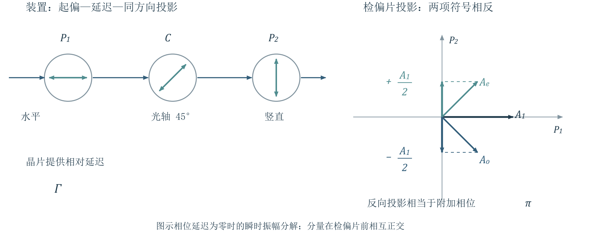{ loading=lazy }
*图 8 正交偏振片之间的晶片。检偏方向上的两个投影符号相反，因而相对多出 π；无晶片延迟时正好相消。*

### 6.2 正交与平行偏振片的光强
教材补充教材 406–407 页把相位与投影关系写成强度式。按本笔记的有符号角度，当 $P_1\perp P_2$，取 $\beta=\pi/2$，两投影等大反向。总相差可按正振幅表示为 $\Phi=\pi-\Gamma$，因此

$$I_{\perp}=I_1\sin^2(2\alpha)\sin^2\frac{\Gamma}{2}.$$

当 $P_1\parallel P_2$，取 $\beta=0$，两投影同向，结果为

$$I_{\parallel}=I_1\left[1-\sin^2(2\alpha)\sin^2\frac{\Gamma}{2}\right],\qquad I_{\perp}+I_{\parallel}=I_1.$$

理解补充$I_1$ 是经过第一片后的强度；若输入自然光强为 $I_0$，应先令 $I_1=I_0/2$。最后的互补关系是在仅改变第二片方向、其他条件相同的两次测量之间成立。
正交时，$\alpha=0^\circ$ 或 $90^\circ$ 使晶片只承载一个模式，始终暗；$\alpha=45^\circ$ 时两个模式振幅相等，调制最强。只有两个模式均被激发，才能讨论随相差出现的明暗变化。
在 $\sin2\alpha\ne0$ 时，正交配置的明暗条件为
明：$|\Gamma|=(2m+1)\pi$；暗：$|\Gamma|=2m\pi$。相应厚度为

$$d_{\mathrm{bright}}=\frac{(2m+1)\lambda}{2|n_o-n_e|},\qquad d_{\mathrm{dark}}=\frac{m\lambda}{|n_o-n_e|}\quad(m=0,1,2,\cdots).$$

对正负晶体都成立；平行配置则在同样延迟处明暗互换。
### 6.3 均匀亮暗 色偏振与等厚条纹
PPT重点均匀晶片加单色平行光时，各处厚度和相差相同，屏上亮度均匀，仍可通过转器件改变整体强度。这是空间上无条纹，不表示两分量没有发生干涉。
白光由不同波长组成，各色各自按 $\Gamma(\lambda)$ 产生不同透射强度，合起来可呈色偏振。某一谱段被削弱时，剩余光色可近似呈其互补色；实际颜色取决于整个透射光谱，不能只凭一个波长判断。
理解补充不能将“转任一器件，颜色都会变化”理解为没有例外。例如正交配置下只转晶片，理想公式中各波长共同乘上 $\sin^2 2\alpha$，主要改变亮度，未必改变归一化光谱；是否变色须结合实际轴向与装置。
晶片厚度随位置变化时，$\Gamma$ 也随位置变化，出现等厚条纹。对小楔角 $\varepsilon$ 的晶体劈尖，设 $d(x)=d_0+x\varepsilon$，忽略折射率随位置变化，邻级同类条纹满足

$$\Delta d=\frac{\lambda}{|n_o-n_e|},\qquad \Delta x=\frac{\lambda}{|n_o-n_e|\varepsilon}.$$

这与薄膜反射干涉的往返光程不同；此处是同一次透射中两种偏振模式的光程差，不能自行添因子 2。

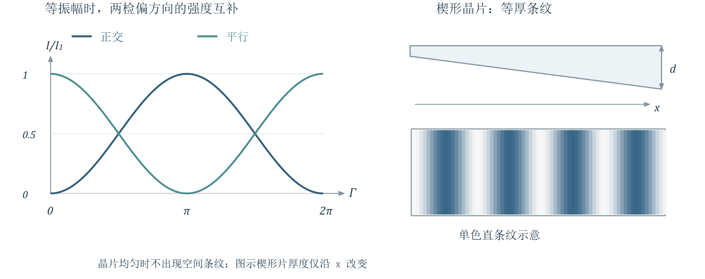{ loading=lazy }
*图 9 正交与平行输出的互补强度，以及晶体劈尖的等厚直条纹示意。实际白光条纹为彩色。*

## 7 人工双折射与电光调制

> **资料范围**：课件 PDF 48–56 页；教材第七章 §4.4–4.5，印刷 408–410 页。重点是外场如何调制光强。

### 7.1 应力双折射与光弹效应
PPT重点原先各向同性的透明玻璃或塑料，在应力作用下可变为各向异性。课件的一维受力模型在一定应力范围内写为

$$|n_o-n_e|=K\frac{F}{S},\qquad |\Gamma|=\frac{2\pi dK}{\lambda}\frac{F}{S}.$$

其中 $F/S$ 为应力，$K$ 为材料应力光学系数，$d$ 为光在试样内的传播厚度。放在正交偏振片之间，主轴与起偏方向成 $45^\circ$ 时，输出为 $I_\perp=I_1\sin^2(\Gamma/2)$。这里的 $\Gamma$ 只表示材料延迟；若用正振幅相干叠加，检偏投影的附加 $\pi$ 要另计一次。
理解补充对一般二维应力场，双折射与主应力之差有关，不能把每个位置都简化成单一 $F/S$。条纹反映应力造成的相差分布；结合材料标定和受力模型，才能进行定量应力分析。
光测弹性仪据此检查透明材料内应力，或用透明模型研究工件、孔洞与矿井结构附近的应力分布。残余应力也能使退火不良的玻璃出现类似图样。
### 7.2 克尔效应与横向电场
PPT重点某些原先各向同性的液体在外电场作用下表现出单轴各向异性，光轴沿电场。课件以硝基苯克尔盒为例：光路长 $l$，电极间距记为 $h$，电压为 $U$，近似匀强电场 $E=U/h$，则

$$|n_o-n_e|=kE^2=k\frac{U^2}{h^2},\qquad |\Gamma|=\frac{2\pi lk}{\lambda}\frac{U^2}{h^2}.$$

这里 $k$ 为课件定义的克尔常数，单位 $\mathrm{m^2/V^2}$；有的教材把波长并入常数，不能直接混用数值。用 $h$ 区别电极间距与光程长 $l$。
无电压时正交偏振片消光；加电压后，若入射线偏振与诱导主轴成 $45^\circ$，延迟转化为强度调制。半波电压对应第一次最大透射，满足

$$U_\pi=h\sqrt{\frac{\lambda}{2lk}},\qquad \frac{I}{I_1}=\sin^2\left(\frac{\pi}{2}\frac{U^2}{U_\pi^2}\right).$$

课堂计算  课件 PDF 52 页给 $k=1.44\times10^{-18}\,\mathrm{m^2/V^2}$，$l=3.0\,\mathrm{cm}$，$h=0.80\,\mathrm{cm}$，$\lambda=600\,\mathrm{nm}$，代入得

$$U_\pi\approx2.11\times10^4\,\mathrm{V},$$

即课件所写约 $2\times10^4\,\mathrm{V}$。先统一为米，可避免把厘米平方带入导致的数量级错误。
### 7.3 泡克尔斯效应与线性电光开关
PPT重点课件的纵向电光装置使用 KDP、ADP 等晶体，光沿原光轴传播；无电压时该方向无线双折射，加电压后出现两个新的横向本征方向。课件所用几何和电光系数 $r$ 下

$$\Gamma=\frac{2\pi}{\lambda}n_o^3rU,\qquad U_\pi=\frac{\lambda}{2n_o^3|r|}.$$

在诱导两轴与起偏方向成 $45^\circ$、偏振片正交的条件下，$I/I_1=\sin^2[\pi U/(2U_\pi)]$。相差正比于电压，称线性电光效应；相对地，克尔效应相差正比于电压平方。
课堂计算  课件 PDF 54 页给 $n_o=1.51$、$r=10.6\times10^{-12}\,\mathrm{m/V}$、$\lambda=546\,\mathrm{nm}$，得到

$$U_\pi\approx7.48\times10^3\,\mathrm{V}.$$

课件给约 $7.6\times10^3\,\mathrm{V}$；按所列数值直接计算应为约 $7.5\,\mathrm{kV}$。本式适用于课件的纵向构型，其他切向与电极布置需要对应的有效电光系数。

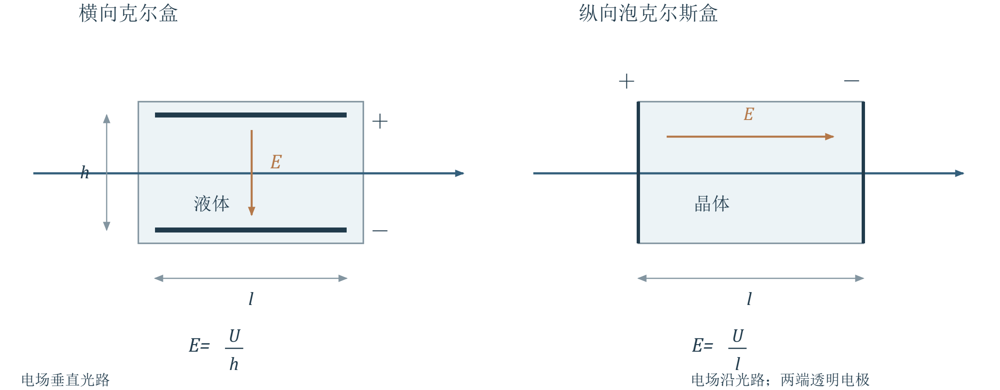{ loading=lazy }
*图 10 克尔盒与纵向泡克尔斯盒。前者区分光路长与电极间距；后者在该构型下厚度与电场中的厚度相消。*

PPT重点电光装置通过“电压 → 双折射 → 相差 → 检偏后光强”实现快速光开关和调制，课件列举高速摄影、通信、测距与激光调 Q。电光响应快不等于整套仪器速度无限，驱动电路也参与实际开关过程。
## 8 自然旋光与法拉第旋光

> **资料范围**：课件 PDF 57–68 页；教材第七章 §5.1–5.2、§5.4–5.5，印刷 414–418、420–423 页。

### 8.1 沿光轴传播也可能发生旋光
PPT重点方解石沿光轴传播时，两种线双折射模式速度相同，不改变入射线偏振方向；石英等旋光物质却能使偏振方向随传播距离旋转。旋光是偏振振动面的变化，光束本身不必弯曲。
均匀物质中，旋转角满足 $\varphi=a l$，其中 $a$ 是旋光率，依赖材料、波长等；溶液还依赖浓度。迎光看，逆时针记为左旋，顺时针记为右旋。同类物质可以具有互为镜像的两种旋光结构。
理解补充“沿光轴无双折射”在前文指普通线双折射简并；旋光物质仍可能有左右圆偏振的折射率差，因此两结论不矛盾。
### 8.2 菲涅耳解释 旋转角等于圆分量相差的一半
PPT重点线偏振可分解为同频、等振幅、相干的左旋与右旋圆偏振。在旋光物质中，两圆模式折射率分别为 $n_L,n_R$，传播长度 $l$ 后的相位落后量为

$$\Gamma_L=\frac{2\pi}{\lambda}n_Ll,\qquad \Gamma_R=\frac{2\pi}{\lambda}n_Rl.$$

建议理解用迎光看时平面内的 $x,y$ 轴，令输入沿 $x$。右旋圆分量写成 $(A/2)(\cos\psi_R,-\sin\psi_R)$，左旋写成 $(A/2)(\cos\psi_L,\sin\psi_L)$，其中 $\psi_j=\omega t-\Gamma_j$。相加并用和差公式，得到

$$\vec E=A(\hat x\cos\varphi+\hat y\sin\varphi)\cos\left[\omega t-\frac{\Gamma_R+\Gamma_L}{2}\right],$$

$$\varphi=\frac{\Gamma_R-\Gamma_L}{2}=\frac{\pi l}{\lambda}(n_R-n_L),\qquad a=\frac{\pi}{\lambda}(n_R-n_L).$$

两圆模式仍等振幅，因此合成光仍为线偏振，只是方向转过 $\varphi$。本式以迎光看逆时针为正；$n_R>n_L$ 对应左旋，反之右旋。若左右圆模式吸收不同，还可能改变椭圆率；本讲不展开。

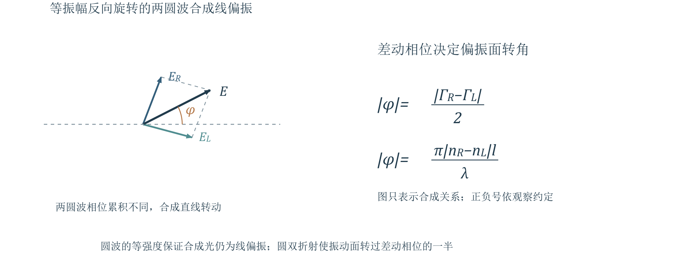{ loading=lazy }
*图 11 两圆偏振模式的相位落后量不同，使合成线偏振方向旋转。角度是两圆模式相差的一半。*

PPT重点菲涅耳复合棱镜交替使用左右旋晶体，使两圆模式的角分离逐级增大；最终检验两束确为左右圆偏振，支持旋光的圆双折射解释。量糖术利用固定波长、温度下旋角随糖溶液长度和浓度变化的关系来测定浓度。
### 8.3 法拉第效应与往返差异
PPT重点线偏振光沿外加磁场方向通过介质时，振动面会旋转，称法拉第磁光效应。均匀纵向磁场下旋角大小为

$$\theta=VBl,$$

其中 $V$ 为费尔德（Verdet）常量，依赖材料与波长，SI 单位为 $\mathrm{rad/(T\cdot m)}$。正负方向还须指定磁场与观察方向，不能只凭 $B$ 的大小判左右旋。
必须掌握比较往返光时，固定同一个实验室坐标观察两个横向偏振方向，并假定反射器只使光原路返回、不额外改变偏振态。自然旋光具有互易性，返回传播抵消去程的方向变化；法拉第旋光在磁场固定时具有非互易性，返回传播继续沿同一实验室方向转动，总旋角加倍。
课件按各自迎光观察描述去程与回程，观察方向随光束反转，容易把“偏转相反”与“往返抵消”混为一谈。判断往返效果应换回同一坐标比较。

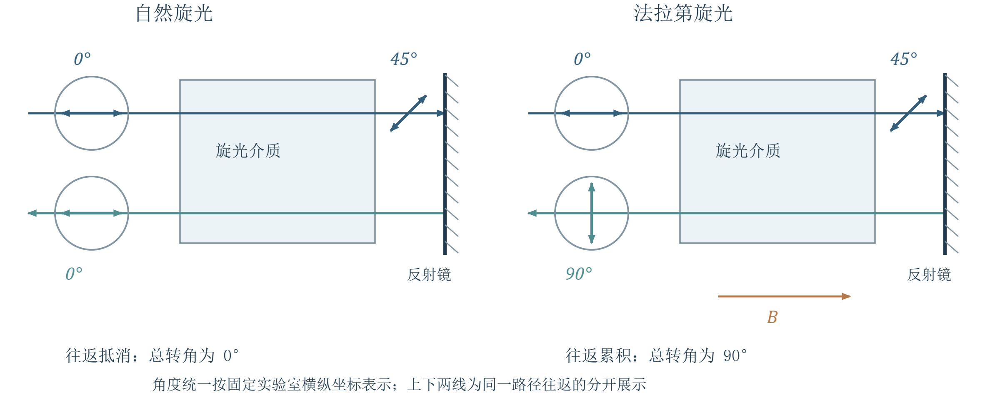{ loading=lazy }
*图 12 同一实验室坐标下的往返偏振方向。自然旋光 0°→45°→0°；磁致旋光 0°→45°→90°，外加磁场保持不变。*

光隔离的原理  把法拉第介质的单程旋角调为 $45^\circ$，界面反射光原路返回后累计转过 $90^\circ$，被前方原透振方向的偏振片阻挡，从而减少反射光对前级的干扰。这个功能依赖磁致旋光的非互易性，普通自然旋光片不能替代。
## 9 公式速查
@break
### 晶体传播与波片
主折射率与非常光相折射率，$\theta$ 为波法线与光轴夹角：

$$n_o=\frac{c}{v_o},\quad n_e=\frac{c}{v_e},\quad n(\theta)=\frac{n_on_e}{\sqrt{n_e^2\cos^2\theta+n_o^2\sin^2\theta}}.$$

射线方向与走离，$\xi$ 为光线与光轴夹角：

$$\tan\xi=\frac{n_o^2}{n_e^2}\tan\theta,\quad \alpha=\xi-\theta,\quad v_N=v_r\cos\alpha.$$

正晶体 $n_e>n_o$；负晶体 $n_e<n_o$。沿光轴两模式均取 $n_o$，垂直光轴时非常光取主值 $n_e$。
正入射、光轴平行表面的晶片，$\lambda$ 为真空波长：

$$\Gamma=\frac{2\pi}{\lambda}(n_o-n_e)d,\quad \delta_{\mathrm{out}}=\delta_{\mathrm{in}}-\Gamma\quad[\cos(\omega t-kz)].$$

四分之一波片 $\Gamma\equiv\pm\pi/2$；半波片 $\Gamma\equiv\pi$；全波片 $\Gamma\equiv0$（均模 $2\pi$）。
四分之一波片：线偏振与两轴成 $45^\circ$ 变圆；沿两轴不变；圆变线；椭圆主轴对准波片轴才变线。半波片：$\gamma_{\mathrm{out}}=2\beta-\gamma$，角度模 $\pi$。
### 偏振光干涉与外场效应
起偏后强度 $I_1$，晶片光轴与起偏方向夹角 $\alpha$：

$$I_\perp=I_1\sin^2(2\alpha)\sin^2\frac{\Gamma}{2},\qquad I_\parallel=I_1-I_\perp.$$

正交配置：非零激发时，$|\Gamma|=(2m+1)\pi$ 亮、$|\Gamma|=2m\pi$ 暗。自然光输入须先令 $I_1=I_0/2$。
克尔盒（电极距 $h$、光路长 $l$）与课件纵向泡克尔斯盒：

$$|\Gamma_K|=\frac{2\pi lkU^2}{\lambda h^2},\quad U_{\pi,K}=h\sqrt{\frac{\lambda}{2lk}},\quad U_{\pi,P}=\frac{\lambda}{2n_o^3|r|}.$$

自然旋光与均匀纵向磁场中的法拉第旋光：

$$\varphi=\frac{\pi l}{\lambda}(n_R-n_L)=al,\qquad \theta=VBl.$$

自然旋光往返抵消；法拉第旋光在磁场固定时往返加倍。旋向先注明观察方向，波片先注明相位符号。
## 10 易错点与资料定位
@break
### 易错清单
1. 光轴是方向。两束方向未分开不代表不存在相位延迟；沿光轴简并也不排除另有旋光。
2. $n_e$ 是非常光垂直光轴传播时的主值；一般方向要用 $n(\theta)$，其角度参照波面法线。
3. 主平面、主截面与入射面不同。两束不同方向光的电矢量正交有几何条件。
4. 惠更斯椭圆上的矢径是射线，切线的垂线才是波法线；非常光光程不能随意写成相折射率乘射线长。
5. 正晶体的光轴是慢轴，负晶体的光轴是快轴。延迟差 $\Gamma$ 与 cos 中相角差的改变量相反。
6. 四分之一波片不把所有线偏振都变圆；半波片的“二倍角”须相对本征轴作镜像判断。
7. 检偏投影异号等价于附加 $\pi$。它只应计一次，不能同时留负振幅又再加一遍 $\pi$。
8. 干涉式中的 $I_1$ 是第一偏振片之后的光强。晶体劈尖的两模式光程差不含薄膜反射的往返因子 2。
9. 克尔效应随 $U^2$，泡克尔斯效应随 $U$；光路长、电极间距和材料常数的定义应分别核对。
10. 左右旋名称依赖约定；比较往返偏振方向要固定坐标。法拉第旋光的返回效应不被去程抵消。
### 资料定位
教师课件共 70 个 PDF 页面，页脚编号到 75，存在跳号。本笔记按 PDF 页序定位：双折射 2–20 页，波片与检偏 21–38 页，偏振光干涉和人工双折射 39–56 页，旋光 57–68 页；69–70 页为术语表。
教材为赵凯华、钟锡华《光学（重排本）》第七章，具体位置已标于各主题开头。该扫描 PDF 的物理页序为印刷页加 13。PPT重点标课堂主线，教材补充标已核对的教材内容，理解补充标解释、条件澄清和自编练习。
## 11 自测题
@break
以下为理解补充自编练习。各题默认器件理想、单色光，忽略反射与吸收；答案见文末。先判断适用模型，再写相位约定，最后计算。
1. 已知某负单轴晶体 $n_o=1.60$、$n_e=1.50$，光轴与平行表面法线成 $45^\circ$，光正入射。求 $n(45^\circ)$、射线倾角 $\xi$ 和走离角 $\alpha$。若把光轴改为平行表面，会不会因两束共线而失去双折射？
2. 设计波长 $600\,\mathrm{nm}$，某负晶体 $n_o-n_e=0.010$。求最薄四分之一、半波片厚度。按正文 $x=e$、$y=o$ 坐标，输入线偏振方向从 $+x$ 向 $+y$ 转 $30^\circ$，通过前者后偏振态、椭圆半轴比和旋向如何？使用正文的迎光观察与 cos 相位约定。
3. 输入是“自然光＋某种完全偏振光”的不相干混合。单用检偏片得到 $I_{\max}=7$、$I_{\min}=3$；把四分之一波片对准先测出的极值方向后，得到新的 $I_{\max}=9$、$I_{\min}=1$。求自然光强、完全偏振部分强度及偏振度；它原先是线偏振还是椭圆偏振？
4. 自然光强 $I_0$，通过正交偏振片与中间晶片，晶片光轴与 $P_1$ 成 $30^\circ$。波长 $600\,\mathrm{nm}$，$|n_o-n_e|=0.010$，厚度 $15\,\mathrm{\mu m}$。求输出光强；若转第二片至平行，输出多少？若改为楔角 $\varepsilon=1.0\times10^{-3}$ 的劈尖，邻级同类条纹间距多少？
5. 两个理想开关均以正交偏振片工作，诱导两轴与起偏方向成 $45^\circ$。当 $U=U_\pi/2$ 时，分别求克尔盒与泡克尔斯盒的 $I/I_1$。另有法拉第片 $V=100\,\mathrm{rad/(T\cdot m)}$、$l=2.0\,\mathrm{cm}$，要求单程转 $45^\circ$，求磁场；界面反射光原路返回后的偏振方向相对起始方向转多少？
## 12 自测答案
@break
### 第 1 题 相折射率与走离
代入正文公式，得 $n(45^\circ)\approx1.5476$，$\xi\approx48.69^\circ$，$\alpha\approx3.69^\circ$。由于是负晶体，图示分支的射线比波法线更偏离光轴。光轴平行表面时两束可共线，但速度不同，会积累相位差，仍有双折射。
### 第 2 题 厚度 偏振态与旋向

$$d_{1/4}=15\,\mathrm{\mu m},\qquad d_{1/2}=30\,\mathrm{\mu m}.$$

负晶体 $\Gamma=+\pi/2$，原线偏振 $\delta_{\mathrm{in}}=0$，因此 $\delta_{\mathrm{out}}=-\pi/2$。输出为主轴沿波片两轴的左旋椭圆偏振，短长半轴比为 $\tan30^\circ=1/\sqrt3$。旋向判断对应入射电矢量在两正轴之间；若把入射偏振方向换到光轴另一侧，旋向反转。
### 第 3 题 区分椭圆分量与线分量
插入合适波片后，完全偏振部分变成线偏振，最小值只来自自然光，因此 $I_n=2\times1=2$，偏振部分 $I_p=9-1=8$，总光强 $I=10$，偏振度 $P=8/10=0.80$。
原检偏极值减去自然光背景 $I_n/2=1$，得椭圆主轴分量强度 $I_a=6$、$I_b=2$。两者均非零，原完全偏振部分是非圆椭圆偏振，短长半轴比 $\sqrt{I_b/I_a}=1/\sqrt3$。其调制幅度由 4 变 8；若原本是线偏振，对准轴的四分之一波片不会使调制幅度增加。
### 第 4 题 先起偏 再算相差

$$I_1=\frac{I_0}{2},\qquad |\Gamma|=\frac{2\pi}{600\,\mathrm{nm}}(0.010)(15\,\mathrm{\mu m})=\frac{\pi}{2}.$$

$$I_\perp=\frac{I_0}{2}\sin^2 60^\circ\sin^2\frac{\pi}{4}=\frac{3I_0}{16},\qquad I_\parallel=\frac{5I_0}{16}.$$

二者相加为 $I_0/2$。劈尖的邻级同类条纹间距为 $\Delta x=\lambda/(|n_o-n_e|\varepsilon)=0.060\,\mathrm m=6.0\,\mathrm{cm}$。
### 第 5 题 电光的非线性与磁光的往返

$$\left(\frac{I}{I_1}\right)_K=\sin^2\frac{\pi}{8}\approx0.1464,\qquad \left(\frac{I}{I_1}\right)_P=\sin^2\frac{\pi}{4}=0.5000.$$

克尔盒在半个半波电压时只有四分之一的半波相差；泡克尔斯盒则有一半的半波相差。

$$B=\frac{\pi/4}{Vl}=\frac{\pi/4}{100\times0.020}\,\mathrm T\approx0.393\,\mathrm T.$$

磁场固定、理想反射原路返回时，总旋角为 $90^\circ$，返回光与起始偏振正交，可被起始透振方向的偏振片阻挡。若换成自然旋光介质，则理想往返的净旋角为零。

