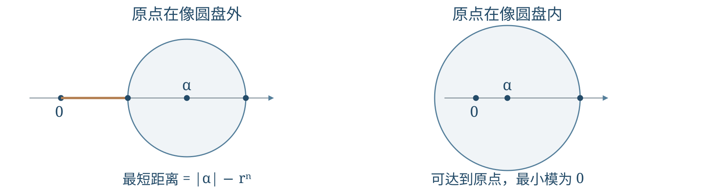
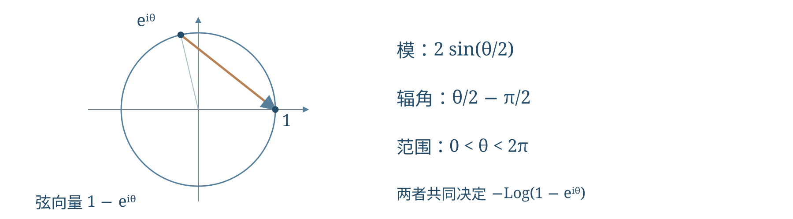
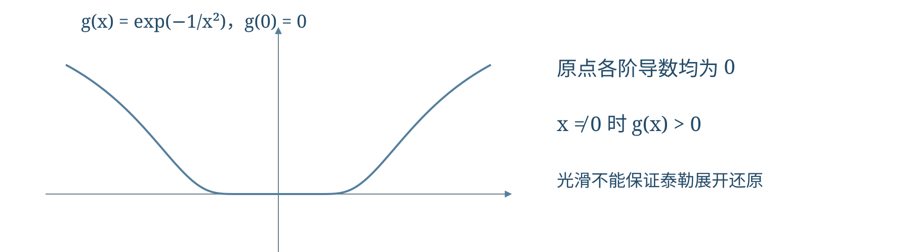
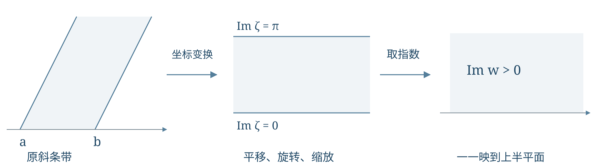
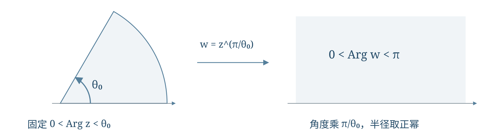
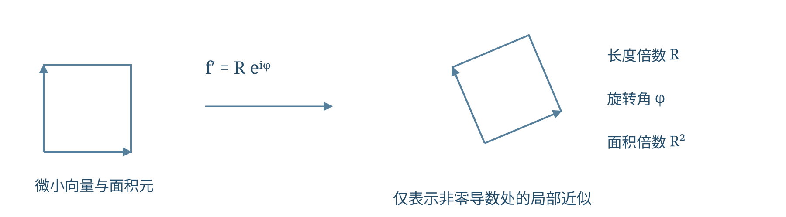

# 第2讲 复幂解析性与复平面映射

!!! tip "本讲配套文件"
    - [PDF 在线阅读（复变函数与数理方程_第2讲_复幂解析性与复平面映射_学习讲义.pdf）](../文件/复变函数与数理方程_第2讲_复幂解析性与复平面映射_学习讲义.pdf)
    - [Word 下载（复变函数与数理方程_第2讲_复幂解析性与复平面映射_学习讲义.docx）](../文件/复变函数与数理方程_第2讲_复幂解析性与复平面映射_学习讲义.docx)

## 第一层 课堂核心速览
### 本节课的核心问题
复幂为什么多值，复导数为什么比实导数严格？本讲用复对数统一复幂与三角级数，再以解析性连接泰勒展开、平面映射和整体值域。
### 必要先修知识
① 模、辐角、全部对数值及复数开方。② 等比级数、实级数判别与逐项运算。③ 偏导数、实可微和链式法则。④ 圆盘、区域与平面面积。
### 核心知识结构
复对数 → 多值复幂 → 圆周上的值与圆盘模最值。
复幂级数与对数 → 三角级数和；正弦乘积 → 偶次倒数和与乘积计算。
复导数 → 柯西—黎曼条件 → 调和函数与泰勒展开；指数和幂映射 → 条带、扇形与半平面。
### 重要结论与条件

$$a^b=\exp\{b[\ln|a|+i(\operatorname{Arg}a+2k\pi)]\},\quad a\ne0,\ k\in\mathbb Z.$$

复可导的点上判据是实部、虚部实可微并满足 $u_x=v_y,\ u_y=-v_x$；仅有两条偏导方程不够。邻域解析才能保证泰勒展开还原函数。

$$\sum_{n=1}^{\infty}\frac{\sin n\theta}{n}=\frac{\pi-\theta}{2}\quad(0<\theta<2\pi).$$

边界公式先证收敛再取径向极限；分数幂映射必须固定辐角支。
### 课堂听讲重点
分清复幂全部值与主值、点上可导与邻域解析、实函数光滑与解析。求映射要检验边界、覆盖与一一性；面积公式检查是否按重数计入。
@break
## 第二层 引导式学习正文
@contents

### 1 复幂的多值性与课堂计算
#### 1.1 定义与计算路线
约定 $\operatorname{Arg}z\in(-\pi,\pi]$。对 $z\ne0$，多值对数与主值分别为

$$\operatorname{Ln}z=\ln|z|+i(\operatorname{Arg}z+2k\pi),\quad k\in\mathbb{Z}.$$

$$\operatorname{Log}z=\ln|z|+i\operatorname{Arg}z.$$

设 $a\ne0$、$b\in\mathbb{C}$，复幂的全部值定义为

$$a^b=\exp\{b[\ln|a|+i(\operatorname{Arg}a+2k\pi)]\}.$$

只取主值对数得到主值 $\exp(b\operatorname{Log}a)$，它只是全部值中的一个。零底数不在这一定义中。
#### 1.2 例题一 有理指数为何只有有限个值
设正整数 $p,q$ 互素。由 $\ln|1|=0$、$\operatorname{Arg}1=0$，

$$1^{q/p}=e^{2\pi i kq/p},\quad k\in\mathbb{Z}.$$

比较参数 $k,j$ 对应的值：两值相等当且仅当 $e^{2\pi i(k-j)q/p}=1$，也就是 $(k-j)q/p$ 为整数。
因为 $p,q$ 互素，$p$ 整除 $(k-j)q$ 当且仅当 $p$ 整除 $k-j$。所以参数相差 $p$ 时重复，而 $k=0,1,\ldots,p-1$ 之间不重复，恰有 $p$ 个不同值。
例如 $1^{2/3}$ 的三个值可列为 $1,e^{4\pi i/3},e^{8\pi i/3}$，最后一个也等于 $e^{2\pi i/3}$。它们是三次单位根，只是排列次序不同。
#### 1.3 例题二 无理指数为何有无穷多个值

$$1^{\sqrt2}=e^{2\sqrt2\,k\pi i},\quad k\in\mathbb{Z}.$$

若第 $k$ 个与第 $j$ 个值相等，则存在整数 $m$ 使 $\sqrt2(k-j)=m$。若 $k\ne j$，将得到 $\sqrt2=m/(k-j)$ 是有理数，矛盾；因此必须 $k=j$。
所以不同整数给出不同值，共有无穷多个，每个值的模都是一。这里列出的是可数多个圆周点，不等于单位圆上的所有点。
课堂例题三　求 $i^i$。

$$\operatorname{Ln}i=i(\pi/2+2k\pi).$$

$$i^i=e^{i\operatorname{Ln}i}=e^{-(\pi/2+2k\pi)},\quad k\in\mathbb{Z}.$$

全部值都是正实数；主值为 $e^{-\pi/2}$。
课堂例题四　求 $(\sqrt{2})^{\sqrt{2}}$ 的全部值及其模。

$$\operatorname{Ln}\sqrt{2}=\tfrac12\ln2+2k\pi i.$$

$$ (\sqrt{2})^{\sqrt{2}}=e^{(\sqrt{2}/2)\ln2}\,e^{2\sqrt{2}k\pi i}.$$

所有值的模都为 $2^{\sqrt{2}/2}$，且不同整数给出不同值。它们落在同一条圆周上，并非填满圆盘。
课堂约定　指数函数采用单值定义

$$\exp z=e^x(\cos y+i\sin y),\quad z=x+iy.$$

因而 $|\exp z|=e^x$，且 $\exp(z+2k\pi i)=\exp z$。
!!! warning "条件提醒"
    多值复幂定义若机械地用于底数 $e$，会得到 $\exp[b(1+2k\pi i)]$。而通常记号 $e^b$ 表示单值指数函数 $\exp b$，相当于固定 $\operatorname{Log}e=1$；不能把“约定取主值”写成“多值对数只有一个值”。

### 2 闭圆盘上多项式模的最值
设 $n\in\mathbb{N}^+$，$r>0$，求 $|z|\le r$ 上 $|z^n+\alpha|$ 的最小值。由 $z^n$ 的值域恰为 $|w|\le r^n$，有

$$\min_{|z|\le r}|z^n+\alpha|=\max\{0,|\alpha|-r^n\}.$$

情形一　$\alpha=0$。最小值为 $0$，在 $z=0$ 处取得。
情形二　$|\alpha|>r^n$。反三角不等式给出

$$|z^n+\alpha|\ge|\alpha|-|z|^n\ge|\alpha|-r^n.$$

设 $\alpha=|\alpha|e^{i\theta_\alpha}$。取等要求 $z^n$ 与 $\alpha$ 反向，且 $|z|=r$，即

$$z^n=-r^n e^{i\theta_\alpha},\quad z_k=r e^{i(\theta_\alpha+\pi+2k\pi)/n}.$$

这里 $k=0,1,\ldots,n-1$，共有 $n$ 个取等点。
情形三　$0<|\alpha|\le r^n$。方程 $z^n=-\alpha$ 的全部根

$$z_k=|\alpha|^{1/n}e^{i(\theta_\alpha+\pi+2k\pi)/n}$$

都在闭圆盘内，故最小值为 $0$。等号 $|\alpha|=r^n$ 时根恰在边界上。
#### 2.1 为什么中间变量的值域恰好是圆盘
只证明 $|z^n|\le r^n$，还不能说明圆盘每一点都能取到。反过来，任取 $|w|\le r^n$：若 $w=0$，选 $z=0$；若 $w\ne0$，它的每个 $n$ 次根都满足 $|z|=|w|^{1/n}\le r$。因此整圆盘确实被映满。
当 $|\alpha|>r^n$ 时，两步下界同时取等才是最小点：第二步要求 $|z|=r$，第一步要求反向。取 $z^n=-r^n\alpha/|\alpha|$ 后，

$$z^n+\alpha=(|\alpha|-r^n)\frac{\alpha}{|\alpha|},$$

其模恰为下界，证明下界可达。反过来，任何最小点都必须满足这两步取等，所以列出的根是全部最小点。
对开圆盘再细分：若 $|\alpha|<r^n$，零点在内部，最小值仍为零；若 $|\alpha|\ge r^n$，最优点只在边界，下确界虽为 $\max\{0,|\alpha|-r^n\}$，却不能取得。
!!! warning "条件提醒"
    这里只考虑闭圆盘。若改为 $|z|<r$，边界上的最优值可能只是下确界，不能说“一定取得最小值”。

{ loading=lazy }

### 3 复对数统一三角级数求和
#### 3.1 第一步 建立复幂级数
令 $|z|<1$，定义

$$F(z)=\sum_{n=1}^{\infty}\frac{z^n}{n}.$$

任取 $0<\rho<1$，在 $|z|\le\rho$ 上，原级数由 $\sum\rho^n/n$ 控制，导数级数由 $\sum\rho^{n-1}$ 控制，两者均一致收敛。幂级数逐项求导定理因此适用：

$$F'(z)=\sum_{n=1}^{\infty}z^{n-1}=\frac1{1-z}.$$

最后一步是几何级数公式，它要求 $|z|<1$。
#### 3.2 第二步 识别原函数并确定常数
此时 $\operatorname{Re}(1-z)>0$，所以 $1-z$ 始终在右半平面，可以连续选取辐角在 $(-\pi/2,\pi/2)$ 内的对数支。
令 $H(z)=-\operatorname{Log}(1-z)$，由对数求导和链式法则得 $H'(z)=1/(1-z)$。又 $H(0)=F(0)=0$，所以两者之差在连通圆盘内导数为零且初值为零，从而

$$F(z)=-\operatorname{Log}(1-z).$$

这里引用幂级数和解析对数的标准求导性质。求解的关键是固定同一个对数支，并用原点值消掉积分常数。
#### 3.3 第三步 分离实部
写 $z=re^{i\theta}$，其中 $0\le r<1$。由欧拉公式，

$$F(re^{i\theta})=\sum_{n=1}^{\infty}\frac{r^n\cos n\theta}{n}+i\sum_{n=1}^{\infty}\frac{r^n\sin n\theta}{n}.$$

因为绝对收敛，可把实部和虚部分别求和。又

$$1-re^{i\theta}=(1-r\cos\theta)-ir\sin\theta,$$

$$|1-re^{i\theta}|^2=(1-r\cos\theta)^2+r^2\sin^2\theta=1-2r\cos\theta+r^2.$$

所以对数实部为模的对数，得到

$$\sum_{n=1}^{\infty}\frac{r^n\cos n\theta}{n}=-\frac12\ln(1-2r\cos\theta+r^2).$$

#### 3.4 第四步 分离虚部并检查符号
因 $1-r\cos\theta\ge1-r>0$，实部始终为正，不需要象限补偿：

$$\operatorname{Arg}(1-re^{i\theta})=\arctan\frac{-r\sin\theta}{1-r\cos\theta}.$$

而 $F$ 的虚部是这个角的相反数，利用反正切为奇函数，得到

$$\sum_{n=1}^{\infty}\frac{r^n\sin n\theta}{n}=\arctan\frac{r\sin\theta}{1-r\cos\theta}.$$
!!! warning "条件提醒"
    两个负号分别来自“对数前的负号”和“向量虚部的负号”，最终抵消。取 $\theta=\pi/2$ 且 $r$ 很小，左边第一项约为正数 $r$，可快速检查符号。
    本节只证明 $r<1$ 的公式。把 $r$ 直接写成一会跨越收敛性条件，下一节需要另外说明。

#### 3.5 第一步 用有限几何级数控制部分和
固定 $0<\theta<2\pi$，于是 $e^{i\theta}\ne1$。令

$$A_N=\sum_{n=1}^{N}e^{in\theta}=\frac{e^{i\theta}(1-e^{iN\theta})}{1-e^{i\theta}}.$$

分子模不超过二，因此 $|A_N|\le2/|1-e^{i\theta}|$，界与 $N$ 无关。更一般地，从任意第 $m$ 项开始的有限和也满足同一个界。
结合 $1/n$ 单调趋零，Dirichlet 判别法给出 $\sum e^{in\theta}/n$ 收敛，其实部和虚部级数也各自收敛。
#### 3.6 第二步 应用 Abel 定理
Abel 定理的这里所需形式是：若 $\sum_{n=1}^{\infty}a_n=S$ 收敛，则

$$\lim_{r\to1^-}\sum_{n=1}^{\infty}a_nr^n=S.$$

它不是说“任意圆内公式都可直接代入边界”；前提是该边界级数已经收敛。
补充说明其理由：记部分和 $s_n=\sum_{k=1}^na_k$，则对 $r<1$ 有

$$\sum_{n=1}^{\infty}a_nr^n=(1-r)\sum_{n=1}^{\infty}s_nr^n.$$

因 $s_n\to S$，将误差分成有限个前项和尾项：前项乘 $1-r$ 后趋零；尾项可用任意小的 $|s_n-S|$ 控制，且权重总和不超过一。常数部分为 $Sr\to S$，因此极限为 $S$。
#### 3.7 第三步 求边界对数的模和辐角
分解弦向量：

$$1-e^{i\theta}=e^{i\theta/2}(e^{-i\theta/2}-e^{i\theta/2})=-2i\sin(\theta/2)e^{i\theta/2}.$$

$$1-e^{i\theta}=2\sin(\theta/2)e^{i(\theta/2-\pi/2)}.$$

由于 $0<\theta<2\pi$，有 $\sin(\theta/2)>0$，而 $\theta/2-\pi/2\in(-\pi/2,\pi/2)$，这正是与圆内连续相接的辐角。
将模与辐角代入 $-\operatorname{Log}(1-e^{i\theta})$ 的实虚部，得到

$$\sum_{n=1}^{\infty}\frac{\cos n\theta}{n}=-\ln\bigl(2\sin(\theta/2)\bigr).$$

$$\sum_{n=1}^{\infty}\frac{\sin n\theta}{n}=\frac{\pi-\theta}{2},\quad0<\theta<2\pi.$$

#### 3.8 代入与端点
取 $\theta=\pi$，余弦为 $(-1)^n$，所以 $\sum(-1)^n/n=-\ln2$；整体乘负一即得交错调和级数的和为 $\ln2$。
在 $\theta=0,2\pi$ 处，余弦级数成为发散的调和级数；正弦级数每项为零，和也为零。因此不能把内部线性公式代入端点。对固定内点的收敛估计，也不能误说成在整个闭区间一致收敛。

{ loading=lazy }

#### 3.9 第一步 在圆内逐项积分
固定 $0\le r<1$，令

$$S_r(t)=\sum_{n=1}^{\infty}\frac{r^n\sin nt}{n}=\arctan\frac{r\sin t}{1-r\cos t}.$$

级数由收敛数项级数 $\sum r^n/n$ 控制，故对角度一致收敛，可在有限区间 $[0,\theta]$ 逐项积分。

$$\int_0^\theta\frac{\sin nt}{n}\,dt=\frac{1-\cos n\theta}{n^2}.$$

于是

$$\sum_{n=1}^{\infty}\frac{r^n(1-\cos n\theta)}{n^2}=\int_0^\theta S_r(t)\,dt.$$

第二个分母因子来自对 $\sin nt$ 积分时的链式法则。
#### 3.10 第二步 让半径趋于一
左边每项的绝对值不超过 $2/n^2$，而 $\sum1/n^2$ 收敛（此处只需收敛，不需知道精确和）。控制尾项后再让有限个前项取极限，即可交换极限与求和。
右边对 $0<t<2\pi$，由上一节得 $S_r(t)\to(\pi-t)/2$，且始终有 $|S_r(t)|\le\pi/2$。可以使用有界控制下的积分极限，也可如下避免在端点直接换序。
在远离两端的闭子区间上，反正切表达式一致趋于极限；端点附近长度为 $\delta$ 的小区间上，被积函数差的绝对值至多为 $\pi$，积分误差至多为 $\pi\delta$。先令 $r\to1^-$，再令 $\delta\to0$，总误差趋零。
所以对 $0\le\theta\le2\pi$，

$$\sum_{n=1}^{\infty}\frac{1-\cos n\theta}{n^2}=\int_0^\theta\frac{\pi-t}{2}\,dt=\frac{\pi\theta}{2}-\frac{\theta^2}{4}.$$

#### 3.11 第三步 确定常数项
利用下一节独立得到的 $\sum1/n^2=\pi^2/6$，从两边减去上式，得

$$\sum_{n=1}^{\infty}\frac{\cos n\theta}{n^2}=\frac{\pi^2}{6}-\frac{\pi\theta}{2}+\frac{\theta^2}{4}.$$

平方分母级数由 $\sum1/n^2$ 控制，绝对且一致收敛，所以所得和连续，包含两个端点。这里没有用本节公式反推常数再当作前提，避免循环论证。
### 4 正弦无穷乘积与倒数和
有限次多项式的分解形式是

$$P_N(z)=C_N\prod_{k=1}^{N}(z-z_k),\quad C_N\ne0.$$

与之相似，正弦有经典乘积表示

$$\sin z=z\prod_{n=1}^{\infty}\left(1-\frac{z^2}{n^2\pi^2}\right).$$

另一方面，

$$\frac{\sin z}{z}=1-\frac{z^2}{3!}+\frac{z^4}{5!}-\cdots.$$

乘积式中二次项系数为 $-\sum_{n=1}^{\infty}1/(n^2\pi^2)$，比较得

$$\sum_{n=1}^{\infty}\frac1{n^2}=\frac{\pi^2}{6}.$$

课堂拓展还列出

$$\sum_{n=1}^{\infty}\frac1{n^4}=\frac{\pi^4}{90},\quad \sum_{n=1}^{\infty}\frac1{n^6}=\frac{\pi^6}{945}.$$

$$\sum_{n=1}^{\infty}\frac1{n^8}=\frac{\pi^8}{9450},\quad \sum_{n=1}^{\infty}\frac1{n^{10}}=\frac{\pi^{10}}{93555}.$$

更一般地，偶数次倒数和等于 $\pi^{2k}$ 乘一个正有理数。奇数次倒数和的问题作为课堂提问保留，这里不套用偶数情形的结论。
!!! warning "条件提醒"
    无穷乘积不是只知道零点就自动成立。本节将正弦乘积公式作为已知结论使用；其乘积局部一致收敛，才可在原点附近比较系数。
    四次项包含不同因子的交叉乘积，因此不能照抄二次项的比较方式，直接把四次系数看成 $\sum n^{-4}$。
    由欧拉公式可得，并可推广到任意复数 $z$：

    $$\cos z=\frac{e^{iz}+e^{-iz}}2,\quad \sin z=\frac{e^{iz}-e^{-iz}}{2i}.$$

    在正弦乘积中令 $z=\pi i$：

    $$\prod_{n=1}^{\infty}\left(1+\frac1{n^2}\right)=\frac{\sin(\pi i)}{\pi i}.$$

    $$\sin(\pi i)=\frac{e^{-\pi}-e^{\pi}}{2i}=i\,\frac{e^\pi-e^{-\pi}}2.$$

    因此

    $$\prod_{n=1}^{\infty}\left(1+\frac1{n^2}\right)=\frac{e^\pi-e^{-\pi}}{2\pi}=\frac{\sinh\pi}{\pi}.$$

    课堂也写到余弦乘积：

    $$\cos z=\prod_{n=0}^{\infty}\left(1-\frac{4z^2}{(2n+1)^2\pi^2}\right).$$

!!! warning "条件提醒"
    照片中提问处的连乘符号一度写得像求和符号，应结合后续乘积推导识别。若真是 $\sum(1+1/n^2)$，通项不趋零，级数发散。
    复数范围内，正弦与余弦的模不受实数情形的界限约束。例如 $\cos(iy)=\cosh y$，可随 $|y|$ 增大而无限增大。

### 5 复导数与柯西黎曼条件
开集的每个点都有一个完全包含在该集合内的小圆盘；区域是非空、开且连通的集合。复平面中的区域内任意两点可以用完全位于区域内的折线连接。
若 $f$ 在 $z_0$ 的一个邻域内定义，并且极限

$$f'(z_0)=\lim_{\Delta z\to0}\frac{f(z_0+\Delta z)-f(z_0)}{\Delta z}$$

存在且有限，就称 $f$ 在 $z_0$ 复可导。
课堂例子　对 $f(z)=z^2$，

$$\frac{(z_0+\Delta z)^2-z_0^2}{\Delta z}=2z_0+\Delta z\longrightarrow2z_0.$$

因此在整个复平面上 $f'(z)=2z$。
反例　$f(z)=\bar z$。沿实增量 $\Delta z=h$，差商为 $1$；沿纯虚增量 $\Delta z=ih$，差商为 $-1$，所以处处不可复导。
若 $f$ 在某点附近的一个开集内处处复可导，则称其在该点解析；在区域内处处复可导，也称在该区域全纯或解析。只在单独一点可导不能推出解析。
!!! warning "条件提醒"
    复导数要求所有趋近路径得到同一极限。两条路径不同足以否定可导；两条路径相同却不足以证明可导。
    “开”与“连通”是两个条件。两个互不相交的开圆盘之并是开集，但不是区域。

#### 5.1 必要性 从复导数推出偏导关系
设 $f=u+iv$ 在 $z_0=x_0+iy_0$ 复可导，导数为 $L$。沿实增量 $h\in\mathbb{R}$，差商极限给出

$$L=u_x+i v_x.$$

沿纯虚增量 $ih$，注意除以 $i$ 等于乘 $-i$，于是

$$L=\frac{u_y+i v_y}{i}=v_y-i u_y.$$

两者表示同一个复数，比较实部与虚部便得

$$u_x=v_y,\quad u_y=-v_x.$$

偏导数都在所考察的点取值；它们的存在性也由对应的方向极限得到。
#### 5.2 如何实际使用
若 $u,v$ 的一阶偏导在区域内连续，实分析的可微判据保证它们实可微。于是只需再检查柯西—黎曼条件，就可判断区域内解析。记号 $C^1$ 表示这些一阶偏导存在且连续。
复可导本身也能写成 $\Delta f=Lh+o(|h|)$，所以复可导必使实、虚部实可微。准确的点上判据是“实可微加柯西—黎曼条件”，偏导连续只是常用的充分保证。
#### 5.3 只有偏导存在为什么不够
定义 $f(0)=0$，而非零点取

$$f(x+iy)=\frac{x^3}{x^2+y^2}+i\frac{y^3}{x^2+y^2}.$$

沿两轴算偏导：$u(h,0)=h$、$u(0,h)=0$、$v(h,0)=0$、$v(0,h)=h$，故原点有 $u_x=v_y=1$、$u_y=-v_x=0$，满足条件。
但是沿 $z=h$，差商 $f(h)/h=1$；沿 $z=h+ih$，有 $f(z)=h/2+ih/2=z/2$，所以差商为 $1/2$。两条路径不同，导数不存在。
缺失的不是偏导方程，而是实可微提供的统一余项估计。
!!! abstract "充分性与导数"
    若 $u,v$ 在所考察点实可微，且满足 $u_x=v_y,u_y=-v_x$，将实一次近似合并便有 $\Delta f=(u_x+iv_x)\Delta z+o(|\Delta z|)$，故复可导，且 $f'=u_x+iv_x=v_y-iu_y$。完整余项证明见参考二。
    对 $f(z)=e^z=e^x\cos y+i e^x\sin y$，取

    $$u=e^x\cos y,\quad v=e^x\sin y.$$

    $$u_x=e^x\cos y=v_y,\quad u_y=-e^x\sin y=-v_x.$$

    偏导处处连续，故指数函数为整函数，且

    $$f'(z)=u_x+i v_x=e^z,\quad |e^z|=e^x.$$

    若 $f=u+iv$ 解析，则其实部与虚部都是调和函数：

    $$\Delta u=u_{xx}+u_{yy}=0,\quad \Delta v=v_{xx}+v_{yy}=0.$$

    课堂推导　由 $u_x=v_y$、$u_y=-v_x$ 得

    $$u_{xx}+u_{yy}=v_{yx}-v_{xy}=0.$$

    虚部的结论同理。此推导使用了二阶混合偏导可交换；解析函数具有足够的光滑性。
    同样，解析函数的高阶导数可按实轴方向求出：

    $$f^{(n)}(z)=\frac{\partial^n u}{\partial x^n}+i\frac{\partial^n v}{\partial x^n}.$$

#### 5.4 一个共轭调和函数的构造例子
给定 $u=x^2-y^2$。先算 $u_{xx}+u_{yy}=2-2=0$，所以它调和。要求 $u+iv$ 解析，须有 $v_y=u_x=2x$。对 $y$ 积分得 $v=2xy+\phi(x)$。
再用 $v_x=-u_y=2y$，得到 $2y+\phi'(x)=2y$，故 $\phi$ 为常数。因此 $v=2xy+C$，对应 $f(z)=z^2+iC$。只满足其中一个偏导关系还不够，第二个关系负责确定积分时留下的函数。
!!! warning "条件提醒"
    两个任意调和函数拼成 $u+iv$，不一定解析；它们还必须彼此满足柯西—黎曼条件。例如 $u=x$、$v=y$ 能配成 $z$，但 $u=x$、$v=-y$ 配成 $\bar z$，不可复导。

### 6 解析性与泰勒展开的边界
#### 6.1 解析函数的幂级数性质
本讲引用解析函数的泰勒展开定理：若 $f$ 在中心 $z_0$ 周围的一个圆盘内解析，则在较小圆盘内

$$f(z)=\sum_{n=0}^{\infty}\frac{f^{(n)}(z_0)}{n!}(z-z_0)^n.$$

反过来，收敛幂级数在其收敛圆内解析。这个等价性属于复分析的基本定理，完整证明需要后续柯西积分公式；它不是“把实变量泰勒公式里的字母换掉”得到的。
常用展开为

$$e^z=\sum_{n=0}^{\infty}\frac{z^n}{n!},\quad \sin z=\sum_{n=0}^{\infty}\frac{(-1)^nz^{2n+1}}{(2n+1)!}.$$

比值判别法表明对任意固定复数都绝对收敛，收敛半径为无穷。
#### 6.2 反例的目标
令实函数 $g(0)=0$，当 $x\ne0$ 时取 $g(x)=e^{-1/x^2}$。要证明它的泰勒级数不能还原函数，必须分别证明：所有阶导数存在、原点所有阶导数为零、附近函数却不恒为零。
#### 6.3 平坦反例的结论
所有泰勒系数 $g^{(n)}(0)/n!$ 都为零，所以泰勒级数恒为零；但每个 $x\ne0$ 都有 $e^{-1/x^2}>0$，因此任何原点邻域内都不能由这条泰勒级数还原函数。
!!! warning "条件提醒"
    不要只给出非零点求导公式，就认为证明了原点各阶可导；第三步是不可省略的桥梁。
    若把表达式放入复平面，沿 $z=iy$ 有 $e^{-1/z^2}=e^{1/y^2}\to\infty$，所以不能补一个原点值就变成解析函数。这与实变量的平坦性不矛盾。

{ loading=lazy }

!!! info "理解提示"
    平坦反例各阶导数存在且在零点为零的完整归纳证明放在参考三。关键不是非零处的求导，而是用差商证明原点也有每阶导数。

### 7 复余弦的值域与方程全部解
令 $z=x+iy$。从指数定义展开，得到

$$\cos(x+iy)=\cos x\cosh y-i\sin x\sinh y.$$

这里 $\cosh y=(e^y+e^{-y})/2$，$\sinh y=(e^y-e^{-y})/2$。
若目标值为实数 $A$，虚部为零要求 $\sin x\sinh y=0$。
情形一　$-1\le A\le1$。可取 $y=0$，并令 $x=\pm\arccos A+2k\pi$。
情形二　$A>1$。可取 $x=2k\pi$，并选择 $y=\pm\operatorname{arcosh}A$。
情形三　$A<-1$。可取 $x=(2k+1)\pi$，并选择 $y=\pm\operatorname{arcosh}(-A)$。
以上 $k\in\mathbb{Z}$。其中 $\operatorname{arcosh}t=\ln(t+\sqrt{t^2-1})$，$t\ge1$。
课堂采用的存在性思路是：$\cosh0=1$，在正半轴上 $\cosh y$ 严格递增并趋于无穷，所以每个大于一的目标模都能达到。
!!! warning "条件提醒"
    当 $A>1$ 时要取偶数倍 $\pi$；当 $A<-1$ 时要取奇数倍 $\pi$。若只写 $x=k\pi$ 却不规定奇偶，就会混入符号错误的解。
    复余弦虚部是 $-\sin x\sinh y$，负号来自 $e^{i(x+iy)}=e^{-y}(\cos x+i\sin x)$。
    设 $C=A+iB$，且 $B\ne0$。方程 $\cos(x+iy)=A+iB$ 等价于

    $$\cos x=\frac A{\cosh y},\quad \sin x=-\frac B{\sinh y}.$$

    于是只需找到 $y\ne0$ 满足

    $$G(y)=\frac{A^2}{\cosh^2y}+\frac{B^2}{\sinh^2y}=1.$$

    在 $y>0$ 上，$G$ 连续且严格递减；当 $y\to0^+$ 时 $G(y)\to\infty$，当 $y\to\infty$ 时 $G(y)\to0$。故存在唯一 $y_*>0$ 使 $G(y_*)=1$。
    分别取 $y=y_*$ 或 $y=-y_*$，右边的余弦值与正弦值平方和为一，所以存在实数 $x$ 同时满足这两个式子。这证明每个非实 $C$ 也都有原像。
    补全全部解　令 $t=e^{iz}\ne0$，则

    $$t^2-2Ct+1=0,\quad t_\pm=C\pm\sqrt{C^2-1}.$$

    两根乘积为一，均非零。选取其中一根 $t$ 后，全部对应解为

    $$z=\operatorname{Arg}t+2k\pi-i\ln|t|,\quad k\in\mathbb{Z}.$$

    对两个根取上述解集之并；若 $C=\pm1$，两根重合，要去除重复解。平方根取两个值只会交换这两组根。

!!! warning "条件提醒"
    由 $\cos x$ 得到 $x=\pm\arccos(A/\cosh y)+2k\pi$ 后，仍要用正弦条件筛选符号。实部和虚部不能独立挑选，否则可能得到不满足原方程的组合。

### 8 条带与扇形到上半平面的映射
对 $w=e^{x+iy}$，竖直直线 $x=x_0$ 映为圆周 $|w|=e^{x_0}$；水平直线 $y=y_0$ 映为辐角为 $y_0$ 的射线。
标准条带 $0<\operatorname{Im}\zeta<\pi$ 经 $w=e^\zeta$ 一一映到上半平面。因为虚部限定在长度为 $\pi$ 的区间内，不会产生整周重复。
课堂斜条带的两条边界与实轴交于 $a<b$，方向角为 $0<\theta_0<\pi$。定义条带为

$$0<\operatorname{Im}[(z-b)e^{-i\theta_0}]<(b-a)\sin\theta_0.$$

步骤一　平移 $z_1=z-b$，使右侧边界经过原点。
步骤二　旋转 $z_2=z_1e^{-i\theta_0}$，把两条边界变成水平线；条带宽为 $h=(b-a)\sin\theta_0$。
步骤三　缩放 $\zeta=\pi z_2/h$，再取指数。最终

$$w=\exp\left(\frac{\pi(z-b)e^{-i\theta_0}}{(b-a)\sin\theta_0}\right).$$

#### 8.1 补全边界代入和逆映射
经过 $b$ 的边界可写为 $z=b+te^{i\theta_0}$，旋转平移后为实数 $t$。经过 $a$ 的边界为 $z=a+te^{i\theta_0}$，变换后为 $(a-b)e^{-i\theta_0}+t$，其虚部为 $(b-a)\sin\theta_0=h$。因此原条带恰好变成宽度为 $h$ 的水平条带。
任取上半平面中的 $w$，令 $\zeta=\ln|w|+i\operatorname{Arg}w$，其中 $0<\operatorname{Arg}w<\pi$。逆向构造

$$z=b+\frac{h e^{i\theta_0}}{\pi}\zeta.$$

该点必在原条带内，且代回指数映射得到 $w$，证明了满射。所用对数在上半平面唯一，其余变换也可逆，所以没有多个原像。
!!! warning "条件提醒"
    条带的实际垂直宽度是 $(b-a)\sin\theta_0$，不是 $b-a$。旋转方向是 $-\theta_0$。
    检查映射方向：经过 $b$ 的边界映到正实轴，经过 $a$ 的边界映到负实轴，条带内部对应上半平面。

{ loading=lazy }

设扇形开角满足 $0<\theta_0\le2\pi$，扇形内 $r>0$、$0<\theta<\theta_0$，并固定 $z=re^{i\theta}$ 的这一辐角支。对 $\alpha>0$，

$$w=z^\alpha=\exp[\alpha(\ln r+i\theta)]=r^\alpha e^{i\alpha\theta}.$$

若取 $\alpha=\pi/\theta_0$，则

$$w=z^{\pi/\theta_0},\quad 0<\operatorname{Arg}w<\pi.$$

半径仍可取任意正数，角度恰好覆盖上半平面，因此这是扇形到上半平面的一一解析映射。
一般地，若顶点在 $z_0$，起始方向为 $\beta$，先令 $\zeta=(z-z_0)e^{-i\beta}$，再对 $\zeta$ 取上述幂。
#### 8.2 一一性与分支的具体检验
设目标点为 $w=Re^{i\varphi}$，其中 $R>0$、$0<\varphi<\pi$。取

$$z=R^{\theta_0/\pi}e^{i\theta_0\varphi/\pi}.$$

它的辐角处于 $(0,\theta_0)$ 内，代入指定分支的幂映射得到 $w$，所以映射覆盖整个上半平面。
若两个原像有相同像，比较模先得半径相同；像的角度都在 $(0,\pi)$，只能相等而不能相差非零整周，因此原像角度也相同，证明单射。
例如第一象限开角为 $\pi/2$，取 $w=z^2$；若开角为 $3\pi/2$，则取指定分支的 $w=z^{2/3}$。后者不能使用多值幂的全部值，否则就不再是这里要求的单值映射。
当开角为 $2\pi$ 时，定义域是沿正实轴割开的平面，辐角支取 $(0,2\pi)$；原点和边界射线均不属于定义域。
!!! warning "条件提醒"
    分数次幂必须指定分支。这里使用扇形内部连续的辐角，不能把所有分支同时当作一个单值映射。
    课堂的 $\alpha>1$ 对应开角 $\theta_0<\pi$ 的情况；当扇形开角大于半周时，需要 $0<\alpha<1$，结论仍可按指定分支使用。

{ loading=lazy }

### 9 整函数值域与导数的几何意义
非恒定复多项式可以取到每个复数：对任意 $C\in\mathbb{C}$，方程 $P(z)-C=0$ 仍是正次数多项式方程，由代数基本定理至少有一根。
指数函数取不到零，但能取到所有非零复数：

$$e^z=C\ne0\quad\Longrightarrow\quad z=\ln|C|+i(\operatorname{Arg}C+2k\pi).$$

前面已经证明余弦能取到任意复数。由 $\sin z=\cos(\pi/2-z)$，正弦同样能取到任意复数。
刘维尔定理　如果 $f$ 在整个复平面解析，并且存在固定常数 $M$ 使 $|f(z)|\le M$ 对所有 $z$ 成立，则 $f$ 为常数。
小皮卡定理　非恒定整函数在复平面上至多遗漏一个复数值。它是课堂拓展结论，本讲不作证明。
课堂还提出 $e^{\sin(z^2)}=C$。该函数始终非零；对任何 $C\ne0$，先选一个对数值 $L\in\operatorname{Ln}C$，再解 $\sin\zeta=L$，最后取 $z^2=\zeta$ 的根，即可构造原像。故它的值域恰为所有非零复数。
!!! warning "条件提醒"
    “有界”必须是整个复平面上的统一界。函数在一个圆盘上有界，不能据此使用刘维尔定理。
    小皮卡定理说“至多遗漏一个值”，不是说所有非恒定整函数都一定遗漏一个值；正弦和余弦就没有遗漏值。
    设 $f=u+iv$ 解析，将其视为实平面映射，雅可比矩阵为

    $$J=\begin{pmatrix}u_x&u_y\\v_x&v_y\end{pmatrix}=\begin{pmatrix}a&-b\\b&a\end{pmatrix},\quad f'=a+ib.$$

    由柯西—黎曼条件，

    $$\det J=u_xv_y-u_yv_x=u_x^2+v_x^2=|f'(z)|^2\ge0.$$

    若 $f'(z_0)\ne0$，则由连续性，充分小邻域内 $|f'(z)|>0$，可用逆函数定理得到局部一一映射，并保持角度与方向。
    若 $f$ 在区域 $\Omega$ 上一一且解析，面积换元公式为

    $$\operatorname{Area}(f(\Omega))=\iint_\Omega |f'(z)|^2\,dx\,dy.$$

    课堂还指出：在连通区域内 $f'\equiv0$ 等价于 $f$ 为常数。若 $f$ 非恒定，则存在一点 $z_0$ 使 $f'(z_0)\ne0$，从而一个小邻域的像具有正面积。

#### 9.1 从导数定义读出旋转和伸缩
复可导给出局部近似

$$f(z_0+h)-f(z_0)=f'(z_0)h+o(|h|).$$

若 $f'(z_0)=Re^{i\phi}\ne0$，线性主部把每个小向量的长度乘 $R$、方向加 $\phi$。两条曲线切向量都转过同一个角，所以它们之间的角保持不变；这是局部、无穷小意义的结论，不是说有限区域必整体变成相似图形。
写 $f'=a+ib$，对应实矩阵的两列分别为 $(a,b)$ 与 $(-b,a)$，互相垂直且长度均为 $\sqrt{a^2+b^2}$，其行列式为 $a^2+b^2>0$。因此无穷小面积乘 $|f'|^2$，且保持定向。
#### 9.2 平方映射的面积积分展开
单位圆盘内 $f(z)=z^2$，导数模平方为 $4|z|^2$。用极坐标 $z=re^{i\theta}$、面积元 $dx\,dy=r\,dr\,d\theta$：

$$\iint_{|z|<1}4|z|^2\,dx\,dy=\int_0^{2\pi}\int_0^1 4r^3\,dr\,d\theta=2\pi.$$

像仍为单位圆盘，面积仅为 $\pi$。非零像点有两个平方根，说明这个积分累计了两次覆盖；临界点零不会改变面积结论。
!!! warning "条件提醒"
    如果映射不是一一的，右边积分一般按覆盖次数重复计算面积，不能直接当成像集不计重数的面积。局部非零导数也不保证在整个区域一一。

{ loading=lazy }

## 第三层 详细参考与拓展
### 参考一 边界收敛的分部求和依据
!!! info "理解即可"
    设 $B_k=\sum_{n=m}^k e^{in\theta}$，则 $|B_k|\le M_\theta=2/|1-e^{i\theta}|$。有限分部求和给出

    $$\sum_{n=m}^{N}\frac{e^{in\theta}}n=\frac{B_N}{N}+\sum_{n=m}^{N-1}B_n\left(\frac1n-\frac1{n+1}\right).$$

    取模后利用括号内非负、望远镜求和，可得尾和模不超过 $M_\theta/m$。它随 $m\to\infty$ 趋零，与 $N\ge m$ 无关，正是柯西收敛条件。

### 参考二 柯西黎曼条件的充分性证明
!!! abstract "重点"
    假设实值函数 $u,v$ 在该点实可微，令 $h=\Delta x+i\Delta y$、$\rho=|h|$。实可微意味着存在一次近似，余项相对于位移长度趋零：

    $$\Delta u=u_x\Delta x+u_y\Delta y+o(\rho).$$

    $$\Delta v=v_x\Delta x+v_y\Delta y+o(\rho).$$

    记号 $o(\rho)$ 的意思是余项除以 $\rho$ 趋于零，并且对任意趋近方向都成立。若同时满足柯西—黎曼条件，则

    $$\Delta f=(u_x+i v_x)\Delta x+(-v_x+i u_x)\Delta y+o(\rho).$$

    $$\Delta f=(u_x+i v_x)(\Delta x+i\Delta y)+o(\rho).$$

    对 $h\ne0$ 除以 $h$，余项模满足 $|o(\rho)/h|=|o(\rho)|/\rho\to0$，因此

    $$f'(z_0)=u_x+i v_x=v_y-i u_y.$$

    这一步才覆盖所有方向，补上了从偏导条件到复可导的关键桥梁。

### 参考三 平坦实函数为什么无法由泰勒级数还原
#### 第一步 证明指数衰减快于任意幂
任取实数 $m\ge0$，令 $t=1/x^2$，则

$$|x|^{-m}e^{-1/x^2}=t^{m/2}e^{-t},\quad t\to+\infty.$$

选整数 $N>m/2$。由指数级数的正项性，$e^t\ge t^N/N!$，故

$$0\le t^{m/2}e^{-t}\le N!t^{m/2-N}\longrightarrow0.$$

所以对任意固定幂次，极限都为零。尤其 $m=0$ 时说明 $g$ 在原点连续。
#### 第二步 看非零点的导数形式
按链式法则和乘积法则：

$$g'(x)=2x^{-3}e^{-1/x^2}.$$

$$g''(x)=(-6x^{-4}+4x^{-6})e^{-1/x^2}.$$

若某阶为 $P_n(1/x)e^{-1/x^2}$，令 $t=1/x$，再求导得到

$$P_{n+1}(t)=-t^2P_n'(t)+2t^3P_n(t).$$

右边仍是多项式，所以每阶在非零点都具有“多项式乘指数衰减”的形式。
#### 第三步 必须用定义证明原点也可导
假设已经证明 $g^{(n)}(0)=0$，且非零点的导数形式如上。由导数定义，

$$g^{(n+1)}(0)=\lim_{h\to0}\frac{P_n(1/h)e^{-1/h^2}}h=0.$$

最后一个极限由第一步逐项控制多项式的有限个幂次得到。归纳从 $g(0)=0$ 开始，就证明所有阶导数在原点存在且为零。
同样的极限还说明各阶导数从非零点趋向零，故它不只是有任意阶导数，而且各阶导数连续。
### 参考四 无穷乘积比较系数的合法性
!!! info "理解即可"
    先取有限乘积 $Q_N(z)=\prod_{n=1}^N(1-a_nz^2)$，其中 $a_n=1/(n^2\pi^2)$。选一个因子的二次项、其余选常数项，才会产生总次数为二的项，所以该系数为 $-\sum_{n=1}^Na_n$。
    正弦乘积在紧集上局部一致收敛，因而可在原点附近传递导数和泰勒系数。这是本节所引用的解析函数标准性质；不是对任意无穷乘积都能逐项比较系数。
    对四次项，必须从两个不同因子中各选一个二次项，所以系数为 $\sum_{j<k}a_ja_k$。由平方展开，

    $$\left(\sum_{n=1}^{\infty}a_n\right)^2=\sum_{n=1}^{\infty}a_n^2+2\sum_{j<k}a_ja_k.$$

    前面的二次项比较给出 $\sum a_n=1/6$，而泰勒展开的四次项给出 $\sum_{j<k}a_ja_k=1/120$，所以

    $$\sum_{n=1}^{\infty}a_n^2=\frac1{36}-\frac2{120}=\frac1{90}.$$

    将 $a_n^2=1/(n^4\pi^4)$ 代回，即得四次倒数和。这个过程解释了为什么不能把四次项直接当成单项倒数和。

### 参考五 刘维尔定理的证明路线
!!! info "理解即可"
    以柯西导数公式为前提：若整函数满足全平面统一界 $|f|\le M$，对任意中心 $a$ 和半径 $R>0$，由圆周长度 $2\pi R$、分母模 $R^2$ 得

    $$|f'(a)|=\left|\frac1{2\pi i}\oint_{|z-a|=R}\frac{f(z)}{(z-a)^2}dz\right|\le\frac{M}{R}.$$

    整函数允许 $R$ 任意大，统一界 $M$ 不随半径变化，故令 $R\to\infty$ 得 $f'(a)=0$。中心任意，沿连接任意两点的线段积分便知 $f$ 恒定。柯西公式本身的证明在第三讲展开。

## 课末核心知识回顾
复幂先列全部对数，再检查参数重复。圆盘最值必须找到全部取等点；开圆盘的界可能不能取得。
三角级数在圆内合法运算，边界另证收敛与径向极限，端点单独检查。无穷乘积比较系数须有局部一致收敛。
复可导要求任意方向的同一极限；实可微与柯西—黎曼条件合起来给出判据。邻域解析才保证泰勒展开还原函数，实函数光滑不够。
复余弦方程用指数代换再取全部对数。条带用指数、扇形用指定分支的幂，均检查一一性与覆盖。
非零复导数给出局部旋转伸缩，长度、面积倍数分别为 $|f'|$、$|f'|^2$；整体像面积还要检查单射，否则积分按覆盖次数累计。

