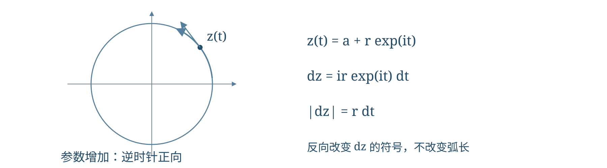
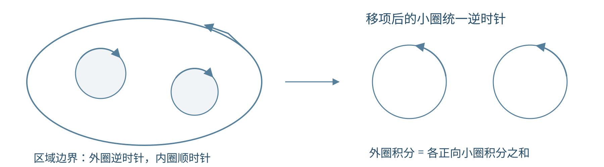
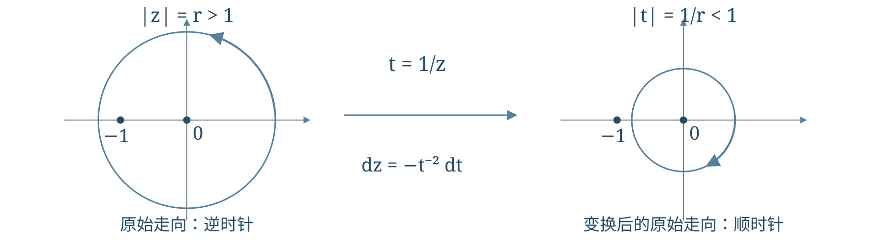

# 第3讲 复积分柯西公式与解析函数的整体性质

!!! tip "本讲配套文件"
    - [PDF 在线阅读（复变函数与数理方程_第3讲_复积分柯西公式与解析函数的整体性质_学习讲义.pdf）](../文件/复变函数与数理方程_第3讲_复积分柯西公式与解析函数的整体性质_学习讲义.pdf)
    - [Word 下载（复变函数与数理方程_第3讲_复积分柯西公式与解析函数的整体性质_学习讲义.docx）](../文件/复变函数与数理方程_第3讲_复积分柯西公式与解析函数的整体性质_学习讲义.docx)

## 第一层 课堂核心速览
### 本节课的核心问题
复积分为什么由路径及其方向共同决定？解析性怎样把闭路积分化为函数值、导数与一个幂级数系数，又怎样限制函数的增长和极值？本讲由积分进入解析函数的整体性质，末尾引入幂级数。
### 必要先修知识
① 复数模与欧拉公式，用于参数化圆周。② 实曲线积分与格林公式，用于理解柯西定理。③ 柯西—黎曼方程与解析区域。④ 指数、正弦、余弦的级数，以及连续函数在闭有界集上取得最值。
### 核心知识结构
有向曲线与复积分 → 柯西积分定理 → 柯西公式及高阶导数公式。
基本圆周积分只保留负一次幂 → 展开与系数筛选 → 课堂三角函数积分。
导数估计 → 刘维尔定理与多项式增长；平均值 → 最大模与调和函数极值。
复合闭路与反演换元 → 综合积分；刘维尔定理 → 代数基本定理。
### 重要结论与条件
!!! abstract "必须掌握"
    以下圆周均取逆时针一圈；函数须在所需闭圆盘附近解析，半径不得越出解析区域。

    $$f^{(n)}(a)=\frac{n!}{2\pi i}\oint_C\frac{f(z)}{(z-a)^{n+1}}\,dz,\qquad |f^{(n)}(a)|\le\frac{n!M_a(r)}{r^n}.$$

    有界整函数必为常数；非恒定解析函数的模不能在区域内部取得局部最大值。

### 课堂听讲重点
每次套公式先检查路径方向、求值点与奇点位置。系数筛选须核对起始指标；反演须同时处理半径、微分负号与方向变化。理解“令半径趋于无穷”为什么要求整函数，以及最大模结论为何不能直接用于一般实函数。
@break
## 第二层 引导式学习正文
@contents
### 1 复积分的定义、方向与柯西积分定理
#### 1.1 参数化把复积分化成实积分
复积分沿一条有方向的曲线累加函数值。设曲线为 $z(t)=x(t)+iy(t)$，$a\le t\le b$。光滑曲线要求 $x,y$ 连续可微，且内部 $z'(t)\ne0$；允许有限个连接点时称分段光滑。方向由参数递增决定，反向曲线记为 $-C$。
!!! abstract "核心结论"
    将参数区间分割为 $a=t_0<\cdots<t_N=b$，取 $\tau_j\in[t_{j-1},t_j]$、$\Delta z_j=z(t_j)-z(t_{j-1})$。对曲线上连续的 $f$，

    $$\int_C f(z)\,dz=\lim_{\max_j(t_j-t_{j-1})\to0}\sum_{j=1}^{N}f(z(\tau_j))\Delta z_j=\int_a^b f(z(t))z'(t)\,dt. \tag{1}$$

    取极限的是参数分割的最大长度，避免仅以端点弦长判断曲线是否被充分细分。复值实积分按实部、虚部分别计算。

!!! warning "条件提醒"
    $dz=z'(t)dt$ 含方向，弧长元 $|dz|=|z'(t)|dt$ 非负。反向积分变号：$\int_{-C}f\,dz=-\int_Cf\,dz$。闭曲线用 $\oint$；简单闭曲线的正向是逆时针，沿曲线走时内部区域在左侧。

{ loading=lazy }

若曲线上 $|f|\le M$，曲线长为 $L$，则三角不等式给出

$$\left|\int_Cf(z)\,dz\right|\le\int_C|f(z)|\,|dz|\le ML. \tag{2}$$

这条估计在证明柯西公式和导数估计时都会用到。
#### 1.2 柯西积分定理的条件与课堂证明
!!! abstract "核心结论"
    设 $C$ 为分段光滑简单闭曲线，内部为 $D$；若 $f$ 在包含 $D\cup C$ 的开集内解析，则

    $$\oint_C f(z)\,dz=0. \tag{3}$$

    更一般地，单连通域内的解析函数沿域内闭曲线积分为零。“单连通”排除了曲线围住定义域中的孔洞。

!!! info "证明思路"
    把复积分拆成两个实曲线积分，再由格林公式将它们化为面积积分。柯西—黎曼方程使两个面积积分的被积函数均为零。
    写 $f=u+iv$、$dz=dx+i\,dy$，相乘得到

    $$\oint_Cf\,dz=\oint_C(u\,dx-v\,dy)+i\oint_C(v\,dx+u\,dy).$$

    在 $u,v$ 一阶偏导连续且区域满足格林公式条件时，

    $$\oint_Cf\,dz=\iint_D(-v_x-u_y)\,dx\,dy+i\iint_D(u_x-v_y)\,dx\,dy=0.$$

    最后一步用到 $u_x=v_y$、$u_y=-v_x$。

!!! warning "条件提醒"
    这一格林公式证明使用了偏导连续性；不预先要求导数连续的完整柯西—古萨定理通常以三角形细分法证明，本讲不将两者混为同一证明。函数只在曲线上光滑仍不够，例如 $1/z$ 在单位圆内部有原点奇点，不能套式（3）。反过来，积分为零也不能推出内部解析，$1/z^2$ 就是反例。

### 2 基本圆周积分与柯西公式
#### 2.1 为什么只有负一次幂留下积分
设 $r>0$，$n\in\mathbb Z$。对正向圆周 $|z-z_0|=r$，令 $z=z_0+re^{i\theta}$、$0\le\theta\le2\pi$，于是

$$I_n=\oint_{|z-z_0|=r}\frac{dz}{(z-z_0)^n}=ir^{1-n}\int_0^{2\pi}e^{i(1-n)\theta}\,d\theta.$$

若 $n=1$，积分中指数为零，得到 $2\pi i$；若 $n\ne1$，指数频率是非零整数，积分的两个端点值相等而相消。因此

$$I_1=2\pi i,\qquad I_n=0\quad(n\in\mathbb Z,\ n\ne1). \tag{4}$$

结果与半径无关，反向时变号。若被积函数写成 $(z-z_0)^k$，特殊指数相应是 $k=-1$。
#### 2.2 从圆周读出函数值与导数
!!! abstract "核心结论"
    设 $C$ 为正向分段光滑简单闭曲线，$f$ 在包含 $C$ 及其内部的开集内解析，$a$ 在内部。则对整数 $n\ge0$，

    $$f(a)=\frac1{2\pi i}\oint_C\frac{f(\zeta)}{\zeta-a}\,d\zeta,$$

    $$f^{(n)}(a)=\frac{n!}{2\pi i}\oint_C\frac{f(\zeta)}{(\zeta-a)^{n+1}}\,d\zeta. \tag{5}$$

    $\zeta$ 是沿路径变化的积分变量，$a$ 是固定求值点。高阶公式中，导数阶数为 $n$，分母次数为 $n+1$，因子为 $n!$。

!!! info "证明思路"
    函数值公式把外圈缩到 $a$ 附近的小圆，再将 $f(\zeta)$ 拆成 $f(a)$ 与趋零的差；高阶公式对积分核求导。小圆余项的估计与求导依据集中放在参考一。
    课堂也用幂级数核对式（5）：把 $f$ 在 $a$ 处展开并逐项积分，式（4）只留下第 $n$ 次项。若正在用柯西公式证明泰勒展开，这只能作为事后核对，不能反过来作为独立证明。

### 3 课堂积分：用幂次结构筛选一个系数
#### 3.1 通用方法与第一道余弦题
若 $F(z)=\sum_{j=0}^{\infty}a_jz^j$ 在包含闭单位圆的圆盘内解析，对正整数 $n$，

$$\oint_{|z|=1}\frac{F(z)}{z^n}\,dz=2\pi i\,a_{n-1}=\frac{2\pi i}{(n-1)!}F^{(n-1)}(0). \tag{6}$$
!!! info "证明思路"
    先展开分子，再找除以 $z^n$ 后成为 $z^{-1}$ 的唯一一项。看到高次分母，不必直接求高阶导数；复合函数的幂次结构常能更快确定答案。
    课堂例题：求正向单位圆上的 $J_n=\oint(1-\cos z)/z^n\,dz$，$n\in\mathbb Z$。分子展开为

    $$1-\cos z=\sum_{m=1}^{\infty}\frac{(-1)^{m+1}z^{2m}}{(2m)!}.$$

    负一次项要求 $2m-n=-1$，即 $n=2m+1$ 且 $m\ge1$，所以

    $$J_{2m+1}=\frac{2\pi i(-1)^{m+1}}{(2m)!}\quad(m=1,2,\ldots).$$

    其余整数 $n$ 的积分均为零。检查前两项 $z^2/2-z^4/24$，得到 $J_3=\pi i$、$J_5=-\pi i/12$。

!!! warning "条件提醒"
    求和从 $m=1$ 开始，故 $J_1=0$，不能把“奇数指标非零”扩展到一。在单位圆上每项的模由 $1/(2m)!$ 控制，上界的和收敛，因而可逐项积分。

#### 3.2 复合余弦：先确定最低次数
课堂例题：求 $A_n=\oint_{|z|=1}[1-\cos(4z^5)]/z^n\,dz$，路径正向，$n\in\mathbb Z$。把 $4z^5$ 整体代入余弦级数：

$$1-\cos(4z^5)=\sum_{m=1}^{\infty}\frac{(-1)^{m+1}4^{2m}z^{10m}}{(2m)!}.$$

负一次项要求 $10m-n=-1$。因此仅 $n=10m+1$、$m\ge1$ 时非零，且

$$A_{10m+1}=\frac{2\pi i(-1)^{m+1}4^{2m}}{(2m)!}.$$

分子从 $8z^{10}-(32/3)z^{20}$ 开始，可核对 $A_{11}=16\pi i$、$A_{21}=-(64/3)\pi i$，而 $A_1=0$。单位圆上的各项由可求和的 $4^{2m}/(2m)!$ 控制，换序合法。
#### 3.3 复合正弦：指标必须是正奇数倍
课堂例题：固定正整数 $k$，求正向单位圆上的 $B_{n,k}=\oint\sin(z^k)/z^n\,dz$，$n\in\mathbb Z$。

$$\sin(z^k)=\sum_{j=0}^{\infty}\frac{(-1)^jz^{k(2j+1)}}{(2j+1)!}.$$

非零条件为 $n-1=k(2j+1)$、$j\ge0$，即 $(n-1)/k$ 必须是正奇数。满足时

$$B_{k(2j+1)+1,k}=\frac{2\pi i(-1)^j}{(2j+1)!};$$

其余整数 $n$ 均为零。例如 $k=2$ 时，非零指标为 $3,7,11,\ldots$，前两项给 $B_{3,2}=2\pi i$、$B_{7,2}=-\pi i/3$。
!!! warning "条件提醒"
    $\sin(z^k)$ 与 $(\sin z)^k$ 不同。匹配出的指标必须是规定范围内的整数；不满足时积分为零，不取“最接近”的整数。

### 4 柯西估计、刘维尔定理与多项式增长
#### 4.1 从积分公式估计导数
记 $M_a(r)=\max_{|z-a|=r}|f(z)|$，其中闭圆盘附近 $f$ 解析。对式（5）取模，并用圆长 $2\pi r$：

$$|f^{(n)}(a)|\le\frac{n!}{2\pi}\oint_{|z-a|=r}\frac{|f(z)|}{r^{n+1}}\,|dz|\le\frac{n!M_a(r)}{r^n}. \tag{7}$$
!!! info "理解提示"
    分母提供 $r^{n+1}$，圆长抵消一个 $r$，因此最后是 $r^n$。增长越慢，允许放大的积分圆越能压低高阶导数。

#### 4.2 有界整函数必为常数
!!! abstract "刘维尔定理"
    若 $f$ 在整个复平面解析，且存在与 $z$ 无关的常数 $M$ 使 $|f(z)|\le M$，则 $f$ 为常数。
    证明：任取中心 $a$，由式（7）的一阶情形，有 $|f'(a)|\le M/r$。整函数允许任取 $r>0$，令 $r\to\infty$ 得 $f'(a)=0$。因 $a$ 任意，导数处处为零，故沿连接两点的线段积分可知函数值处处相同。

!!! warning "条件提醒"
    仅在实轴上有界不够，例如 $\sin z$ 沿虚轴为 $i\sinh y$，模无界；仅在部分区域有界也不够，例如 $1/z$ 在 $|z|>1$ 上有界，但不是整函数。

#### 4.3 课堂命题：增长上界决定多项式次数
设 $N\ge0$ 为整数，$f$ 为整函数，且对全部 $z$ 有

$$|f(z)|\le M\sum_{k=0}^{N}|z|^k.$$

则 $f$ 是次数不超过 $N$ 的多项式。先固定任意正整数 $j$，在原点用柯西估计：

$$|f^{(N+j)}(0)|\le M(N+j)!\sum_{k=0}^{N}r^{k-N-j}\to0\quad(r\to\infty).$$

每个指数均小于零，故 $f^{(N+j)}(0)=0$。对每个固定 $j\ge1$ 都成立，于是泰勒展开只剩

$$f(z)=\sum_{k=0}^{N}\frac{f^{(k)}(0)}{k!}z^k.$$

这是“次数至多 $N$”，并不保证最高次项非零。若仅在充分大的 $|z|$ 上有 $C(1+|z|^N)$ 型上界，同样选足够大的圆即可；函数只在有限圆盘解析时，则不能令 $r\to\infty$。
### 5 平均值、最大模与调和函数的极值
#### 5.1 圆心值是复函数值的平均
在柯西公式中令 $\zeta=a+re^{i\theta}$，分母与 $d\zeta$ 中的因子相消，得到

$$f(a)=\frac1{2\pi}\int_0^{2\pi}f(a+re^{i\theta})\,d\theta. \tag{8}$$
!!! warning "条件提醒"
    闭圆盘必须位于解析区域内。式（8）平均的是复数值，一般只有 $|f(a)|\le(2\pi)^{-1}\int_0^{2\pi}|f(a+re^{i\theta})|d\theta$，不能把两边直接换成模后仍写等号。

#### 5.2 最大模原理的结论与证明主线
!!! abstract "核心结论"
    非恒定解析函数的模，在连通解析区域内部不能取得局部最大值。若区域有界，函数在闭区域连续，则最大模可在边界取得。

!!! info "证明思路"
    若圆心的模已不小于附近所有值，把圆心值旋转到正实轴。圆周上所有值的实部均不超过它，而实部的平均又必须等于它；连续性迫使每一点都达到等号。结合模的上界，虚部也只能为零，因而小圆盘内恒定，再由解析性推广到连通域。完整等号与延拓论证见参考二。
    常函数的内部与边界都可取最大模。解析函数的模可以在内部取最小值，例如 $f(z)=z$ 在原点取零；因此不要把最大模结论直接改成无条件的最小模结论。

#### 5.3 调和函数的边界最大最小值
实值 $C^2$ 函数满足 $\Delta u=u_{xx}+u_{yy}=0$ 时称调和。若 $f=u+iv$ 解析，由柯西—黎曼方程得

$$u_{xx}+u_{yy}=v_{yx}-v_{xy}=0,$$

所以解析函数的实部、虚部都是调和函数。
!!! abstract "核心结论"
    调和函数在有界连通域内调和、闭区域连续时，最大值与最小值均可在边界取得；非恒定调和函数在内部不能有局部极大或极小值。
    课堂证明用指数函数连接两个原理：若 $u=\operatorname{Re}f$，令 $g=e^f$，则 $|g|=e^u$。$u$ 的局部最大值成为 $|g|$ 的局部最大值，故 $g$ 为常数；由 $g'=f'e^f$ 且 $e^f\ne0$，得到 $f'=0$。对 $e^{-f}$ 同理处理最小值。

!!! warning "条件提醒"
    一般多连通域上的调和函数未必有全局单值共轭函数。上述证明先在小圆盘构造局部共轭，再沿连通域传播；必要细节见参考三。$|f|$ 通常不是调和函数，不能混用两个原理。

#### 5.4 课堂实变量对照题
求 $q=x^2-xy+y^2$ 在 $x^2+y^2\le r^2$ 上的最值，$r>0$。它有 $\Delta q=4$，不适用调和函数极值原理，直接用极坐标：

$$q=\rho^2(1-\tfrac12\sin2\theta),\qquad 0\le\rho\le r.$$

括号位于 $[1/2,3/2]$，所以最小值为零，仅原点取得；最大值为 $3r^2/2$，需同时 $\rho=r$、$\sin2\theta=-1$。故最大值点为 $(r/\sqrt2,-r/\sqrt2)$ 与 $(-r/\sqrt2,r/\sqrt2)$。这道题提醒：一般实函数可在内部取极值，边界结论必须有相应结构作为前提。
### 6 复合闭路：外圈为何等于小圈之和
!!! abstract "核心结论"
    设正向简单闭曲线 $C$ 内有互不相交的小闭曲线 $C_1,\ldots,C_m$，各小圈均单独取逆时针，内部互不重叠。若 $f$ 在挖去这些内部后剩余闭区域的一个邻域内解析，则

    $$\oint_C f(z)\,dz=\sum_{k=1}^{m}\oint_{C_k}f(z)\,dz. \tag{9}$$

    孔洞内可以有奇点，但剩余区域及边界不能再遗漏奇点。

!!! info "证明思路"
    用不相交的切口连接内外边界。切开后的区域边界包括外圈、反向内圈，以及切口的两侧；切口两侧同路反向，积分相消。对切开区域用柯西定理，剩下

    $$0=\oint_Cf\,dz-\sum_{k=1}^{m}\oint_{C_k}f\,dz,$$

    移项即得式（9）。可将切口看作宽度趋零的细通道，连续性保证两侧积分在极限中相消。

{ loading=lazy }

!!! warning "方向提醒"
    作为挖孔区域的正向边界，外圈逆时针、内圈顺时针；写成“外圈等于各小圈之和”时，右侧小圈都改成逆时针。路径可在无奇点的区域内变形，但不能穿过奇点，也不能改变包围了哪些奇点。

### 7 课堂综合积分与反演换元校正
#### 7.1 先找奇点，再跟踪方向
课堂题目是对 $r>1$ 计算正向圆周上的

$$K_r=\oint_{|z|=r}\frac{e^{1/z}}{1+z}\,dz.$$

被积函数在 $0,-1$ 以外解析，两点都在圆内。板书将两处小圈贡献相加写成 $2\pi i+2\pi i/e$；原点小圈的反演半径判断有误，正确结果是 $K_r=2\pi i$。下面给出可独立核查的推导。
令 $t=1/z$，则 $dz=-dt/t^2$，且

$$\frac{e^{1/z}}{1+z}\,dz=-\frac{e^t}{t(t+1)}\,dt.$$

若 $z=re^{i\theta}$ 逆时针转动，则 $t=r^{-1}e^{-i\theta}$ 顺时针转动。把新路径改回逆时针，方向负号与微分负号相消：

$$K_r=\oint_{|t|=1/r}^{+}\frac{e^t}{t(t+1)}\,dt.$$

因 $1/r<1$，$t=-1$ 位于新圆外，$G(t)=e^t/(t+1)$ 在新圆内外邻域解析。柯西公式给出

$$K_r=2\pi iG(0)=2\pi i. \tag{10}$$

{ loading=lazy }

#### 7.2 分开计算两小圈，定位板书遗漏
在原点周围取正向小圆 $C_0:|z|=\varepsilon$，$0<\varepsilon<1$；再在 $-1$ 周围取不与它相交的小圆 $C_{-1}$。复合闭路定理给出 $K_r=K_0+K_{-1}$。
负一附近直接用柯西公式：

$$K_{-1}=2\pi i e^{-1}.$$

原点小圆反演后的半径是 $1/\varepsilon>1$，所以新圆同时围住 $0,-1$。整理方向后再分式分解：

$$K_0=\oint_{|t|=1/\varepsilon}^{+}\left(\frac{e^t}{t}-\frac{e^t}{t+1}\right)dt=2\pi i(1-e^{-1}).$$

二者相加仍是 $2\pi i$。板书遗漏的是原点小圈反演后 $t=-1$ 对第二项的贡献。这里不能把“小圆”在反演后仍当作小圆。
!!! warning "条件提醒"
    若原题改为 $0<r<1$，只围住原点，积分便是 $2\pi i(1-e^{-1})$；$r=1$ 时路径穿过 $-1$，通常的曲线积分不适用。半径范围是题意的一部分。

### 8 代数基本定理：无根假设怎样导出矛盾
!!! abstract "核心结论"
    任意次数 $n\ge1$ 的复多项式都有复根；按重数计共有 $n$ 个根，可完全分解为一次因子的乘积。

!!! info "证明思路"
    假设多项式无根，则倒数为整函数。最高次项控制圆外，紧致性控制圆内，使倒数全平面有界；刘维尔定理将它变成常数，与它在远处趋零却处处非零矛盾。
    设 $P(z)=a_nz^n+\cdots+a_0$，$a_n\ne0$。提出最高次项：

    $$P(z)=a_nz^n(1+\frac{a_{n-1}}{a_nz}+\cdots+\frac{a_0}{a_nz^n}).$$

    括号内除一以外的有限项之和，在所有方向上随 $|z|\to\infty$ 一致趋零。取充分大 $R$，使其模不超过 $1/2$，反三角不等式给出

    $$|P(z)|\ge\frac{|a_n|}{2}|z|^n\quad(|z|\ge R).$$

    若 $P$ 无根，则 $F=1/P$ 为整函数。圆外 $|F(z)|\le2/(|a_n||z|^n)\to0$；圆内 $|P|$ 连续且不为零，在闭圆盘取得正最小值 $m$，故 $|F|\le1/m$。两部分上界合并，得到 $F$ 全平面有界。
    刘维尔定理推出 $F$ 为常数，再由远处极限为零，得 $F\equiv0$，与 $1/P$ 处处非零矛盾。因此 $P$ 至少有一根 $\alpha_1$。
    多项式除法给 $P(z)=(z-\alpha_1)Q_{n-1}(z)$。对非恒定商重复根存在性，次数每次降低一，最终得到

    $$P(z)=a_n\prod_{j=1}^{n}(z-\alpha_j). \tag{11}$$

    重复出现的因子数就是对应根的重数；分解已经说明按重数恰有 $n$ 根。

!!! warning "条件提醒"
    应写 $|P(z)|\to\infty$，不能把复数值按实数大小比较。圆外趋零不自动给出全平面有界，圆内的连续性、紧致性与无根假设缺一不可。

### 9 幂级数的引入与本讲的逻辑联系
课堂末尾进入幂级数：以 $z_0$ 为中心的级数形如

$$\sum_{n=0}^{\infty}c_n(z-z_0)^n.$$

系数固定，收敛点由 $z$ 决定，不能像有限多项式一样默认处处有意义。课堂例子包括

$$e^z=\sum_{n=0}^{\infty}\frac{z^n}{n!},\qquad \cos z=\sum_{n=0}^{\infty}\frac{(-1)^nz^{2n}}{(2n)!},$$

$$\sin z=\sum_{n=0}^{\infty}\frac{(-1)^nz^{2n+1}}{(2n+1)!}.$$

它们对所有复数收敛，并在每个固定闭圆盘上一致收敛。例如指数项的相邻绝对值之比为 $|z|/(n+1)\to0$，闭圆盘上再用半径对应的数值级数统一控制。
!!! info "逻辑衔接"
    本讲使用的解析函数展开可由“柯西定理 → 柯西公式与高阶导数 → 几何级数展开积分核 → 泰勒定理”建立，参考四给出关键换序步骤。不能只凭“有任意阶导数”就断言等于泰勒级数；复解析性提供了更强的保证。

## 第三层 详细参考与拓展
### 参考一 柯西公式的小圆证明与高阶求导
!!! abstract "重点"
    目标是说明大曲线积分为何只留下中心函数值。取 $a$ 附近的正向小圆 $C_\varepsilon$，使它位于 $C$ 内部。$f(\zeta)/(\zeta-a)$ 在两圈之间解析，复合闭路定理将大圈积分化为小圈积分。

    $$\oint_{C_\varepsilon}\frac{f(\zeta)}{\zeta-a}\,d\zeta=2\pi i f(a)+\oint_{C_\varepsilon}\frac{f(\zeta)-f(a)}{\zeta-a}\,d\zeta.$$

    由式（2），后一项的模不超过

    $$2\pi\max_{|\zeta-a|=\varepsilon}|f(\zeta)-f(a)|\to0\quad(\varepsilon\to0).$$

    外圈积分不随小圆半径改变，因而等于 $2\pi if(a)$。
    高阶公式从参数 $a$ 的求导得到。在远离 $C$ 的一个小闭圆盘内，$|\zeta-a|$ 有统一正下界，核的差商一致趋向 $1/(\zeta-a)^2$，可交换极限与积分。反复求导时

    $$\frac{d^n}{da^n}\frac1{\zeta-a}=\frac{n!}{(\zeta-a)^{n+1}},$$

    即得到式（5），并证明解析函数存在任意阶导数。

### 参考二 最大模原理的等号与连通性
!!! info "重点"
    设 $a$ 是内部局部最大模点，附近 $|f(z)|\le|f(a)|=M$。若 $M=0$，附近直接恒零；若 $M>0$，写 $f(a)=Me^{i\alpha}$，令 $g=e^{-i\alpha}f$，则 $g(a)=M$、$|g|\le M$。
    对任意充分小的圆，平均值公式取实部给

    $$M=\frac1{2\pi}\int_0^{2\pi}\operatorname{Re}g(a+re^{i\theta})\,d\theta.$$

    每个被平均的实数都不超过 $M$。若一点严格小于 $M$，连续性使一段圆弧也严格小于 $M$，平均就严格小于 $M$，矛盾。因此圆周上 $\operatorname{Re}g=M$。又由 $|g|\le M$，若 $g=M+ib$，便有 $M^2+b^2\le M^2$，所以 $b=0$。半径可任取，故小圆盘内 $f$ 为常数。
    从局部到全域用解析函数的唯一性：若解析函数不局部恒零，泰勒展开有首个非零项，可写成 $(z-a)^m[a_m+O(z-a)]$，其中 $a_m\ne0$，故附近零点孤立。于是对 $h=f-f(a)$，局部恒零点组成的集合非空且开；若这些点趋向域内一点，该点附近不可能是孤立零点，因而也局部恒零，集合又相对闭。连通性使它等于整个域。
    有界闭区域上的连续函数取得最大值；若最大点在内部，刚证明的结论使函数恒定。因此非恒定时最大模只能在边界。此处“有界、闭区域连续”保证最大值存在，“内部解析、连通”排除内部最大模点。

### 参考三 调和函数的局部共轭与极值传播
!!! info "理解即可"
    多连通域上不必存在全局共轭，但任一内点都有足够小的圆盘包含于域内。在该圆盘中考虑微分形式 $-u_y\,dx+u_x\,dy$。其相容条件为

    $$(-u_y)_y=(u_x)_x,$$

    恰好等价于 $u_{xx}+u_{yy}=0$。圆盘单连通，格林公式保证该形式的积分与路径无关，所以可定义 $v$，满足 $v_x=-u_y$、$v_y=u_x$，从而 $u+iv$ 解析。
    指数证明于是可在每个小圆盘内使用。若 $u$ 有内部局部极值，则先在一个小圆盘恒定。以相交的小圆盘沿域内路径覆盖；在相邻圆盘的重叠开集中 $u$ 已为常数，相应解析函数的导数在开集为零，由参考二的唯一性论证，它在整个相邻圆盘为零。因此常值逐盘传播到整个连通域。这补全了不依赖全局共轭函数的证明。

### 参考四 从柯西公式得到泰勒展开
!!! info "理解即可"
    设 $f$ 在包含闭圆盘 $|\zeta-a|\le R$ 的开集内解析。对 $|z-a|\le\rho<R$，在圆周 $|\zeta-a|=R$ 上有

    $$\frac1{\zeta-z}=\frac1{\zeta-a}\sum_{n=0}^{\infty}\left(\frac{z-a}{\zeta-a}\right)^n.$$

    比值的模统一不超过 $\rho/R<1$，所以级数在圆周上一致收敛。代入柯西公式并逐项积分：

    $$f(z)=\sum_{n=0}^{\infty}c_n(z-a)^n,\qquad c_n=\frac1{2\pi i}\oint_{|\zeta-a|=R}\frac{f(\zeta)}{(\zeta-a)^{n+1}}\,d\zeta.$$

    由高阶公式，$c_n=f^{(n)}(a)/n!$；由 $|c_n|\le M_a(R)/R^n$，截断尾项满足

    $$\left|f(z)-\sum_{n=0}^{N}c_n(z-a)^n\right|\le M_a(R)\frac{(\rho/R)^{N+1}}{1-\rho/R}\to0.$$

    因此展开等于函数，而不只是形式上写出的级数。整函数允许任取 $R$，便覆盖所有有限点。

## 课末核心知识回顾
复积分先参数化并确定方向；$dz$ 含方向，$|dz|$ 是弧长。柯西定理要求相关区域无奇点，单有闭路积分为零不能反推解析。
基本圆周积分只保留负一次幂。柯西公式把积分转为内部函数值或导数；课堂三角函数题则利用幂次结构直接筛选 $z^{n-1}$ 的系数，并检查求和起点。
柯西估计通过圆周上界限制导数。整函数允许放大半径，因此有界推出常数，多项式增长推出有限次数。
平均值公式平均复数值；等号的刚性产生最大模原理。调和函数的最大、最小值均受边界控制，须与一般实函数及解析函数的模区分。
复合闭路中外边界逆时针、孔洞边界顺时针；改写为外圈等于小圈和后，小圈统一逆时针。反演 $t=1/z$ 使半径取倒数、方向翻转，微分另有负号。
代数基本定理把无根假设化为有界整函数的矛盾。幂级数随后将系统研究展开与收敛；本讲通过柯西公式说明解析性为何能保证泰勒展开。

