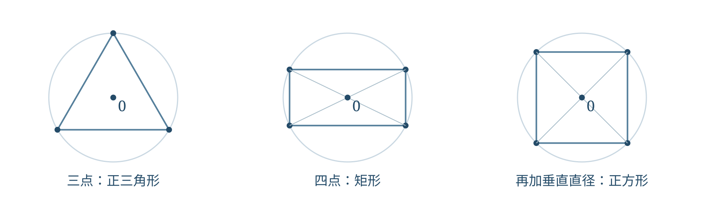
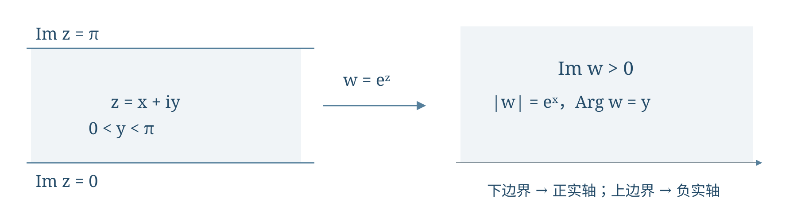

# 第1讲 复数几何模的极值与指数映射

!!! tip "本讲配套文件"
    - [在线阅读 PDF（排版与 Word 版一致）](文件/复变函数与数理方程_第1讲_复数几何模的极值与指数映射_学习讲义.pdf)
    - [下载 Word 版（公式可编辑）](文件/复变函数与数理方程_第1讲_复数几何模的极值与指数映射_学习讲义.docx)

## 第一层 课堂核心速览
### 本节课的核心问题
怎样把复数的代数运算解释为平面上的长度与方向，并据此证明几何结论、求模的极值、构造简单映射？
### 必要先修知识
① 平面坐标与向量、圆和直线的方程。② 三角函数及弧度制。③ 多项式的根与系数关系。④ 实函数连续性的误差控制思想。
### 核心知识结构
代数形式与极形式 → 共轭、模与辐角 → 复对数与复数开方。
模不等式与根的配对 → 等模三点、四点的几何；不等式取等条件 → 圆盘上模的极值。
连续性保证局部非零；平移、旋转、缩放与指数映射共同处理条带。
### 重要结论与条件

$$z=re^{i\theta},\qquad z\bar z=|z|^2,\qquad |u+v|\le|u|+|v|.$$

非零复数的辐角相差 $2k\pi$；$z^n=\rho e^{i\varphi}\ne0$ 恰有 $n$ 个不同的根，根的模为 $\rho^{1/n}$、相邻角差为 $2\pi/n$。

$$\max_{|z|\le r}|z^n+\alpha|=r^n+|\alpha|,\quad \min_{|z|\le r}|z^n+\alpha|=\max\{0,|\alpha|-r^n\}.$$

上述极值公式要求 $n$ 为正整数、$r>0$。指数映射把 $0<\operatorname{Im}z<\pi$ 一一映到上半平面。
### 课堂听讲重点
辐角先判断象限；几何证明要说清互异与非退化条件。求最值不能只找界，还要求出全部取等点；映射既要检查边界，也要证明覆盖目标区域。
## 第二层 引导式学习正文
### 1 复数表示、辐角与复对数
#### 1.1 数、点与向量的同一表示
复数 $z=x+iy$ 对应平面点 $(x,y)$，也对应从原点出发的向量；$\operatorname{Re}z=x$、$\operatorname{Im}z=y$。虚部是实数 $y$，不是 $iy$。

$$\bar z=x-iy,\qquad |z|=\sqrt{x^2+y^2},\qquad z\bar z=|z|^2.$$

若 $z\ne0$，令 $r=|z|>0$，选一个方向角 $\theta$，利用欧拉公式得到

$$z=r(\cos\theta+i\sin\theta)=re^{i\theta}. \tag{1}$$
!!! abstract "辐角与主辐角"
    本讲固定 $\operatorname{Arg}z\in(-\pi,\pi]$；所有辐角为 $\operatorname{Arg}z+2k\pi$，其中 $k\in\mathbb Z$。零没有确定方向，因而不定义其辐角。
    课堂相关例子 $z=-1+i$ 的模为 $\sqrt2$，位置在第二象限，故主辐角为 $3\pi/4$，而不是 $\arctan(-1)=-\pi/4$。反正切只能恢复斜率，不能独自区分相反方向；最终应核对余弦、正弦与实部、虚部的符号。

#### 1.2 用指数方程推出复对数
求 $z\ne0$ 的对数，就是求全部满足 $e^w=z$ 的 $w$。设 $w=u+iv$，则 $e^w=e^u(\cos v+i\sin v)$。比较模得 $u=\ln|z|$；比较方向得 $v=\operatorname{Arg}z+2k\pi$。

$$\operatorname{Ln}z=\ln|z|+i(\operatorname{Arg}z+2k\pi),\quad k\in\mathbb Z. \tag{2}$$

这里 $\operatorname{Ln}$ 表示全部对数值；选 $k=0$ 得主值 $\operatorname{Log}z=\ln|z|+i\operatorname{Arg}z$。对正实数仍用普通实对数 $\ln$。
课堂例题：$|-1|=1$、$\operatorname{Arg}(-1)=\pi$，所以 $\operatorname{Ln}(-1)=(2k+1)\pi i$，主值为 $\pi i$。若 $x>0$，则 $\operatorname{Ln}(-x)=\ln x+(2k+1)\pi i$。
!!! warning "主值法则与板书补全"
    板书以 $\arctan(y/x)$ 表示辐角，使用时必须补上象限判断与 $x=0$ 的情形。主值对数不无条件满足乘积法则：$\operatorname{Log}((-1)(-1))=0$，而两项主值之和为 $2\pi i$。主值沿负实轴发生跳变，不能把选一个值等同于在整个去心平面上得到解析对数。

### 2 复数运算、模不等式与平面方程
#### 2.1 乘除法就是缩放与旋转
加减法按实部、虚部分别进行。若 $z_j=r_je^{i\theta_j}\ne0$，则

$$z_1z_2=r_1r_2e^{i(\theta_1+\theta_2)},\qquad \frac{z_2}{z_1}=\frac{r_2}{r_1}e^{i(\theta_2-\theta_1)}.$$

因此乘以 $e^{i\alpha}$ 是逆时针旋转 $\alpha$，乘以正实数是按比例缩放。商必须有非零分母；若要求主辐角，角度相加减后仍须调整到规定区间。
!!! abstract "模与距离的工具"
    $|u-v|$ 是两点距离，$u-v$ 是位移向量。后面的几何证明与极值计算主要使用

    $$|u+v|\le|u|+|v|,\qquad ||u|-|v||\le|u-v|. \tag{3}$$

    两非零向量的三角不等式取等，当且仅当二者同向；至少一个为零时也取等。反向叠加决定最小模，必须同时比较两向量的长度。完整证明见参考一。

    $$|u+v|^2+|u-v|^2=2(|u|^2+|v|^2). \tag{4}$$

    式（4）称平行四边形恒等式：相邻边为 $u,v$ 时，两条对角线为 $u+v,u-v$。其证明只需展开两式的模平方，交叉项相消。
    课堂判断：$z^2=|z|^2$ 当且仅当 $z$ 为实数。由 $|z|^2=z\bar z$ 得 $z(z-\bar z)=0$；$z=0$ 已是实数，$z\ne0$ 时约去 $z$ 得 $z=\bar z$。反向代入即可。

#### 2.2 从实坐标改写直线与圆
由 $z+\bar z=2x$、$z-\bar z=2iy$，在 $Ax+By+C=0$ 中代入，得到

$$\frac{A-iB}{2}z+\frac{A+iB}{2}\bar z+C=0.$$
!!! abstract "直线方程"
    记 $\alpha=(A+iB)/2$，则直线可写成 $\alpha\bar z+\bar\alpha z+\beta=0$，其中 $\alpha\ne0$、$\beta\in\mathbb R$。
    圆心 $z_0$、半径 $R>0$ 的圆先写为 $|z-z_0|=R$，平方展开得

    $$z\bar z-z_0\bar z-\bar z_0z+|z_0|^2-R^2=0.$$

    一般式 $z\bar z+\alpha\bar z+\bar\alpha z+\beta=0$ 中，$\beta$ 为实数。配方得 $|z+\alpha|^2=|\alpha|^2-\beta$：右边正、零、负分别对应圆、一个点、空集。
    例如 $z\bar z-(1+i)\bar z-(1-i)z-2=0$ 化为 $|z-(1+i)|=2$，圆心为 $1+i$，半径为二。这个计算示例用于核对系数与圆心的共轭位置。

!!! warning "区域与边界"
    圆周用等号，开圆盘用小于号，闭圆盘用小于等于号；三者不能混用。

### 3 课堂几何证明：等模三点与四点
#### 3.1 等模三点且和为零为什么是正三角形
课堂题：设 $|z_1|=|z_2|=|z_3|=r>0$，且 $z_1+z_2+z_3=0$，证明三点构成正三角形。
!!! info "证明思路"
    等模说明三点在同一圆上；和为零把两个复数的和变为第三个数的相反数，恰好能代入平行四边形恒等式，求出每一条边。
    由 $z_1+z_2=-z_3$ 得 $|z_1+z_2|=r$，代入式（4）：

    $$r^2+|z_1-z_2|^2=2(r^2+r^2)=4r^2.$$

    故 $|z_1-z_2|=\sqrt3r$。另两组同理，因此

    $$|z_1-z_2|=|z_2-z_3|=|z_3-z_1|=\sqrt3r>0.$$

    三条边相等且非零，三点互异，得到非退化正三角形。条件 $r>0$ 排除了三点均为零的情形；仅有等模并不足够。

#### 3.2 等模四点且和为零为什么是矩形
课堂题：四个互异复数模均为 $r>0$，且和为零，按圆周次序连接，证明得到矩形，并求成为正方形的附加条件。
!!! info "证明思路"
    先用等模把根的倒数变成共轭，证明以四点为根的多项式只含偶次幂；于是根成相反数配对，回到两条直径的几何图形。
    令 $P(z)$ 为以四点为根的首一多项式：

    $$P(z)=\prod_{k=1}^4(z-z_k)=z^4-s_1z^3+s_2z^2-s_3z+s_4.$$

    其中 $s_1$ 为四根之和，$s_4$ 为四根之积；已知 $s_1=0$，且四根非零，故 $s_4\ne0$。三根乘积之和满足

    $$s_3=s_4\sum_{k=1}^4\frac1{z_k}=\frac{s_4}{r^2}\sum_{k=1}^4\bar z_k=\frac{s_4}{r^2}\overline{s_1}=0.$$

    这里用了 $z_k\bar z_k=r^2$。所以 $P(z)=z^4+s_2z^2+s_4$，有 $P(-z)=P(z)$；若 $z_k$ 为根，$-z_k$ 也是根。四根非零且互异，适当编号为 $a,b,-a,-b$。
    两对相反点组成对角线，均以原点为中点，故四边形是平行四边形；两条对角线又都长 $2r$，故为矩形。

{ loading=lazy }

#### 3.3 从矩形到正方形还缺什么条件
对根配对后再展开，能看清二次项系数：

$$P(z)=(z^2-a^2)(z^2-b^2)=z^4-(a^2+b^2)z^2+a^2b^2.$$

因此 $s_2=-(a^2+b^2)$。矩形为正方形，当且仅当两条直径垂直，即 $a=\pm ib$；这又等价于 $a^2+b^2=0$。故附加条件可取

$$s_2=0,\qquad \text{或}\qquad \sum_{k=1}^4z_k^2=0.$$
!!! warning "条件与板书校正"
    四点互异、按圆周次序连接都不可省；否则可能重复顶点或得到交叉四边形。照片253的配对多项式二次项符号与展开不一致，此处按上式保留负号；虽不影响“系数为零”的判据，推导本身须写正确。

### 4 复数开方与正多边形
求 $z^n=w\ne0$ 时，先比较模，再处理角度的所有可能值。设 $w=\rho e^{i\varphi}$、$z=se^{i\theta}$，其中 $\rho,s>0$，$n$ 为正整数，则

$$s^n=\rho,\qquad n\theta=\varphi+2k\pi.$$
!!! abstract "全部根公式"
    $$z_k=\rho^{1/n}e^{i(\varphi+2k\pi)/n},\quad k=0,1,\ldots,n-1. \tag{5}$$

    为什么恰好这些根？任意根都必须满足前述模与角条件；$k$ 增加 $n$ 时角度增加 $2\pi$，结果重复。若 $z_j=z_k$，则 $e^{2\pi i(j-k)/n}=1$，故 $j-k$ 是 $n$ 的整数倍，在所列范围内只能 $j=k$。
    各根等模，相邻根之比为 $e^{2\pi i/n}$；当 $n\ge3$ 时，按辐角次序连接为正 $n$ 边形。若 $w=0$，只有一个不同的根零，其多项式重数为 $n$。
    课堂例子 $z^4+d=0$（$d\ne0$）：写 $-d=r^4e^{i\varphi}$，四根为 $re^{i(\varphi+2k\pi)/4}$，相邻根之比为 $i$，每次旋转直角，所以构成正方形。

!!! warning "角度必须整体除以阶数"
    先加 $2k\pi$，再除以 $n$；只把主辐角除以 $n$ 会漏根。全部根与某一个选定主值根是不同概念。

### 5 课堂极值题：圆盘上的最大模与最小模
#### 5.1 先把问题变成一个平移圆盘
课堂题：给定正整数 $n$、$r>0$、$\alpha\in\mathbb C$，求闭圆盘 $|z|\le r$ 上 $|z^n+\alpha|$ 的最大值、最小值与全部取等点。
!!! info "几何思路"
    $u=z^n$ 把原圆盘映满 $|u|\le r^n$，因为任意非零 $u$ 的 $n$ 次根模为 $|u|^{1/n}\le r$，而零由 $z=0$ 取得。再平移 $v=u+\alpha$，像是圆心 $\alpha$、半径 $r^n$ 的闭圆盘；目标模就是像点到原点的距离。

{ loading=lazy }

#### 5.2 最大值：上界与全部取等点

$$|z^n+\alpha|\le|z|^n+|\alpha|\le r^n+|\alpha|.$$

若 $\alpha\ne0$，令 $\alpha=|\alpha|e^{i\theta_\alpha}$。第二步取等要求 $|z|=r$，第一步取等要求 $z^n$ 与 $\alpha$ 同向；联立得 $z^n=r^ne^{i\theta_\alpha}$。所以最大值及全部取等点为

$$M=r^n+|\alpha|,\qquad z_k=re^{i(\theta_\alpha+2k\pi)/n},\quad k=0,\ldots,n-1. \tag{6}$$

这些根代回均达到上界，才完成“最大值”的证明。若 $\alpha=0$，$M=r^n$，整个边界 $|z|=r$ 都取等。
#### 5.3 最小值：先问能否达到零
若 $\alpha=0$，最小值为零，只在 $z=0$ 取得。若 $0<|\alpha|\le r^n$，则 $z^n=-\alpha$ 的全部根都在闭圆盘内，所以最小值为零，取等点为

$$z_k=|\alpha|^{1/n}e^{i(\theta_\alpha+\pi+2k\pi)/n},\quad k=0,\ldots,n-1.$$

若 $|\alpha|>r^n$，原点在像圆盘外，反三角不等式给出

$$|z^n+\alpha|\ge|\alpha|-|z|^n\ge|\alpha|-r^n>0.$$

要同时取等，须有 $|z|=r$ 且 $z^n$ 与 $\alpha$ 反向。于是全部取等点为 $z_k=re^{i(\theta_\alpha+\pi+2k\pi)/n}$，其中 $k=0,\ldots,n-1$。
!!! abstract "最小值结论"
    $$m=\max\{0,|\alpha|-r^n\}. \tag{7}$$

!!! warning "板书校正与定义域"
    照片259在 $|\alpha|>r^n$ 情形末行写成等于零，与其上一行正差矛盾；正确值为 $|\alpha|-r^n>0$。若题目改为圆周 $|z|=r$，最小值为 $||\alpha|-r^n|$，因为不能再进入圆盘内部寻找零点。若改为开圆盘，边界取等点不允许，可能只有上确界或下确界。

### 6 连续函数为何局部保持非零
#### 6.1 连续性控制的是函数值的距离
设 $f$ 定义于 $D$、$z_0\in D$。在 $z_0$ 连续，是指任给 $\varepsilon>0$，存在 $\delta>0$，使 $z\in D$ 且 $|z-z_0|<\delta$ 时有 $|f(z)-f(z_0)|<\varepsilon$。
!!! abstract "局部非零性"
    若 $f$ 在 $z_0$ 连续且 $f(z_0)\ne0$，则 $z_0$ 某个相对邻域内函数仍不为零。

!!! info "证明思路"
    函数值 $f(z_0)$ 到零的距离是正数。把允许误差取为该距离的一半，附近函数值就无法碰到零。
    令 $c=|f(z_0)|>0$，取 $\varepsilon=c/2$，由连续性选 $\delta$。于是

    $$|f(z)|\ge|f(z_0)|-|f(z)-f(z_0)|>c-\frac c2=\frac c2>0.$$

    三角不等式还给出 $|f(z)|<3c/2$。这完成了课堂从实函数“保号性”推广到复函数“非零性”的证明。

!!! warning "只能比较模"
    复数没有与实数兼容的大小顺序，不能把结论写成 $f(z)>0$。局部非零只保证足够小的邻域，不代表整个定义域无零点；它也使 $1/f$ 在该邻域有定义，并有 $|1/f(z)|<2/c$。

### 7 指数映射与斜条带课堂例题
#### 7.1 实部控制模，虚部控制方向
邻域 $|z-z_0|<\delta$ 是开圆盘；$z=z_0+\delta e^{i\theta}$ 只表示边界圆周。若要表示内部，应让半径 $0\le\rho<\delta$ 变化。
由 $w=e^{x+iy}=e^xe^{iy}$，固定 $x=x_0$ 得圆周 $|w|=e^{x_0}$，$y$ 增大时逆时针运动；固定 $y=y_0$ 得方向角为 $y_0$ 的射线，原点不取到。
!!! abstract "标准条带的像"
    指数映射把 $S=\{z:0<\operatorname{Im}z<\pi\}$ 一一映到上半平面 $\operatorname{Im}w>0$。
    先证像落在其中：$0<y<\pi$ 时，$\operatorname{Im}w=e^x\sin y>0$。再证覆盖：任取上半平面点 $w=Re^{i\theta}$，其中 $R>0$、$0<\theta<\pi$，点 $z=\ln R+i\theta$ 属于 $S$ 且 $e^z=w$。这个极坐标表示唯一，因此原像也唯一。

{ loading=lazy }

!!! warning "局部与全局的区别"
    $e^z$ 在全平面不单射，因为周期是 $2\pi i$；原点永远不是像点。这里限制虚部范围，才消除了周期造成的重复。

#### 7.2 斜条带：平移、旋转、缩放、取指数
课堂图示给出两条平行直线，分别经过实轴上的 $a<b$，共同倾角为 $0<\alpha<\pi$。求它们之间的开条带到上半平面的一一映射。以下按板书的分步变换补全最终式。
!!! info "构造思路"
    先让一条边界经过原点，再把两条边界旋成水平线，最后把条带宽度调成 $\pi$，接上标准指数映射。
    两边界写为 $z=b+te^{i\alpha}$ 与 $z=a+te^{i\alpha}$，其中 $t\in\mathbb R$。令 $z_2=(z-b)e^{-i\alpha}$；经过 $b$ 的边界变成实轴。在另一条边界上，

    $$z_2=(a-b)e^{-i\alpha}+t,\qquad \operatorname{Im}z_2=(b-a)\sin\alpha=h>0.$$

    旋转不改变距离，所以 $h$ 正是原斜条带的垂直宽度。内部变成 $0<\operatorname{Im}z_2<h$，再令 $\zeta=\pi z_2/h$，得到标准条带。

    $$w=\exp\left(\frac{\pi e^{-i\alpha}}{(b-a)\sin\alpha}(z-b)\right). \tag{8}$$

{ loading=lazy }

平移、旋转与正实数缩放均可逆，标准条带上的指数映射也一一，因此复合映射一一且满。边界检查：经过 $b$ 的直线对应 $\operatorname{Im}\zeta=0$，像为正实轴；经过 $a$ 的直线对应 $\operatorname{Im}\zeta=\pi$，像为负实轴。两边界均不属于原开条带。
再取内部点 $z=(a+b)/2$，可算得 $\operatorname{Im}\zeta=\pi/2$，其像位于正虚轴，方向正确。不能漏掉平移项 $z-b$；宽度是 $(b-a)\sin\alpha$，不是水平距离 $b-a$。
## 第三层 详细参考与拓展
### 参考一 模不等式的证明与取等条件
!!! abstract "必须掌握"
    用模平方将长度转化为代数，既能证明不等式，也能定位等号：

    $$|u+v|^2=|u|^2+|v|^2+2\operatorname{Re}(u\bar v).$$

    因为 $\operatorname{Re}(u\bar v)\le|u\bar v|=|u||v|$，所以右边不超过 $(|u|+|v|)^2$，开平方得式（3）的第一条。当 $u,v\ne0$ 时，取等要求 $u\bar v$ 为正实数，等价于两向量同向。
    再将 $u=(u-v)+v$ 代入三角不等式，得 $|u|-|v|\le|u-v|$；交换二者得 $|v|-|u|\le|u-v|$，合成 $||u|-|v||\le|u-v|$。

!!! info "理解即可"
    对圆盘最小模题，若 $|\alpha|>|u|>0$，则 $|\alpha+u|=|\alpha|-|u|$ 当且仅当 $u$ 与 $\alpha$ 反向。可把它改写成三角不等式 $|\alpha|\le|\alpha+u|+|u|$ 的取等问题：$\alpha+u$ 与 $-u$ 同向，且相加后仍指向 $\alpha$ 的方向。

### 参考二 课堂提到的指数、三角与无穷乘积
!!! info "理解即可"
    课堂列出以下公式，作为后续幂级数与无穷乘积内容的引入：

    $$e^z=\sum_{n=0}^{\infty}\frac{z^n}{n!},\quad \cos z=\frac{e^{iz}+e^{-iz}}2,\quad \sin z=\frac{e^{iz}-e^{-iz}}{2i}.$$

    三角公式可由正、负角的欧拉公式相加减得到；对复自变量，它们与幂级数定义一致。

    $$\sin z=z\prod_{n=1}^{\infty}(1-\frac{z^2}{n^2\pi^2}).$$

    $$\cos z=\prod_{n=0}^{\infty}(1-\frac{4z^2}{(2n+1)^2\pi^2}).$$

!!! info "理解即可"
    上述无穷乘积本讲作为课堂列出的结论保留，不由“零点相同”直接推出，也不在此补写整套证明。当 $0<x<\pi$ 时各正弦乘积因子为正，先对有限乘积取实对数，再利用正极限及对数连续性，得到

    $$\ln(\sin x)=\ln x+\sum_{n=1}^{\infty}\ln(1-\frac{x^2}{n^2\pi^2}).$$

    这条实对数公式不能直接用于零点、负因子或任意复数；复数情况下还要考虑对数分支与收敛条件。

### 参考三 正多边形的代数刻画与资料边界
!!! info "理解即可"
    以原点为中心的正 $m$ 边形（$m\ge3$）可写为 $a e^{2k\pi i/m}$，其中 $a\ne0$、$k=0,\ldots,m-1$；它们恰好是 $z^m-a^m=0$ 的全部根。因此首一多项式只含最高次项和非零常数项，是这种顶点集的一个刻画。
    课堂提出“等模偶数个点成为正多边形需要多少个独立条件”。现有板书未留下完整答案，本讲不将上述可用条件组当作“最少独立条件数”的结论。

## 课末核心知识回顾
复数既是代数对象也是平面向量：代数形式适合加减，共轭便于处理模平方，极形式适合乘除与开方。辐角的多值性同时解释复对数的多值与开方的多个根。
几何题先把条件翻译成模、和、差或根与系数：等模三点且和为零用平行四边形恒等式；等模四点且和为零用偶多项式找相反根，再判矩形与正方形。
极值题按“统一界 → 每步取等条件 → 构造全部取等点”完成证明。闭圆盘内部可出现零点，圆周不允许自由改变模，二者的最小值公式不同。
连续性将函数值限制在一个小圆盘内，原值非零就能保证局部非零。映射题先拆为平移、旋转、缩放，再使用指数；不仅检查边界，还要说明内部、单射与覆盖。