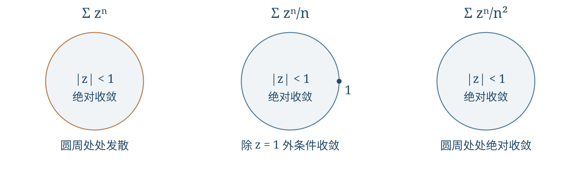
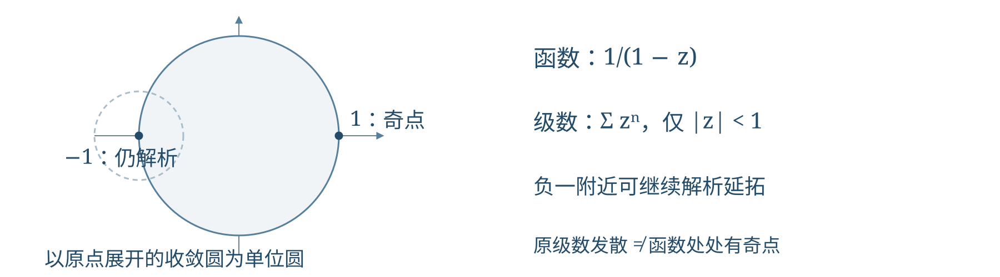
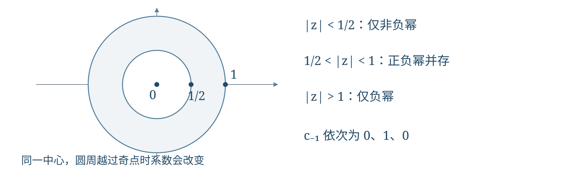

# 第4讲 幂级数收敛与泰勒洛朗展开

!!! tip "本讲配套文件"
    - [在线阅读 PDF（排版与 Word 版一致）](文件/复变函数与数理方程_第4讲_幂级数收敛与泰勒洛朗展开_学习讲义.pdf)
    - [下载 Word 版（公式可编辑）](文件/复变函数与数理方程_第4讲_幂级数收敛与泰勒洛朗展开_学习讲义.docx)

## 第一层 课堂核心速览
### 本节课的核心问题
一个幂级数在哪些点收敛？它何时等于解析函数？同一个函数怎样随所选圆盘或圆环改变展开式？本讲先研究收敛，再用几何级数构造泰勒与洛朗展开。
### 必要先修知识
① 复数模与极限，区分函数的定义域和级数的收敛域。② 实级数的比值、根值与比较判别法。③ 柯西积分公式与圆周正向。④ 等比级数及部分分式分解。
### 核心知识结构
数项级数 → 幂级数 → 阿贝尔定理与收敛半径；圆内绝对收敛，边界逐点另判。
逐项运算与系数唯一性 → 泰勒展开；允许负幂 → 环形收敛域与洛朗系数。
定位奇点 → 分区域选择小量 → 合并幂次 → 回代与首项检查；课末实积分衔接留数法。
### 重要结论与条件

$$\frac1R=\limsup_{n\to\infty}|c_n|^{1/n},\qquad f(z)=\sum_{n=0}^{\infty}\frac{f^{(n)}(z_0)}{n!}(z-z_0)^n.$$

第二式要求函数在相应圆盘内解析。逐项求导积分保持半径，却可能改变边界收敛情况。

$$c_n=\frac1{2\pi i}\oint_{|\zeta-z_0|=\rho}\frac{f(\zeta)}{(\zeta-z_0)^{n+1}}\,d\zeta\quad(n\in\mathbb Z).$$

圆周须位于同一个解析圆环内，逆时针一圈；洛朗系数的唯一性必须连同中心和圆环说明。
### 课堂听讲重点
求半径不等于求完整收敛域；边界展开发散不等于函数在那里有奇点。洛朗展开须让正、负幂分别收敛，每个分式的小量条件必须有非空交集。
## 第二层 引导式学习正文
### 1 数项级数与幂级数的收敛
#### 1.1 用部分和定义收敛
设 $c_n=a_n+ib_n$，其中 $a_n,b_n$ 为实数。级数收敛是指有限部分和 $S_N=\sum_{n=0}^Nc_n$ 有有限极限，而不是给“无穷多个数相加”直接赋值。
!!! abstract "核心结论"
    复数列收敛等价于实部、虚部分别收敛，所以 $\sum c_n$ 收敛当且仅当 $\sum a_n$、$\sum b_n$ 都收敛。必要条件是 $c_n\to0$；反向不成立，调和级数即为反例。
    若 $\sum|c_n|<\infty$，称绝对收敛，由 $|a_n|,|b_n|\le|c_n|$ 可知原级数收敛；收敛而不绝对收敛称条件收敛。课堂例子为 $\sum n^{-2}$ 绝对收敛、$\sum_{n=1}^{\infty}(-1)^n/n=-\ln2$ 条件收敛。

!!! warning "分组不能制造收敛"
    $1-1+1-1+\cdots$ 的部分和为一、零交替，没有极限。分组得到零或一，只选取了不同子列，不能说明普通级数有多个和。

#### 1.2 幂级数何时代表一个函数
给定中心 $z_0$ 和系数 $c_n$，形式 $\sum_{n=0}^{\infty}c_n(z-z_0)^n$ 称幂级数。每固定 $z$，它才成为一个数项级数；只在收敛点上能以和定义函数。
若收敛半径 $R>0$，和函数在圆内解析，且该级数正是和函数在 $z_0$ 的泰勒级数。不能将“不是某个指定函数的泰勒级数”说成“不能成为任何函数的泰勒级数”。
课堂例题：$\sum n!z^n$ 在零点取值一。若 $z\ne0$，相邻项模比为 $(n+1)|z|\to\infty$，通项不趋零，故仅在中心收敛，$R=0$。
对几何级数，由有限等比和取极限得

$$\frac1{1-q}=\sum_{n=0}^{\infty}q^n\quad(|q|<1). \tag{1}$$

当 $|q|\ge1$ 时通项不趋零。于是 $1/(1+z^2)=\sum(-1)^nz^{2n}$ 只在 $|z|<1$ 成立，尽管左侧函数在远大于这个圆盘的区域有定义。
### 2 阿贝尔定理、收敛半径与边界
#### 2.1 为什么收敛域内部一定是圆盘
!!! abstract "阿贝尔定理"
    若 $\sum c_nz^n$ 在 $z_1\ne0$ 收敛，则在 $|z|<|z_1|$ 绝对收敛；若它在 $z_2$ 发散，则在 $|z|>|z_2|$ 都发散。等号情形不在这两个结论中。

!!! info "证明思路"
    收敛点只需提供通项有界，再用一个模小于一的几何因子控制较小圆盘。
    由 $c_nz_1^n\to0$，可取 $M$ 使 $|c_nz_1^n|\le M$。对 $|z|<|z_1|$，

    $$|c_nz^n|\le M\left(\frac{|z|}{|z_1|}\right)^n.$$

    右侧为收敛几何级数；在任一固定闭圆盘 $|z|\le r<|z_1|$ 上上界还与 $z$ 无关，得到一致收敛。外发散由反证：若外侧存在收敛点，刚证的内收敛结论就使 $z_2$ 收敛，矛盾。
    因此存在唯一广义半径 $R\in[0,\infty]$：$|z-z_0|<R$ 绝对收敛，$|z-z_0|>R$ 发散。$R=0$ 表示只在中心收敛，$R=\infty$ 表示全平面收敛。

#### 2.2 同一半径下三种完全不同的圆周
三个课堂级数的半径都是一：$\sum z^n$、$\sum_{n=1}^{\infty}z^n/n$、$\sum_{n=1}^{\infty}z^n/n^2$。在 $|z|=1$ 上，第一类通项模恒为一，处处发散；第二类仅 $z=1$ 发散，其余点条件收敛；第三类由 $\sum1/n^2$ 控制，处处绝对收敛。
{ loading=lazy }

第二类在 $z=e^{i\theta}\ne1$ 时，$z^n$ 的有限部分和模不超过 $2/|1-z|$，而 $1/n$ 单调趋零，狄利克雷判别法给出收敛；模级数是发散的调和级数。分部求和的细节见参考一。
!!! warning "圆内一致收敛的范围"
    通常保证的是每个严格位于收敛圆内的闭圆盘，不能自动改成整个开圆盘或整个圆周。一致收敛与逐点收敛不可混用。

#### 2.3 边界和需要额外的径向极限定理
在 $|z|<1$ 内对几何级数积分，得到

$$F(z)=\sum_{n=1}^{\infty}\frac{z^n}{n}=-\operatorname{Log}(1-z).$$

这里 $\operatorname{Re}(1-z)>0$，选取 $\operatorname{Log}1=0$ 的解析支。先证明边界级数收敛，再由阿贝尔径向极限定理将其和与圆内的径向极限对应，不能直接把 $|z|<1$ 改成小于等于。
对 $0<\theta<2\pi$，因 $\sin(\theta/2)>0$，

$$1-e^{i\theta}=2\sin(\theta/2)e^{i(\theta/2-\pi/2)},$$

从而

$$\sum_{n=1}^{\infty}\frac{e^{in\theta}}n=-\ln(2\sin(\theta/2))+i\frac{\pi-\theta}{2}. \tag{2}$$

取 $\theta=\pi$ 得 $-\ln2$，可同时检查实部符号与虚部。另一课堂关系是 $F_3'(z)=F(z)/z$，其中 $F_3=\sum z^n/n^2$；其原函数不是 $F$ 的直接积分，而是 $F_3(z)=\int_0^zF(t)/t\,dt$，零点按极限补值。
### 3 求半径与比较半径的方法
#### 3.1 系数法、缺项与奇点距离
!!! abstract "系数判据"
    当系数从某项起非零且极限存在时，$R=\lim|c_n/c_{n+1}|$；一般情形用

    $$R^{-1}=\limsup_{n\to\infty}|c_n|^{1/n},\qquad 1/0=\infty,\quad1/\infty=0. \tag{3}$$

    比值或普通根值极限不存在，不代表半径不存在。对 $\sum a_nz^{mn}$，宜先令 $w=z^m$；若作为 $w$ 的级数半径为 $\rho$，则原变量半径为 $\rho^{1/m}$。零系数使机械相邻比值失效。
    例：$c_n=n!$ 给出 $R=0$，$c_n=1/n!$ 给出 $R=\infty$；$1/(1+z^m)=\sum(-1)^nz^{mn}$ 要求 $|z|<1$，最近的不可去奇点也都位于单位圆。
    对已知解析函数在指定中心的泰勒级数，半径是该函数元素可解析延拓的最大圆盘半径。本课有理函数等常用题可计算中心到最近不可去奇点的距离，须先检查约消。
    课堂函数为 $f(z)=1/(1-z)+3/(3-z^2)+\sin(z^2/(1-z))$。零点附近的最近障碍是 $z=1$，其余分母零点为 $\pm\sqrt3$；正弦复合项在 $z=1$ 处的本性奇点不能被另两项消去，故 $R=1$。

!!! warning "展开边界与奇点"
    $\sum z^n$ 在单位圆处处发散，但和函数 $1/(1-z)$ 只有 $z=1$ 是奇点，负一附近仍解析。有限非零半径的圆周至少有一个延拓障碍，不是每点都有障碍。

{ loading=lazy }

#### 3.2 从收敛信息与系数大小比较半径
若在 $z_1\ne z_0$ 条件收敛，则 $R=|z_1-z_0|$：收敛说明该点不在圆外；若在圆内就应绝对收敛，矛盾。仅知收敛只能推 $R\ge|z_1-z_0|$，仅知发散只能推反向不等式，均允许等号。
若从某项起 $|c_n|\le|d_n|$，则 $R_c\ge R_d$。理由是在任意 $r<R_d$ 上比较两个非负模级数，再令 $r$ 逼近 $R_d$。例如 $n!\le n^n$，故 $\sum z^n/n^n$ 的半径不小于指数级数的无穷半径，因而也是无穷。
设 $c_n=a_n+ib_n$，其中 $a_n,b_n$ 为实数；三个系数列的半径分别为 $R,R_a,R_b$，则

$$R=\min(R_a,R_b). \tag{4}$$

共同圆内由 $|c_n|\le|a_n|+|b_n|$ 得 $R\ge\min(R_a,R_b)$；反向用 $|a_n|,|b_n|\le|c_n|$ 得 $R_a,R_b\ge R$。不可通过“无穷减无穷”证明。一般复系数相加只有半径不小于最小值，同半径可能抵消变大。
### 4 逐项运算与泰勒系数唯一性
!!! abstract "圆内运算"
    设 $R>0$，$f(z)=\sum c_n(z-z_0)^n$。在 $|z-z_0|<R$ 内，

    $$f'(z)=\sum_{n=1}^{\infty}nc_n(z-z_0)^{n-1},\qquad \int_{z_0}^zf(t)dt=\sum_{n=0}^{\infty}\frac{c_n}{n+1}(z-z_0)^{n+1}. \tag{5}$$

    两者半径仍为 $R$；圆内积分路径不影响结果。边界上的收敛性质可以变化，式（5）并未授权在圆周上逐项求导。

!!! info "证明思路"
    在 $r<\rho<R$ 上用较大闭圆盘的系数界控制较小圆盘的导数级数；这比仅说“每项都可导”多出必要的一致收敛。
    取 $|c_n|\rho^n\le M$，则 $n|c_n|r^{n-1}\le(M/\rho)n(r/\rho)^{n-1}$，右侧求和收敛。故可逐项求导；原级数在较小闭圆盘一致收敛，允许沿有限长路径逐项积分。若导数级数半径更大，再积分就使原级数在更大圆盘收敛，矛盾；积分级数同理。
    反复求导并代入中心，只有相应幂次留下，所以

    $$c_n=\frac{f^{(n)}(z_0)}{n!}. \tag{6}$$

    这证明同一函数在同一中心的泰勒系数唯一。常用的指数、正弦展开半径均无穷；有限多项式是后续系数全零的特例。

### 5 课堂复积分回顾：倒数换元
求正向圆 $|z|=r>1$ 上 $I_r=\oint e^{1/z}/(1+z)\,dz$。圈内零和负一都是奇点，不能直接对原函数用柯西定理。
!!! info "方法选择"
    令 $t=1/z$，使大圆变成半径 $1/r<1$ 的小圆，将负一排除在新圈外。若 $z=re^{i\theta}$ 逆时针，则 $t=r^{-1}e^{-i\theta}$ 顺时针；同时

    $$dz=-t^{-2}dt,\qquad \frac{e^{1/z}}{1+z}dz=-\frac{e^t}{t(1+t)}dt.$$

    微分负号与把顺时针改成逆时针的负号抵消，因此

    $$I_r=\oint_{|t|=1/r}^{+}\frac{e^t}{t(1+t)}dt=2\pi i. \tag{7}$$

    最后一步对 $g(t)=e^t/(1+t)$ 使用柯西公式，$g$ 在小圆及内部解析且 $g(0)=1$。

{ loading=lazy }

!!! warning "两个符号分别记录"
    方向翻转与微分变换是两件事。只处理其中一个，会错一个负号；$r>1$ 是排除新奇点负一的条件。

### 6 洛朗级数与圆环内的系数
#### 6.1 为什么必须允许正幂和负幂
当中心不解析，或研究避开中心的圆环时，采用

$$\sum_{n=-\infty}^{\infty}c_n(z-z_0)^n=\sum_{n=0}^{\infty}c_n(z-z_0)^n+\sum_{k=1}^{\infty}c_{-k}(z-z_0)^{-k}. \tag{8}$$

正、负两部分必须分别收敛，不能借双向截断相消造出收敛。正幂要求 $|z-z_0|<R_2$；将负幂看作 $w=1/(z-z_0)$ 的幂级数，得到 $|z-z_0|>R_1$。交集是 $R_1<|z-z_0|<R_2$，须 $R_1<R_2$ 才非空。
课堂例子 $e^z+e^{1/z}-1=1+\sum_{n=1}^{\infty}z^n/n!+\sum_{n=1}^{\infty}z^{-n}/n!$ 在 $0<|z|<\infty$ 成立，常数系数是一。
两个几何级数给出

$$\sum_{n=0}^{\infty}(z/a)^n+\sum_{n=0}^{\infty}(b/z)^n=\frac{a}{a-z}+\frac{z}{z-b},\qquad |b|<|z|<|a|.$$

这里 $a,b\ne0$；两部分均从零开始，所以常数系数为二。令 $b=0$ 时第二部分仍有零次项一，不能无故丢掉。
#### 6.2 系数公式为什么与所选圆周无关
!!! abstract "洛朗定理"
    若 $f$ 在 $r<|z-z_0|<R$ 内解析，则有唯一的式（8）展开；对任意 $r<\rho<R$，

    $$c_n=\frac1{2\pi i}\oint_{|\zeta-z_0|=\rho}\frac{f(\zeta)}{(\zeta-z_0)^{n+1}}d\zeta,\qquad n\in\mathbb Z. \tag{9}$$

    积分均逆时针。换半径时两圈之间的被积函数解析，由复合闭路定理知积分相同。把已有展开乘以 $(z-z_0)^{-n-1}$ 再绕圆积分，也只有第 $n$ 项留下，故系数唯一。

!!! warning "唯一性的范围"
    同一个函数在不同圆环上可有不同系数；换圈越过奇点后，式（9）的积分不能再以“中间解析”为由保持不变。存在性的双圈推导见参考二。

### 7 课堂洛朗展开：为每个区域选择小量
#### 7.1 同一分式的内外展开
由式（1），$1/(1+z^2)$ 在 $|z|<1$ 为 $\sum(-1)^nz^{2n}$；在 $|z|>1$ 先提出 $z^2$，得到 $\sum(-1)^nz^{-2n-2}$，首项为 $z^{-2}$。
对课堂题 $h(z)=z/(1-z^2)$，部分分式为 $[1/(1-z)-1/(1+z)]/2$，因此

$$h(z)=\sum_{k=0}^{\infty}z^{2k+1}\quad(|z|<1),\qquad h(z)=-\sum_{k=0}^{\infty}z^{-2k-1}\quad(|z|>1).$$
!!! warning "板书符号核对"
    本题后续板书的符号有不一致，此处以题面 $z/(1-z^2)$ 通分核对，圆内首项应为正 $z$，也可用 $h'(0)=1$ 检查；外部首项则为 $-z^{-1}$。

#### 7.2 两个奇点划分三个展开区域
课堂题 $f(z)=1/[(z-1)(1-2z)]$。先定位奇点 $1/2,1$，再作可回代的分解：

$$f(z)=\frac1{1-z}-\frac2{1-2z}. \tag{10}$$

当 $|z|<1/2$，两个分式都用正幂，得

$$f(z)=\sum_{n=0}^{\infty}(1-2^{n+1})z^n.$$

常数项为负一，等于 $f(0)$，且负幂系数均零。对 $1/2<|z|<1$，第一项仍用 $z$，第二项改用 $1/(2z)$：

$$-\frac2{1-2z}=\frac{z^{-1}}{1-(2z)^{-1}},\qquad f(z)=\sum_{n=0}^{\infty}z^n+\sum_{k=0}^{\infty}2^{-k}z^{-k-1}. \tag{11}$$

若改成双向指标，$n\ge0$ 时 $c_n=1$，$n\le-1$ 时 $c_n=2^{n+1}$；特别地 $c_{-1}=1,c_{-2}=1/2$。
{ loading=lazy }

!!! info "外部展开的检查"
    在 $|z|>1$ 两部分均写成负幂，得到 $f(z)=\sum_{k=1}^{\infty}(2^{1-k}-1)z^{-k}$。负一次项抵消，首项为 $-1/(2z^2)$，与原有理函数在无穷远处的渐近式相同。
    三个区域内的 $c_{-1}$ 依次为零、一、零，体现的是圆环改变，不违反唯一性。解题固定按“中心—奇点距离—圆环—各分式小量—条件交集—首项与回代”进行。

### 8 课末实积分例题与留数衔接
#### 8.1 单位圆换元处理整周期三角积分
课堂以实积分预告留数法。此处只保留所需结论：设 $C$ 为正向分段光滑简单闭曲线，$f$ 在包含 $C$ 及其内部的开集内除有限个孤立奇点外解析，且 $C$ 上无奇点，则积分等于圈内各留数之和乘以 $2\pi i$；简单极点 $a$ 的留数为 $\lim_{z\to a}(z-a)f(z)$，系统理论见第五讲。
设实参数 $a,b$ 满足 $a>|b|$，求 $I=\int_0^{2\pi}d\theta/(a+b\cos\theta)$。$b=0$ 直接得 $2\pi/a$。否则令 $z=e^{i\theta}$，$d\theta=dz/(iz)$、$\cos\theta=(z+z^{-1})/2$：

$$I=\frac2i\oint_{|z|=1}\frac{dz}{bz^2+2az+b}.$$

记 $\Delta=\sqrt{a^2-b^2}>0$，根为 $z_\pm=(-a\pm\Delta)/b$。有理化得 $z_+=-b/(a+\Delta)$，故 $|z_+|<1$；又 $z_+z_-=1$，故另一根在圈外。
圈内留数为 $1/(2bz_++2a)=1/(2\Delta)$，所以

$$I=\frac{2\pi}{\sqrt{a^2-b^2}}. \tag{12}$$

正弦版本由平移角度及周期性得到同值。结果为正，且 $b=0$ 回到直接计算值。
#### 8.2 平方三角分母与参数条件
设实参数 $A,B\ne0$。四象限对称后，第一象限令 $t=\tan\theta$：

$$J=\int_0^{2\pi}\frac{d\theta}{A^2\cos^2\theta+B^2\sin^2\theta}=4\int_0^{\infty}\frac{dt}{A^2+B^2t^2}=\frac{2\pi}{|AB|}. \tag{13}$$

课堂给定 $AB>0$ 时可写 $2\pi/(AB)$；若只知非零，须保留绝对值。任一参数为零会产生不可积奇点，不能直接代公式。
!!! warning "末行题面尚需核对"
    末张照片的半无限积分分子看似 $x^2\sin(kx)$，参数条件不完整。若题面确为 $\int_0^{\infty}x^2\sin(kx)/(x^2+a^2)dx$、$a>0,k\ne0$，普通反常积分不收敛：分解 $x^2/(x^2+a^2)=1-a^2/(x^2+a^2)$，第二项绝对可积，第一项截断积分 $(1-\cos kT)/k$ 无极限。因此不能擅改为分子 $x\sin(kx)$，也不能赋予普通积分一个留数值。

## 第三层 详细参考与拓展
### 参考一 边界收敛与径向极限的依据
!!! info "理解即可"
    对 $z=e^{i\theta}\ne1$，令 $B_k=\sum_{j=p}^kz^j$，则 $|B_k|\le2/|1-z|$。分部求和给出

    $$\sum_{n=p}^q\frac{z^n}{n}=\frac{B_q}{q}+\sum_{n=p}^{q-1}B_n\left(\frac1n-\frac1{n+1}\right).$$

    取模后望远镜求和，上界为 $2/(p|1-z|)\to0$，证明满足柯西准则。
    径向极限定理中，若 $\sum b_n=S$，记 $s_n=\sum_{k=1}^nb_k$。对 $0<r<1$，有 $\sum b_nr^n=(1-r)\sum s_nr^n$。写 $s_n=S+(s_n-S)$，常数部分为 $Sr\to S$；有限前段误差乘 $1-r$ 后趋零，尾段由任意小的 $|s_n-S|$ 控制，总权重不超过一。因此径向极限为 $S$。它以前提“边界已收敛”为起点。

### 参考二 洛朗展开怎样由双圆周公式产生
!!! abstract "重点"
    简化取中心零。若 $f$ 在 $r<|z|<R$ 解析，固定 $z$，选择 $r<\rho_1<|z|<\rho_2<R$，则圆环柯西公式为

    $$f(z)=\frac1{2\pi i}\oint_{|\zeta|=\rho_2}\frac{f(\zeta)}{\zeta-z}d\zeta-\frac1{2\pi i}\oint_{|\zeta|=\rho_1}\frac{f(\zeta)}{\zeta-z}d\zeta.$$

    两圈在式中都取逆时针，内圈实际负向由减号表示。外圈用 $z/\zeta$ 展开核，产生非负幂；内圈用 $\zeta/z$，产生负幂：

    $$\frac1{\zeta-z}=\sum_{n=0}^{\infty}\frac{z^n}{\zeta^{n+1}}\quad(|z|<|\zeta|),\qquad \frac1{\zeta-z}=-\sum_{k=0}^{\infty}\frac{\zeta^k}{z^{k+1}}\quad(|\zeta|<|z|).$$

    固定两圈上几何比一致小于一，允许逐项积分；内圈核的负号与双圈公式的减号抵消，得到式（8）和（9）。这也说明负幂不是任意加入，而是内边界贡献的自然结果。

## 课末核心知识回顾
幂级数先求半径，再另判圆周。圆内绝对收敛、较小闭圆盘一致收敛；一个条件收敛点可锁定半径，普通收敛或发散点通常只给不等式。
系数比值需检查非零与极限条件，缺项宜换变量或用根值公式。奇点距离针对指定中心与指定函数元素，级数圆周处处发散不代表圆周处处是奇点。
逐项求导积分保持半径，边界性质未必保留。泰勒系数由中心导数唯一确定；洛朗系数还依赖所选圆环，且正负两部分须分别收敛。
展开题先定位奇点，按距离划分区域，为每个分式选模小于一的参数，再取条件交集。常数项、首项、幂次指标与通分回代都是有效检查。
圆周积分只留下负一次项，将展开与留数法连接起来。每次换元同时跟踪路径方向、微分和奇点；未核实收敛前不能给普通反常积分强行赋值。